# lmaws
AWS read-only inventory and safely owned test resources for lmscript, powered by the AWS SDK for Java v2.

## Quickstart

One command from an empty directory to a picture (synthetic data; no AWS account needed):

```text
lmctl https://raw.githubusercontent.com/lmctl-ai/lmaws/main/examples/recipe_quickstart.lms
```


Then the same recipe against your account, read-only: `lmctl https://raw.githubusercontent.com/lmctl-ai/lmaws/main/recipes/quickstart.lms --live` (profile `default`).
[Which profile do I need?](docs/PROFILES.md) · [Troubleshooting](docs/TROUBLESHOOTING.md) · [All recipes](recipes/README.md)


## Detailed spend report — read-only

The new report covers EC2, Savings Plans/Reserved Instances, public IPv4, EBS/snapshots, transfer, Lambda and DynamoDB. **Every committed picture below uses synthetic fixtures.** Normal runs contact no AWS endpoint; live mode is a separate explicit opt-in using `AWS_PROFILE=default`. Real CSV/JSON/SVG/PNG output is confined to ignored `.lmaws-local/spend/` and must never be committed.

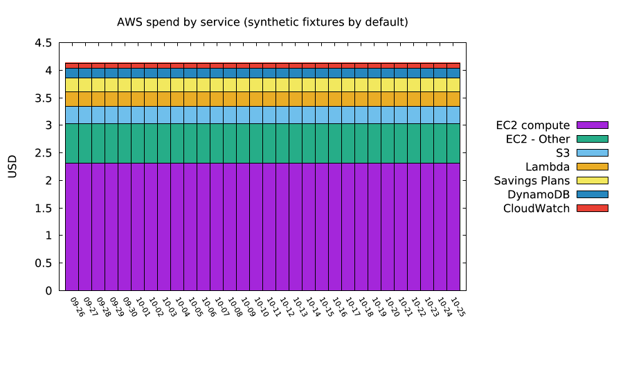

`lmctl https://raw.githubusercontent.com/lmctl-ai/lmaws/main/examples/spend_detail.lms`

running this example costs about $0.10018 in the shown request-price model (10 CE pages and 18 requested metrics; synthetic fixture, not a live account measurement). **Actual offline AWS charge: $0.00.** The run cap defaults to $0.25 and is checked before each billed dispatch; pagination counts separately.

| Service spend | Idle-resource review |
| --- | --- |
| 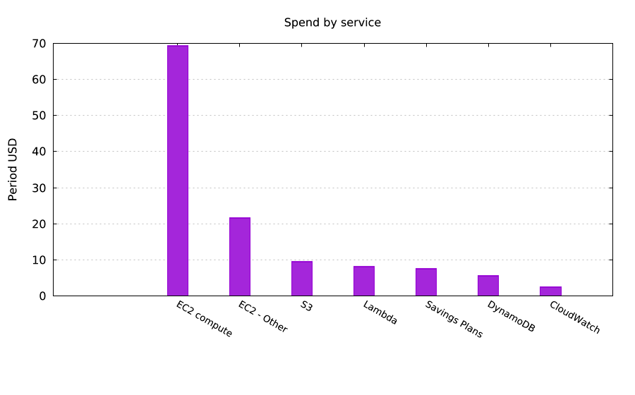 | 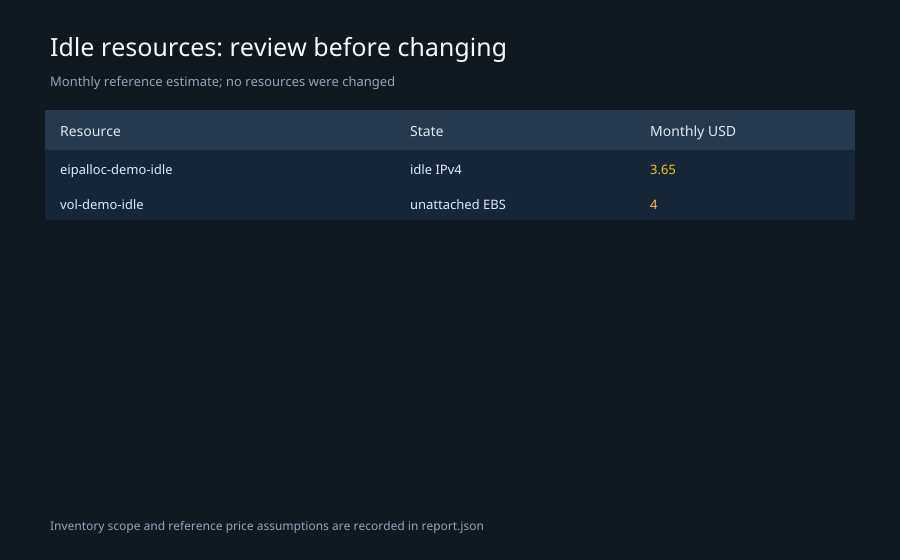 |
| `lmctl https://raw.githubusercontent.com/lmctl-ai/lmaws/main/examples/spend_detail.lms`<br>running this example costs about $0.10018 (synthetic price-table estimate) | `lmctl https://raw.githubusercontent.com/lmctl-ai/lmaws/main/examples/spend_detail.lms`<br>running this example costs about $0.10018 (synthetic price-table estimate) |

| Savings Plan coverage | Transfer costs |
| --- | --- |
| 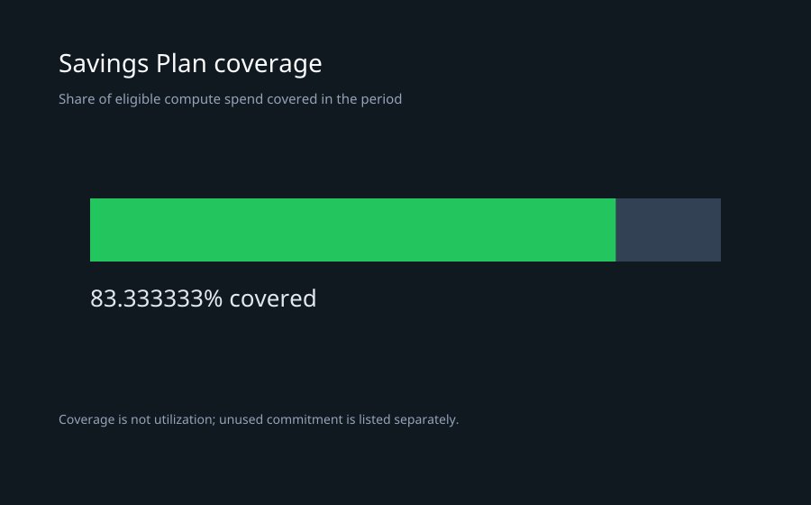 | 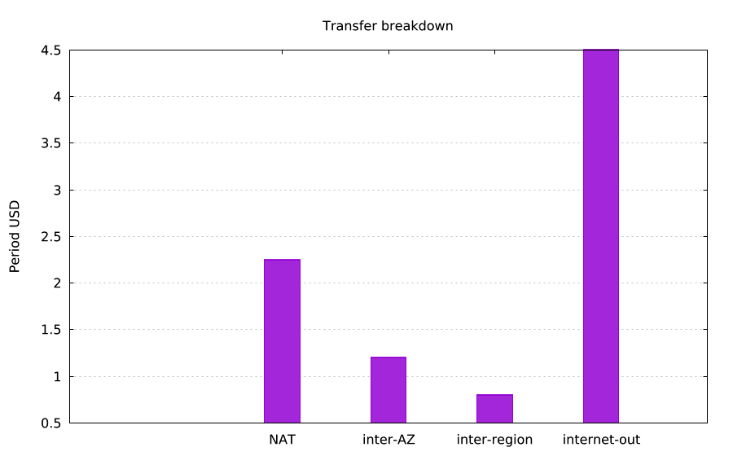 |
| `lmctl https://raw.githubusercontent.com/lmctl-ai/lmaws/main/examples/spend_detail.lms`<br>running this example costs about $0.10018 (synthetic price-table estimate) | `lmctl https://raw.githubusercontent.com/lmctl-ai/lmaws/main/examples/spend_detail.lms`<br>running this example costs about $0.10018 (synthetic price-table estimate) |

These five figures are generated by **one** flagship run. Optional positional arguments are days, top-N and the query-cost cap, for example `lmctl https://raw.githubusercontent.com/lmctl-ai/lmaws/main/examples/spend_detail.lms 30 5 0.25`. Monthly/MTD totals reuse grouped daily results where possible. Account IDs are masked; missing, denied and non-enabled features remain explicit instead of becoming zero.

### Smaller spend topics

| Picture | Runnable example and estimate |
| --- | --- |
| 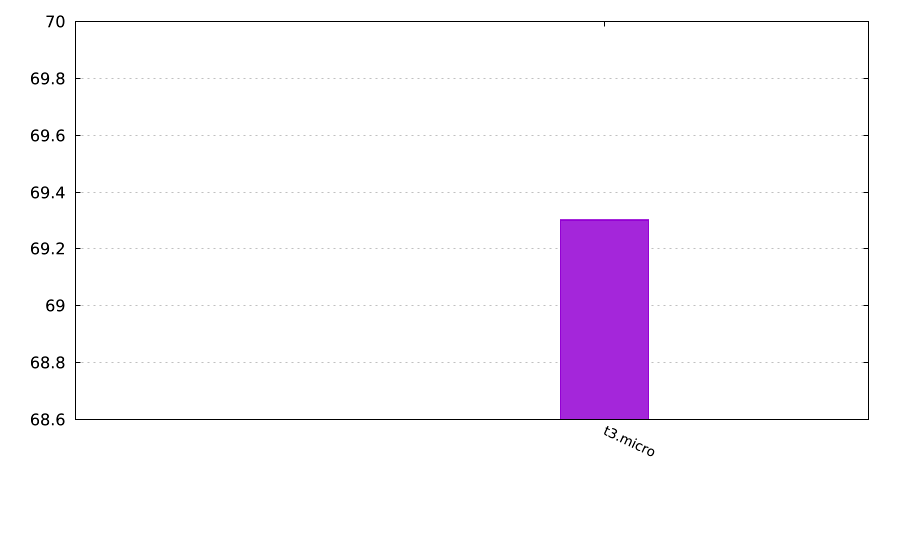 | **EC2 state, on-demand estimates and CE instance types**<br>`lmctl https://raw.githubusercontent.com/lmctl-ai/lmaws/main/examples/ec2_spend.lms`<br>running this example costs about $0.03 (synthetic fixture price-table estimate; actual offline charge $0.00) |
| 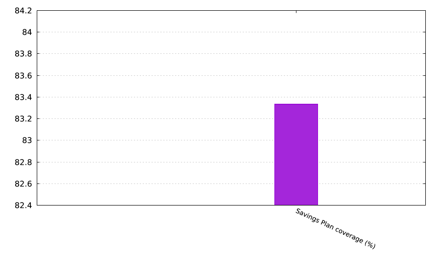 | **Savings Plans and Reserved Instance coverage/utilization**<br>`lmctl https://raw.githubusercontent.com/lmctl-ai/lmaws/main/examples/savings_plans.lms`<br>running this example costs about $0.07 (synthetic fixture price-table estimate; actual offline charge $0.00) |
| 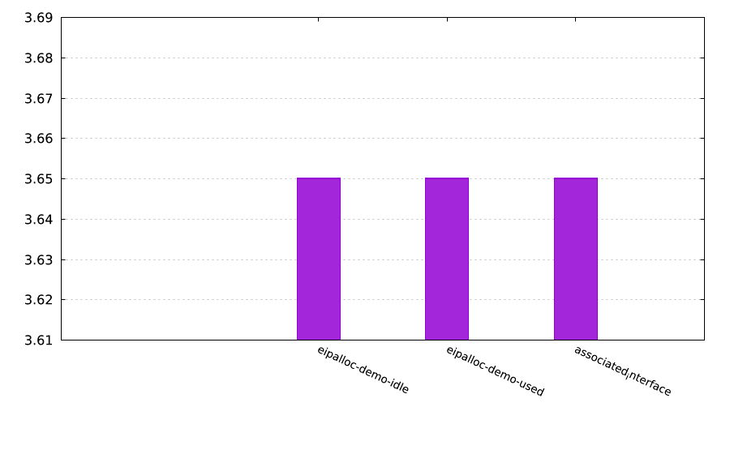 | **Idle and associated public IPv4**<br>`lmctl https://raw.githubusercontent.com/lmctl-ai/lmaws/main/examples/eip_audit.lms`<br>running this example costs about $0.01 (synthetic fixture price-table estimate; actual offline charge $0.00) |
| 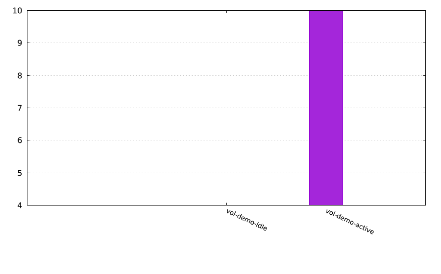 | **Volumes, gp2/gp3 candidates and snapshot bounds**<br>`lmctl https://raw.githubusercontent.com/lmctl-ai/lmaws/main/examples/ebs_audit.lms`<br>running this example costs about $0.01 (synthetic fixture price-table estimate; actual offline charge $0.00) |
| 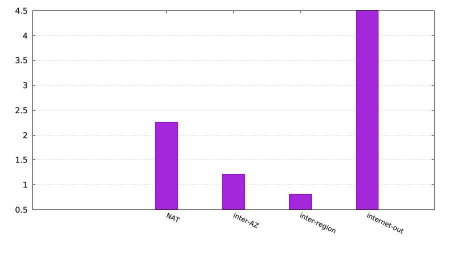 | **Billed transfer usage and per-instance network counters**<br>`lmctl https://raw.githubusercontent.com/lmctl-ai/lmaws/main/examples/bandwidth.lms`<br>running this example costs about $0.02004 (synthetic fixture price-table estimate; actual offline charge $0.00) |
| 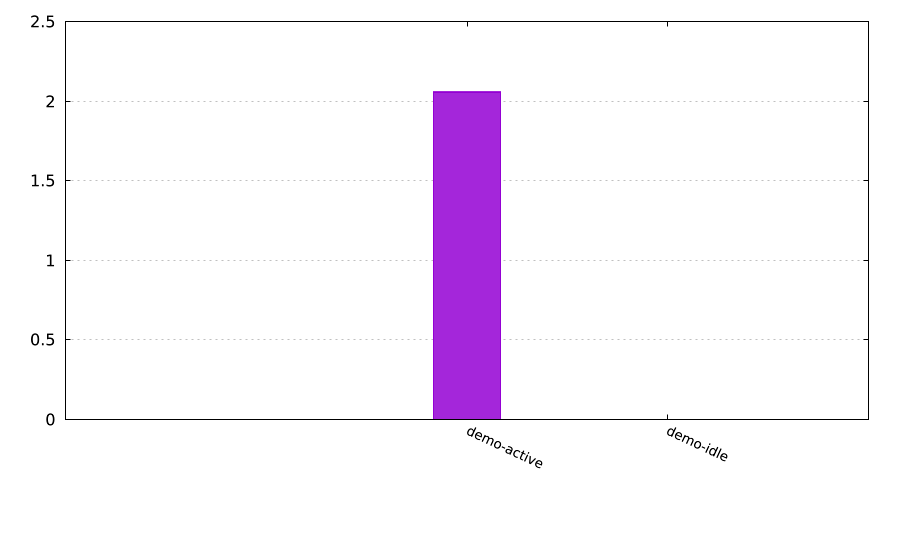 | **Lambda requests, duration, GB-seconds and errors**<br>`lmctl https://raw.githubusercontent.com/lmctl-ai/lmaws/main/examples/lambda_spend.lms`<br>running this example costs about $0.01006 (synthetic fixture price-table estimate; actual offline charge $0.00) |
| 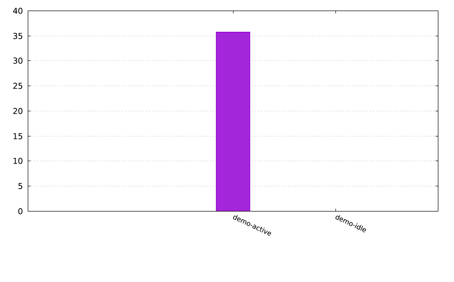 | **DynamoDB spend, capacity and break-even hints**<br>`lmctl https://raw.githubusercontent.com/lmctl-ai/lmaws/main/examples/dynamodb_spend.lms`<br>running this example costs about $0.01008 (synthetic fixture price-table estimate; actual offline charge $0.00) |

[Spend API, permissions, safety and assumptions](docs/SPEND_REPORT.md). Cost Explorer resource-level EC2 data is opt-in and restricted to the last 14 days; this tool detects availability and never enables it. Recommendations never purchase commitments. No AWS CLI, IAM changes or resource mutations are used.


| Picture | Story and reproducible command | Measured local cost |
|---|---|---|
|  | Cloud inventory at a glance — `lmctl https://raw.githubusercontent.com/lmctl-ai/lmaws/main/examples/inventory.lms` | running this example costs about $0.00 ([live evidence](evidence/live-cost-inventory-r71d606a0xcaf04f53.json)).
|  | Network topology overview — `lmctl https://raw.githubusercontent.com/lmctl-ai/lmaws/main/examples/vpcs.lms` | running this example costs about $0.00 ([live evidence](evidence/live-cost-vpcs-r62eeb5c9x53334996.json)).
|  | Queue lifecycle simulation — `lmctl https://raw.githubusercontent.com/lmctl-ai/lmaws/main/examples/queue_pipeline.lms` | running this example costs about $0.00000360 (measured live; independently verified deletion).
|  | Read-only safety audit — `lmctl https://raw.githubusercontent.com/lmctl-ai/lmaws/main/examples/read_only_audit.lms` | running this example costs about $0.00 (estimated, not measured live; IAM intentionally skipped for federated profiles).
|  | Resource relationship graph — `lmctl https://raw.githubusercontent.com/lmctl-ai/lmaws/main/examples/resource_graph.lms` | running this example costs about $0.00 ([live evidence](evidence/live-cost-resource_graph-r2511a45fxb4544623.json)).

## Install

Install the single native executable from the latest GitHub release:

```text
lmctl https://raw.githubusercontent.com/lmctl-ai/lmaws/main/examples/inventory.lms
```

The original inventory and lifecycle examples use `aws.example("name")`: demo data by default, and real AWS only when `LMAWS_LIVE=1` with `default` for read-only calls or `lmaws` for writes, in us-east-1. The reusable recipe examples always force synthetic mode. Public CI forces `LMAWS_LIVE=0`, uses fakes only, and has no OIDC or cloud credentials. The live test ledger owns every mutation and tears it down on success or failure. S3 names use `lmaws-<run-id>-...` plus the `lmaws_test=<run-id>` tag; other resources use the `lmaws_<run-id>_` prefix. The federated `lmaws` session is re-issued by the existing local session tooling; its scoped policy permits both patterns (S3 uses the hyphen because bucket names cannot contain underscores).

The typed API covers inventory and owned test flows for buckets, EC2 instances, VPCs, security groups, DynamoDB tables, SQS queues, SNS topics, Lambda metadata, CloudWatch log groups and alarms, Route 53 zones, Secrets Manager metadata, SSM parameters, ECS clusters and IAM role metadata. Secret-value APIs, access-key APIs, and session-token APIs are not exposed. Lambda examples describe metadata and do not deploy functions.

The native release targets five platforms and uses a 4096 MB memory budget. Linux binaries require glibc 2.35 or newer; Windows requires the standard Microsoft Visual C++ runtime. The host and examples are MIT licensed; the AWS SDK for Java v2 is Apache-2.0.

## Account prefix utilities

These read-only utilities use synthetic fixtures by default and keep live output
private. Their public pictures contain no account identifiers or real resources.

| Picture | Command and estimate |
|---|---|
|  | `lmctl https://raw.githubusercontent.com/lmctl-ai/lmaws/main/examples/find_lmaws_resources.lms`<br>running this example costs about $0.00 in synthetic mode |
| 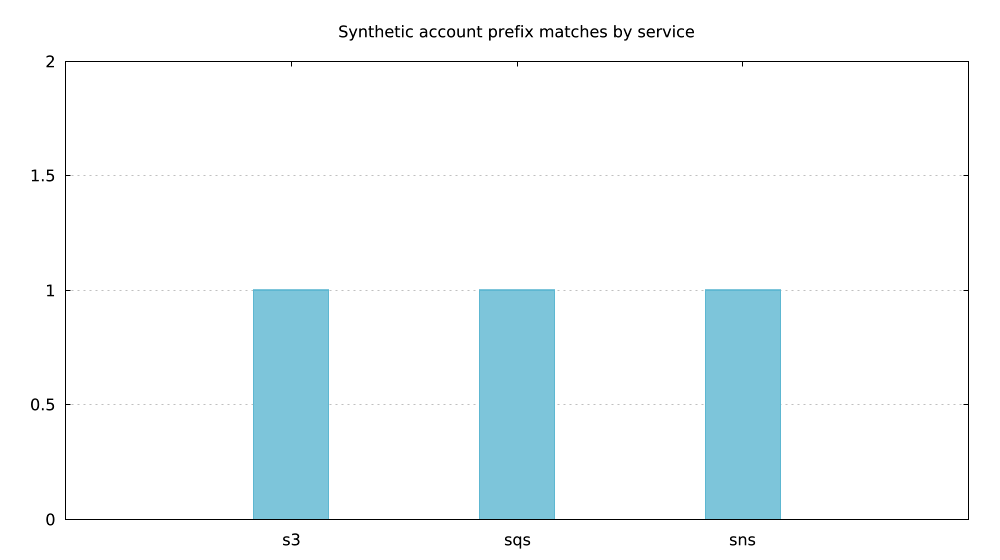 | `lmctl https://raw.githubusercontent.com/lmctl-ai/lmaws/main/examples/leftover_report.lms`<br>running this example costs about $0.00 in synthetic mode |

Live discovery requires explicit local approval and the existing profile gates;
no public picture is generated from live account data; live figures stay in the ignored local directory.

## Recipes

<!-- RECIPES:START -->


`lmctl https://raw.githubusercontent.com/lmctl-ai/lmaws/main/examples/recipe_spend_detail.lms`


`lmctl https://raw.githubusercontent.com/lmctl-ai/lmaws/main/examples/recipe_prefix_search.lms`


`lmctl https://raw.githubusercontent.com/lmctl-ai/lmaws/main/examples/recipe_sandbox_queue.lms`

Reusable LMScript recipes for audits, inventory, spend review and safely owned sandboxes.
The access column describes AWS permissions; local reports are written only when a recipe is called.
Each generated entry is self-contained and runnable directly. Import the paired library from its raw URL when composing recipes; entry scripts perform the execution step.
Use `lmaws`, never the `aws` CLI. Read-only recipes use `default`; writes require
`AWS_PROFILE=lmaws`, the ownership prefix/tag, a ledger and teardown.

All executable recipes default to synthetic fixtures. Use `--preview` for a no-call plan,
or the runner's `lmctl script --dry-run recipes/<name>.lms`. Live inventory needs `--live`;
live sandboxes also require `--apply --profile lmaws`. Prefix discovery is read-only; sweeper deletion
requires --delete, the lmaws profile, matching run tags and original creation-ledger proof.

Arguments override defaults. `AWS_PROFILE` / `AWS_REGION` and `LMAWS_RECIPE_PERIOD`,
`LMAWS_RECIPE_TOP`, `LMAWS_RECIPE_PREFIX` supply environment defaults. Period is used
by spend recipes; prefix filters inventory when explicitly supplied. All examples force
synthetic mode and their committed pictures contain no real account data.

Inventory/sandbox caps default to $0.05. Spend reports default to the explicit $0.25
spend cap; `--cap` or `LMAWS_MAX_COST_USD` overrides it. A script reserves each live
recipe's full cap against a shared $0.25 ceiling before dispatch. Compose recipes
sequentially and choose smaller individual caps for a multi-report live run.
Synthetic spend estimates model billable requests but make no AWS calls and spend no
real money. Read `metadata.status` in reports: missing, partial or budget-exhausted
data must not be read as an observed zero. Live spend costs have not been measured
as part of this recipe presentation work.

Price references: [Cost Explorer](https://aws.amazon.com/aws-cost-management/aws-cost-explorer/pricing/)
and [CloudWatch GetMetricData](https://docs.aws.amazon.com/AmazonCloudWatch/latest/monitoring/metrics-classic-getdata.html).

Import-only composition example (functions do not execute on import):

```javascript
import "https://raw.githubusercontent.com/lmctl-ai/lmaws/main/recipes/lib/inventory.lms";
let report=recipe_inventory({task:"queues",top:5,output:"data/my-queues",live:false});
println("matched rows:",len(report.rows));
```


### Identity and access posture

| File | What it does | Access | Arguments | Typical cost |
|---|---|---|---|---|
| [`grant_lambda_role.lms`](recipes/grant_lambda_role.lms) | Preview or apply the pre-built lmaws_lambda_exec execution role with the mandatory boundary and scoped data access | Write with the admin profile | --role lmaws_lambda_exec --profile admin [--live] [--apply] [--output .lmaws-local/iam-role/report] | $0.00 synthetic; live IAM metadata only; apply requires AWS_PROFILE=admin, LMAWS_ADMIN_GRANT=1 and --apply |
| [`grant_session_policy.lms`](recipes/grant_session_policy.lms) | Preview statement-level diff or grant the lmaws_session customer-managed IAM policy | Write with the admin profile | --policy lmaws_session --file POLICY.json --profile admin --top 20 --output data/grant_session_policy [--live] [--apply] | $0.00 IAM metadata; live apply requires AWS_PROFILE=admin and LMAWS_ADMIN_GRANT=1 |
| [`inventory_identity.lms`](recipes/inventory_identity.lms) | Inspect bounded identity metadata (synthetic only; federated IAM cases skipped live) | Read-only | --task TASK --period 30 --top 10 --prefix lmaws --region us-east-1 --profile default --output data/inventory_identity [--live] | $0.00 synthetic; live capped request estimate in ledger |
| [`inventory_roles.lms`](recipes/inventory_roles.lms) | Inspect bounded roles metadata (synthetic only; federated IAM cases skipped live) | Read-only | --task TASK --period 30 --top 10 --prefix lmaws --region us-east-1 --profile default --output data/inventory_roles [--live] | $0.00 synthetic; live capped request estimate in ledger |
| [`inventory_security_groups.lms`](recipes/inventory_security_groups.lms) | Inspect bounded security groups metadata | Read-only | --task TASK --period 30 --top 10 --prefix lmaws --region us-east-1 --profile default --output data/inventory_security_groups [--live] | $0.00 synthetic; live capped request estimate in ledger |
| [`open_ports.lms`](recipes/open_ports.lms) | Security groups open to the internet, by port, with admin/database ports flagged | Read-only | --region us-east-1 --profile default --output data/open_ports [--live] | $0.00 synthetic; live Describe/List calls are free; cap $0.05 |
| [`policy_lint.lms`](recipes/policy_lint.lms) | Validate and lint an IAM managed policy JSON document offline against lmaws guardrails | Read-only | --file POLICY.json --top 20 --output data/policy_lint | $0.00 offline lint |
| [`secret_age.lms`](recipes/secret_age.lms) | Secrets not changed for 90+ days (values are never read) | Read-only | --region us-east-1 --profile default --output data/secret_age [--live] | $0.00 synthetic; live Describe/List calls are free; cap $0.05 |
| [`session_doctor.lms`](recipes/session_doctor.lms) | Inspect profile session types, 0600 credential cache expiry and dry-run/read-only permission probes | Read-only | --profile lmaws --region us-east-1 --top 20 --output data/session_doctor [--live] | $0.00 synthetic; live read and EC2 DryRun probes create no resources; cap $0.05 |
| [`which_profile.lms`](recipes/which_profile.lms) | Which AWS profile and flags each kind of recipe needs | Read-only | --output data/which_profile | $0.00 synthetic and offline |

### Permission builder and IAM analysis

| File | What it does | Access | Arguments | Typical cost |
|---|---|---|---|---|
| [`policy_billing_viewer.lms`](recipes/policy_billing_viewer.lms) | Build a read-only Cost Explorer, Budgets, Pricing and CloudWatch metrics viewer policy | Read-only | --prefix lmaws --region us-east-1 --output data/policy_billing_viewer | $0.00 offline policy compilation |
| [`policy_break_glass.lms`](recipes/policy_break_glass.lms) | Build an MFA-gated, time-windowed and bastion-IP-locked emergency break-glass policy | Read-only | --cidr 203.0.113.10/32 --from 2026-01-01T00:00:00Z --to 2026-01-01T04:00:00Z --output data/policy_break_glass | $0.00 offline policy compilation |
| [`policy_cheat_sheet.lms`](recipes/policy_cheat_sheet.lms) | Map every lmaws capability to its exact IAM statement Sids, scope rationale, missing-permission error and minimal builder fix | Read-only | --policy lmaws_session --prefix lmaws --domain example.com --output data/policy_cheat_sheet | $0.00 offline IAM cheat sheet |
| [`policy_ci_bucket_deployer.lms`](recipes/policy_ci_bucket_deployer.lms) | Build a least-privilege CI static asset uploader and CloudFront invalidation policy | Read-only | --prefix lmaws --region us-east-1 --output data/policy_ci_bucket_deployer | $0.00 offline policy compilation |
| [`policy_deny_untagged_delete.lms`](recipes/policy_deny_untagged_delete.lms) | Build a defense-in-depth policy pairing request-tag creation gates with explicit Denies on untagged deletes | Read-only | --prefix lmaws --region us-east-1 --output data/policy_deny_untagged_delete | $0.00 offline policy compilation |
| [`policy_diff_review.lms`](recipes/policy_diff_review.lms) | Compare two policy versions statement-by-statement and report added, modified, removed and unchanged rules | Read-only | --prefix lmaws --region us-east-1 --output data/policy_diff_review | $0.00 offline statement diff |
| [`policy_dynamodb_sandbox.lms`](recipes/policy_dynamodb_sandbox.lms) | Build a prefix-scoped DynamoDB table sandbox policy with account-boundary and region-lock guardrails | Read-only | --prefix lmaws --region us-east-1 --output data/policy_dynamodb_sandbox | $0.00 offline policy compilation |
| [`policy_ec2_spot_sandbox.lms`](recipes/policy_ec2_spot_sandbox.lms) | Build a tag-gated EC2 spot nano sandbox policy with instance-type and 8 GiB volume caps | Read-only | --prefix lmaws --types t4g.nano,t3.nano --max-gib 8 --region us-east-1 --output data/policy_ec2_spot_sandbox | $0.00 offline policy compilation |
| [`policy_explain_denial.lms`](recipes/policy_explain_denial.lms) | Parse an AWS AccessDenied message, identify the failing statement/condition and emit a minimal builder fix | Read-only | [--error TEXT] --output data/policy_explain_denial | $0.00 offline denial analysis |
| [`policy_fit_inline.lms`](recipes/policy_fit_inline.lms) | Compact a multi-statement policy into the 2048-character STS inline session limit and report byte savings | Read-only | --prefix lmaws --region us-east-1 --output data/policy_fit_inline | $0.00 offline policy compaction |
| [`policy_from_ledger.lms`](recipes/policy_from_ledger.lms) | Synthesize a least-privilege IAM policy and fluent builder program from observed SDK calls in run ledgers | Read-only | [--ledger FILE] --output data/policy_from_ledger | $0.00 offline ledger synthesis |
| [`policy_ip_restricted.lms`](recipes/policy_ip_restricted.lms) | Build a corporate/bastion CIDR-locked policy with single-host /32 security-group ingress enforcement | Read-only | --prefix lmaws --cidr 203.0.113.10/32 --output data/policy_ip_restricted | $0.00 offline policy compilation |
| [`policy_lambda_deployer.lms`](recipes/policy_lambda_deployer.lms) | Build a prefix- and tag-scoped Lambda function and EventBridge rule deployer policy | Read-only | --prefix lmaws --region us-east-1 --output data/policy_lambda_deployer | $0.00 offline policy compilation |
| [`policy_logs_sandbox.lms`](recipes/policy_logs_sandbox.lms) | Build a prefix-scoped CloudWatch Logs sandbox policy with account-boundary and region-lock guardrails | Read-only | --prefix lmaws --region us-east-1 --output data/policy_logs_sandbox | $0.00 offline policy compilation |
| [`policy_mfa_deletes.lms`](recipes/policy_mfa_deletes.lms) | Build a sandbox policy that requires hardware/virtual MFA for every destructive delete or terminate action | Read-only | --prefix lmaws --region us-east-1 --output data/policy_mfa_deletes | $0.00 offline policy compilation |
| [`policy_migrate_json.lms`](recipes/policy_migrate_json.lms) | Migrate hand-written IAM policy JSON into a typed fluent lmaws permission builder program | Read-only | [--file POLICY.json] --output data/policy_migrate_json | $0.00 offline JSON migration |
| [`policy_permission_boundary.lms`](recipes/policy_permission_boundary.lms) | Build a maximum IAM permission boundary capping delegated roles to prefix, tag, nano and region guardrails | Read-only | --prefix lmaws --region us-east-1 --output data/policy_permission_boundary | $0.00 offline policy compilation |
| [`policy_read_only_auditor.lms`](recipes/policy_read_only_auditor.lms) | Build a zero-secret read-only inventory and posture auditor policy with region lock | Read-only | --prefix lmaws --region us-east-1 --output data/policy_read_only_auditor | $0.00 offline policy compilation |
| [`policy_region_lock.lms`](recipes/policy_region_lock.lms) | Build a regional policy with an explicit NotAction exemption list for global AWS control planes | Read-only | --prefix lmaws --region us-east-1 --output data/policy_region_lock | $0.00 offline policy compilation |
| [`policy_s3_sandbox.lms`](recipes/policy_s3_sandbox.lms) | Build a prefix-scoped S3 bucket and object sandbox policy with account-boundary and tagged-delete guardrails | Read-only | --prefix lmaws --region us-east-1 --output data/policy_s3_sandbox | $0.00 offline policy compilation |
| [`policy_simulate_probes.lms`](recipes/policy_simulate_probes.lms) | Evaluate allow and deny security probes against a policy offline or via IAM SimulateCustomPolicy | Read-only | --policy lmaws_session [--probes SPEC] [--live --profile admin] --output data/policy_simulate_probes | $0.00 offline; live IAM simulator requires AWS_PROFILE=admin |
| [`policy_sns_sandbox.lms`](recipes/policy_sns_sandbox.lms) | Build a prefix-scoped SNS topic sandbox policy with account-boundary and region-lock guardrails | Read-only | --prefix lmaws --region us-east-1 --output data/policy_sns_sandbox | $0.00 offline policy compilation |
| [`policy_split_managed.lms`](recipes/policy_split_managed.lms) | Split a large policy into balanced <= 6144-char managed policy parts while preserving Deny guardrails | Read-only | --policy lmaws_session --domain example.com --output data/policy_split_managed | $0.00 offline policy splitting |
| [`policy_sqs_sandbox.lms`](recipes/policy_sqs_sandbox.lms) | Build a prefix-scoped SQS queue sandbox policy with account-boundary and region-lock guardrails | Read-only | --prefix lmaws --region us-east-1 --output data/policy_sqs_sandbox | $0.00 offline policy compilation |
| [`policy_ssm_sandbox.lms`](recipes/policy_ssm_sandbox.lms) | Build a prefix-scoped SSM Parameter Store sandbox policy with public parameter read access | Read-only | --prefix lmaws --region us-east-1 --output data/policy_ssm_sandbox | $0.00 offline policy compilation |
| [`policy_tag_operator.lms`](recipes/policy_tag_operator.lms) | Build a tag discovery and tag-gated resource tagging operator policy | Read-only | --prefix lmaws --region us-east-1 --output data/policy_tag_operator | $0.00 offline policy compilation |
| [`policy_web_stack.lms`](recipes/policy_web_stack.lms) | Build a static site stack policy (S3 bucket + CloudFront OAC + ACM + Route53 record pattern lock) | Read-only | --prefix lmaws --domain example.com --region us-east-1 --output data/policy_web_stack | $0.00 offline policy compilation |
| [`session_policy.lms`](recipes/session_policy.lms) | Generate the 23-statement lmaws_session IAM managed policy with the fluent builder, statement size report and optional snapshot diff | Read-only | --policy lmaws_session --prefix lmaws --domain example.com --region us-east-1 --types t4g.nano,t3.nano --max-gib 8 [--file SNAPSHOT.json] --output data/session_policy | $0.00 offline policy compilation and diff |

### Inventory

| File | What it does | Access | Arguments | Typical cost |
|---|---|---|---|---|
| [`inventory.lms`](recipes/inventory.lms) | Review all supported inventories; IAM entries are skipped live | Read-only | --task TASK --period 30 --top 10 --prefix lmaws --region us-east-1 --profile default --output data/inventory [--live] | $0.00 synthetic; live request cap $0.05 |
| [`inventory_alarms.lms`](recipes/inventory_alarms.lms) | Inspect bounded alarms metadata | Read-only | --task TASK --period 30 --top 10 --prefix lmaws --region us-east-1 --profile default --output data/inventory_alarms [--live] | $0.00 synthetic; live capped request estimate in ledger |
| [`inventory_buckets.lms`](recipes/inventory_buckets.lms) | Inspect bounded buckets metadata | Read-only | --task TASK --period 30 --top 10 --prefix lmaws --region us-east-1 --profile default --output data/inventory_buckets [--live] | $0.00 synthetic; live capped request estimate in ledger |
| [`inventory_clusters.lms`](recipes/inventory_clusters.lms) | Inspect bounded clusters metadata | Read-only | --task TASK --period 30 --top 10 --prefix lmaws --region us-east-1 --profile default --output data/inventory_clusters [--live] | $0.00 synthetic; live capped request estimate in ledger |
| [`inventory_functions.lms`](recipes/inventory_functions.lms) | Inspect bounded functions metadata | Read-only | --task TASK --period 30 --top 10 --prefix lmaws --region us-east-1 --profile default --output data/inventory_functions [--live] | $0.00 synthetic; live capped request estimate in ledger |
| [`inventory_instances.lms`](recipes/inventory_instances.lms) | Inspect bounded instances metadata | Read-only | --task TASK --period 30 --top 10 --prefix lmaws --region us-east-1 --profile default --output data/inventory_instances [--live] | $0.00 synthetic; live capped request estimate in ledger |
| [`inventory_log_groups.lms`](recipes/inventory_log_groups.lms) | Inspect bounded log groups metadata | Read-only | --task TASK --period 30 --top 10 --prefix lmaws --region us-east-1 --profile default --output data/inventory_log_groups [--live] | $0.00 synthetic; live capped request estimate in ledger |
| [`inventory_parameters.lms`](recipes/inventory_parameters.lms) | Inspect bounded parameters metadata | Read-only | --task TASK --period 30 --top 10 --prefix lmaws --region us-east-1 --profile default --output data/inventory_parameters [--live] | $0.00 synthetic; live capped request estimate in ledger |
| [`inventory_queues.lms`](recipes/inventory_queues.lms) | Inspect bounded queues metadata | Read-only | --task TASK --period 30 --top 10 --prefix lmaws --region us-east-1 --profile default --output data/inventory_queues [--live] | $0.00 synthetic; live capped request estimate in ledger |
| [`inventory_secrets.lms`](recipes/inventory_secrets.lms) | Inspect bounded secrets metadata | Read-only | --task TASK --period 30 --top 10 --prefix lmaws --region us-east-1 --profile default --output data/inventory_secrets [--live] | $0.00 synthetic; live capped request estimate in ledger |
| [`inventory_tables.lms`](recipes/inventory_tables.lms) | Inspect bounded tables metadata | Read-only | --task TASK --period 30 --top 10 --prefix lmaws --region us-east-1 --profile default --output data/inventory_tables [--live] | $0.00 synthetic; live capped request estimate in ledger |
| [`inventory_topics.lms`](recipes/inventory_topics.lms) | Inspect bounded topics metadata | Read-only | --task TASK --period 30 --top 10 --prefix lmaws --region us-east-1 --profile default --output data/inventory_topics [--live] | $0.00 synthetic; live capped request estimate in ledger |
| [`inventory_vpcs.lms`](recipes/inventory_vpcs.lms) | Inspect bounded vpcs metadata | Read-only | --task TASK --period 30 --top 10 --prefix lmaws --region us-east-1 --profile default --output data/inventory_vpcs [--live] | $0.00 synthetic; live capped request estimate in ledger |
| [`inventory_zones.lms`](recipes/inventory_zones.lms) | Inspect bounded zones metadata | Read-only | --task TASK --period 30 --top 10 --prefix lmaws --region us-east-1 --profile default --output data/inventory_zones [--live] | $0.00 synthetic; live capped request estimate in ledger |
| [`quickstart.lms`](recipes/quickstart.lms) | Quickstart: one command to an account snapshot picture (resources per service) | Read-only | --region us-east-1 --profile default --output data/quickstart [--live] | $0.00 synthetic; live Describe/List calls are free; cap $0.05 |

### Cost and spend

| File | What it does | Access | Arguments | Typical cost |
|---|---|---|---|---|
| [`bandwidth.lms`](recipes/bandwidth.lms) | Break down billed transfer categories and network counters | Read-only | --period 30 --top 10 --region us-east-1 --profile default --cap 0.25 [--live] [--output PRIVATE_DIR] | Synthetic actual $0.00; live CE $0.01/request plus metrics; default/hard cap $0.25 |
| [`dynamodb_spend.lms`](recipes/dynamodb_spend.lms) | Review DynamoDB usage and spend signals | Read-only | --period 30 --top 10 --region us-east-1 --profile default --cap 0.25 [--live] [--output PRIVATE_DIR] | Synthetic actual $0.00; live CE $0.01/request plus metrics; default/hard cap $0.25 |
| [`ebs_audit.lms`](recipes/ebs_audit.lms) | Review EBS attachments and snapshot retention signals | Read-only | --period 30 --top 10 --region us-east-1 --profile default --cap 0.25 [--live] [--output PRIVATE_DIR] | Synthetic actual $0.00; live CE $0.01/request plus metrics; default/hard cap $0.25 |
| [`ec2_spend.lms`](recipes/ec2_spend.lms) | Break down EC2 compute spend and current resource signals | Read-only | --period 30 --top 10 --region us-east-1 --profile default --cap 0.25 [--live] [--output PRIVATE_DIR] | Synthetic actual $0.00; live CE $0.01/request plus metrics; default/hard cap $0.25 |
| [`eip_audit.lms`](recipes/eip_audit.lms) | Review idle public IPv4 allocations and estimated run-rate | Read-only | --period 30 --top 10 --region us-east-1 --profile default --cap 0.25 [--live] [--output PRIVATE_DIR] | Synthetic actual $0.00; live CE $0.01/request plus metrics; default/hard cap $0.25 |
| [`lambda_spend.lms`](recipes/lambda_spend.lms) | Review Lambda usage and spend signals | Read-only | --period 30 --top 10 --region us-east-1 --profile default --cap 0.25 [--live] [--output PRIVATE_DIR] | Synthetic actual $0.00; live CE $0.01/request plus metrics; default/hard cap $0.25 |
| [`savings_plans.lms`](recipes/savings_plans.lms) | Review Savings Plans and Reserved Instance utilization and coverage | Read-only | --period 30 --top 10 --region us-east-1 --profile default --cap 0.25 [--live] [--output PRIVATE_DIR] | Synthetic actual $0.00; live CE $0.01/request plus metrics; default/hard cap $0.25 |
| [`spend_detail.lms`](recipes/spend_detail.lms) | Review account spend detail and optimization signals | Read-only | --period 30 --top 10 --region us-east-1 --profile default --cap 0.25 [--live] [--output PRIVATE_DIR] | Synthetic actual $0.00; live CE $0.01/request plus metrics; default/hard cap $0.25 |

### Idle and waste detection

| File | What it does | Access | Arguments | Typical cost |
|---|---|---|---|---|
| [`idle_instances.lms`](recipes/idle_instances.lms) | Flag stopped-instance state for further review; never delete | Read-only | --task TASK --period 30 --top 10 --prefix lmaws --region us-east-1 --profile default --output data/idle_instances [--live] | $0.00 synthetic; live request cap $0.05 |
| [`log_retention_audit.lms`](recipes/log_retention_audit.lms) | Log groups that never expire, grouped by retention | Read-only | --region us-east-1 --profile default --output data/log_retention_audit [--live] | $0.00 synthetic; live Describe/List calls are free; cap $0.05 |
| [`public_ipv4_cost.lms`](recipes/public_ipv4_cost.lms) | Every billed public IPv4 address (Elastic and auto-assigned) and its monthly cost | Read-only | --region us-east-1 --profile default --output data/public_ipv4_cost [--live] | $0.00 synthetic; live Describe/List calls are free; cap $0.05 |
| [`unattached_volumes.lms`](recipes/unattached_volumes.lms) | Unattached EBS volumes with size and monthly cost (never deletes) | Read-only | --region us-east-1 --profile default --output data/unattached_volumes [--live] | $0.00 synthetic; live Describe/List calls are free; cap $0.05 |

### Tag and naming compliance

| File | What it does | Access | Arguments | Typical cost |
|---|---|---|---|---|
| [`naming_compliance.lms`](recipes/naming_compliance.lms) | Check case-sensitive lmaws_ and lmaws- naming among prefix candidates | Read-only | --task TASK --period 30 --top 10 --prefix lmaws --region us-east-1 --profile default --output data/naming_compliance [--live] | $0.00 synthetic; live request cap $0.05 |
| [`tag_compliance.lms`](recipes/tag_compliance.lms) | Report missing and unknown tag presence without assuming compliance | Read-only | --task TASK --period 30 --top 10 --prefix lmaws --region us-east-1 --profile default --output data/tag_compliance [--live] | $0.00 synthetic; live request cap $0.05 |

### Leftover search and cleanup by prefix

| File | What it does | Access | Arguments | Typical cost |
|---|---|---|---|---|
| [`leftover_report.lms`](recipes/leftover_report.lms) | Inspect account resources by age and their creation-ledger proof | Read-only | --task TASK --period 30 --top 10 --prefix lmaws --region us-east-1 --profile default --output data/leftover_report [--live] --ledger-dir .lmaws-local/recipes/ledgers --older-hours 24 [--delete --profile lmaws] | $0.00 synthetic; live request cap $0.05 |
| [`prefix_search.lms`](recipes/prefix_search.lms) | Find every literal lmaws prefix variant through native account APIs | Read-only | --task TASK --period 30 --top 10 --prefix lmaws --region us-east-1 --profile default --output data/prefix_search [--live] --ledger-dir .lmaws-local/recipes/ledgers --older-hours 24 [--delete --profile lmaws] | $0.00 synthetic; live request cap $0.05 |
| [`sweeper.lms`](recipes/sweeper.lms) | Plan account cleanup; explicit delete checks prefix, tag and run ledger | Read-only | --task TASK --period 30 --top 10 --prefix lmaws --region us-east-1 --profile default --output data/sweeper [--live] --ledger-dir .lmaws-local/recipes/ledgers --older-hours 24 [--delete --profile lmaws] | $0.00 synthetic; live request cap $0.05 |

### Safe lifecycle sandboxes

| File | What it does | Access | Arguments | Typical cost |
|---|---|---|---|---|
| [`lifecycle.lms`](recipes/lifecycle.lms) | Select a disposable queue/topic/table/bucket/parameter/log-group lifecycle | Write with the lmaws profile | --task TASK --period 30 --top 10 --prefix lmaws --region us-east-1 --profile lmaws --output data/lifecycle [--live] [--apply] | Synthetic $0.00; live generally below $0.0001; cap $0.05 |
| [`sandbox_bucket.lms`](recipes/sandbox_bucket.lms) | Create and tear down one owned bucket with its run ledger | Write with the lmaws profile | --task TASK --period 30 --top 10 --prefix lmaws --region us-east-1 --profile lmaws --output data/sandbox_bucket [--live] [--apply] | Synthetic $0.00; live generally below $0.0001; cap $0.05 |
| [`sandbox_log_group.lms`](recipes/sandbox_log_group.lms) | Create and tear down one owned log group with its run ledger | Write with the lmaws profile | --task TASK --period 30 --top 10 --prefix lmaws --region us-east-1 --profile lmaws --output data/sandbox_log_group [--live] [--apply] | Synthetic $0.00; live generally below $0.0001; cap $0.05 |
| [`sandbox_parameter.lms`](recipes/sandbox_parameter.lms) | Create and tear down one owned parameter with its run ledger | Write with the lmaws profile | --task TASK --period 30 --top 10 --prefix lmaws --region us-east-1 --profile lmaws --output data/sandbox_parameter [--live] [--apply] | Synthetic $0.00; live generally below $0.0001; cap $0.05 |
| [`sandbox_queue.lms`](recipes/sandbox_queue.lms) | Create and tear down one owned queue with its run ledger | Write with the lmaws profile | --task TASK --period 30 --top 10 --prefix lmaws --region us-east-1 --profile lmaws --output data/sandbox_queue [--live] [--apply] | Synthetic $0.00; live generally below $0.0001; cap $0.05 |
| [`sandbox_table.lms`](recipes/sandbox_table.lms) | Create and tear down one owned table with its run ledger | Write with the lmaws profile | --task TASK --period 30 --top 10 --prefix lmaws --region us-east-1 --profile lmaws --output data/sandbox_table [--live] [--apply] | Synthetic $0.00; live generally below $0.0001; cap $0.05 |
| [`sandbox_topic.lms`](recipes/sandbox_topic.lms) | Create and tear down one owned topic with its run ledger | Write with the lmaws profile | --task TASK --period 30 --top 10 --prefix lmaws --region us-east-1 --profile lmaws --output data/sandbox_topic [--live] [--apply] | Synthetic $0.00; live generally below $0.0001; cap $0.05 |

### Compute and fleet

| File | What it does | Access | Arguments | Typical cost |
|---|---|---|---|---|
| [`ami_lookup.lms`](recipes/ami_lookup.lms) | Latest Ubuntu 24.04 and Amazon Linux 2023 AMIs (arm64, x86_64) from public SSM parameters | Read-only with the lmaws-ec2 profile | --region us-east-1 --profile lmaws-ec2 --output data/ami_lookup [--live] | $0.00 (public SSM parameters are free) |
| [`cpu_credits.lms`](recipes/cpu_credits.lms) | CPU credit balance, usage, surplus and headroom of burstable instances, without SSH | Read-only | --tag-key Project --tag-value VALUE --instance ID --hours 24 --region us-east-1 --profile default --output data/cpu_credits [--live] | $0.00 synthetic; live CloudWatch statistics about $0.00005 per instance; cap $0.05 |
| [`ebs_roots.lms`](recipes/ebs_roots.lms) | EBS volumes, attachments, root DeleteOnTermination and the AZ lock, as a report | Read-only | --region us-east-1 --profile default --output data/ebs_roots [--live] | $0.00 synthetic; live Describe calls are free; cap $0.05 |
| [`eip_map.lms`](recipes/eip_map.lms) | Map Elastic IPs to instances, flag idle ones, report pinned addresses (never releases) | Read-only | --tag-key Project --region us-east-1 --profile default --output data/eip_map [--live] | $0.00 synthetic; live Describe calls are free; cap $0.05 |
| [`fleet_status.lms`](recipes/fleet_status.lms) | Discover tagged instances: state, type, addresses and root-storage policy | Read-only | --tag-key Project --tag-value VALUE --region us-east-1 --profile default --output data/fleet_status [--live] | $0.00 synthetic; live EC2 Describe calls are free; cap $0.05 |
| [`spot_nano_lifecycle.lms`](recipes/spot_nano_lifecycle.lms) | Launch one tagged no-public-IP spot nano, check it, terminate it and prove zero leftovers | Write with the lmaws-ec2 profile | --region us-east-1 --profile lmaws-ec2 --output .lmaws-local/compute/spot_nano_lifecycle [--live --apply] | Synthetic $0.00; live about $0.0005 (spot nano minutes + 8 GiB gp3); cap $0.05 |
| [`spot_prices.lms`](recipes/spot_prices.lms) | Spot price history per AZ for nano types, cheapest AZ and saving vs On-Demand | Read-only | --types t4g.nano,t3.nano --hours 3 --region us-east-1 --profile default --output data/spot_prices [--live] | $0.00 synthetic; live Describe calls are free; cap $0.05 |

### Picture-first examples

Each recipe points at an offline synthetic example so its output can be previewed safely.

#### grant_lambda_role


`lmctl https://raw.githubusercontent.com/lmctl-ai/lmaws/main/examples/recipe_grant_lambda_role.lms`

Example: [`examples/recipe_grant_lambda_role.lms`](examples/recipe_grant_lambda_role.lms).
Import library: `https://raw.githubusercontent.com/lmctl-ai/lmaws/main/recipes/lib/iam_role.lms`; function `recipe_grant_lambda_role`.

#### grant_session_policy


`lmctl https://raw.githubusercontent.com/lmctl-ai/lmaws/main/examples/recipe_grant_session_policy.lms`

Example: [`examples/recipe_grant_session_policy.lms`](examples/recipe_grant_session_policy.lms).
Import library: `https://raw.githubusercontent.com/lmctl-ai/lmaws/main/recipes/lib/iam_policy.lms`; function `recipe_grant_session_policy`.

#### inventory_identity


`lmctl https://raw.githubusercontent.com/lmctl-ai/lmaws/main/examples/recipe_inventory_identity.lms`

Example: [`examples/recipe_inventory_identity.lms`](examples/recipe_inventory_identity.lms).
Import library: `https://raw.githubusercontent.com/lmctl-ai/lmaws/main/recipes/lib/inventory.lms`; function `recipe_inventory`.

#### inventory_roles


`lmctl https://raw.githubusercontent.com/lmctl-ai/lmaws/main/examples/recipe_inventory_roles.lms`

Example: [`examples/recipe_inventory_roles.lms`](examples/recipe_inventory_roles.lms).
Import library: `https://raw.githubusercontent.com/lmctl-ai/lmaws/main/recipes/lib/inventory.lms`; function `recipe_inventory`.

#### inventory_security_groups


`lmctl https://raw.githubusercontent.com/lmctl-ai/lmaws/main/examples/recipe_inventory_security_groups.lms`

Example: [`examples/recipe_inventory_security_groups.lms`](examples/recipe_inventory_security_groups.lms).
Import library: `https://raw.githubusercontent.com/lmctl-ai/lmaws/main/recipes/lib/inventory.lms`; function `recipe_inventory`.

#### open_ports


`lmctl https://raw.githubusercontent.com/lmctl-ai/lmaws/main/examples/recipe_open_ports.lms`

Example: [`examples/recipe_open_ports.lms`](examples/recipe_open_ports.lms).
Import library: `https://raw.githubusercontent.com/lmctl-ai/lmaws/main/recipes/lib/hygiene.lms`; function `recipe_open_ports`.

#### policy_lint


`lmctl https://raw.githubusercontent.com/lmctl-ai/lmaws/main/examples/recipe_policy_lint.lms`

Example: [`examples/recipe_policy_lint.lms`](examples/recipe_policy_lint.lms).
Import library: `https://raw.githubusercontent.com/lmctl-ai/lmaws/main/recipes/lib/iam_policy.lms`; function `recipe_policy_lint`.

#### secret_age


`lmctl https://raw.githubusercontent.com/lmctl-ai/lmaws/main/examples/recipe_secret_age.lms`

Example: [`examples/recipe_secret_age.lms`](examples/recipe_secret_age.lms).
Import library: `https://raw.githubusercontent.com/lmctl-ai/lmaws/main/recipes/lib/hygiene.lms`; function `recipe_secret_age`.

#### session_doctor


`lmctl https://raw.githubusercontent.com/lmctl-ai/lmaws/main/examples/recipe_session_doctor.lms`

Example: [`examples/recipe_session_doctor.lms`](examples/recipe_session_doctor.lms).
Import library: `https://raw.githubusercontent.com/lmctl-ai/lmaws/main/recipes/lib/iam_policy.lms`; function `recipe_session_doctor`.

#### which_profile


`lmctl https://raw.githubusercontent.com/lmctl-ai/lmaws/main/examples/recipe_which_profile.lms`

Example: [`examples/recipe_which_profile.lms`](examples/recipe_which_profile.lms).
Import library: `https://raw.githubusercontent.com/lmctl-ai/lmaws/main/recipes/lib/hygiene.lms`; function `recipe_which_profile`.

#### policy_billing_viewer


`lmctl https://raw.githubusercontent.com/lmctl-ai/lmaws/main/examples/recipe_policy_billing_viewer.lms`

Example: [`examples/recipe_policy_billing_viewer.lms`](examples/recipe_policy_billing_viewer.lms).
Import library: `https://raw.githubusercontent.com/lmctl-ai/lmaws/main/recipes/lib/policy_builder.lms`; function `recipe_policy_builder`.

#### policy_break_glass


`lmctl https://raw.githubusercontent.com/lmctl-ai/lmaws/main/examples/recipe_policy_break_glass.lms`

Example: [`examples/recipe_policy_break_glass.lms`](examples/recipe_policy_break_glass.lms).
Import library: `https://raw.githubusercontent.com/lmctl-ai/lmaws/main/recipes/lib/policy_builder.lms`; function `recipe_policy_builder`.

#### policy_cheat_sheet


`lmctl https://raw.githubusercontent.com/lmctl-ai/lmaws/main/examples/recipe_policy_cheat_sheet.lms`

Example: [`examples/recipe_policy_cheat_sheet.lms`](examples/recipe_policy_cheat_sheet.lms).
Import library: `https://raw.githubusercontent.com/lmctl-ai/lmaws/main/recipes/lib/policy_builder.lms`; function `recipe_policy_builder`.

#### policy_ci_bucket_deployer


`lmctl https://raw.githubusercontent.com/lmctl-ai/lmaws/main/examples/recipe_policy_ci_bucket_deployer.lms`

Example: [`examples/recipe_policy_ci_bucket_deployer.lms`](examples/recipe_policy_ci_bucket_deployer.lms).
Import library: `https://raw.githubusercontent.com/lmctl-ai/lmaws/main/recipes/lib/policy_builder.lms`; function `recipe_policy_builder`.

#### policy_deny_untagged_delete


`lmctl https://raw.githubusercontent.com/lmctl-ai/lmaws/main/examples/recipe_policy_deny_untagged_delete.lms`

Example: [`examples/recipe_policy_deny_untagged_delete.lms`](examples/recipe_policy_deny_untagged_delete.lms).
Import library: `https://raw.githubusercontent.com/lmctl-ai/lmaws/main/recipes/lib/policy_builder.lms`; function `recipe_policy_builder`.

#### policy_diff_review


`lmctl https://raw.githubusercontent.com/lmctl-ai/lmaws/main/examples/recipe_policy_diff_review.lms`

Example: [`examples/recipe_policy_diff_review.lms`](examples/recipe_policy_diff_review.lms).
Import library: `https://raw.githubusercontent.com/lmctl-ai/lmaws/main/recipes/lib/policy_builder.lms`; function `recipe_policy_builder`.

#### policy_dynamodb_sandbox


`lmctl https://raw.githubusercontent.com/lmctl-ai/lmaws/main/examples/recipe_policy_dynamodb_sandbox.lms`

Example: [`examples/recipe_policy_dynamodb_sandbox.lms`](examples/recipe_policy_dynamodb_sandbox.lms).
Import library: `https://raw.githubusercontent.com/lmctl-ai/lmaws/main/recipes/lib/policy_builder.lms`; function `recipe_policy_builder`.

#### policy_ec2_spot_sandbox


`lmctl https://raw.githubusercontent.com/lmctl-ai/lmaws/main/examples/recipe_policy_ec2_spot_sandbox.lms`

Example: [`examples/recipe_policy_ec2_spot_sandbox.lms`](examples/recipe_policy_ec2_spot_sandbox.lms).
Import library: `https://raw.githubusercontent.com/lmctl-ai/lmaws/main/recipes/lib/policy_builder.lms`; function `recipe_policy_builder`.

#### policy_explain_denial


`lmctl https://raw.githubusercontent.com/lmctl-ai/lmaws/main/examples/recipe_policy_explain_denial.lms`

Example: [`examples/recipe_policy_explain_denial.lms`](examples/recipe_policy_explain_denial.lms).
Import library: `https://raw.githubusercontent.com/lmctl-ai/lmaws/main/recipes/lib/policy_builder.lms`; function `recipe_policy_builder`.

#### policy_fit_inline


`lmctl https://raw.githubusercontent.com/lmctl-ai/lmaws/main/examples/recipe_policy_fit_inline.lms`

Example: [`examples/recipe_policy_fit_inline.lms`](examples/recipe_policy_fit_inline.lms).
Import library: `https://raw.githubusercontent.com/lmctl-ai/lmaws/main/recipes/lib/policy_builder.lms`; function `recipe_policy_builder`.

#### policy_from_ledger


`lmctl https://raw.githubusercontent.com/lmctl-ai/lmaws/main/examples/recipe_policy_from_ledger.lms`

Example: [`examples/recipe_policy_from_ledger.lms`](examples/recipe_policy_from_ledger.lms).
Import library: `https://raw.githubusercontent.com/lmctl-ai/lmaws/main/recipes/lib/policy_builder.lms`; function `recipe_policy_builder`.

#### policy_ip_restricted


`lmctl https://raw.githubusercontent.com/lmctl-ai/lmaws/main/examples/recipe_policy_ip_restricted.lms`

Example: [`examples/recipe_policy_ip_restricted.lms`](examples/recipe_policy_ip_restricted.lms).
Import library: `https://raw.githubusercontent.com/lmctl-ai/lmaws/main/recipes/lib/policy_builder.lms`; function `recipe_policy_builder`.

#### policy_lambda_deployer


`lmctl https://raw.githubusercontent.com/lmctl-ai/lmaws/main/examples/recipe_policy_lambda_deployer.lms`

Example: [`examples/recipe_policy_lambda_deployer.lms`](examples/recipe_policy_lambda_deployer.lms).
Import library: `https://raw.githubusercontent.com/lmctl-ai/lmaws/main/recipes/lib/policy_builder.lms`; function `recipe_policy_builder`.

#### policy_logs_sandbox


`lmctl https://raw.githubusercontent.com/lmctl-ai/lmaws/main/examples/recipe_policy_logs_sandbox.lms`

Example: [`examples/recipe_policy_logs_sandbox.lms`](examples/recipe_policy_logs_sandbox.lms).
Import library: `https://raw.githubusercontent.com/lmctl-ai/lmaws/main/recipes/lib/policy_builder.lms`; function `recipe_policy_builder`.

#### policy_mfa_deletes


`lmctl https://raw.githubusercontent.com/lmctl-ai/lmaws/main/examples/recipe_policy_mfa_deletes.lms`

Example: [`examples/recipe_policy_mfa_deletes.lms`](examples/recipe_policy_mfa_deletes.lms).
Import library: `https://raw.githubusercontent.com/lmctl-ai/lmaws/main/recipes/lib/policy_builder.lms`; function `recipe_policy_builder`.

#### policy_migrate_json


`lmctl https://raw.githubusercontent.com/lmctl-ai/lmaws/main/examples/recipe_policy_migrate_json.lms`

Example: [`examples/recipe_policy_migrate_json.lms`](examples/recipe_policy_migrate_json.lms).
Import library: `https://raw.githubusercontent.com/lmctl-ai/lmaws/main/recipes/lib/policy_builder.lms`; function `recipe_policy_builder`.

#### policy_permission_boundary


`lmctl https://raw.githubusercontent.com/lmctl-ai/lmaws/main/examples/recipe_policy_permission_boundary.lms`

Example: [`examples/recipe_policy_permission_boundary.lms`](examples/recipe_policy_permission_boundary.lms).
Import library: `https://raw.githubusercontent.com/lmctl-ai/lmaws/main/recipes/lib/policy_builder.lms`; function `recipe_policy_builder`.

#### policy_read_only_auditor


`lmctl https://raw.githubusercontent.com/lmctl-ai/lmaws/main/examples/recipe_policy_read_only_auditor.lms`

Example: [`examples/recipe_policy_read_only_auditor.lms`](examples/recipe_policy_read_only_auditor.lms).
Import library: `https://raw.githubusercontent.com/lmctl-ai/lmaws/main/recipes/lib/policy_builder.lms`; function `recipe_policy_builder`.

#### policy_region_lock


`lmctl https://raw.githubusercontent.com/lmctl-ai/lmaws/main/examples/recipe_policy_region_lock.lms`

Example: [`examples/recipe_policy_region_lock.lms`](examples/recipe_policy_region_lock.lms).
Import library: `https://raw.githubusercontent.com/lmctl-ai/lmaws/main/recipes/lib/policy_builder.lms`; function `recipe_policy_builder`.

#### policy_s3_sandbox


`lmctl https://raw.githubusercontent.com/lmctl-ai/lmaws/main/examples/recipe_policy_s3_sandbox.lms`

Example: [`examples/recipe_policy_s3_sandbox.lms`](examples/recipe_policy_s3_sandbox.lms).
Import library: `https://raw.githubusercontent.com/lmctl-ai/lmaws/main/recipes/lib/policy_builder.lms`; function `recipe_policy_builder`.

#### policy_simulate_probes


`lmctl https://raw.githubusercontent.com/lmctl-ai/lmaws/main/examples/recipe_policy_simulate_probes.lms`

Example: [`examples/recipe_policy_simulate_probes.lms`](examples/recipe_policy_simulate_probes.lms).
Import library: `https://raw.githubusercontent.com/lmctl-ai/lmaws/main/recipes/lib/policy_builder.lms`; function `recipe_policy_builder`.

#### policy_sns_sandbox


`lmctl https://raw.githubusercontent.com/lmctl-ai/lmaws/main/examples/recipe_policy_sns_sandbox.lms`

Example: [`examples/recipe_policy_sns_sandbox.lms`](examples/recipe_policy_sns_sandbox.lms).
Import library: `https://raw.githubusercontent.com/lmctl-ai/lmaws/main/recipes/lib/policy_builder.lms`; function `recipe_policy_builder`.

#### policy_split_managed


`lmctl https://raw.githubusercontent.com/lmctl-ai/lmaws/main/examples/recipe_policy_split_managed.lms`

Example: [`examples/recipe_policy_split_managed.lms`](examples/recipe_policy_split_managed.lms).
Import library: `https://raw.githubusercontent.com/lmctl-ai/lmaws/main/recipes/lib/policy_builder.lms`; function `recipe_policy_builder`.

#### policy_sqs_sandbox


`lmctl https://raw.githubusercontent.com/lmctl-ai/lmaws/main/examples/recipe_policy_sqs_sandbox.lms`

Example: [`examples/recipe_policy_sqs_sandbox.lms`](examples/recipe_policy_sqs_sandbox.lms).
Import library: `https://raw.githubusercontent.com/lmctl-ai/lmaws/main/recipes/lib/policy_builder.lms`; function `recipe_policy_builder`.

#### policy_ssm_sandbox


`lmctl https://raw.githubusercontent.com/lmctl-ai/lmaws/main/examples/recipe_policy_ssm_sandbox.lms`

Example: [`examples/recipe_policy_ssm_sandbox.lms`](examples/recipe_policy_ssm_sandbox.lms).
Import library: `https://raw.githubusercontent.com/lmctl-ai/lmaws/main/recipes/lib/policy_builder.lms`; function `recipe_policy_builder`.

#### policy_tag_operator


`lmctl https://raw.githubusercontent.com/lmctl-ai/lmaws/main/examples/recipe_policy_tag_operator.lms`

Example: [`examples/recipe_policy_tag_operator.lms`](examples/recipe_policy_tag_operator.lms).
Import library: `https://raw.githubusercontent.com/lmctl-ai/lmaws/main/recipes/lib/policy_builder.lms`; function `recipe_policy_builder`.

#### policy_web_stack


`lmctl https://raw.githubusercontent.com/lmctl-ai/lmaws/main/examples/recipe_policy_web_stack.lms`

Example: [`examples/recipe_policy_web_stack.lms`](examples/recipe_policy_web_stack.lms).
Import library: `https://raw.githubusercontent.com/lmctl-ai/lmaws/main/recipes/lib/policy_builder.lms`; function `recipe_policy_builder`.

#### session_policy


`lmctl https://raw.githubusercontent.com/lmctl-ai/lmaws/main/examples/recipe_session_policy.lms`

Example: [`examples/recipe_session_policy.lms`](examples/recipe_session_policy.lms).
Import library: `https://raw.githubusercontent.com/lmctl-ai/lmaws/main/recipes/lib/policy_builder.lms`; function `recipe_policy_builder`.

#### inventory


`lmctl https://raw.githubusercontent.com/lmctl-ai/lmaws/main/examples/recipe_inventory.lms`

Example: [`examples/recipe_inventory.lms`](examples/recipe_inventory.lms).
Import library: `https://raw.githubusercontent.com/lmctl-ai/lmaws/main/recipes/lib/inventory.lms`; function `recipe_inventory`.

#### inventory_alarms


`lmctl https://raw.githubusercontent.com/lmctl-ai/lmaws/main/examples/recipe_inventory_alarms.lms`

Example: [`examples/recipe_inventory_alarms.lms`](examples/recipe_inventory_alarms.lms).
Import library: `https://raw.githubusercontent.com/lmctl-ai/lmaws/main/recipes/lib/inventory.lms`; function `recipe_inventory`.

#### inventory_buckets


`lmctl https://raw.githubusercontent.com/lmctl-ai/lmaws/main/examples/recipe_inventory_buckets.lms`

Example: [`examples/recipe_inventory_buckets.lms`](examples/recipe_inventory_buckets.lms).
Import library: `https://raw.githubusercontent.com/lmctl-ai/lmaws/main/recipes/lib/inventory.lms`; function `recipe_inventory`.

#### inventory_clusters


`lmctl https://raw.githubusercontent.com/lmctl-ai/lmaws/main/examples/recipe_inventory_clusters.lms`

Example: [`examples/recipe_inventory_clusters.lms`](examples/recipe_inventory_clusters.lms).
Import library: `https://raw.githubusercontent.com/lmctl-ai/lmaws/main/recipes/lib/inventory.lms`; function `recipe_inventory`.

#### inventory_functions


`lmctl https://raw.githubusercontent.com/lmctl-ai/lmaws/main/examples/recipe_inventory_functions.lms`

Example: [`examples/recipe_inventory_functions.lms`](examples/recipe_inventory_functions.lms).
Import library: `https://raw.githubusercontent.com/lmctl-ai/lmaws/main/recipes/lib/inventory.lms`; function `recipe_inventory`.

#### inventory_instances


`lmctl https://raw.githubusercontent.com/lmctl-ai/lmaws/main/examples/recipe_inventory_instances.lms`

Example: [`examples/recipe_inventory_instances.lms`](examples/recipe_inventory_instances.lms).
Import library: `https://raw.githubusercontent.com/lmctl-ai/lmaws/main/recipes/lib/inventory.lms`; function `recipe_inventory`.

#### inventory_log_groups


`lmctl https://raw.githubusercontent.com/lmctl-ai/lmaws/main/examples/recipe_inventory_log_groups.lms`

Example: [`examples/recipe_inventory_log_groups.lms`](examples/recipe_inventory_log_groups.lms).
Import library: `https://raw.githubusercontent.com/lmctl-ai/lmaws/main/recipes/lib/inventory.lms`; function `recipe_inventory`.

#### inventory_parameters


`lmctl https://raw.githubusercontent.com/lmctl-ai/lmaws/main/examples/recipe_inventory_parameters.lms`

Example: [`examples/recipe_inventory_parameters.lms`](examples/recipe_inventory_parameters.lms).
Import library: `https://raw.githubusercontent.com/lmctl-ai/lmaws/main/recipes/lib/inventory.lms`; function `recipe_inventory`.

#### inventory_queues


`lmctl https://raw.githubusercontent.com/lmctl-ai/lmaws/main/examples/recipe_inventory_queues.lms`

Example: [`examples/recipe_inventory_queues.lms`](examples/recipe_inventory_queues.lms).
Import library: `https://raw.githubusercontent.com/lmctl-ai/lmaws/main/recipes/lib/inventory.lms`; function `recipe_inventory`.

#### inventory_secrets


`lmctl https://raw.githubusercontent.com/lmctl-ai/lmaws/main/examples/recipe_inventory_secrets.lms`

Example: [`examples/recipe_inventory_secrets.lms`](examples/recipe_inventory_secrets.lms).
Import library: `https://raw.githubusercontent.com/lmctl-ai/lmaws/main/recipes/lib/inventory.lms`; function `recipe_inventory`.

#### inventory_tables


`lmctl https://raw.githubusercontent.com/lmctl-ai/lmaws/main/examples/recipe_inventory_tables.lms`

Example: [`examples/recipe_inventory_tables.lms`](examples/recipe_inventory_tables.lms).
Import library: `https://raw.githubusercontent.com/lmctl-ai/lmaws/main/recipes/lib/inventory.lms`; function `recipe_inventory`.

#### inventory_topics


`lmctl https://raw.githubusercontent.com/lmctl-ai/lmaws/main/examples/recipe_inventory_topics.lms`

Example: [`examples/recipe_inventory_topics.lms`](examples/recipe_inventory_topics.lms).
Import library: `https://raw.githubusercontent.com/lmctl-ai/lmaws/main/recipes/lib/inventory.lms`; function `recipe_inventory`.

#### inventory_vpcs


`lmctl https://raw.githubusercontent.com/lmctl-ai/lmaws/main/examples/recipe_inventory_vpcs.lms`

Example: [`examples/recipe_inventory_vpcs.lms`](examples/recipe_inventory_vpcs.lms).
Import library: `https://raw.githubusercontent.com/lmctl-ai/lmaws/main/recipes/lib/inventory.lms`; function `recipe_inventory`.

#### inventory_zones


`lmctl https://raw.githubusercontent.com/lmctl-ai/lmaws/main/examples/recipe_inventory_zones.lms`

Example: [`examples/recipe_inventory_zones.lms`](examples/recipe_inventory_zones.lms).
Import library: `https://raw.githubusercontent.com/lmctl-ai/lmaws/main/recipes/lib/inventory.lms`; function `recipe_inventory`.

#### quickstart


`lmctl https://raw.githubusercontent.com/lmctl-ai/lmaws/main/examples/recipe_quickstart.lms`

Example: [`examples/recipe_quickstart.lms`](examples/recipe_quickstart.lms).
Import library: `https://raw.githubusercontent.com/lmctl-ai/lmaws/main/recipes/lib/hygiene.lms`; function `recipe_quickstart`.

#### bandwidth


`lmctl https://raw.githubusercontent.com/lmctl-ai/lmaws/main/examples/recipe_bandwidth.lms`

Example: [`examples/recipe_bandwidth.lms`](examples/recipe_bandwidth.lms).
Import library: `https://raw.githubusercontent.com/lmctl-ai/lmaws/main/recipes/lib/spend.lms`; function `recipe_spend`.

#### dynamodb_spend


`lmctl https://raw.githubusercontent.com/lmctl-ai/lmaws/main/examples/recipe_dynamodb_spend.lms`

Example: [`examples/recipe_dynamodb_spend.lms`](examples/recipe_dynamodb_spend.lms).
Import library: `https://raw.githubusercontent.com/lmctl-ai/lmaws/main/recipes/lib/spend.lms`; function `recipe_spend`.

#### ebs_audit


`lmctl https://raw.githubusercontent.com/lmctl-ai/lmaws/main/examples/recipe_ebs_audit.lms`

Example: [`examples/recipe_ebs_audit.lms`](examples/recipe_ebs_audit.lms).
Import library: `https://raw.githubusercontent.com/lmctl-ai/lmaws/main/recipes/lib/spend.lms`; function `recipe_spend`.

#### ec2_spend


`lmctl https://raw.githubusercontent.com/lmctl-ai/lmaws/main/examples/recipe_ec2_spend.lms`

Example: [`examples/recipe_ec2_spend.lms`](examples/recipe_ec2_spend.lms).
Import library: `https://raw.githubusercontent.com/lmctl-ai/lmaws/main/recipes/lib/spend.lms`; function `recipe_spend`.

#### eip_audit


`lmctl https://raw.githubusercontent.com/lmctl-ai/lmaws/main/examples/recipe_eip_audit.lms`

Example: [`examples/recipe_eip_audit.lms`](examples/recipe_eip_audit.lms).
Import library: `https://raw.githubusercontent.com/lmctl-ai/lmaws/main/recipes/lib/spend.lms`; function `recipe_spend`.

#### lambda_spend


`lmctl https://raw.githubusercontent.com/lmctl-ai/lmaws/main/examples/recipe_lambda_spend.lms`

Example: [`examples/recipe_lambda_spend.lms`](examples/recipe_lambda_spend.lms).
Import library: `https://raw.githubusercontent.com/lmctl-ai/lmaws/main/recipes/lib/spend.lms`; function `recipe_spend`.

#### savings_plans


`lmctl https://raw.githubusercontent.com/lmctl-ai/lmaws/main/examples/recipe_savings_plans.lms`

Example: [`examples/recipe_savings_plans.lms`](examples/recipe_savings_plans.lms).
Import library: `https://raw.githubusercontent.com/lmctl-ai/lmaws/main/recipes/lib/spend.lms`; function `recipe_spend`.

#### spend_detail


`lmctl https://raw.githubusercontent.com/lmctl-ai/lmaws/main/examples/recipe_spend_detail.lms`

Example: [`examples/recipe_spend_detail.lms`](examples/recipe_spend_detail.lms).
Import library: `https://raw.githubusercontent.com/lmctl-ai/lmaws/main/recipes/lib/spend.lms`; function `recipe_spend`.

#### idle_instances


`lmctl https://raw.githubusercontent.com/lmctl-ai/lmaws/main/examples/recipe_idle_instances.lms`

Example: [`examples/recipe_idle_instances.lms`](examples/recipe_idle_instances.lms).
Import library: `https://raw.githubusercontent.com/lmctl-ai/lmaws/main/recipes/lib/audits.lms`; function `recipe_idle`.

#### log_retention_audit


`lmctl https://raw.githubusercontent.com/lmctl-ai/lmaws/main/examples/recipe_log_retention_audit.lms`

Example: [`examples/recipe_log_retention_audit.lms`](examples/recipe_log_retention_audit.lms).
Import library: `https://raw.githubusercontent.com/lmctl-ai/lmaws/main/recipes/lib/hygiene.lms`; function `recipe_log_retention_audit`.

#### public_ipv4_cost


`lmctl https://raw.githubusercontent.com/lmctl-ai/lmaws/main/examples/recipe_public_ipv4_cost.lms`

Example: [`examples/recipe_public_ipv4_cost.lms`](examples/recipe_public_ipv4_cost.lms).
Import library: `https://raw.githubusercontent.com/lmctl-ai/lmaws/main/recipes/lib/hygiene.lms`; function `recipe_public_ipv4_cost`.

#### unattached_volumes


`lmctl https://raw.githubusercontent.com/lmctl-ai/lmaws/main/examples/recipe_unattached_volumes.lms`

Example: [`examples/recipe_unattached_volumes.lms`](examples/recipe_unattached_volumes.lms).
Import library: `https://raw.githubusercontent.com/lmctl-ai/lmaws/main/recipes/lib/hygiene.lms`; function `recipe_unattached_volumes`.

#### naming_compliance


`lmctl https://raw.githubusercontent.com/lmctl-ai/lmaws/main/examples/recipe_naming_compliance.lms`

Example: [`examples/recipe_naming_compliance.lms`](examples/recipe_naming_compliance.lms).
Import library: `https://raw.githubusercontent.com/lmctl-ai/lmaws/main/recipes/lib/audits.lms`; function `recipe_naming`.

#### tag_compliance


`lmctl https://raw.githubusercontent.com/lmctl-ai/lmaws/main/examples/recipe_tag_compliance.lms`

Example: [`examples/recipe_tag_compliance.lms`](examples/recipe_tag_compliance.lms).
Import library: `https://raw.githubusercontent.com/lmctl-ai/lmaws/main/recipes/lib/audits.lms`; function `recipe_compliance`.

#### leftover_report


`lmctl https://raw.githubusercontent.com/lmctl-ai/lmaws/main/examples/recipe_leftover_report.lms`

Example: [`examples/recipe_leftover_report.lms`](examples/recipe_leftover_report.lms).
Import library: `https://raw.githubusercontent.com/lmctl-ai/lmaws/main/recipes/lib/prefix.lms`; function `recipe_leftovers`.

#### prefix_search


`lmctl https://raw.githubusercontent.com/lmctl-ai/lmaws/main/examples/recipe_prefix_search.lms`

Example: [`examples/recipe_prefix_search.lms`](examples/recipe_prefix_search.lms).
Import library: `https://raw.githubusercontent.com/lmctl-ai/lmaws/main/recipes/lib/prefix.lms`; function `recipe_prefix_search`.

#### sweeper


`lmctl https://raw.githubusercontent.com/lmctl-ai/lmaws/main/examples/recipe_sweeper.lms`

Example: [`examples/recipe_sweeper.lms`](examples/recipe_sweeper.lms).
Import library: `https://raw.githubusercontent.com/lmctl-ai/lmaws/main/recipes/lib/prefix.lms`; function `recipe_sweeper`.

#### lifecycle


`lmctl https://raw.githubusercontent.com/lmctl-ai/lmaws/main/examples/recipe_lifecycle.lms`

Example: [`examples/recipe_lifecycle.lms`](examples/recipe_lifecycle.lms).
Import library: `https://raw.githubusercontent.com/lmctl-ai/lmaws/main/recipes/lib/lifecycle.lms`; function `recipe_lifecycle`.

#### sandbox_bucket


`lmctl https://raw.githubusercontent.com/lmctl-ai/lmaws/main/examples/recipe_sandbox_bucket.lms`

Example: [`examples/recipe_sandbox_bucket.lms`](examples/recipe_sandbox_bucket.lms).
Import library: `https://raw.githubusercontent.com/lmctl-ai/lmaws/main/recipes/lib/lifecycle.lms`; function `recipe_lifecycle`.

#### sandbox_log_group


`lmctl https://raw.githubusercontent.com/lmctl-ai/lmaws/main/examples/recipe_sandbox_log_group.lms`

Example: [`examples/recipe_sandbox_log_group.lms`](examples/recipe_sandbox_log_group.lms).
Import library: `https://raw.githubusercontent.com/lmctl-ai/lmaws/main/recipes/lib/lifecycle.lms`; function `recipe_lifecycle`.

#### sandbox_parameter


`lmctl https://raw.githubusercontent.com/lmctl-ai/lmaws/main/examples/recipe_sandbox_parameter.lms`

Example: [`examples/recipe_sandbox_parameter.lms`](examples/recipe_sandbox_parameter.lms).
Import library: `https://raw.githubusercontent.com/lmctl-ai/lmaws/main/recipes/lib/lifecycle.lms`; function `recipe_lifecycle`.

#### sandbox_queue


`lmctl https://raw.githubusercontent.com/lmctl-ai/lmaws/main/examples/recipe_sandbox_queue.lms`

Example: [`examples/recipe_sandbox_queue.lms`](examples/recipe_sandbox_queue.lms).
Import library: `https://raw.githubusercontent.com/lmctl-ai/lmaws/main/recipes/lib/lifecycle.lms`; function `recipe_lifecycle`.

#### sandbox_table


`lmctl https://raw.githubusercontent.com/lmctl-ai/lmaws/main/examples/recipe_sandbox_table.lms`

Example: [`examples/recipe_sandbox_table.lms`](examples/recipe_sandbox_table.lms).
Import library: `https://raw.githubusercontent.com/lmctl-ai/lmaws/main/recipes/lib/lifecycle.lms`; function `recipe_lifecycle`.

#### sandbox_topic


`lmctl https://raw.githubusercontent.com/lmctl-ai/lmaws/main/examples/recipe_sandbox_topic.lms`

Example: [`examples/recipe_sandbox_topic.lms`](examples/recipe_sandbox_topic.lms).
Import library: `https://raw.githubusercontent.com/lmctl-ai/lmaws/main/recipes/lib/lifecycle.lms`; function `recipe_lifecycle`.

#### ami_lookup


`lmctl https://raw.githubusercontent.com/lmctl-ai/lmaws/main/examples/recipe_ami_lookup.lms`

Example: [`examples/recipe_ami_lookup.lms`](examples/recipe_ami_lookup.lms).
Import library: `https://raw.githubusercontent.com/lmctl-ai/lmaws/main/recipes/lib/compute.lms`; function `recipe_ami_lookup`.

#### cpu_credits


`lmctl https://raw.githubusercontent.com/lmctl-ai/lmaws/main/examples/recipe_cpu_credits.lms`

Example: [`examples/recipe_cpu_credits.lms`](examples/recipe_cpu_credits.lms).
Import library: `https://raw.githubusercontent.com/lmctl-ai/lmaws/main/recipes/lib/compute.lms`; function `recipe_cpu_credits`.

#### ebs_roots


`lmctl https://raw.githubusercontent.com/lmctl-ai/lmaws/main/examples/recipe_ebs_roots.lms`

Example: [`examples/recipe_ebs_roots.lms`](examples/recipe_ebs_roots.lms).
Import library: `https://raw.githubusercontent.com/lmctl-ai/lmaws/main/recipes/lib/compute.lms`; function `recipe_ebs_roots`.

#### eip_map


`lmctl https://raw.githubusercontent.com/lmctl-ai/lmaws/main/examples/recipe_eip_map.lms`

Example: [`examples/recipe_eip_map.lms`](examples/recipe_eip_map.lms).
Import library: `https://raw.githubusercontent.com/lmctl-ai/lmaws/main/recipes/lib/compute.lms`; function `recipe_eip_map`.

#### fleet_status


`lmctl https://raw.githubusercontent.com/lmctl-ai/lmaws/main/examples/recipe_fleet_status.lms`

Example: [`examples/recipe_fleet_status.lms`](examples/recipe_fleet_status.lms).
Import library: `https://raw.githubusercontent.com/lmctl-ai/lmaws/main/recipes/lib/compute.lms`; function `recipe_fleet_status`.

#### spot_nano_lifecycle


`lmctl https://raw.githubusercontent.com/lmctl-ai/lmaws/main/examples/recipe_spot_nano_lifecycle.lms`

Example: [`examples/recipe_spot_nano_lifecycle.lms`](examples/recipe_spot_nano_lifecycle.lms).
Import library: `https://raw.githubusercontent.com/lmctl-ai/lmaws/main/recipes/lib/compute.lms`; function `recipe_spot_nano_lifecycle`.

#### spot_prices


`lmctl https://raw.githubusercontent.com/lmctl-ai/lmaws/main/examples/recipe_spot_prices.lms`

Example: [`examples/recipe_spot_prices.lms`](examples/recipe_spot_prices.lms).
Import library: `https://raw.githubusercontent.com/lmctl-ai/lmaws/main/recipes/lib/compute.lms`; function `recipe_spot_prices`.

<!-- RECIPES:END -->

## API

| Expression | Result |
|---|---|
| `aws.example("name")` | Demo deterministic Cloud; live AWS only with `LMAWS_LIVE=1` |
| `cloud.is_demo()`, `cloud.example_run()`, `run.estimated_cost()` | Select fixture assertions, create a capped ledger-owned run, inspect its estimate |
| `aws.region("us-east-1")`, `aws.region("")` | Live Cloud with an explicit region, or the default region chain |
| `cloud.buckets()`, `instances()`, `vpcs()`, `security_groups()` | Resource Rows |
| `cloud.tables()`, `queues()`, `topics()`, `functions()` | Data, messaging and function metadata Rows |
| `cloud.log_groups()`, `alarms()`, `zones()`, `secrets()`, `parameters()` | Operations and metadata Rows |
| `rows.len()`, `rows.at(i)`, `rows.count(key,value)`, `rows.filter(key,value)` | Inspect and aggregate Rows |
| `rows.csv(path)`, `rows.json()` | Masked tabular or JSON output |
| `cloud.run(runId, existingLedgerDir)` (legacy explicit form) | Owned writes with an automatically named ledger, tags and cleanup |
| `run.bucket(name)`, `queue(name)`, `topic(name)` | Create owned storage/messaging resources |
| `run.parameter(name,value)`, `table(name)`, `log_group(name)` | Create owned standard parameters, on-demand tables and log groups |
| `run.put(resource,key,value)`, `cleanup()`, `remaining()` | Update owned resources, tear down, inspect outstanding resources |
| `cloud.ec2_instances(tagKey,tagValue)`, `addresses()`, `volumes()`, `subnets()` | EC2 fleet, Elastic IP, EBS and subnet Rows (empty tag value = any instance with that tag key) |
| `cloud.cpu_credits(idsCsv,hours)`, `spot_prices(typesCsv,hours)`, `instance_status(id)` | Burstable credit metrics, latest spot price per AZ, state and status checks |
| `cloud.public_parameter("/aws/service/...")` | Public SSM parameter (for example the latest AMI id) |
| `cloud.spot_run()` then `spot.security_group(vpc)`, `launch(type,ami,subnet,sg,maxPrice)` | One run-owned t4g.nano/t3.nano one-time spot sandbox, tagged `lmaws_test` at creation, no public IPv4 |
| `spot.wait_state(id,state,s)`, `wait_status_ok(id,s)`, `stop/start/terminate(id)` | Bounded waits; actions only on this run's tagged instances |
| `spot.teardown()`, `verify()`, `leftovers()`, `estimated_cost()`, `cloud.spot_recover(runId)` | Teardown (also on every failure), provider proof, account leftover search, cost |
| `cloud.iam_policy_lint(documentJson)` | Offline validator/linter (`<= 6144` compact chars, `"Version": "2012-10-17"`, scoped `Allow` rules, forbidden action/wildcard checks) |
| `cloud.iam_policy_get(policyName)`, `cloud.iam_policy_versions(policyName)` | Read customer-managed `lmaws_` policy metadata, default document and versions |
| `cloud.iam_policy_put(policyName, documentJson, apply)` | Statement-level diff by default; create or update default version (rotating oldest non-default at 5 versions) when `AWS_PROFILE=admin`, `LMAWS_ADMIN_GRANT=1`, `--apply` and `LMAWS_LIVE=1` |
| `cloud.iam_policy_delete(policyName, apply)` | Delete unattached `lmaws_` policy and its non-default versions under the same `admin` + `LMAWS_ADMIN_GRANT=1` + `--apply` guard |
| `cloud.session_doctor()` | Read-only profile session mapping, `0600` credential cache expiry/TTL, caller identity, and dry-run/read-only permission & guardrail probes (zero resources created, zero secrets exposed) |
| `lmaws --credential-process <mode>` | CLI `credential_process` helper (`default`, `lmaws`, `lmaws-ec2`, `lmaws-web`): issues STS `GetFederationToken` (`awsspot-local-<mode>`, 3600s, `0600` file cache until 5m before expiry) from the isolated `admin` source profile |

```lmscript
mkdir("data");
aws = _dsl_ cli="lmaws" install="github:lmctl-ai/lmaws@latest";
let cloud = aws.example("inventory");
let rows = cloud.instances();
check(rows.len() == 3);
rows.csv("data/instances.csv");
end _dsl_
savedsl(aws, "inventory.dslb");
r = system ${dsl_cli(aws)} --dsl "inventory.dslb";
assert(r.code == 0);
```

`--dry-run` uses demo data and makes no AWS requests, while still writing local reports and ledgers. `lmaws --sweep LEDGER_DIR --older-than-hours 24` is always a dry-run: it lists stale `lmaws-*.jsonl` ledger candidates and never deletes account resources. Create the ledger directory before opening a run; explicit ledger filenames should also use that prefix and extension. Errors use exit 2 for configuration and 3 for runtime failures.

For `run.put`, `key` is the S3 object key or DynamoDB `pk`; queue/topic/parameter writes use `value` as the message or parameter value, and log groups accept `key="retention_days"`.

Writes are limited to those six resource kinds, one run-owned spot nano sandbox (instance, its root volume and network interface, one security group) under `AWS_PROFILE=lmaws-ec2`, and customer-managed `lmaws_` IAM session policies under `AWS_PROFILE=admin` with `LMAWS_ADMIN_GRANT=1` and `--apply`. General ECS and Secrets Manager operations remain metadata-only. The guarded Web API below additionally owns temporary CloudFront/Route 53/ACM resources. Serverless APIs are verified with loopback transports and live lmweblab scenarios under the lmaws profile.

## Cost per example

Every example prints a final `estimated cost: $...` line. The original metadata/demo examples conventionally show `$0.00`; the new spend reports explicitly meter paid CE and metric queries. Write examples estimate each request and resource from a price table, exact request counts, fractional minutes alive and fractional GB-month storage. The table uses conservative us-east-1 prices as of 2026-10-25, ignores free-tier credits, for owned-test resources. The separate spend API deliberately calls Cost Explorer under its own capped read-only ledger. Prices vary by region and change over time.

Each ledger refuses the next creation above the example cap of $0.05 or the whole-run hard ceiling of $0.25. Evidence is stored as `evidence/live-cost-<example>-<run-id>.json`; successful entries include the price table, requests, resources and leftover count. Nineteen read-only examples retain measured $0.00 evidence. The seven write/lifecycle examples are run once with `AWS_PROFILE=lmaws`; each successful lifecycle has a measured price-table estimate and is independently verified absent with the read-only `default` profile. The four IAM-dependent examples are intentionally skipped and labelled **estimated, not measured live**.

Profiles: `default` is READ-ONLY; **only `AWS_PROFILE=lmaws` (service sandboxes) or `lmaws-ec2` (the spot nano sandbox) may mutate resources**, in `us-east-1`. There are exactly two documented exceptions where the `admin` profile is permitted (`admin` is refused for every other mutating call):
1. **Customer-managed `lmaws_` IAM policy updates & Permission Builder** (`recipes/session_policy.lms` + `recipes/grant_session_policy.lms` via `iam_policy_put` / `iam_policy_delete`), which require `AWS_PROFILE=admin` **and** `LMAWS_ADMIN_GRANT=1` **and** `--apply` (`LMAWS_APPLY=1`) **and** `LMAWS_LIVE=1`. Inline STS session policies are capped at 2,048 characters, whereas customer-managed IAM policies support up to 6,144 compact characters (`lmaws_session` is 5,290 compact characters across 23 statements, including Lambda-only iam:PassRole for lmaws_* roles when passed to Lambda, generated byte-for-byte by `recipes/session_policy.lms`). The typed fluent Permission Builder (`cloud.policy(name)` -> `Policy`) validates actions against a 23-service catalog, classifies `list`/`read`/`write`/`tagging`/`permissions_management`, provides account-less ARN templates and intent helpers (`name_prefix`, `require_tag_on_create`, `only_tagged`, `region_lock`, `instance_types`, `max_volume_gib`, `route53_names`, `cidr_only`, `mfa_required`, `time_window`, `source_ip`, `deny_delete_unless_tagged`), composes sandbox building blocks, compacts inline policies (`fit_inline()`), splits managed policies (`split_managed()`), explains denials (`explain_denial()`), synthesizes policies from ledgers (`policy_from_ledger()`), migrates raw JSON (`policy_import_json()`), and runs offline or live IAM simulations (`policy_simulate` / `policy_simulate_principal`, requiring `AWS_PROFILE=admin` when live). Every `iam_policy_put` lints the JSON document before writing (`<= 6144` compact chars, `"Version": "2012-10-17"`, every `Allow` statement either read/inventory or scoped by `lmaws-*`/`lmaws_*` resource name, `lmaws_test` tag, or condition; refuses `iam:*`, `sts:AssumeRole*`, `organizations:*`, `account:*`, `kms:*`, `secretsmanager:*`, bare `'*'`, or `'Resource': '*'` with a write action).
2. **Federated session token issuance (`lmaws --credential-process <mode>`)**: replaces external `aws sts get-federation-token` scripts so no `aws` CLI dependency is needed. It reads ONLY the static `admin` source profile from `~/.aws/credentials` and `~/.aws/config` (ignoring all ambient environment variables, web identity, container, and EC2 metadata credentials) to call STS `GetCallerIdentity` and `GetFederationToken` (`awsspot-local-<mode>`, 3,600s default duration): `default` attaches `arn:aws:iam::aws:policy/ReadOnlyAccess` plus the inline `DenySecretValueRetrieval` policy, while `lmaws`, `lmaws-ec2` and `lmaws-web` attach `arn:aws:iam::<account>:policy/lmaws_session` with no inline policy. Credentials are cached in memory and in a `0600` file under the user cache directory until 5 minutes before expiry. Point `~/.aws/config` profiles at the installed native binary (`~/.local/bin/lmaws` on Linux/macOS or `%USERPROFILE%\.local\bin\lmaws.exe` on Windows): `credential_process = lmaws --credential-process lmaws` (or `default`, `lmaws-ec2`, `lmaws-web`), and run `lmctl recipes/session_doctor.lms --live --profile lmaws` to verify session type, cache TTL, and dry-run permission probes without creating any resources. Do not put account IDs or real policy files in this public repository.

The v0.1.3 native campaign added six successful lifecycle runs and independent
default-profile absence checks: measured estimates total $0.00001272500021 for
the six resource operations plus $0.00000130 for their verification reads. All
resources were deleted with **zero leftovers**. This is price-table accounting
from observed SDK requests and lifetimes, not an AWS invoice measurement.

The original 30 examples have [lmcloud/OpenTofu equivalents and results](compare/RESULTS.md).
With released **lmcloud v0.1.10** and AWS provider 5.100.0, all **26 live pairs
completed**: **8 matching comparisons and 18 explicit differences** in supported
outputs or local-state semantics. Four IAM cases are skipped. The SDK
and OpenTofu each created one run-owned bucket and tiny object; all were deleted
and independently verified absent with `default`. There are **zero leftovers**.

The [v0.1.3 comparison campaign](evidence/comparison-campaign-v013.json) records
conservative total accounting of **$0.03503065000042**, below the $0.25 cap,
including the superseded local-build verification runs and two preflight rejects. Provider SDK request counts are
opaque, so its 500-request/$0.0025 per-attempt allowance is reserved before plan;
it is **not a measured AWS charge**. Timings in RESULTS include native rendering
and multiple provider phases with a shared warm plugin cache. A checksum audit
caught a local lmcloud build in the initial comparison pass; all six provider
sides were repeated with the SHA256SUMS-verified release, reusing native evidence.
The total retains both passes and conservative reused-native accounting. See the
[current provider notes](compare/PROVIDER_TEST.md) and [cleanup proof](evidence/comparison-cleanup-v013.json).

Per-run ledgers include preflight/tag/verification requests, retries and storage. Prices vary by region and time. [Local test steps and profile model](docs/USER_TEST.md).

## Resource limits and build

`LMAWS_MAX_MEMORY_MB` accepts a positive whole number, defaults to 4096 MiB, and bounds both heap and VM inputs. Budgets below 16 MiB end with a runtime error. The minimum supported runtime is Java 21 for JVM development; releases are GraalVM native executables. Build and validate locally with:

```sh
bash scripts/sync-deps.sh
mvn -q verify
./test.sh
bash scripts/build-native.sh
LMAWS_NATIVE=1 ./test.sh
```

The native build uses the GraalVM distribution selected by `JAVA_HOME`; release CI builds Linux, macOS and Windows binaries. Windows users need the Microsoft Visual C++ runtime. macOS Intel uses GraalVM CE 25.0.1, the final upstream build for that architecture; other release builds use CE 25.0.2.

After a release is published, `python3 scripts/release-proof.py` downloads its assets, verifies SHA256SUMS, the five expected binaries, Linux linkage and the offline self-test of the linux-x64 binary, and writes proof.json (edit the version and the expected counts at its top for each release).

## Examples

Each example writes its image to `images/<name>.png` in the current directory and includes an assertion. Copy any command into an empty directory:

- **inventory** — `lmctl https://raw.githubusercontent.com/lmctl-ai/lmaws/main/examples/inventory.lms` — running this example costs about $0.00 ([live evidence](evidence/live-cost-inventory-r71d606a0xcaf04f53.json)). · lmcloud: `lmctl https://raw.githubusercontent.com/lmctl-ai/lmaws/main/compare/inventory/inventory.lms`
- **buckets** — `lmctl https://raw.githubusercontent.com/lmctl-ai/lmaws/main/examples/buckets.lms` — running this example costs about $0.00 ([live evidence](evidence/live-cost-buckets-r957ab3d1xc5e247e7.json)). · lmcloud: `lmctl https://raw.githubusercontent.com/lmctl-ai/lmaws/main/compare/buckets/buckets.lms`
- **instances** — `lmctl https://raw.githubusercontent.com/lmctl-ai/lmaws/main/examples/instances.lms` — running this example costs about $0.00 ([live evidence](evidence/live-cost-instances-ra4a54d9fxb3054905.json)). · lmcloud: `lmctl https://raw.githubusercontent.com/lmctl-ai/lmaws/main/compare/instances/instances.lms`
- **vpcs** — `lmctl https://raw.githubusercontent.com/lmctl-ai/lmaws/main/examples/vpcs.lms` — running this example costs about $0.00 ([live evidence](evidence/live-cost-vpcs-r62eeb5c9x53334996.json)). · lmcloud: `lmctl https://raw.githubusercontent.com/lmctl-ai/lmaws/main/compare/vpcs/vpcs.lms`
- **security_groups** — `lmctl https://raw.githubusercontent.com/lmctl-ai/lmaws/main/examples/security_groups.lms` — running this example costs about $0.00 ([live evidence](evidence/live-cost-security_groups-r978c99a4x285a43fa.json)). · lmcloud: `lmctl https://raw.githubusercontent.com/lmctl-ai/lmaws/main/compare/security_groups/security_groups.lms`
- **tables** — `lmctl https://raw.githubusercontent.com/lmctl-ai/lmaws/main/examples/tables.lms` — running this example costs about $0.00 ([live evidence](evidence/live-cost-tables-r0a638e82x6bb64168.json)). · lmcloud: `lmctl https://raw.githubusercontent.com/lmctl-ai/lmaws/main/compare/tables/tables.lms`
- **queues** — `lmctl https://raw.githubusercontent.com/lmctl-ai/lmaws/main/examples/queues.lms` — running this example costs about $0.00 ([live evidence](evidence/live-cost-queues-rad2e44b3x2dcc4dd7.json)). · lmcloud: `lmctl https://raw.githubusercontent.com/lmctl-ai/lmaws/main/compare/queues/queues.lms`
- **topics** — `lmctl https://raw.githubusercontent.com/lmctl-ai/lmaws/main/examples/topics.lms` — running this example costs about $0.00 ([live evidence](evidence/live-cost-topics-r3f3a6389xd6084890.json)). · lmcloud: `lmctl https://raw.githubusercontent.com/lmctl-ai/lmaws/main/compare/topics/topics.lms`
- **functions** — `lmctl https://raw.githubusercontent.com/lmctl-ai/lmaws/main/examples/functions.lms` — running this example costs about $0.00 ([live evidence](evidence/live-cost-functions-r8b53f0abx71fc40db.json)). · lmcloud: `lmctl https://raw.githubusercontent.com/lmctl-ai/lmaws/main/compare/functions/functions.lms`
- **log_groups** — `lmctl https://raw.githubusercontent.com/lmctl-ai/lmaws/main/examples/log_groups.lms` — running this example costs about $0.00 ([live evidence](evidence/live-cost-log_groups-r87934eb2x848e4203.json)). · lmcloud: `lmctl https://raw.githubusercontent.com/lmctl-ai/lmaws/main/compare/log_groups/log_groups.lms`
- **alarms** — `lmctl https://raw.githubusercontent.com/lmctl-ai/lmaws/main/examples/alarms.lms` — running this example costs about $0.00 ([live evidence](evidence/live-cost-alarms-r2f6f55b6x5be54f83.json)). · lmcloud: `lmctl https://raw.githubusercontent.com/lmctl-ai/lmaws/main/compare/alarms/alarms.lms`
- **zones** — `lmctl https://raw.githubusercontent.com/lmctl-ai/lmaws/main/examples/zones.lms` — running this example costs about $0.00 ([live evidence](evidence/live-cost-zones-r38602169x68ff4e86.json)). · lmcloud: `lmctl https://raw.githubusercontent.com/lmctl-ai/lmaws/main/compare/zones/zones.lms`
- **secrets** — `lmctl https://raw.githubusercontent.com/lmctl-ai/lmaws/main/examples/secrets.lms` — running this example costs about $0.00 ([live evidence](evidence/live-cost-secrets-r320f386bx9cea4ec7.json)). · lmcloud: `lmctl https://raw.githubusercontent.com/lmctl-ai/lmaws/main/compare/secrets/secrets.lms`
- **parameters** — `lmctl https://raw.githubusercontent.com/lmctl-ai/lmaws/main/examples/parameters.lms` — running this example costs about $0.00 ([live evidence](evidence/live-cost-parameters-r61d3586dx74ab4fa6.json)). · lmcloud: `lmctl https://raw.githubusercontent.com/lmctl-ai/lmaws/main/compare/parameters/parameters.lms`
- **clusters** — `lmctl https://raw.githubusercontent.com/lmctl-ai/lmaws/main/examples/clusters.lms` — running this example costs about $0.00 ([live evidence](evidence/live-cost-clusters-rc6e3bf8bx64b54aaf.json)). · lmcloud: `lmctl https://raw.githubusercontent.com/lmctl-ai/lmaws/main/compare/clusters/clusters.lms`
- **roles** — `lmctl https://raw.githubusercontent.com/lmctl-ai/lmaws/main/examples/roles.lms` — running this example costs about $0.00 (estimated, not measured live; IAM intentionally skipped for federated profiles). · lmcloud: `lmctl https://raw.githubusercontent.com/lmctl-ai/lmaws/main/compare/roles/roles.lms`
- **identity** — `lmctl https://raw.githubusercontent.com/lmctl-ai/lmaws/main/examples/identity.lms` — running this example costs about $0.00 (estimated, not measured live; IAM intentionally skipped for federated profiles). · lmcloud: `lmctl https://raw.githubusercontent.com/lmctl-ai/lmaws/main/compare/identity/identity.lms`
- **resource_graph** — `lmctl https://raw.githubusercontent.com/lmctl-ai/lmaws/main/examples/resource_graph.lms` — running this example costs about $0.00 ([live evidence](evidence/live-cost-resource_graph-r2511a45fxb4544623.json)). · lmcloud: `lmctl https://raw.githubusercontent.com/lmctl-ai/lmaws/main/compare/resource_graph/resource_graph.lms`
- **tag_compliance** — `lmctl https://raw.githubusercontent.com/lmctl-ai/lmaws/main/examples/tag_compliance.lms` — running this example costs about $0.00 ([live evidence](evidence/live-cost-tag_compliance-r7cb07155x9d6941ad.json)). · lmcloud: `lmctl https://raw.githubusercontent.com/lmctl-ai/lmaws/main/compare/tag_compliance/tag_compliance.lms`
- **queue_pipeline** — `lmctl https://raw.githubusercontent.com/lmctl-ai/lmaws/main/examples/queue_pipeline.lms` — running this example costs about $0.00000360 (measured live; independently verified deletion). · lmcloud: `lmctl https://raw.githubusercontent.com/lmctl-ai/lmaws/main/compare/queue_pipeline/queue_pipeline.lms`
- **sandbox_lifecycle** — `lmctl https://raw.githubusercontent.com/lmctl-ai/lmaws/main/examples/sandbox_lifecycle.lms` — running this example costs about $0.00000000 (measured live; independently verified deletion). · lmcloud: `lmctl https://raw.githubusercontent.com/lmctl-ai/lmaws/main/compare/sandbox_lifecycle/sandbox_lifecycle.lms`
- **before_after** — `lmctl https://raw.githubusercontent.com/lmctl-ai/lmaws/main/examples/before_after.lms` — running this example costs about $0.00000400 (measured live; independently verified deletion). · lmcloud: `lmctl https://raw.githubusercontent.com/lmctl-ai/lmaws/main/compare/before_after/before_after.lms`
- **read_only_audit** — `lmctl https://raw.githubusercontent.com/lmctl-ai/lmaws/main/examples/read_only_audit.lms` — running this example costs about $0.00 (estimated, not measured live; IAM intentionally skipped for federated profiles). · lmcloud: `lmctl https://raw.githubusercontent.com/lmctl-ai/lmaws/main/compare/read_only_audit/read_only_audit.lms`
- **regional_posture** — `lmctl https://raw.githubusercontent.com/lmctl-ai/lmaws/main/examples/regional_posture.lms` — running this example costs about $0.00 ([live evidence](evidence/live-cost-regional_posture-r8c324e7dx1c334aa2.json)). · lmcloud: `lmctl https://raw.githubusercontent.com/lmctl-ai/lmaws/main/compare/regional_posture/regional_posture.lms`
- **service_matrix** — `lmctl https://raw.githubusercontent.com/lmctl-ai/lmaws/main/examples/service_matrix.lms` — running this example costs about $0.00 (estimated, not measured live; IAM intentionally skipped for federated profiles). · lmcloud: `lmctl https://raw.githubusercontent.com/lmctl-ai/lmaws/main/compare/service_matrix/service_matrix.lms`

- **bucket_objects** — `lmctl https://raw.githubusercontent.com/lmctl-ai/lmaws/main/examples/bucket_objects.lms` — running this example costs about $0.00001781 ([measured live estimate](evidence/live-cost-bucket_objects-raaa7c272xd3864f73.json); lmaws profile, independently verified deletion). · lmcloud: `lmctl https://raw.githubusercontent.com/lmctl-ai/lmaws/main/compare/bucket_objects/bucket_objects.lms`
- **table_items** — `lmctl https://raw.githubusercontent.com/lmctl-ai/lmaws/main/examples/table_items.lms` — running this example costs about $0.00000063 (measured live; independently verified deletion). · lmcloud: `lmctl https://raw.githubusercontent.com/lmctl-ai/lmaws/main/compare/table_items/table_items.lms`
- **topic_publish** — `lmctl https://raw.githubusercontent.com/lmctl-ai/lmaws/main/examples/topic_publish.lms` — running this example costs about $0.00000450 (measured live; independently verified deletion). · lmcloud: `lmctl https://raw.githubusercontent.com/lmctl-ai/lmaws/main/compare/topic_publish/topic_publish.lms`
- **log_retention** — `lmctl https://raw.githubusercontent.com/lmctl-ai/lmaws/main/examples/log_retention.lms` — running this example costs about $0.00000000 (measured live; independently verified deletion). · lmcloud: `lmctl https://raw.githubusercontent.com/lmctl-ai/lmaws/main/compare/log_retention/log_retention.lms`

The original inventory/lifecycle gallery contains 27 lmplot charts and 3 lmdraw diagrams from its 30 stories; the parameterized recipes and eight spend examples add their own synthetic figures. `scripts/test-gallery.py` checks every URL, image and isolated demo run. The reusable recipe examples always force synthetic mode. Public CI forces `LMAWS_LIVE=0` and `LMAWS_SPEND_LIVE=0`, uses fakes only, and never receives OIDC or cloud credentials. Live runs use the default AWS profile on this machine, with per-example ledgers, a dry-run sweeper and teardown.


- **sweeper** — `lmctl https://raw.githubusercontent.com/lmctl-ai/lmaws/main/examples/sweeper.lms` — running this example costs about $0.00 ([live evidence](evidence/live-cost-sweeper-rb06fb78dx83ba4d51.json)). · lmcloud: `lmctl https://raw.githubusercontent.com/lmctl-ai/lmaws/main/compare/sweeper/sweeper.lms`

Compiler minimum: lmscript 0.2.420. Host schema bytes omit built-in std; `--dsl-signatures` includes it and `--without-std` selects host declarations.

### Persistent web-stack recipes

`Cloud.web_stack(run_id, domain, private_state_path)` exposes a `Web` with explicit `step`, `status` and `down` methods for the [lmweblab integration](https://github.com/lmctl-ai/lmweblab). It covers run-tagged S3 origins, CloudFront OAC/distributions, scoped Route 53 records, ACM DNS validation and disposable HTTP spot nanos. Mutations require the single `lmaws` profile in us-east-1; state and live output stay private. Each deletion rechecks ownership, and teardown performs fresh provider inventory. See [the web-stack note](durable-memory/11-web-stack.md) for the local safety gates and the CloudFront certificate requirement.

### Account names and recovery plans

These fixtures show literal prefix matching, age metadata and ledger-qualified recovery. Live searches use read-only APIs; deletion remains explicit and run-owned.


`lmctl https://raw.githubusercontent.com/lmctl-ai/lmaws/main/examples/find_lmaws_resources.lms`


`lmctl https://raw.githubusercontent.com/lmctl-ai/lmaws/main/examples/find_lmaws_resources.lms`

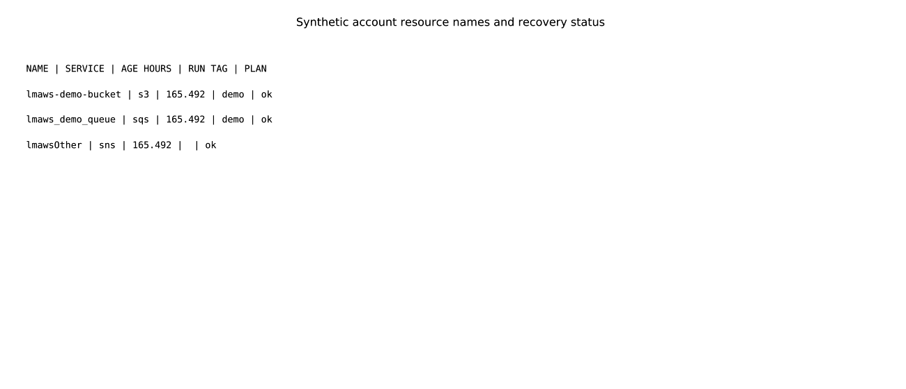

`lmctl https://raw.githubusercontent.com/lmctl-ai/lmaws/main/examples/find_lmaws_resources.lms`


`lmctl https://raw.githubusercontent.com/lmctl-ai/lmaws/main/examples/leftover_report.lms`


`lmctl https://raw.githubusercontent.com/lmctl-ai/lmaws/main/examples/leftover_report.lms`


`lmctl https://raw.githubusercontent.com/lmctl-ai/lmaws/main/examples/leftover_report.lms`


`lmctl https://raw.githubusercontent.com/lmctl-ai/lmaws/main/examples/sweeper.lms`

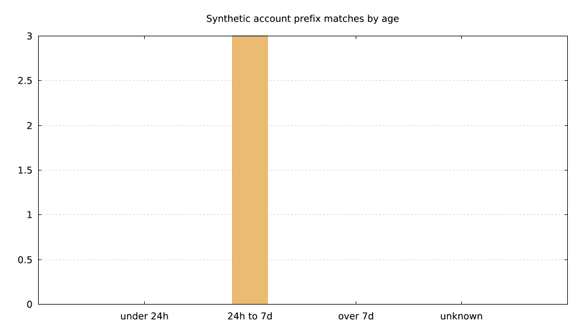

`lmctl https://raw.githubusercontent.com/lmctl-ai/lmaws/main/examples/sweeper.lms`

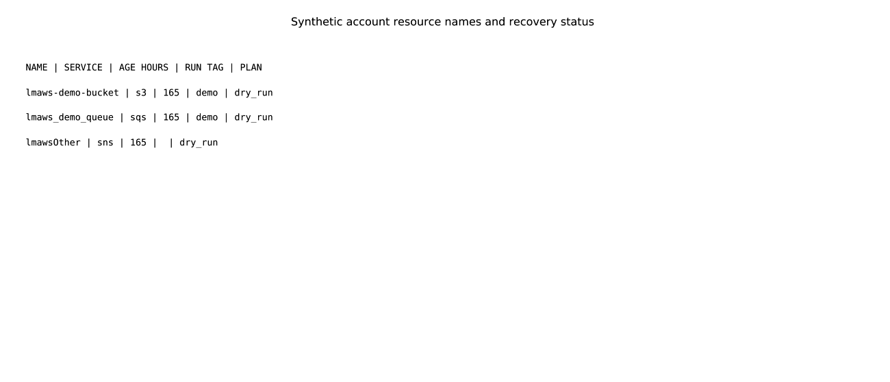

`lmctl https://raw.githubusercontent.com/lmctl-ai/lmaws/main/examples/sweeper.lms`


Current source also supports weighted DNS and the [lmweblab scenario catalog](https://github.com/lmctl-ai/lmweblab/tree/main/scenarios). Typed Lambda/EventBridge operations, DynamoDB TTL/items, S3 notifications and persistent `Serverless` state are verified with loopback SDK transports. The live 03–06 campaign passed with custom tagged logging, Lambda-only role passing and zero final leftovers after log-delivery settlement. Function roles are restricted to the short name `lmaws_lambda_exec`, resolved in the caller's account. See [the web/scenario note](durable-memory/11-web-stack.md) for limits, ownership checks, live evidence and post-delivery settlement. These new APIs require a current source build until a release includes them.

The main-source [remaining web scenario APIs](docs/REMAINING_SCENARIOS.md) add owned SQS/Lambda event mappings, DLQ redrive, conditional DynamoDB writes, bounded SigV4 upload URLs and static cache settings. The five [lmweblab scenarios](https://github.com/lmctl-ai/lmweblab/tree/main/scenarios) are verified with synthetic transports; live execution awaits the Lead go and the documented scenario-07 IAM grant. These APIs require a current source build until included in a subsequent release.
