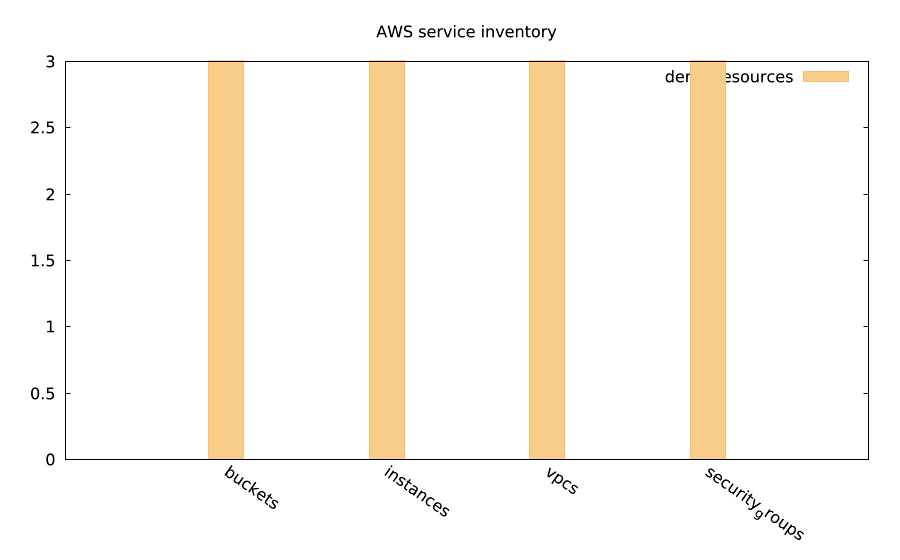
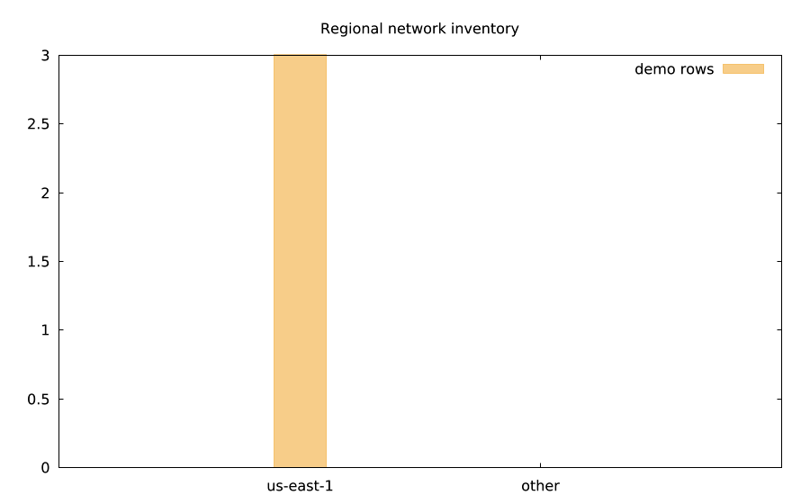
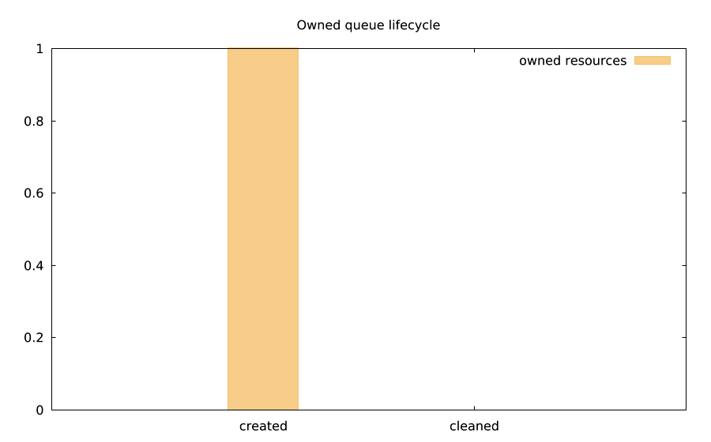
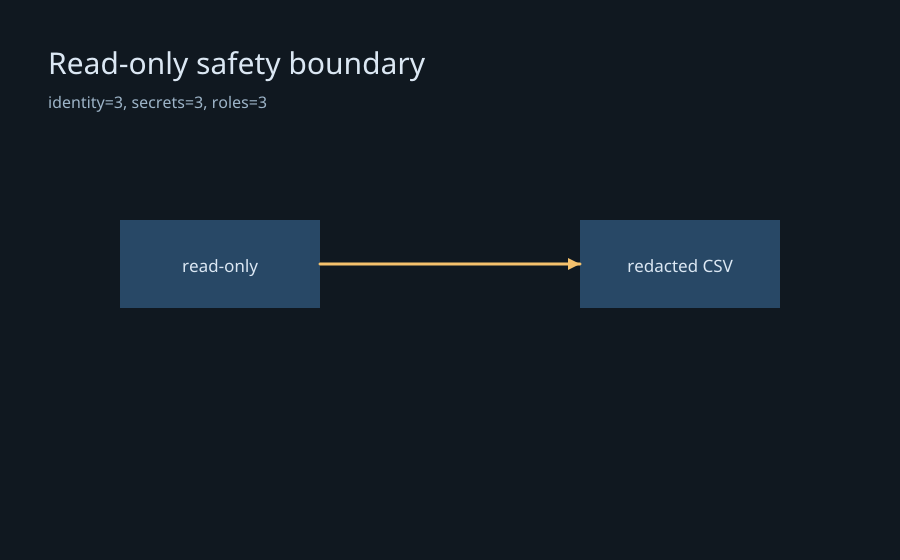
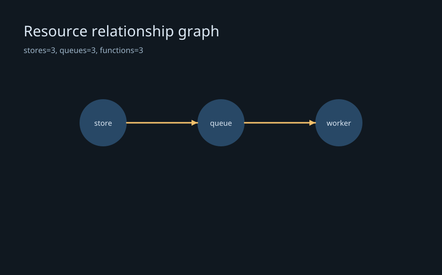

# lmaws
AWS read-only inventory and safely owned test resources for lmscript, powered by the AWS SDK for Java v2.

| Picture | Story and reproducible command |
|---|---|
|  | Cloud inventory at a glance — `lmctl autorun https://raw.githubusercontent.com/lmctl-ai/lmaws/main/examples/inventory.lms` |
|  | Network topology overview — `lmctl autorun https://raw.githubusercontent.com/lmctl-ai/lmaws/main/examples/vpcs.lms` |
|  | Queue lifecycle simulation — `lmctl autorun https://raw.githubusercontent.com/lmctl-ai/lmaws/main/examples/queue_pipeline.lms` |
|  | Read-only safety audit — `lmctl autorun https://raw.githubusercontent.com/lmctl-ai/lmaws/main/examples/read_only_audit.lms` |
|  | Resource relationship graph — `lmctl autorun https://raw.githubusercontent.com/lmctl-ai/lmaws/main/examples/resource_graph.lms` |

## Install

Install the single native executable from the latest GitHub release:

```text
lmctl autorun https://raw.githubusercontent.com/lmctl-ai/lmaws/main/examples/inventory.lms
```

Every example is offline by default and calls `aws.demo()`. Read-only live inventory uses the AWS standard profile/region chain and does not require `LMAWS_LIVE=1`; real-account writes require `LMAWS_LIVE=1`. The live test ledger owns every mutation and tears it down on success or failure. S3 names use `lmaws-<run-id>-...` plus the `lmaws_test=<run-id>` tag; other resources use the `lmaws_<run-id>_` prefix.

The typed API covers inventory and owned test flows for buckets, EC2 instances, VPCs, security groups, DynamoDB tables, SQS queues, SNS topics, Lambda metadata, CloudWatch log groups and alarms, Route 53 zones, Secrets Manager metadata, SSM parameters, ECS clusters and IAM role metadata. Secret-value APIs, access-key APIs, and session-token APIs are not exposed. Lambda examples describe metadata and do not deploy functions.

The native release targets five platforms and uses a 4096 MB memory budget. Linux binaries require glibc 2.35 or newer; Windows requires the standard Microsoft Visual C++ runtime. The host and examples are MIT licensed; the AWS SDK for Java v2 is Apache-2.0.

## API

| Expression | Result |
|---|---|
| `aws.demo()` | Offline deterministic Cloud |
| `aws.region("us-east-1")` | Live Cloud using the AWS standard profile/region chain |
| `cloud.buckets()`, `instances()`, `vpcs()`, `security_groups()` | Resource Rows |
| `cloud.tables()`, `queues()`, `topics()`, `functions()` | Data, messaging and function metadata Rows |
| `cloud.log_groups()`, `alarms()`, `zones()`, `secrets()`, `parameters()` | Operations and metadata Rows |
| `rows.len()`, `rows.at(i)`, `rows.count(key,value)`, `rows.filter(key,value)` | Inspect and aggregate Rows |
| `rows.csv(path)`, `rows.json()` | Masked tabular or JSON output |
| `cloud.run(runId, existingLedgerDir)` | Owned writes with an automatically named ledger, tags and cleanup |

```lmscript
mkdir("data");
aws = _dsl_ cli="lmaws" install="github:lmctl-ai/lmaws@latest";
let cloud = aws.demo();
let rows = cloud.instances();
check(rows.len() == 3);
rows.csv("data/instances.csv");
end _dsl_
savedsl(aws, "inventory.dslb");
r = system ${dsl_cli(aws)} --dsl "inventory.dslb";
assert(r.code == 0);
```

`--dry-run` uses demo data and makes no AWS requests, while still writing local reports and ledgers. `lmaws --sweep LEDGER_DIR --older-than-hours 24` is always a dry-run: it lists stale `lmaws-*.jsonl` ledger candidates and never deletes account resources. Create the ledger directory before opening a run; explicit ledger filenames should also use that prefix and extension. Errors use exit 2 for configuration and 3 for runtime failures.

## Resource limits and build

`LMAWS_MAX_MEMORY_MB` accepts a positive whole number, defaults to 4096 MiB, and bounds both heap and VM inputs. Budgets below 16 MiB end with a runtime error. The minimum supported runtime is Java 21 for JVM development; releases are GraalVM native executables. Build and validate locally with:

```sh
bash scripts/sync-deps.sh
mvn -q verify
./test.sh
bash scripts/build-native.sh
LMAWS_NATIVE=1 ./test.sh
```

The native build uses the GraalVM distribution selected by `JAVA_HOME`; release CI builds Linux, macOS and Windows binaries. Windows users need the Microsoft Visual C++ runtime. macOS Intel uses GraalVM CE 25.0.1, the final upstream build for that architecture; other release builds use CE 25.0.2.

## Examples

Each example writes its image to `images/<name>.png` in the current directory and includes an assertion. Copy any command into an empty directory:

- **inventory** — `lmctl autorun https://raw.githubusercontent.com/lmctl-ai/lmaws/main/examples/inventory.lms`
- **buckets** — `lmctl autorun https://raw.githubusercontent.com/lmctl-ai/lmaws/main/examples/buckets.lms`
- **instances** — `lmctl autorun https://raw.githubusercontent.com/lmctl-ai/lmaws/main/examples/instances.lms`
- **vpcs** — `lmctl autorun https://raw.githubusercontent.com/lmctl-ai/lmaws/main/examples/vpcs.lms`
- **security_groups** — `lmctl autorun https://raw.githubusercontent.com/lmctl-ai/lmaws/main/examples/security_groups.lms`
- **tables** — `lmctl autorun https://raw.githubusercontent.com/lmctl-ai/lmaws/main/examples/tables.lms`
- **queues** — `lmctl autorun https://raw.githubusercontent.com/lmctl-ai/lmaws/main/examples/queues.lms`
- **topics** — `lmctl autorun https://raw.githubusercontent.com/lmctl-ai/lmaws/main/examples/topics.lms`
- **functions** — `lmctl autorun https://raw.githubusercontent.com/lmctl-ai/lmaws/main/examples/functions.lms`
- **log_groups** — `lmctl autorun https://raw.githubusercontent.com/lmctl-ai/lmaws/main/examples/log_groups.lms`
- **alarms** — `lmctl autorun https://raw.githubusercontent.com/lmctl-ai/lmaws/main/examples/alarms.lms`
- **zones** — `lmctl autorun https://raw.githubusercontent.com/lmctl-ai/lmaws/main/examples/zones.lms`
- **secrets** — `lmctl autorun https://raw.githubusercontent.com/lmctl-ai/lmaws/main/examples/secrets.lms`
- **parameters** — `lmctl autorun https://raw.githubusercontent.com/lmctl-ai/lmaws/main/examples/parameters.lms`
- **clusters** — `lmctl autorun https://raw.githubusercontent.com/lmctl-ai/lmaws/main/examples/clusters.lms`
- **roles** — `lmctl autorun https://raw.githubusercontent.com/lmctl-ai/lmaws/main/examples/roles.lms`
- **identity** — `lmctl autorun https://raw.githubusercontent.com/lmctl-ai/lmaws/main/examples/identity.lms`
- **resource_graph** — `lmctl autorun https://raw.githubusercontent.com/lmctl-ai/lmaws/main/examples/resource_graph.lms`
- **tag_compliance** — `lmctl autorun https://raw.githubusercontent.com/lmctl-ai/lmaws/main/examples/tag_compliance.lms`
- **queue_pipeline** — `lmctl autorun https://raw.githubusercontent.com/lmctl-ai/lmaws/main/examples/queue_pipeline.lms`
- **sandbox_lifecycle** — `lmctl autorun https://raw.githubusercontent.com/lmctl-ai/lmaws/main/examples/sandbox_lifecycle.lms`
- **before_after** — `lmctl autorun https://raw.githubusercontent.com/lmctl-ai/lmaws/main/examples/before_after.lms`
- **read_only_audit** — `lmctl autorun https://raw.githubusercontent.com/lmctl-ai/lmaws/main/examples/read_only_audit.lms`
- **regional_posture** — `lmctl autorun https://raw.githubusercontent.com/lmctl-ai/lmaws/main/examples/regional_posture.lms`
- **service_matrix** — `lmctl autorun https://raw.githubusercontent.com/lmctl-ai/lmaws/main/examples/service_matrix.lms`

The gallery contains 22 lmplot charts and 3 lmdraw diagrams generated from each example's host output. `scripts/test-gallery.py` checks the gallery links, image magic bytes and the 25-example inventory; `python3 scripts/test-gallery.py --run` executes all examples in isolated temporary directories. The default CI uses in-process fakes and never needs AWS credentials. Live testing is opt-in: read-only calls may inspect the configured account, and writes are limited to resources created by that run with the `lmaws_` prefix, ledger ownership and teardown.

