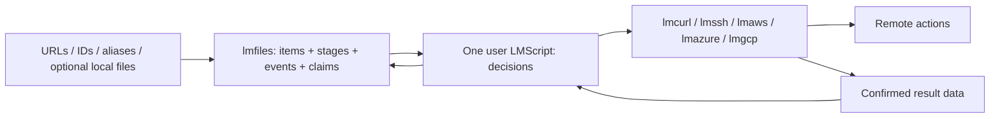

# lmfiles: file lifecycle registry (proposed name)

Status: **design only, brief v2 plus file-lifecycle and lmssh addenda**. This is the current registry design. It
consolidates the useful publication examples from root `SYNC_DESIGN.md` at
`d0f033f`, replacing its integrated sync/policy engine with the boundary below.
No implementation, AWS command, remote-host test, workflow dispatch or benchmark
is performed here. No product name is final and no repository is created. The
requested document path remains `docs/LMSYNC_DESIGN.md`; legacy lmsync links point here.

Contents: [boundary](#definition-and-boundary), [API](#1-core-api-and-neutral-data),
[belief/verification](#2-believed-state-and-verification-scripts),
[optional logs](#3-optional-planresult-log-glue),
[durability](#4-durable-db-and-failure-injection),
[Java stores](#5-java-implementation-and-scale-tier-storage),
[lifecycle jobs and host gaps](#6-lifecycle-jobs-using-existing-products),
[multi-host milestone](#7-one-lmscript-two-hosts-first-milestone),
[benchmarks](#8-benchmark-plan-proving-the-local-state-claim),
[implementation](#9-positioning-risks-and-implementation-breakdown).

## Definition and boundary

Recommend **lmfiles**: a **file lifecycle registry**, not a directory sync engine.
Alternatives: **lmregistry** (emphasizes generic state, less obviously files) and
**lmtrack** (emphasizes history, less obviously file operations). These are naming
proposals, not new repositories or renamed existing products.

An item can start as a source URL before a local file exists, become a cleaned
artifact, and acquire several publication aliases. A law/case ingestion script
can track millions of such items through its own stages. The registry is a local
model of observations and reported outcomes, including believed remote state;
it is neither a downloader nor an uploader. Directory scan is an **optional
adoption/observation helper**, not the core workflow.

It exposes a Java lmcode host/library for DB access, item/alias and stage queries,
local observations/hashes, event history, claims, recording and optional local
log helpers. It makes **zero remote calls, ever**: no list, remote stat, HEAD,
credential resolution, cloud client or SSH connection. Queries about arbitrary
paths/URLs/IDs never enumerate a remote directory.

**One job is one user-authored LMScript.** It calls lmfiles for state and existing
lmcurl, lmaws or lmssh for actions. The script owns download, clean, publish,
archive and cleanup decisions and reports their outcomes. lmaws keeps its Java/
GraalVM SDK v2 host; lmazure/lmgcp keep theirs. No C++, JNI or external native
component is introduced for the registry. Existing action products are used as
products today, not redesigned here.

| Registry owns | Job script owns | Existing action host owns |
|---|---|---|
| Durable items, aliases, local observations, stage projections, audit events, indexed queries, snapshots, atomic leased claims, optional local logs | Stage names and meaning; pipeline dependencies; retries/skipping gone sources; transforms; local deletion; key mapping; freshness; budgets; verification; retention; invalidation | Explicit HTTP/cloud/SSH actions, credentials, host-key/ownership checks, provider limits, transfer receipts and provider cost ledger |

There is **no config-file-driven rules engine**, automatic upload/delete choice,
record-age warning, quota policy or cloud-specific target validation in lmfiles.
A page may be unchanged for years. Operational tuning parameters (batch size,
store cache, hash mode, scan globs) are ordinary API arguments, not rules that
trigger remote work. Script templates may choose defaults; core does not impose
them. A no-op job can avoid invoking its transfer host entirely. If that host is
invoked, count its security/metadata calls as well as transfers; never market
zero decision requests as zero total requests for a script that chose verification.



## 1. Core API and neutral data

All registry signatures below are **proposed**, not existing bindings. Example
stage names `fetched`, `parsed`, `cleaned`, `published`, `archived`, `deleted` are
user strings: none is built in, ordered, required or interpreted by the core.
An item need not have a file, URL, hash or any stage yet.

### Schema, identity and revisions

Use stable internal `ItemId` (128-bit, opaque); the caller may additionally supply
an opaque external ID. An alias is `(kind, namespace, value)` such as URL/local
root+path/published key. Its bytes are caller supplied, compared exactly; no URL
canonicalization, path case folding or S3 key rule is hidden in the registry.
The alias index enforces one active item per alias in that namespace. Adding an
alias already owned by another item returns a conflict, never an automatic merge.
Several items may share a content hash; duplicates are not identity. A transform
may update an item or make a derived item with `derived_from` attributes, as the
script decides. Conflicting source URLs should use separate source namespaces or
items if their versions cannot share a coherent content revision.

| Record/key | Value and semantics | Estimated encoded bytes before index duplication |
|---|---|---:|
| Item / `item_id` | Current content revision, optional hash algorithm+digest, size, mtime precision, local observation refs, free-form typed attributes, tombstone flag | 240–400 with ~128 B attributes |
| Alias / `(kind,namespace,value)` | Item ID, added event sequence, removed marker; average value 96 UTF-8 bytes | 140–200 each |
| Observation / `(item,local-alias)` | Size/mtime, optional ctime/file ID/hash, observed presence and scan coverage | 100–180 per local alias |
| Stage projection / `(stage,namespace,item,slot)` | Latest attempt plus last-success pointer; status, reported UTC timestamp, source revision/fingerprint, event sequence, metadata | 220–360 with ~128 B metadata |
| Event / `(db_epoch,sequence)` | Immutable operation ID, item, stage/namespace, timestamp, outcome, source revision, metadata or blob reference | 180–320 with ~96 B metadata |
| Claim / `(work_namespace,item)` | Token/fence, owner, source revision, selection snapshot, deadline, generation | 100–180 while active |
| Tombstone / entity key | Removal event sequence and identity; retained until safe compaction/export boundary | 32–64 plus key |

These are **sizing assumptions**, not measured codecs. Arbitrary large attributes,
URLs or error text increase them; use bounded blobs with digests. Metadata may
hold ETag, Last-Modified, HTTP status, local artifact alias, remote ID/version,
error text or failure count. The script supplies these values; secret values do
not belong in public fixtures or audit output. `status` is the neutral enum
`ok | failed | gone | skipped`; it does not trigger retry, deletion or suppression.
`slot` is an optional caller-defined name (default empty), allowing several
artifacts within one stage/namespace. An event stores the exact reported source
revision: successful processing of revision R never asserts success for R+1.

Completion may include an explicit observed-item update in the same transaction:
compare the pre-fetch revision, allocate a new revision only if content changed,
and bind fetched success to the resulting revision. A transform instead references
its input revision and separately reported output fingerprint. No implicit hashing
or adoption of whatever bytes happen to be at a path during completion.

A stage projection retains both latest attempt and most recent successful event,
so a later failed retry does not erase evidence of an earlier publication.
Keep the last-success source fingerprint/status/revision summary materialized in
the projection even if its full event payload is explicitly archived; archive
availability must not turn a known comparison baseline into a fabricated match.
Queries explicitly choose latest-attempt or last-success; status alone is not
current-revision success. Attributes support JSON scalar values, bytes/blob refs
and bounded maps; indexed scalar fields have explicit type/collation. Unindexed
nested predicates are allowed only as explicitly requested streaming scans.
Tombstoning an item/alias/stage never deletes a file or remote object, nor rewrites
its append-only audit events. No name implies a business transition.

### Typed API

```text
files.open(path: string, namespace: string, options: OpenOptions) -> Registry
Registry.close() -> CloseReceipt
Registry.item_upsert(identity: Identity, fields: ItemFields) -> ItemReceipt
Registry.alias_add(item: ItemId, alias: Alias) -> AliasReceipt
Registry.alias_remove(item: ItemId, alias: Alias) -> AliasReceipt
Registry.observe(item: ItemId, observation: Observation) -> ObservationReceipt
Registry.get(ids: IdentitySource, snapshot: Snapshot) -> ItemCursor
Registry.query_subset(namespace: string, ids: IdentitySource, options: CompareOptions) -> StateCursor
Registry.stage_record(item: ItemId, result: StageResult) -> RecordReceipt
Registry.stage_forget(item: ItemId, stage: string, namespace: string, slot: string) -> RecordReceipt
Registry.item_tombstone(item: ItemId, note: string) -> RecordReceipt
Registry.select(predicate: Query, snapshot: Snapshot) -> ItemCursor
Registry.stage_difference(a: StageSelector, b: StageSelector, options: JoinOptions) -> ItemCursor
Registry.by_attribute(name: string, predicate: ScalarPredicate) -> ItemCursor
Registry.by_hash(algorithm: string, digest: bytes) -> ItemCursor
Registry.by_timestamp(field: TimeField, range: TimeRange, scope: Query) -> ItemCursor
Registry.aggregate(query: Query, groups: GroupFields, metrics: AggregateFields) -> AggregateCursor
Registry.changes(after: EventCursor, filter: EventFilter, max_rows: int) -> EventBatch
Registry.claim(selection: Query, work_namespace: string, count: int, lease_ms: int,
               owner: string) -> ClaimBatch
Registry.renew(token: ClaimToken, lease_ms: int) -> ClaimReceipt
Registry.release(token: ClaimToken) -> ClaimReceipt
Registry.complete(token: ClaimToken, result: StageResult, expected_revision: Revision) -> RecordReceipt
Registry.scan(root: string, options: ScanOptions) -> ScanRun
Registry.scan_paths(paths: PathSource, options: ScanOptions) -> ScanRun
Registry.hash_paths(paths: PathSource, algorithm: HashAlgorithm) -> ObservationCursor
Registry.mark_suspect(items: IdentitySource, stage: string, namespace: string, note: string) -> RecordReceipt
Registry.set_suspect(items: IdentitySource, stage: string, namespace: string,
                     value: bool, note: string) -> RecordReceipt
Registry.snapshot() -> Snapshot
Registry.begin() -> WriteBatch
WriteBatch.item_upsert / observe / stage_record / stage_forget / checkpoint(...) -> WriteBatch
WriteBatch.commit() -> CommitReceipt
WriteBatch.rollback() -> void
Registry.import_records(source: LocalRecordSource, options: ImportOptions) -> ImportReceipt
Registry.export_records(output: string, options: ExportOptions) -> ExportReceipt
Registry.doctor(options: DoctorOptions) -> IntegrityReport
```

Cursors expose `has_next`, `next_batch(max_rows,max_bytes)` and `close`, with
streaming JSONL/CSV output. Default 4,096 rows is an operational batch parameter;
a byte ceiling can shorten it. No million-item array or in-memory handle graph
is required. ScanRun has the same bounded `next_batch` plus `finish` receipt.
IdentitySource adapters accept explicit aliases/IDs, local stdin/NUL lists, globs,
manifest records or unrelated roots. The user script obtains git diff paths;
core never invokes git or fetches a URL. Convenience arrays have explicit limits.

A target is an opaque namespace, not necessarily a bucket. It may name an HTTP
source, S3 bucket/prefix, SFTP host/path or transform version. The core neither
parses nor validates those descriptors. A local path is root ID+relative path;
a remote object key is another alias. User code owns their mapping/collisions.
The earlier path API is a **projection**, not a second DB: `query(target,paths)`
means query_subset against a caller-selected stage/namespace; `record` means
stage_record, `forget` means stage_forget, `records` means select, and
local_not_recorded/recorded_not_local are explicit set predicates over observations
and stage records. Optional log projections use these abbreviations but must
carry the stage/namespace/item when ambiguous. No default `published` stage exists.
`explain(query)` and explicit local `archive_events(range, output)`/consumer
`checkpoint(name,cursor)` are additional typed administrative data operations;
archive never deletes unexported history or silently rewinds a consumer.

### Indexed queries and change cursors

Primary items are ordered by ID; maintain alias, hash and caller-declared scalar
attribute indexes, plus `(stage,namespace,status,item)` membership postings,
`(stage,namespace,item,slot)` projections, successful-source-revision postings,
`(time-field,namespace,timestamp,item)` and ordered event sequence indexes.
Changing a projection updates indexes and appends its event in the same transaction.
Index definitions are data access choices, not lifecycle rules. `explain(query)`
returns chosen index, estimated rows and scan requirement; no silent full scan
for an apparently indexed attribute lookup.

Stage A minus B uses ordered posting merge/anti-join with bounded buffers,
O(|A|+|B|) sequential reads worst case, or indexed probes from a sparse A. It does
not loop over all item blobs or make a remote request. Selectors name status,
namespace, slot and latest-attempt/last-success explicitly. `JoinOptions` specifies
whether B must match A's source revision/fingerprint; this is a relational
comparison parameter, not an implied cleaned-before-published rule. For dense
100M anti-joins even an optimal merge reads millions of IDs; report that cost.
Do not promise O(output) latency for arbitrary complements. Optional partition
counts accelerate exact membership counts; snapshot aggregate totals and index
updates commit together. General grouped aggregates may stream the qualifying
postings, with external spill when groups exceed memory.

`changes` is ordered committed events with `(db_epoch,sequence)` cursor, never a
wall-clock guess. It returns the last consumed sequence even when a filter matches
no rows. Event sequence, decimal in interchange, is 64-bit within an epoch.
Daily scripts record output plus consumer checkpoint in one transaction, or use
idempotent operation IDs to close their own crash gap. No scheduler is in core.
Append-only events are not silently expired; an **explicit** export/archive request
may move sealed event segments to checksummed local archives. Queries across
archived history require those segments. A cursor below the online low-watermark
returns `cursor-history-unavailable` with archive ranges, never an empty success.
Consumers select their own replay or rebuild procedure. No built-in age rule.

### Comparison semantics

CompareOptions names stage, namespace, slot and the exact baseline event or
last-success projection; success comparison never silently uses a failed attempt
as confirmed work. Query compares the latest observation (or caller-provided
subset fingerprint) with the source fingerprint attached to that baseline; it performs no remote I/O and no implicit local tree scan.
The script supplies observations/fingerprints or optionally calls scan/scan_paths
when it wants refreshed local-file observations. URL-only items remain valid;
without a new observed fingerprint their unseen source changes are unknown.
Query returns observed and recorded fingerprints, the selected stage/status, comparison basis (`stat` or
`digest`), hash availability, explicit suspect annotation and record metadata.

| Neutral state | Exact meaning |
|---|---|
| `unknown` | No record, or insufficient local observation to compare; reason distinguishes these cases. It does not assert absence on the remote |
| `same-as-recorded` | The compared local fingerprint agrees with the one the script last recorded, under the disclosed stat/hash basis |
| `changed` | The local comparison differs; if hashing was deferred, this may mean changed stat inputs rather than proven different bytes |
| `recorded-but-missing-locally` | A recorded path has an explicitly observed local absence, from a completed scope scan or scan_paths result |

A scan receipt includes its root, filter/traversal parameters and completed coverage.
Excluded/unvisited paths are not marked absent, and changing include/exclude
parameters is not evidence that previously observed files disappeared.
A path not yet observed is not declared missing. A failed/partial scan exposes its
incomplete scope; set differences cannot describe that unobserved portion as
confirmed absence. The helpers compare local DB sets, not the remote namespace. Old upload-index
policy verdicts such as new/key-conflict/stale are not core states; the script can
distinguish absent-record vs unobserved-local reason data and map them as it wishes.
None of the four states means upload, delete, warn, refuse or rebuild. Even a
`same-as-recorded` file may need a script-chosen action because its desired remote
key or HTTP metadata changed. Conversely `changed` does not require an upload.
A suspect flag is data set by the script, not a fifth policy verdict or a TTL.

### Scan and hash cost

ScanOptions supplies include/exclude globs, symlink handling, hash algorithm/mode,
worker/batch limits and local scope. Empty filter choices mean no caller filter;
there is no built-in project/deploy exclusion policy. Hash modes are ON_CHANGE,
ON_DEMAND and ALWAYS; size/mtime checks reuse known hashes where applicable.
Record timestamp precision and optional ctime/file identity. If a stat change
hashes to the same content, disclose both facts. Never equate an opaque provider
ETag with a local content hash.

Use bounded per-directory/shard queues, streaming observations and spill files,
not a whole-tree list in memory. Directory mtimes can help detect name changes;
descendant content edits need not alter a parent directory mtime. Do not skip
children on that evidence alone. An optional local watcher is just an observation
accelerator; JDK WatchService can use Linux inotify without a new native binding.
Overflow, a stopped watcher or an interrupted scan is returned as a local
observation gap. The script chooses whether/how to rescan; no cloud verification
or record-age policy follows automatically.

A same-size edit with preserved timestamps can evade stat-based comparison. The
script can request ALWAYS hashing or an immutable source snapshot when that
matters. Re-stat around hashing and report local mutation rather than publishing
a misleading digest. The core does not certify that a later transfer read the
same bytes: the action host must report the actual transferred fingerprint.

### Record and forget

StageResult (the earlier RecordMetadata projection) carries an immutable **source fingerprint for the bytes reported
transferred**, an action/event ID and an opaque result payload. It can hold an
ETag/version, remote path, content type, Cache-Control, upload ID, SFTP attributes,
phase/status or arbitrary caller data; core does not interpret these business
fields. A logical action/event may have no source-file fingerprint.

`stage_record` (or its explicit record projection) must not implicitly attach today's local fingerprint to yesterday's
transfer. Callers pass the plan/source snapshot or actual transferred hash. If a
file changed while/after uploading, a subsequent scan must still compare against
the bytes actually reported uploaded. `forget` removes believed state via a local
transaction/tombstone; it never deletes a remote path. The caller is free to
record or forget directly without any plan/log mechanism.

## 2. Believed state and verification scripts

Outside changes are invisible until a script chooses to check. Age alone does
not make a record suspect, and opening/querying never calls the remote. A DB can
faithfully preserve a mistaken user report; it cannot independently certify a
remote effect. Document these limits instead of implying a local remote oracle.

A verification script chooses N recorded paths, calls lmaws HEAD (or another
host's equivalent), compares returned data using its own policy, then explicitly
marks suspect, records revised metadata, forgets or does nothing. Sampling rate,
selection seed, cost cap, checksums and behavior on mismatch all belong to that
script. A failed sample cannot certify unsampled paths. Multipart/composite ETags,
metadata changes and encrypted objects need explicit interpretation by the host/
script, not a content-equivalence rule hidden in lmfiles.

A rebuild script can fetch a listing, S3 Inventory or other records with its cloud
host, then call import_records on a **local** stream. lmfiles never fetches a URL or
creates Inventory. The script chooses prefix fan-out/concurrency, coverage,
pricing/admission, validation and whether to replace or merge a target snapshot.
ImportOptions provides mechanical append/upsert/replace and transaction choices;
a replace is local state replacement, not remote deletion. Preserve import
provenance in caller metadata. A listing does not necessarily recover source paths
through a non-invertible flatten/custom mapping, and Inventory may not contain
custom metadata or checksum values. Unknown information stays unknown.

No watcher detects outside remote edits. Multiple machines can hold different
beliefs; any remote coordination/leases or conditional-write policy belongs in
the job and action host. Local single-writer locking only protects this DB.

## 3. Optional plan/result log glue

This is a **thin file codec/helper library**, not a mandatory workflow, scheduler
or executor. A script may use direct record() calls instead. A plan is data the
script wrote; lmfiles never synthesizes upload/delete instructions from a state.

Proposed helpers: `plan_writer`, `result_writer`, `read_instructions`,
`read_results`, `unconfirmed(plan, results)`, and `apply_records(db, results)`.
The last helper applies only explicit record/forget projections supplied by the
script. It does not infer a projection from a verb such as `delete` or `invalidate`.
All readers/writers stream in bounded batches and return data/receipts.

### Wire grammar

Versioned UTF-8 JSON Lines; one compact object per line, LF terminator. Strings
use JSON escaping, so spaces, quotes, tabs, backslashes and embedded newlines in
path names are unambiguous. Never use whitespace-separated shell instructions or
shell interpolation. Metadata is bounded per line; large payloads refer to a
local blob plus digest. Store nanosecond timestamps, byte counters/IDs that may
exceed JavaScript's exact integer range as decimal strings. Timestamps are UTC
RFC3339 data, not expiration instructions.

Each managed line has `v`, `kind`, `job`, `op`, `payload` and a checksum. Result
lines additionally have an immutable `result_id` and explicit
`completes_instruction` boolean; separate accepted/completed/progress projections
can share an instruction op but use different result IDs. The helper
uses its versioned canonical JSON encoding of payload for CRC32C and instruction
SHA-256; all hosts share the codec conformance fixtures. Logs from external tools
may be imported explicitly, but are not silently treated as managed crash receipts.
The examples below omit computed checksums for readability; actual helper output
includes them and each result binds the full instruction digest.

```json
{"v":1,"kind":"instruction","job":"example","op":"add-a","payload":{"verb":"add","stage":"published","target":"site","item":"<item-id>","source_revision":"7","path":"assets/a b \"quoted\".css","source_fingerprint":{"size":"3","mtime_ns":"<decimal-int64>","hash":"<digest>"},"args":{"remote_path":"assets/a.css"},"record_projection":"record"}}
{"v":1,"kind":"instruction","job":"example","op":"delete-b","payload":{"verb":"delete","target":"site","path":"old.css","args":{"remote_path":"old.css"},"record_projection":"forget"}}
{"v":1,"kind":"instruction","job":"example","op":"event-c","payload":{"verb":"cloudfront.invalidate","target":"events","path":"invalidation/event-c","args":{"paths":["/*"]},"record_projection":"record"}}
{"v":1,"kind":"result","job":"example","op":"add-a","result_id":"add-a-complete","completes_instruction":true,"payload":{"instruction_digest":"<sha256>","confirmed":true,"timestamp":"2026-01-01T00:00:00Z","projection":{"kind":"record","stage":"published","target":"site","item":"<item-id>","source_revision":"7","path":"assets/a b \"quoted\".css","source_fingerprint":{"hash":"<actually-transferred-digest>"},"metadata":{"remote_path":"assets/a.css","phase":"uploaded","etag":"<opaque>"}}}}
```

`verb` is an arbitrary caller string; `args` and result metadata are caller data.
The projection primitives are local `record`/`stage_record`, `forget`/`stage_forget`
or `none`; item/alias/observation updates must be explicit in a versioned
transaction projection. `record` uses a caller-supplied item, stage, namespace and
source revision (the path shorthand below is only an identity adapter). Metadata
can describe an accepted/pending remote action if that is what the script reports;
it must not thereby be presented as completed publication. Job/op identifiers and
instruction digest detect conflicting reuse. Replaying the same confirmed `(job,result_id)` is idempotent; a different
payload for that same result ID is an integrity conflict. Only the caller's
explicit completes_instruction marker removes an instruction from the unconfirmed
set. Progress/event data need not imply a fully uploaded file. A transaction commits its result-log replay offset and record changes
together, so a crash cannot skip a result or double-apply it.

A writer fsyncs a complete confirmed result before declaring that receipt durable.
A torn final line is retained/ignored as unconfirmed and can be truncated only to
the last verified line boundary. Corruption in a middle line is an error, not an
excuse to skip later results. Plan files commit atomically; appending to a journal
is single-writer. The helper never executes any verb or invokes a provider.

### Resume and the confirmation gap

Resume means the script re-plans the unconfirmed remainder. Completed results
replay into the DB even if the process died before its DB update. A transfer that
completed remotely but crashed **before** producing a durable confirmation remains
unconfirmed: lmfiles cannot infer success without a report. Its instruction is not
lost, and the script can safely retry with provider idempotency/conditional writes
or explicitly reconcile the known path. It may repeat transfer work or cost.

Scripts should store multipart/progress events without a completed-file source
fingerprint until they actually report that full-file success. The core does not
interpret phase strings.

The invariant is no lost **durably reported** success and no false unchanged
inferred from intent, a start record, file existence or a partial line. Exactly-once
remote effects across a process/network/filesystem crash are not promised. A
script that reports an incorrect result can corrupt its own belief; the library
must not manufacture confirmation. Changed local sources are re-planned rather
than marked uploaded with a newly observed fingerprint. Optional log glue is not
required for small direct-call jobs, but those jobs accept a larger confirmation
window unless the action host emits its own durable result receipt.

## 4. Durable DB and failure injection

Logical records are the item/alias/observation/stage/event/claim schema in section 1,
plus indexes, import provenance, generations, transaction IDs, replay IDs/offsets
and consumer checkpoints. Keep observations separate from reported stage results:
a scan cannot overwrite fetched/cleaned/published history. Hash lookup is generic;
provider key-mapping logic, quota policies and release catalogs are script data,
not core business tables.

Use transactional/WAL storage, checksummed pages/records, monotonic committed
sequence numbers and versioned codecs. On open, validate the manifest, recover
committed WAL transactions, discard only incomplete tail records and report
structural corruption. Do not silently open an empty DB or forget records when a
file is corrupt. Compaction writes/fsyncs a new generation, atomically commits its
manifest and only then releases old unpinned files. Compaction drops superseded
records/tombstones only when snapshots no longer need them; it never expires a
path because of age. Export/backup produces a consistent checksummed snapshot;
import validates it into a staging generation before an explicit local commit.

### One writer, many workers and processes

Recommend **one DB writer with transactional batching**, not independently opened
multi-writer embedded stores. The owner process serializes short mutation batches;
parallel action workers never hold a DB transaction across HTTP/SSH/CPU work.
Same-process clients call its writer queue; several processes connect through an
OS-local filesystem mailbox under the private DB directory: bounded request and
response files, written to temporary names then atomically renamed, with operation
IDs and checksums. No socket/TCP listener, remote RPC or native pipe binding is
needed. This is an optional mode of the Java registry host, not another native
component. Restrict directory permissions to the owner, reject symlink traversal,
use backpressure/bounded polling and fsync before acknowledging. Keep completed
request IDs durably deduplicated before reclaiming reply files. Measure mailbox
latency and file churn; batch messages to amortize it. A later OS-local IPC
optimization must preserve this protocol and qualify platform support.
Clients retry uncertain requests with the same operation ID. Embedded mode remains
useful for one process; second direct writers get `writer-busy`, not corruption.
If the owner dies, clients reconnect after a new owner acquires the OS lock and
recovers WAL. No claim success is acknowledged from a merely queued request.

Writer uses an OS file lock plus diagnostic PID/process-start/instance data. Only
acquiring the real lock permits stale metadata recovery; never unlink/recreate a
live locked file or steal a live lock by timeout. Refuse filesystems lacking the
required lock/rename/fsync guarantees. Snapshot readers run in the owner process
or consume pinned immutable exports; do not promise independent live MVStore opens
across processes. Mailbox clients request paged snapshot reads, not DB-file access.
Reader pins release only after outstanding reads cease and client-liveness
reconciliation confirms the snapshot is no longer in use; compaction
cannot delete a still-used generation. Backpressure bounds queues/read snapshots.

Claims select N unclaimed candidates and commit tokens in **one transaction**.
Work namespace is user supplied, so unrelated tasks may claim the same item
independently. Claim tokens contain monotonically increasing fencing generation,
item/source revision and lease deadline. Renew/release/complete compare the token
atomically; complete appends the stage event, updates indexes and releases the
claim together. The caller chooses selection, count and positive lease duration;
expiry makes a claim eligible, not an automatic transfer/retry. Claims are
coordination data, not a built-in work scheduler or lifecycle pipeline.

Use a monotonic clock while the owner lives, durable UTC expiry plus owner epoch
for recovery. On restart/clock discontinuity, conservatively block ambiguous
unexpired leases until their bounded remaining duration or an explicit recovery
request; expose clock uncertainty and never silently steal work on a wall-clock
jump. Reissued tokens always fence old owners. The library can reject a late
complete after expiry/reclaim; it cannot fence a remote upload already executing.
Scripts use provider preconditions/idempotency where needed and do not claim
exactly-once effects. A late worker can explicitly append its factual historical
receipt with the old revision, without replacing a newer successful projection.
Revision mismatch returns conflict; no false success for newly changed content.

`parallel_map(batch, work, limit)` is the intended one-LMScript worker shape:
pass owned item/token data, create action-host resources inside each task, close
them there and return own-data receipts only. **The inspected local lmscript
checkout currently supports only literal `parallel([call(), ...])`, not
parallel_map.** Small runner addition needed: `parallel_map(items, fn, limit)`
with ordered results, bounded concurrency, all tasks settled before first error
by input order, and existing own-data/resource/task rules. Until available use
fixed-width literal parallel batches; neither registry nor transports need a new
parallel-download engine. Separate processes use the same claim primitive through
the local owner. Re-audit the installed staging runtime before implementation.

Doctor reports local checksum/manifest/sequence/index consistency, dangling
references, transaction/replay integrity and storage statistics. It performs no
HEAD, rebuild or provider verification, and returns data for the script to handle.
Opening old-format data requires a versioned migration, not automatic semantic
policy changes. Memory, disk space, file offsets and malformed-input limits are
implementation/resource constraints, not upload/delete policy.

A deterministic kill-point harness will exercise these boundaries:

| Kill/fault point | Required observation after reopen |
|---|---|
| After plan commit, before any transfer | DB unchanged; all instructions unconfirmed |
| Mid-transfer/part | No completed record; script can use stored opaque provider resume data or retry |
| After remote transfer, before result append | Unconfirmed intent retained; no fabricated same-as-recorded |
| After fsynced result, before DB record | Replay restores exactly that reported source snapshot/result |
| During DB transaction/replay-offset commit | Both record and offset commit, or neither |
| Mid-compaction/manifest swap | Last complete committed generation remains readable |
| Disk full / failed fsync | No success acknowledgment for an undurable transaction |
| Truncated last log line | Previous verified receipts replay; last operation stays unconfirmed |
| Corrupt middle log/page/index record | Doctor/open reports corruption; no silent row loss |
| Stale lock metadata / crashed writer | OS lock can be reacquired safely; live locks cannot be stolen |
| Reader crash / active snapshot during compaction | No use-after-delete; obsolete files reclaimed only after pin release |
| Two workers/processes claim overlapping candidates | Exactly one live token per work namespace/item; batched event+claim completion is atomic |
| Owner crash after claim fsync, before reply | Same operation ID returns committed claim; no second grant |
| Lease expiry, stale completion, source revision change | Old token cannot overwrite newer success; historical result stays tied to old revision |
| Clock jump/reboot, worker dies mid-transfer | Conservative lease recovery; no invented result or exactly-once claim |
| Consumer crash around cursor checkpoint | Atomic stage/checkpoint or deduplicated replay; no silently skipped events |
| Stage/alias/attribute-index corruption | Doctor detects mismatch to primary records; no silent anti-join omission |

Compare recovered state to an independent model oracle at every kill point.
Test large offsets, empty DB, duplicate/conflicting operation IDs, arbitrary path
quoting, many targets and millions of streamed rows in JVM and native-image runs.

## 5. Java implementation and scale-tier storage

Implement lmfiles as a Java lmcode host with JDK local I/O/hash primitives. GraalVM
native-image remains the deployment route; no AWS SDK, SSH client or cloud ledger
belongs in its dependency graph. TransferManager is an **lmaws** concern. No new C++
or external native state component is selected for lmfiles, and there is no JNI
fallback. Existing lmcurl/lmssh/lmaws keep their own implementations; this
design adds no transport dependency to the registry.

| Store | Primary-source evidence / uncertainty | Recommendation |
|---|---|---|
| Direct H2 MVStore | Java file-backed log-structured maps, MVCC and configurable cache; our native-image/large-file/crash workload still needs qualification | Small-tier candidate using explicit byte codecs, no SQL/server or object serialization |
| Custom sorted runs + sparse fences + Bloom filters | Implementable with Java NIO; immutable generations, WAL and compaction are our engineering responsibility | Recommended 100M/1B path; small-tier fallback/common export format |
| iq80 Java LevelDB / embedded LSM | Java port with batches/snapshots/cache controls; reviewed README describes limited testing, and no representative native-image qualification was found | Prototype/benchmark alternative, not an assumed production dependency |
| MapDB | JVM file-backed collections; exact dependency/reachability/durability behavior needs testing | Optional candidate; no unmeasured native-image claim |
| Xerial SQLite JDBC | Native-image support exists, but SQLite is loaded from platform native libraries through JNI | Not compatible with this brief's Java-only/no-JNI requirement |
| RocksDB JNI | Adds native libraries and per-platform JNI packaging/testing | Not needed by the proposed Java design; only reconsider with explicit new user direction if every viable Java approach fails |

Sources: [MVStore](https://h2database.github.io/html/mvstore.html),
[iq80](https://github.com/dain/leveldb), [MapDB](https://mapdb.org/doc/),
[SQLite JDBC](https://github.com/xerial/sqlite-jdbc). These provide feature evidence,
not measured lmfiles results. Check pinned-version reachability and file locking
in the actual GraalVM binary; a working JVM test is not native-image certification.
No dependency is added by this design.

### Scale with stages and audit history

Baseline workload: three aliases/item (URL, local path, publication key), one
local observation, **five stage projections and six audit events/item**, SHA-256,
128 B stage metadata and declared attribute/status/time/hash indexes. Summing the
section 1 records plus ~0.6–1.0 KiB index/filter/fence overhead gives an estimated
**3–5 KiB/item**, including those stages/events, not 400–700 B/path-target as in
the older upload-only model. Events grow without bound unless the script explicitly
archives them: each extra event adds about 180–320 B plus index overhead, each
additional stage/target 220–360 B plus postings, alias 140–200 B plus lookup index.
For example: 300 B item + 3×160 B aliases + 140 B observation + 5×280 B
stages + 6×220 B events + 700 B indexes = 4,340 B/item (about 4.24 KiB).
The 3–5 KiB budget describes this workload's average, not a per-item maximum;
all-long-key/large-metadata populations require a larger measured budget.
Store-level compression is uncredited. Long legal URLs or retained error payloads
must be measured with representative synthetic distributions.

| Tier (items, not stage rows) | Store recommendation | Estimated live disk | Working-memory ceiling | Query acceptance goals, not measured results |
|---|---|---:|---:|---|
| <=1M (~5M stages + 6M events) | Qualified MVStore; sorted-run fallback | 3–5 GB | 128–256 MiB | 1M subset lookups <=20 s warm / <=60 s cold |
| <=100M (~500M stages + 600M events) | Partitioned Java sorted runs + WAL | 300–500 GB | 512–768 MiB | 1M subset <=30 s warm / <=180 s cold |
| <=1B (~5B stages + 6B events) | Same with bounded partitions/caches | 3–5 TB | <=1,024 MiB | Projection: 1M subset <=60 s warm / <=300 s cold |

All figures are unmeasured engineering budgets. Reserve at least **2x live disk**
for compaction, plus WAL, archives and pinned snapshots: 100M needs at least
0.6–1.0 TB before extra retention, 1B about 6–10 TB. Stage/event indexes may dominate
bulk ingest and write amplification. Partition by stable item shard and stage/
namespace, not an inferred directory; directory scan can additionally shard local
traversal by directory. Use merge cursors across shards. A 10-bit/key filter for
billions of records cannot reside wholly in RAM: keep filters/fences partitioned
on disk, cache bounded pages, check full keys on positives. Measure heap, direct
buffers, RSS and OS page cache separately.

Dense anti-join qualification target: >=1M examined posting IDs/s warm and
>=250k/s cold on recorded NVMe hardware, bounded memory and correct snapshot;
these are goals, not a promise of a millisecond 100M-row complement. Attribute and
hash point queries target <10 ms warm p95 for small result sets; duplicate-heavy
queries stream. Aggregate latency includes all scanned postings. Report claim
throughput/latency at batch sizes 1/32/256 and writer saturation under concurrent
query/record load; never assume network work makes local index throughput free.
No benchmark has been run for this design.

Cap memtable, block/filter caches, open shards/files and compaction workers through
plain resource options. Use checksummed blocks, explicit encodings, bounded merge
buffers, 64-bit offsets and versioned manifests. These limits bound local resources;
they never decide which remote action a script should take. Migration is a
streaming local operation retaining the prior generation until commit. Qualify
Linux x64 dynamic-glibc native images first, then macOS and Windows; retain the
existing Java cloud hosts. If Java options fail, present actual evidence and
native/JNI package-size, platform and maintenance costs before any new decision.
Do not assert RocksDB is necessary while a viable Java sorted-store design exists.

## 6. Lifecycle jobs using existing products

### Eight lifecycle recipes: one file per job

These are **design sketches**, not executable shipped examples: the registry
schema does not exist yet. Each future `.lms` contains its orchestration, CONFIG
constants and product-specific `_lmcode_` blocks; it may import helpers but never
requires an invisible scheduler. Registry pseudocode below uses the proposed API;
the existing transfer signatures are audited in the pairing sections below.
All committed fixtures/pictures are synthetic. No live job or picture generation
is performed by this documentation task.

Each recipe gets `examples/<name>.lms`, a synthetic image and a picture-first
caption `lmctl https://raw.githubusercontent.com/lmctl-ai/<chosen-repo>/main/examples/<name>.lms`
when the product repo actually exists. `<chosen-repo>` is deliberately a placeholder,
not a created repo or runnable URL today. Captions explain inputs, outputs, stage
names and cost assumptions. Never commit real legal-source/account/host data or
credentials. Images show counts/state flow, with the action-host estimated cost
line for billable scripts; the registry has no cloud-price ledger.

| Recipe | Input -> output | Planned synthetic picture |
|---|---|---|
| `ingest_urls.lms` | URL list -> observed artifacts + fetched/gone/failed reports | URL/304/200/404 counts and recorded-stage flow |
| `clean_fetched.lms` | Fetched revision without matching clean revision -> derived artifact | Before/after synthetic text and revision links |
| `publish_cleaned.lms` | Cleaned artifacts -> S3 reported publication + result journal | Selected/confirmed/unconfirmed upload flow |
| `lifecycle_report.lms` | Snapshot queries -> JSON/CSV | Published-but-source-changed, fetched-not-published, failure/gone table |
| `cleanup_published.lms` | Explicit script-selected local artifacts -> deletion receipts | Local bytes removed vs retained, remote untouched |
| `daily_incremental.lms` | Event cursor -> affected-item processing/checkpoint | Event N -> N+K, deduplicated work and checkpoint |
| `publish_sftp.lms` | Selected artifacts -> SFTP temp/final receipts | Known-hosts + selected paths + confirmed rename |
| `spotcheck_published.lms` | N chosen publication records -> suspect annotations | Sampled/matched/mismatched/unknown counts |

**(a) Ingest URL list, conditional download and record fetched.** Adopt each URL
as an alias to an item, initially without a local path; URL identity alone is
sufficient. Query latest fetched attempt/last success in namespace chosen by this
script. Script policy: skip a previously recorded gone/404 unless its own explicit
retry option is set; use validators only when it still has a verified local copy.
This is why recording gone avoids needless re-requests without making that a core
rule. Failure count is caller data, updated with a compare-and-swap transaction
or claim, never a registry retry counter policy.

```text
# Proposed registry pseudocode inside this ONE job's orchestration:
items = db.item_upsert(each URL alias from bounded input batch)
claims = db.claim(script_selected(items), "fetch-job", 32, 120000, worker_id)
receipts = parallel_map(claims, fetch_one, 8)   # runner addition noted in section 4
# fetch_one builds/executes the current lmcurl block, closes its resources,
# and returns only own-data {token, response, actual_artifact_fingerprint}.
for receipt in receipts:
    db.complete(receipt.token, script_constructed_stage_result, expected_revision)
```

The actual existing lmcurl calls are `curl.session(base).get(path)`, optional
`.header("If-None-Match", etag)` or `.header("If-Modified-Since", last_modified)`,
`.timeout(...)`, `.limit(...)`, `.retry(count,delay)`, `.send()`, then response
`.status()/.error()/.header(...)` and `.save(path)`. A 200 plus verified complete
artifact yields observed hash/size/local alias and `fetched/ok`; a 304 preserves
the validated existing bytes, not a fabricated new download. 404/410 yields
`fetched/gone` with HTTP status, URL, validators if returned and reported timestamp;
other failures record `failed`, bounded error and script-updated failure count.
If local copy is absent, script does unconditional GET instead of treating 304 as
proof a file exists. Never store a partial response as fetched/ok. Raw binary/large
artifacts need only the `download_to_file` addition below; bounded synthetic text
uses the existing redacting sink and hashes the bytes it actually saved.
Partial offset/validator state can be another caller stage/slot; Range/If-Range
headers exist, and no resume or skip decision is in core.

**(b) Clean fetched items.** Query `stage_difference(fetched-ok, cleaned-ok)` with
matching source revision and explicit transform-version namespace. Claim a bounded
batch under a separate work namespace. User code parses/normalizes synthetic
text (or invokes an existing parsing host) and writes a temporary local artifact,
then promotes it with existing LMScript `move_file`. It records cleaned/ok with
input revision/hash, transform ID, output alias/hash and actual size; failed
transform records failed without erasing the prior successful output. In-place
transforms increment content revision; retaining both raw and cleaned content
uses a derived item with `derived_from` ID+revision. Neither approach is built in.
The script must choose a consistent artifact model in its CONFIG. Claim complete
compares expected input revision, so late work cannot certify newly changed input.
No registry clean/delete-files call exists.

**(c) Publish cleaned items with optional plan/result logs.** Select explicit
cleaned-ok revision minus matching published-ok in the S3 namespace. Script maps
keys and headers, enforces lmaws name/tag/ledger caps, writes a checksummed plan
with item ID, source revision, artifact hash, stage/namespace and desired result
projection. It runs lmaws for only those entries, appends/fsyncs each confirmed
receipt, then applies stage_record projections plus replay offset transactionally.
No confirmed log -> no published/ok. Crash resume re-plans the unconfirmed remainder;
remote success before a durable receipt may repeat work, never invent success.
The bounded current-host demo uses `Run.bucket/put/cleanup` with string fixtures;
persistent arbitrary-file publication is explicitly blocked on the small
`s3_put_file` binding below. Journal `record` projections are explicit
`stage_record(published, target, item, source_revision, metadata)` here; user verbs
never select a stage automatically. Recording cleanup/forget for the sandbox is
separate from its publication receipt. No real S3 operation is run now.

**(d) Lifecycle report.** A single snapshot produces JSON/CSV and a synthetic table:

```text
published_but_source_changed = published.last_success join items
    where published.source_revision != items.content_revision
fetched_not_published = stage_difference(fetched.ok, published.ok,
    require_matching_source_revision=true)
failed_gone = aggregate(select(latest_attempt.status in [failed,gone]),
    groups=[stage,namespace,status], metrics=[count])
duplicates = by_hash(algorithm, digest)
```

Those are explicit relational predicates, not hard-coded report functions.
Derived outputs compare the stored provenance input revision with their source
item instead of comparing unrelated raw/cleaned hashes. A failed publication retry
may leave a valid earlier publication; report latest attempt and last success
separately. A database report does not claim remote existence or freshness.

**(e) Cleanup local downloads already published.** User script chooses published-ok
records with a matching source/output revision and acceptable local path scope,
then explicitly deletes selected local files using its local filesystem API.
After confirmed deletion it calls observe(absent) and records its own
`local-cleanup/ok` (or `deleted/ok`) stage with removed alias/fingerprint. A failure
records failed. It does not forget the source URL, fetched history, publication or
gone state. Choice to retain raw input, require backup or delay cleanup belongs
entirely to that script. Claiming coordinates cooperating workers only; re-stat
before deletion and reject changed paths. No portable deletion CAS is promised
against an unrelated writer; immutable per-revision paths/local writer exclusion
are script requirements when that risk matters. Registry never deletes files.

**(f) Daily incremental job from change cursor.** This one script requests bounded
`changes(after=consumer_cursor)` batches, coalesces affected item IDs only within
the batch, queries their current stages and runs its chosen fetch/clean/publish
steps using the same action blocks. It tracks origin/operation IDs so its own
recorded events do not cause an infinite reprocessing loop. It commits checkpoints
only after durable outcome recording (including explicit failed outcomes if that
script elects to move on), with dedup IDs for replay. A crash before checkpoint
repeats harmless local selection; a cursor-history-unavailable result requires an
explicit script-chosen archive replay or snapshot rebuild. Running every day is
an external scheduling decision; the registry has no timer or age predicate.

**(g) SFTP publish (and download variant).** Query/claim selected item revisions,
then use the existing lmssh `ssh.known_hosts(...).strict_host_key("yes")`,
`.identity(key_path).reuse(true).connect(alias)`, `Session.put(local,temp)` and
`Session.rename(temp,final)`; record published/ok only after success. For selected
downloads use `Session.get(remote,temp)` then local `move_file` and record fetched.
`Session.sftp(batch)` supports explicit `reput/reget` partial resume today. Persist
source/prefix assumptions and partial paths as metadata; restart if those cannot
be trusted. Temp parents come from explicit mkdir operations, no directory listing
or remote checksum comparison. A resume may perform protocol attribute work, not
a directory diff. Close each task's Session; credentials never appear in events.
There is no lmssh addition needed for this sketch.

**(h) Spot-check script.** The script chooses N random published records (seed and
sampling policy explicit), invokes lmaws per-object HEAD, compares expected
metadata/version/hash using its own rule, then mark_suspect or records revised
metadata. A mismatch, transport denial and unknown checksum are different reports;
unsampled items remain unverified. Registry doctor is not this script. Exact HEAD
binding missing today is named below; fake receipts prove the workflow first.

The existing TTL/hashed/release and invalidation recipes below remain useful
**publication policies** inside such scripts. They do not become required stages,
a core configuration engine or a reason to re-query a remote on every run.

### Current transfer-call audit supporting those recipes

**lmcurl, lmssh and lmaws already exist.** Only the registry is the new product.
One job is one `.lms` containing its choices and typed calls to the registry and
an existing action host. Do not build another downloader, uploader or SSH transport
inside lmfiles. No libssh2-enablement or Java-SSH proposal is part of this design.

The API audit used each product's current README, durable-memory API notes,
schema/registry and existing examples. Local source references were lmcurl
`8e65448` and lmssh `68e6159`; lmaws was the current main worktree and its checked
schema. Five action-host example blocks below were checked against schemas
printed by the local executables (`lmcurl`, `lmssh`, `lmaws`); only compile/check
was performed, never the block bodies. Metadata-only `--help`/schema queries were
used where useful; no HTTP request, SSH session or AWS action was run. Native
binaries and source can differ, so future examples bind to their executable's
schema with `cli=...`; the existing examples below are concrete reference points.

Demo/dry-run output is not confirmation of a real action. Jobs use separate
synthetic target namespaces for fixtures and never record a dry-run's apparent
success into production belief. The script knows whether it requested a preview;
core does not infer provider mode or grant a report more authority.

Registry calls remain proposed until lmfiles exists. Every action-host method shown
as available below is a current method. A narrowly missing call is listed once in
“small additions needed”; the examples must disclose that blocker rather than
pretend a proposed API already exists. These are design examples, not new runnable
job files in this change.

### A. DOWNLOAD MANAGER — registry + lmcurl

`download_http.lms` reads its chosen URL/path manifest and registry data, skips a
trusted complete local copy, and otherwise uses existing lmcurl requests. The
script owns ETag/Last-Modified revalidation, retries, parallelism, gone handling
and when to request anything again. Zero re-requests means skipped trusted items;
a conditional GET returning 304 still counts as one request. Outside changes are
invisible when the script chooses not to revalidate.

Current lmcurl calls for a bounded public-text fixture, inside this one job:

```text
request_program = _lmcode_ cli="lmcurl";
let s = curl.session(${BASE_URL});
let request = s.get(${URL_PATH}).timeout(10000).limit(1048576).retry(3, 500);
if (${RECORDED_ETAG} != "") {
  request = request.header("If-None-Match", ${RECORDED_ETAG});
} else {
  if (${RECORDED_LAST_MODIFIED} != "") {
    request = request.header("If-Modified-Since", ${RECORDED_LAST_MODIFIED});
  }
}
let response = request.send();
if (response.error() == "" && response.status() == 200) {
  response.save(${PART_PATH});
}
file_write(${STATUS_PATH}, str(response.status()));
file_write(${ERROR_PATH}, response.error());
file_write(${ETAG_PATH}, response.header("etag"));
file_write(${DATE_PATH}, response.header("last-modified"));
end _lmcode_
# Existing savedsl/dsl_cli/system runs this block. The user script then:
# 200 with empty error -> validate saved result and record its actual fingerprint;
# 304 -> retain/record only if the complete local copy is valid;
# 404/410 -> record gone data, without an automatic local deletion;
# failure/partial -> retain unconfirmed work, never record a complete file.
```

A bounded range-resume can also use **existing** `Request.header("Range", ...)`,
`header("If-Range", ...)`, `header("Accept-Encoding", "identity")`,
`Response.status()`, `header("content-range")`, `body()` and `file_append()`.
The script checks for a successful complete 206 response and the expected offset,
representation and validator before appending. A 200 restarts instead of appending;
416 is not automatic success. Validate the existing local prefix against the
recorded partial fingerprint before resuming. Weak/unknown source identity means
restart or an explicit verification choice, not a guessed safe append.

These operations buffer response bodies. `Response.save` and the standard
file-write/append wrappers also redact content; they are suitable for the checked
public-text examples, not a promise of byte-exact arbitrary binary artifacts.
The exact streaming/raw-artifact limitation is a small addition note below, not
an invitation to redesign lmcurl. `Request.stream(true)` is SSE behavior, not a
stream-to-file API. The script records actual saved bytes/checkpoints, not an
assumed raw response size.

Existing examples demonstrate these building blocks:
`lmcurl/examples/web_pagination.lms` and `web_site_mirror.lms` use get/options/send/
save; `retry_recovery.lms` exercises retries; `response_limits.lms` bounds responses.
`web_site_mirror.lms` and `web_feed_reader.lms` already use LMScript
`parallel([download(...), download(...)])`. Use fixed-width batches of those calls
for bounded parallelism; return plain per-file outcomes and durable receipt paths,
not live Session handles. `Suite.parallel(bool)` exists for suite requests; no
new parallel-download product is needed for this example.

The registry stores caller-reported validators, complete/partial/gone phase,
confirmed local offset and source fingerprint. No automatic re-request rule or
URL scheduler lives in core. The future picture shows skipped/200/304/206/gone/
failed counts from a loopback fixture, with interrupted and changed-validator cases.
Keep credentials in references and logs redacted; do not persist signed tokens,
userinfo or cookie values as registry receipts.

### B. UPLOAD MANAGER — registry + lmaws

lmaws already performs owned S3 writes and web publication. Its current checked
public surface includes `Run.bucket(string) -> Row`,
`Run.put(Row,string,string) -> void`, `Run.cleanup()`,
`Cloud.web_stack(string,string,string) -> Web`, `Web.step(string,string) -> Row`,
`Web.status()`, `Web.down()` and `Cloud.s3_presigned_put(...)`. Presigning is not
a file transfer. Run sandboxes clean their resources; they are not persistent
incremental site targets merely because the PUT method exists.

Current small text-write example (the existing sandbox API, not a new uploader):

```text
upload_program = _lmcode_ cli="lmaws";
let cloud = aws.demo();
let run = cloud.example_run();
let bucket = run.bucket("site-example");
run.put(bucket, "index.html", "<html><body>example</body></html>");
run.cleanup();
end _lmcode_
```

For persistent existing web scenarios, current calls are:

```text
web_program = _lmcode_ cli="lmaws";
let cloud = aws.demo();
let web = cloud.web_stack("cafe1234", "example.com", ".lmweblab-local/web.json");
let uploaded = web.step("bucket", "{\"site_dir\":\"./site\"}");
let distribution = web.step("distribution", "{}");
let cache = web.step("cache", "{\"default_ttl\":30,\"max_ttl\":60}");
end _lmcode_
```

These are current typed calls, but `bucket` uploads its fixed asset set and is a
journaled setup step; it is not a general per-key incremental PUT. The registry
must not claim it selected arbitrary keys while this step uploads other assets.
See existing lmaws sandbox recipes and the current lmweblab lmaws static-site
scripts, plus `lmaws/durable-memory/11-web-stack.md` for exact setup semantics.

The single-script registry examples are therefore scoped honestly:

- **`publish_ttl.lms`:** scan/query, make the script's per-file choices, ask lmaws
  to upload, record confirmed bytes. Current Run.put demonstrates bounded text
  writes; a persistent arbitrary-file job has the small PUT gap below. The user
  chooses short HTML TTL and headers; the registry does not.
- **`publish_hashed.lms`:** the script creates hashed files and rewrites supported
  references locally, queries those chosen artifacts and records lmaws results.
  The same generic PUT gap applies; hashing/reference policy needs no registry or
  lmaws redesign. Unknown dependencies/cycles are handled by script code.
- **`publish_release.lms`:** the script stages its manifest, records per-file
  results and requests a conditional activation/rollback. Current Web.step has no
  general OriginPath switch selector; that exact small gap is below. Retention,
  keep-last-N and deletion safety remain script choices, not core behavior.
- **`publish_git_diff.lms`:** git diff/manifests/cherry-picks produce the script's
  chosen path subset, including unrelated directories. Core query is local;
  mapping/conflict and delete decisions are in the script. Use the same PUT call
  when available; do not substitute a whole-bucket listing or whole-site step.
- **`verify_sample.lms`:** the user chooses N/seed and compares remote metadata,
  then calls registry mark_suspect/record explicitly. Generic per-object S3 HEAD
  is the small public-API gap below. No age rule is introduced.
- **`track_invalidations.lms`:** current `web.step("invalidate", "{}")` requests
  the owned distribution's wildcard invalidation. After a successful reported call,
  the script can record one known submitted path/event and sum its own UTC-month
  history. Check the existing `seconds_invalidate`/private step receipt so an
  idempotent step return is not counted as another submission; uncertain outcomes
  remain unknown. It cannot obtain an invalidation ID/completion/caller reference from
  this wrapper, or assume complete account-wide quota history. Do not fabricate
  those fields. This bounded example tracks submitted events only; it does not claim provider
  completion or design a new tracking API.

Freshness options remain **user script policies**, retaining the earlier design's
small-site TTL and large-site release/hashed/TTL recommendations. They are not
registry options, automatic size switches or a rules engine.

| User policy | Requests/cost | Freshness | Rollback / failure |
|---|---|---|---|
| `ttl` | Chosen changed PUTs/metadata operations; ordinary cache misses | User-selected entry/asset TTL | Re-publish retained bytes; mixed-cache/non-atomic multi-file windows |
| `hashed,ttl` | User transformation plus new assets/entries | New asset URLs; entry TTL still applies | Re-publish retained entry references; graph/SRI/old-asset retention are user concerns |
| `release,ttl` or `release,hashed,ttl` | Staging/copy/activation/retention work, including any physical-key amplification | Switch propagation and entry TTL | Immediate switch request, not simultaneous global viewer freshness; incomplete staging/conflicts remain visible |
| Explicit `invalidate` | Submitted paths, status calls where available, cache refill | Asynchronous; browser caches may remain | Script records what the current API reports; no inferred completion or guaranteed remaining free quota |

If the user script chooses invalidation, its path cap, wildcard choice, cost
preview and ledger handling belong with lmaws/script code. No such rule belongs
in lmfiles. Existing host safety/ownership/profile limits remain in force. This
note does not change IAM grants or execute any operation.

### C. RSYNC ALTERNATIVE — registry + existing lmssh

**Use lmssh today**, not a proposed Java SSH library, lmcurl SFTP extension or
new transport product. lmssh is the existing static OpenSSH 10.6p1 executable
with ssh/scp/sftp/ssh-keygen and a scripting API; it contains no sshd. Its README,
`durable-memory/04-api.md`, generated schema and existing deploy/fetch examples
provide the current API. User scripts can select arbitrary path lists, skip trusted
recorded copies and transfer without a remote tree listing or checksum comparison.

Current upload pattern; defaults are set before `ssh.connect` copies them:

```text
sftp_upload = _lmcode_ cli="lmssh";
ssh.known_hosts(${KNOWN_HOSTS}).strict_host_key("yes")
   .identity(${KEY_FILE}).connect_timeout(10).timeout(120).reuse(true);
let s = ssh.connect(${DEST_ALIAS});
s.put(${LOCAL_FILE}, ${REMOTE_TEMP});
s.rename(${REMOTE_TEMP}, ${REMOTE_FINAL});
s.close();
end _lmcode_
```

Current download is `s.get(remote_path, local_part)` followed in the same outer
LMScript by `move_file(local_part, final_path)` on the same filesystem after its
validation choice. Current exact cleanup is `s.rm(path)`. `s.mkdir(path)` creates
one directory; for parent components a script can use `s.sftp(batch)` with explicit
OpenSSH `-mkdir` lines and let the subsequent transfer expose any real failure.
Only requested paths are touched; no `ls` is needed. Quote/reject unsafe batch
paths before constructing text; do not interpolate untrusted commands.

Resume is also available through the **current** raw SFTP batch API:

```text
resume = _lmcode_ cli="lmssh";
ssh.known_hosts(${KNOWN_HOSTS}).strict_host_key("yes")
   .identity(${KEY_FILE}).timeout(120).reuse(true);
let s = ssh.connect(${DEST_ALIAS});
let result = s.sftp(${QUOTED_REGET_OR_REPUT_BATCH});
result.require();
s.close();
end _lmcode_
```

The bundled OpenSSH source/help supports `reget remote [local]` and
`reput local [remote]`. Store source/temp/progress metadata in the registry and
choose these commands explicitly in the script. `reuse(true)` reuses a connection,
not a byte checkpoint. A simple `put/get` retry restarts that transfer. Do not
invent typed `Session.resume`/`stat` methods: none is needed to call existing
reget/reput. A remembered offset does not establish unchanged remote bytes; use a
trusted immutable source/temp contract or local expected digest, otherwise restart
or explicitly verify. No remote checksum round trip is mandatory. OpenSSH may
perform file-attribute work as part of transfer/resume; that is not remote tree
comparison and must be counted honestly.

Use `s.put`/`rename` from `lmssh/examples/deploy-file.lms`, but omit that example's
optional `s.output("sha256sum ...")` when implementing this no-remote-checksum
policy. `fetch-files.lms` already uses get. `mirror-dir.lms` uses ls and therefore
is **not** the template for the no-list registry job. `Session.sftp(batch)` returns
Result with `ok/status/stdout/stderr/timed_out/require`; ordinary put/get/rename
throw on failure. Only after the chosen action reports success does the user
script record the corresponding source snapshot/final-path result.

Host-key verification remains strict: the API's default refuses unknown hosts
in unattended batch use. These examples explicitly retain
`strict_host_key("yes")` with trusted known_hosts; never set accept-new/no or
silently enroll a remote key. User ssh_config/raw options can override behavior,
so a deployment script must not import a permissive config accidentally. Key paths
and the existing SSH agent can supply auth; lmssh has no agent server to build.
Its existing password/passphrase support uses SSH_ASKPASS, not printed arguments.
`Session.password(io.env(...))` exists if needed, but examples prefer key/agent
references and never print credentials, key material, environment values or raw
secret-bearing diagnostics. No real remote target is used in this design.
Temp/final paths must share the server filesystem for rename atomicity; do not
claim rename is a durable fsync or cross-filesystem transaction. Known-host,
authentication, transfer and rename failures remain unconfirmed.

#### lmssh gap analysis: compose what exists, add only missing receipts

The audit is against lmssh source `68e6159`, README, `durable-memory/04-api.md`,
`examples/deploy-file.lms`, `cpp/host.cpp`, and bundled `sftp.c`. Existing methods
remain valid; neither lmcurl/libssh2 enablement nor Java SSH-library work is part
of this plan. The registry still makes zero remote calls. The action host may
perform protocol stat/attribute operations during put/get/resume; no remote
listing or checksum round trip is selected by default.

| Requirement | Available today / limit | Recipe choice or exact small addition |
|---|---|---|
| Per-file parallelism on one host | `ssh.each` fans commands over hosts; `ssh.parallel(n)` does not turn `Session.put` or one raw batch into a per-file pool. Several sessions/calls in one DSL block remain sequential | Outer LMScript uses bounded parallel workers, each running an lmssh block/process with a disjoint claimed manifest. No new session-pool API needed for the initial job; benchmark handshake/multiplex costs |
| Connection reuse under concurrency | `reuse(true)` uses ControlMaster with a host-runtime work-directory ControlPath. Sessions for the same endpoint in one runtime can share that master; closing one may disturb siblings | Give each outer worker its own lmssh process/private work directory, reuse within it, and close after its batch. Do not share live Session handles or close a shared master per file |
| Interrupted upload/download | Existing raw `sftp` accepts `reput`/`reget`, including preservation flags; ordinary put/get retries restart. Resume consults server attributes as protocol work | Script records immutable source revision, known temp path and partial state; resumes only with its own trusted-prefix contract. A changed/unknown source or oversized/corrupt prefix restarts or explicitly verifies. No append/resume binding is missing |
| mtime and permissions | Raw `put -p`, `get -p`, `reput -p`, `reget -p` request mode/time preservation; `chmod mode path` is available in raw batches. Typed put/get has no preserve argument; server privilege/umask/time precision can limit results | Use existing batch commands and explicit script-selected metadata; record requested versus actually confirmed attributes separately. No new chmod/mtime wrapper needed. Do not claim ownership/ACL/xattr preservation or remote mode confirmation without an explicit verification |
| Millions of small files | `Session.sftp(batch)` sends many commands through one child/connection; each typed put/rename call starts a step. Batch string and captured output are buffered; exit status is whole-batch, not per-file structured | Stream registry queries into bounded batches (example 128 files or 1 MiB of command text, script parameters), not one million-line string. Use one worker connection per batch stream. A full successful batch can confirm its explicit files; on failed batch its unknown completed prefix must remain unconfirmed |
| Transfer receipt with size | `put/get/rename` return void or throw; raw `sftp` returns Result, not per-file byte totals. Outer script can supply immutable source size/hash for upload, or stat/hash the completed local download | Present size as `source_size`/`local_size`, never invented server-measured bytes. For efficient confirmed-prefix replay and actual byte counts add **`Session.transfer_batch(plan_path, result_log_path) -> Result`** to lmssh, a thin structured wrapper around its existing client path |
| Retryable vs permanent errors | Result exposes `ok`, `status`, `stderr`, `stdout`, `timed_out`; host throws RUN_HOST for failed typed steps. Generic exit codes/localized stderr do not reliably distinguish denial, quota and transport reset | Today retry timeout/uncertain transport only by explicit script policy; unknown remains unknown. Add **`Result.error_kind() -> string`** backed by structured SFTP/transport facts (`none`, `timeout`, `transport`, `authentication`, `host-key`, `permission`, `not-found`, `no-space`, `unsupported`, `unknown`), never pretend all exit-255 errors are retryable |

`transfer_batch` is a **proposed addition**, not an existing signature. Its local
manifest contains explicit op IDs, put/get/reput/reget/mkdir/rename/chmod requests,
quoted paths and optional source fingerprint/preserve flags. It emits bounded,
checksummed per-operation result lines with timestamp, source/temp/final paths,
reported bytes and their basis, exit/protocol status and error kind. It must use
actual successful command/transfer boundaries, not scrape progress percentages
or assume every command succeeded from intent. Instrument the bundled client's
existing batch/transfer dispatch as necessary; do not replace the transport.
A rename receipt completes the script's publication projection; a successful put
to a temp path alone does not. A connection loss yields unknown outcomes for
unconfirmed operations. Result fsync and DB replay retain the confirmation gap
from section 3; nothing makes remote transfer exactly-once. Provider durability
beyond its acknowledged operation must be labelled, not invented.

Do not build an automatic retry policy into error_kind: e.g. not-found may mean
source gone or a missing parent, permission failure may need user action, and a
transport retry may repeat a completed operation. The script interprets context.
Classify only facts available from structured paths; keep ambiguous failures
`unknown` and bounded/redacted diagnostics. A script choosing remote stat or hash
verification must request it explicitly and record its extra round trips.

#### Implementation steps in the existing lmssh repo

Whoever implements these jobs also makes the small lmssh additions; no owner
handoff or new transport product is required. **This document implements none.**

1. Keep the current strict host-key/auth contracts and raw SFTP API. Add regression
   fixtures for reget/reput, preserve flags, quoting and batched rename before
   introducing the receipt wrapper; reuse the existing deploy/fetch examples.
2. Add `Session.transfer_batch(plan_path,result_log_path)` using existing client
   dispatch, bounded input/output and per-op machine receipts. Keep old signatures
   unchanged, generate schema/signatures and document byte-count provenance.
   Validate/reject unsupported path encodings/commands explicitly; no shell glue
   or secret text in logs. Unknown-host failures must not create success receipts.
3. Add `Result.error_kind()` and the same factual field in batch receipts; test
   structured errors and unknown fallback. Policy/retry caps stay in the `.lms`.
4. Compose worker-process concurrency with existing runtime fan-out and private
   ControlPaths. Benchmark batch sizes and per-host worker counts; only add a
   connection-pool convenience later if measured process overhead justifies it.
5. Test JVM/native registry replay against actual lmssh local receipts, update
   lmssh schema/help/API docs and synthetic recipe pictures, and run its local
   gate. No change to lmcurl, no new SSH library and no real remote host is needed.

#### Local sshd test plan (future implementation gate)

Use the existing lmssh `test.sh` loopback harness as a starting point. lmssh has no
server: discover system sshd or a separately built temporary OpenSSH sshd. If none
is usable, report exactly that prerequisite; `LMSSH_REQUIRE_SSHD=1` must fail the
required integration gate rather than silently skip. Do not fetch/build a server
or start one during this design task.

Create a private temp directory, throwaway client and host keys, dedicated
sshd_config/PID/log/authorized_keys, and a high loopback-only port. Use only
synthetic files under temp local/remote roots. Obtain the host public key directly
from the generated key, prepopulate `[127.0.0.1]:port` in private known_hosts, then
connect strictly. Do **not** copy existing harness accept-new settings. Disable
password/network exposure and use internal-sftp; validate sshd config and bound
startup/each operation/whole test by timeouts. Trap cleanup kills only the owned
PID, closes masters and removes temp artifacts. Some system sshd configurations
need privileged setup or an unlocked test account; report that limitation rather
than changing global sshd, authentication or host configuration.

| Test | Required proof |
|---|---|
| First publish/download, then unchanged registry-selected rerun | Exact synthetic bytes and recorded source revision; second run invokes no action host and no remote list/checksum |
| Nested mkdir, quoted spaces/quotes/glob characters, UTF-8 paths | Explicit paths only; no command injection or glob expansion into unselected files; unsafe newline/NUL paths rejected if not representable |
| Interrupted put/get and reget/reput | Kill a throttled bounded transfer, retain known temp state, resume immutable source, compare bytes **locally in the harness**; no runtime remote checksum command |
| Changed source, wrong prefix, temp larger than source | Script refuses unsafe resume/restarts; wrong prefix is not magically detected without a chosen integrity check |
| Temp rename, overwrite and cross-filesystem boundary | Publication record follows acknowledged rename; unsupported/non-atomic case reported, never asserted atomic |
| `-p`, explicit chmod and timestamp precision | Harness inspects local server temp tree; requested/observed permissions/time distinguished, unsupported cases reported |
| Batch success, failure in middle, lost connection | Confirmed-prefix receipts survive; no record for unconfirmed suffix or merely staged temp; older raw API may safely re-plan the entire failed batch |
| Timeout/reset, denial, missing source, full disk (isolated fault fixture) | Stable factual error kind or unknown; script decides retries; no leaked error secrets |
| Unknown/changed host key, wrong client key, encrypted key via askpass | Strict refusal, no enrollment/no receipt; successful throwaway passphrase path never logs key/passphrase |
| Several workers/same host, close one worker, bounded memory | Disjoint claims, independent masters, surviving workers unaffected, batch memory capped, receipts ordered per operation identity |
| Crash after remote success/before receipt and after receipt/before DB | First remains unconfirmed; second replays once; no false published stage or lost durable confirmation |

Instrument loopback server/client operations (or a recording SFTP test subsystem)
to assert zero READDIR and no remote exec/checksum command for normal recipes;
permit/count protocol stat attributes needed by transfer/resume. Local harness
inspection of the owned temp tree is test evidence, not a production remote
verification policy. Assert no key/secret text in stdout, diagnostics or result
logs. Linux/macOS are current lmssh targets; its README states Windows unsupported,
so do not claim a Windows SFTP job works from a registry Windows build alone.

The synthetic picture shows registry-selected upload/download, temp/final paths,
confirmed receipts, and zero default tree/checksum comparison calls. lmssh plus
registry is the rsync alternative: retained local belief and arbitrary subsets,
not rsync delta computation or a hidden remote directory scan.

### Small additions needed only for the blocked variants

These are narrow missing calls found in the current schemas/source—not new product
designs. Existing bounded examples use current APIs above. No addition is proposed
for a capability that can already be composed (conditional headers, retries,
fixed-call parallelism, reget/reput, mkdir/rename or local move_file).

| Blocked example variant | Exact small addition needed | Why the current call is insufficient |
|---|---|---|
| A: byte-exact arbitrary/large artifact download and append-resume | `Request.download_to_file(path, offset) -> Response` in lmcurl, a bounded raw artifact sink | Response.save/body/file_append buffer and redact output; they cannot promise arbitrary byte-exact streaming. Keep log redaction; do not redact artifact bytes |
| B1/B2/B4: persistent arbitrary-file S3 writes with script headers | `Cloud.s3_put_file(bucket,key,local_path,content_type,cache_control,run_id) -> Row` | Run.put is sandbox-owned string data; Web.step("bucket") uploads a fixed set, not the selected subset |
| B3: conditional release activation/rollback | `Web.step("origin_path", args_json) -> Row` selector on the existing Web API | That selector is absent today; current distribution/setup/cache methods do not perform this switch |
| B5: S3 spot-check | `Cloud.s3_head_object(bucket,key,run_id) -> Row` | No generic per-object HEAD is bound; bucket inventory or a PUT-presigned URL is not a substitute |

Keep any future implementation local to those existing hosts and their normal
safety/ledger contracts. COPY, per-key release GC, typed multipart-resume and richer invalidation
completion conveniences are not required by the bounded examples above; do not design them here merely because
they might be useful later. If a later job genuinely needs one, audit then name
that exact missing binding. There is no lmssh transport blocker for the bounded shown jobs. Structured
per-file bulk receipts/error classification are the small lmssh additions above;
they are not required for a one-file existing-API smoke test.

### Full pipeline: A -> user clean -> B, optionally C, in one `.lms`

The same file invokes its lmcurl block, applies explicit local cleanup/transform
code (existing lmhtml parsing blocks can help), invokes its lmaws block, and can
mirror selected output with its lmssh block. It calls registry record/replay
between phases. Import-only user helper functions are allowed; they are not new
products or separately scheduled jobs. Clean is user code, not lmfiles.clean.

Use separate namespaces for download/partial/transform/S3/SFTP data. Do not publish
private registry files or credentials. Abort or continue after partial inputs only
as that script explicitly decides. Preserve each phase's confirmed results before
reporting failure. The generic persistent S3 stage carries the narrow PUT blocker
above; the document must not claim the complete pipeline runs today before the
new registry and that missing binding exist. Existing transports need no redesign.
The future picture labels actual API calls, recorded outcomes and any blocked step.

## 7. One LMScript, two hosts; first milestone

**Available today:** a `.lms` file can contain multiple `_lmcode_` / `_dsl_` blocks,
each compiled against its own `cli="host"` schema. `savedsl` writes bytecode;
`dsl_cli(program)` returns the matching executable argv; `system(argv, timeout)`
runs it. `${...}` interpolation supplies scalar strings/numbers/bools, so a file
path can bridge blocks. Schema-bound handles belong to their host process: do not
pass a Registry/provider handle to another host, merge schemas blindly or assume that
printing/serializing a compiled block transfers its live objects.

The existing lmweblab report scripts already demonstrate lmdraw and lmplot in one
LMScript. The source contract is in
`lmscript/durable-memory/lmscript_language_reference.md` (DSL blocks) and
`lmscript/lmscript.ts` in the existing monorepo; only local source inspection was
used, with no workflow dispatch. General orchestration is therefore available;
a new universal multi-host VM or cross-language JNI bridge is not required.

Illustrative orchestration shape, using existing runner mechanics but future
lmfiles/provider APIs inside the marked bodies:

```text
# === CONFIG ===
let DB_PATH = ".lmfiles-local/site.db";
let PLAN_PATH = ".lmfiles-local/plan.jsonl";
let RESULT_PATH = ".lmfiles-local/results.jsonl";
# === END CONFIG ===
state_program = _lmcode_ cli="lmfiles";
  # future local scan/query API; user-written if/loop chooses instructions
end _lmcode_
savedsl(state_program, ".lmfiles-local/state.dslb");
let a = system(concat(dsl_cli(state_program), ["--dsl", ".lmfiles-local/state.dslb"]), 120000);
assert(a.code == 0);

transfer_program = _lmcode_ cli="lmcurl";
  # current get/header/retry/send/save calls selected by user-written policy
end _lmcode_
# save and run the transfer host only if this script selected actions

record_program = _lmcode_ cli="lmfiles";
  # future local record/log-replay API consumes confirmed RESULT_PATH projections
end _lmcode_
# save and run, check every exit code, close resources, report this job's result
```

This is a mechanism sketch, not a currently executable lmfiles script. Markers/
`cli` are supported aliases, but lmfiles does not yet exist and has no installed
schema. Current `read_lines` returns an array: do not load a million-line plan
through it. Use the registry's proposed local bounded-batch helpers, or partition files into
bounded batches consumed with existing file APIs. Shared codec fixtures belong
with the optional registry log format, not a redesign of the action hosts. Process one batch or a streaming file in a host, not one process per
file. Keep policy in the `.lms` block's explicit code; helpers do not dispatch
verbs by themselves. Generic local codec APIs are the only common host glue.

lmazure and lmgcp use exactly the same local state/query/record data contract.
Replace the transfer block with their typed blob/object API and receipts; native
.NET/Go/Java implementations can read the versioned files without sharing live
objects or linking the DB. Provider names and Azure/GCP safety/cost rules remain
in those hosts/scripts. No lmfiles provider plugin or cloud credential is needed.
SFTP uses a separate explicit `cli="lmssh"` block with the same reported-result
contract. A pipeline can call existing lmcurl, lmaws and lmssh in one script,
with lmfiles handling local data only.

### What actually needs implementation

The runner and existing product calls do not need a new integration architecture.
Implement the new registry and its local bounded batch/file helpers. The script
can consume small batches with today's read_lines/read_json and invoke action
blocks; do not load million-line arrays at once. No provider-specific streaming
codec service, new SSH product, universal VM or new parallel-download product is
required to demonstrate the jobs. The few blocked variants are named in section 6.

### Smallest useful milestone

1. Java lmcode skeleton and qualified crash-safe store: item/alias identity,
   observations, stage projections and events, indexed subset/stage-difference
   queries, record/forget, claims, bounded iteration and transactions. Add optional
   local scan/scan_paths and hash helpers; URL-first ingestion needs no tree.
2. Thin optional plan/result codec with direct-call alternative, idempotent
   confirmed replay, local import/export, doctor and the kill-point tests.
3. One complete `publish_ttl.lms` containing its own choices and two-host glue,
   plus a **local fake S3-like executor** returning deterministic receipts. Test
   first publish, no-op, one changed file, local deletion without automatic remote
   deletion, uncertain transfer, result-before-record crash and changed-source race.
4. Use current lmaws Run.bucket/put/cleanup for the bounded sandbox smoke; record
   reported PUT and cleanup/forget separately. Persistent arbitrary-file
   publication needs only the exact s3_put_file addition noted in section 6,
   verified when that blocked variant is implemented.
5. **Only after later explicit live authorization**, run that one job against one
   owned test bucket named `lmaws-*`, tagged `lmaws_test`, within lmaws ledger caps.
   The script explicitly cleans its known test objects/bucket in success and
   failure paths and records/reports outcomes. The existing sandbox API can serve
   the small smoke test; a persistent incremental site test must disclose the
   missing PUT binding. The real test is a future milestone,
   not executed or authorized by this design task.

No need to finish every script policy, large-store tier or inventory importer
before this local state primitive is useful. Existing lmssh already provides SFTP. The repo is created later;
this document creates no registry repository and dispatches no build/release job.

## 8. Benchmark plan proving the local-state claim

Measure pure read queries separately from mutation operations: claim, renew,
complete, scan, observe and record intentionally change local state, although all
remain remote-side-effect free. No measurements are fabricated here. Use deterministic synthetic fixtures and a
local protocol-recording fake endpoint first. A network-denying harness must prove
that all lmfiles operations, including doctor/import/recovery, make **zero network
calls**. Benchmark transfer scripts separately, counting every host request,
security check, retry and byte. Emulator timing is not AWS timing.

### Query and request counts

Measure 1M queried paths as index-only lookups with existing local observations,
then separately end-to-end local scan/stat/hash + query. Include random and
localized sets, hits/misses, multiple targets, dirty stat records, unrelated roots
and streaming output. Compare HEAD-per-file and explicit list-and-compare via the
fake action host, not new network methods in lmfiles. An arbitrary subset of M paths
need not correspond to a remote directory; enumerating N remote keys still leaves
the application to compare that subset. An existing local DB answers directly.

Expected decision counts below are **hypotheses for measurement**, excluding
separately reported transfer-host security checks. Assume full 1,000-object pages;
directory shape, short pages, retries and baseline options can add requests.

| No-change decision method | 10k files | 200k files | 1M queried paths with a 1B-object target |
|---|---|---|---|
| lmfiles local query | 0 remote calls | 0 remote calls | 0 remote calls; 1M local comparisons |
| HEAD/stat per file baseline | 10k HEAD/stat | 200k HEAD/stat | 1M HEAD/stat |
| Flat list-and-compare | About 10 LIST | About 200 LIST | At least 1M LIST pages if enumerating the whole target |
| AWS CLI `s3 sync` tree workflow | Expect about 10 LIST plus measured extras | Expect about 200 LIST plus extras | Destination enumeration scales with the compared namespace |
| rclone ordinary sync | Page lower bound plus per-directory/metadata calls | Same caveat | Measure directory traversal, not only the flat lower bound |
| rclone fast-list sync | About 10 LIST plus measured checks | About 200 LIST plus checks | Enumeration and memory scale with destination |
| rclone no-traverse subset copy | Direct candidate checks measured; no full-tree listing expected | Same | A fair optimized subset competitor; usually trades traversal for direct checks |

Do not claim every tool always lists. Fix/document the exact baseline flags and
versions, including rclone modtime/HEAD-after-upload and fast-list memory choices.
Keep metadata, integrity checks, concurrency, part settings, byte sizes, latency,
region/endpoint and retry policy comparable; report tuned as well as default
baselines. [AWS CLI sync](https://docs.aws.amazon.com/cli/latest/reference/s3/sync.html),
[rclone S3 behavior](https://rclone.org/s3/), [rclone flags](https://rclone.org/flags/).
No baseline commands are executed here. A future non-lmaws AWS baseline requires
its own explicit authorization; loopback/fake comparisons need no real account.

ListObjectsV2 returns at most 1,000 keys/page. A billion keys implies at least a
million LIST requests, roughly $5 under an illustrative $0.005/1,000 request rate,
before other costs. At illustrative $0.0004/1,000 read requests, 1M HEADs cost $0.40;
lmfiles's local query costs $0 in remote requests. These are arithmetic examples,
not invoices, performance measurements or hardcoded lmfiles prices. Pricing belongs
to the script/action host. [ListObjectsV2](https://docs.aws.amazon.com/AmazonS3/latest/API/API_ListObjectsV2.html),
[AWS pricing example](https://docs.aws.amazon.com/solutions/latest/automated-security-response-on-aws/cost.html).

### 10k / 200k publication jobs

Create real local synthetic trees of 10k and 200k files with recorded distributions,
seed and digests. Measure first publication, no-change re-run, and 1% changes
(100 / 2,000 files), plus separate metadata-only, preserved-mtime and multipart
variants. Run the same user policy with state enabled and a Java transfer baseline
without remembered state to isolate DB benefits from SDK transfer throughput.

Collect scan/query/decision/transfer/record wall time, CPU/hash bytes, peak heap/RSS,
OS page cache, disk I/O, open-file peak, per-operation request counts, uploaded/copied
bytes and action-host estimated cost. Use at least three trials with hardware,
filesystem, dependency versions and JVM/native-image labels. A cold process is not
a cold filesystem cache; report the distinction. Any picture from fake trials is
clearly synthetic.

With a script that chooses only changed stable-key single-part uploads, expected
PUTs are N initially, 0 on no-op, and 0.01N for a 1% content change, plus host checks
and any verification the script deliberately selected. Release prefixes, hash
rewrites and script-selected verification can amplify these counts; show them as
separate policies, not hidden costs of the state primitive. A 200k first publish
can exceed the existing lmaws $0.25 per-run hard ceiling. Use the fake executor for
that experiment; any later live campaign needs explicit bounded batches, aggregate
cost disclosure and authorization, not a silent cap raise.

### 100M-entry local index test

Generate **100M synthetic items**, three aliases, five stages and six events per
item with the section 5 metadata distribution, plus all required indexes, on local
disk: not 100M actual downloaded files or remote objects. Check free space first:
the revised model needs at least 0.6–1.0 TB compaction headroom, plus archives/WAL.
If unavailable, report the limitation and run a smaller measured scale; never
claim a 1M-only benchmark proved 100M behavior. Measure actual bytes per family, WAL,
filters/fences, compaction amplification, bulk ingest, open/recovery time and
1M-query warm/cold latency under fixed memory limits. Include 90/10 hit/miss mix,
localized/uniform random queries, multiple targets, 1% updates, forget tombstones,
concurrent snapshot readers, stage A-not-B (dense and sparse), revision-aware
anti-joins, scalar attribute predicates, duplicate hash buckets, time ranges,
aggregates and event cursor replay. Measure lease claim/renew/complete contention
with many workers/process clients and the forced-kill cases in section 4.
Report bytes separately for items, aliases, stage projections, events, claims,
indexes and WAL; report per-event growth and full write amplification. Use 64-bit offsets and files
larger than 4 GiB. Compare JVM and shipped GraalVM binaries.

Publish measured size/lookup/RSS results before selecting the 100M tier as stable.
The 1B estimates remain projections until a separately qualified larger test;
do not create a billion remote objects. An all-in-memory microbenchmark is not
evidence for this disk tier. Store failures trigger a better Java codec/store
choice, not automatic JNI adoption or a full C++ rewrite.

## 9. Positioning, risks and implementation breakdown

The scripts provide three compositions: an aria2/`wget -c`-style download manager
with persistent complete/partial registry data and no needless repeat requests;
an upload manager comparable to aws s3 sync/rclone workflows without normal
remote enumeration; and an lmssh-based SFTP alternative to basic rsync transfer jobs with
no remote listing or checksum-comparison round trips. Explicit revalidation,
retries and transfer protocol work still cause requests. Safe resume has the
source/checkpoint guarantees described above; the registry does not create them.

lmfiles itself remains a reusable remembered-state primitive, not an all-in-one
transport or policy product. aws s3 sync/rclone combine comparison and transfer workflows; rsync can
exchange remote file metadata and exploit transfer deltas. Those are useful
capabilities that lmfiles does not replace. Its distinct contract is arbitrary
subset questions against a local believed model with zero remote calls, while
user scripts own policy and choose cloud/SFTP actions. Optimized no-traverse
baselines matter; do not pretend they cannot avoid directory enumeration.

Unlike aria2/wget-style download managers, the registry remembers provenance and
arbitrary named stages across download, parsing, cleaning, publication and local
cleanup; it is not a replacement HTTP transport. A script may skip a recorded
404 forever or revalidate it tomorrow—both are its choice. Unlike make-like state
trackers, it does not infer a dependency DAG, freshness rule, target recipe or
build scheduler. Scripts explicitly compare revisions and name transforms; event
cursors support incremental work without making a pipeline mandatory. Its file
manager role is tracking identities and lifecycle facts, not browsing remote
directories or moving/deleting files itself.

| Risk/failure | Boundary and mitigation |
|---|---|
| Alias collision or hash treated as identity | Unique alias index returns conflict; duplicate hashes remain separate items |
| Failed retry hides prior publication / new source mistaken for published | Latest attempt and last-success distinct; compare explicit source revisions |
| Dense anti-join/index explosion | Sorted posting merge, declared indexes and measured stage/event amplification |
| Lease fencing mistaken for remote exactly-once | Fenced local completion only; script/host idempotency and version preconditions |
| Archived cursor range unavailable | Explicit error with low-watermark/archive ranges; never silently skip events |
| Outside writer or years-old belief | No age heuristic or hidden query; script chooses explicit verification/reconciliation |
| Same-size preserved-mtime edit | Disclosed stat basis; caller can request hashing/immutable inputs |
| Script records wrong success/current instead of transferred fingerprint | Library must never auto-attach current fingerprint; retain reported source snapshot and test races; user reports remain the trust boundary |
| Remote completion before local confirmation | Intent remains unconfirmed; user retries/reconciles; no exactly-once remote promise |
| Partial scan mistaken for missing files | Incomplete scope is data; unobserved paths are not confirmed missing |
| Metadata/key mapping/freshness changes | Script compares its desired metadata and chooses actions; core same-as-recorded is not an upload decision |
| Multi-target/shared-key collisions | Script maps/checks physical destinations; core keeps separate namespace/path records |
| Disk full, checksum corruption, stale lock | Crash-safe commit, doctor, OS locking and validated backup/import; no silent empty-store fallback |
| Huge output or cached filter growth | Bounded cursors/spills/caches; no unbounded arrays or all-in-memory 1B map |
| Registry native-image/store compatibility | Qualify the new registry/store; reuse existing action products and label exact small API blockers |
| Incorrect free-quota assumptions | Script tracks known events, discloses incomplete history and uses host pricing/admission |
| Policy creeping into core | Review rejects auto-upload/delete/age/rebuild/cache/provider/ledger decisions in lmfiles |

Implementation steps for registry coders:

1. Freeze item/alias/revision, stage/namespace/slot, event cursor and fenced claim
   types, comparison basis and reported-confirmation semantics. Keep user-defined
   stage meaning and all provider/policy concepts out of core.
2. Qualify the Java store and implement durable DB operations, snapshots, local
   item/alias/stage/event indexes, subset/anti-join queries, stage_record/forget,
   claims and batching, transactions and doctor; scan is an optional ingestion helper.
3. Add bounded cursors/import/export and optional log replay. Run the crash/kill
   harness with no network client in the registry.
4. Author one-script examples using the current calls audited above. Bind/compile
   each product block against its real executable schema. Reuse existing lmcurl
   and lmssh example patterns; only new registry calls are proposed APIs.
5. Use fake endpoints/local test fixtures for the compositions. Test a trusted
   no-op, conditional response, retry, partial result and confirmed-replay case.
   No provider redesign or libssh2/Java-SSH work is part of this plan.
6. For a genuinely blocked example, add only the exact small host function in
   section 6 and verify it there; do not invent a new upload/download product.
   Keep current product APIs and examples valid. Later real AWS tests require
   separate authorization and the existing lmaws safety/ledger rules.
7. Qualify large sorted-store tiers and the local 100M benchmark. Measure the
   registry's disk/memory/query behavior rather than claiming unrun results.
8. Update registry schema/help/examples and synthetic pictures. No new repository,
   release or workflow dispatch is authorized by this documentation task.

Acceptance: core tests prove zero network attempts; every query returns neutral
state plus provenance; every reported confirmation survives a crash; uncertain
work never becomes unchanged; scripts can implement different policies without
changing lmfiles. No default stage order, retry, gone-source skip, cleanup, freshness, retention, invalidation, age or delete rule
is added to the core. This document is the consolidated design; root
`SYNC_DESIGN.md` is only a pointer.
