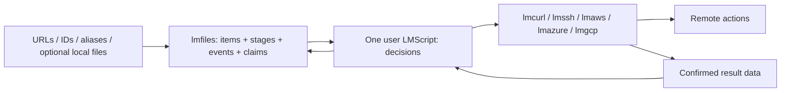

# lmfiles: file lifecycle registry

Implementation: **[lmctl-ai/lmfiles](https://github.com/lmctl-ai/lmfiles)** implements
1A/1B and1C-a: the local registry, journals, optional scan, compact format3 events
and real local lmcurl/lmssh pairings. Existing10k figures are informational only.
**User decision: performance and scale measurement are not planned; correctness
is the bar.** No100M benchmark, large uploads or scale-qualification campaign is a
goal. lmfiles core remains local, Java-only and free of business rules.

The Lead has authorized one narrowly scoped correctness run: released lmaws
v0.1.22, AWS_PROFILE=lmaws only, one lmaws-lmfiles-<runid> bucket in us-east-1,
100 synthetic objects, lmaws_test=<runid>, default$0.05 cap and complete teardown.
This does not authorize other buckets, admin/default writes or other live work.
The release capability preflight currently blocks that run before resource
creation; see lmfiles docs/S3_100_TEST.md. No denial was observed because no AWS
request was attempted. No workflow dispatch or release is part of this task.

This remains the canonical registry design; legacy SYNC_DESIGN.md is a pointer.
Scripts own policy; the registry stores beliefs and never calls a remote.

Contents: [boundary](#definition-and-boundary), [API](#1-core-api-and-neutral-data),
[belief/verification](#2-believed-state-and-verification-scripts),
[optional logs](#3-optional-planresult-log-glue),
[durability](#4-durable-db-and-failure-injection),
[Java stores](#5-java-implementation-and-scale-tier-storage),
[lifecycle jobs and host gaps](#6-lifecycle-jobs-using-existing-products),
[multi-host milestone](#7-one-lmscript-two-hosts-first-milestone),
[functional upload correctness](#8-functional-correctness-bounded-real-upload-pairing),
[implementation](#9-positioning-risks-and-implementation-breakdown).

## Definition and boundary

The confirmed product **lmfiles** is a **file lifecycle registry**, not a directory sync engine.
Alternatives: **lmregistry** (emphasizes generic state, less obviously files) and
**lmtrack** (emphasizes history, less obviously file operations). Those were design-stage naming alternatives; lmfiles is now confirmed. Existing
action products keep their names.

An item can start as a source URL before a local file exists, become a cleaned
artifact, and acquire several publication aliases. A law/case ingestion script
can track millions of such items through its own stages. The registry is a local
model of observations and reported outcomes, including believed remote state;
it is neither a downloader nor an uploader. Directory scan is an **optional
adoption/observation helper**, not the core workflow.

It exposes a Java lmcode host/library for DB access, item/alias and stage queries,
local observations/hashes, event history, claims, recording and optional local
log helpers. It makes **zero remote calls, ever**: no list, remote stat, HEAD,
credential resolution, cloud client or SSH connection. Queries about arbitrary
paths/URLs/IDs never enumerate a remote directory.

**One job is one user-authored LMScript.** It calls lmfiles for state and existing
lmcurl, lmaws or lmssh for actions. The script owns download, clean, publish,
archive and cleanup decisions and reports their outcomes. lmaws keeps its Java/
GraalVM SDK v2 host; lmazure/lmgcp keep theirs. No C++, JNI or external native
component is introduced for the registry. Existing action products are used as
products today, not redesigned here.

| Registry owns | Job script owns | Existing action host owns |
|---|---|---|
| Durable items, aliases, local observations, stage projections, audit events, indexed queries, snapshots, atomic leased claims, optional local logs | Stage names and meaning; pipeline dependencies; retries/skipping gone sources; transforms; local deletion; key mapping; freshness; budgets; verification; retention; invalidation | Explicit HTTP/cloud/SSH actions, credentials, host-key/ownership checks, provider limits, transfer receipts and provider cost ledger |

There is **no config-file-driven rules engine**, automatic upload/delete choice,
record-age warning, quota policy or cloud-specific target validation in lmfiles.
A page may be unchanged for years. Operational tuning parameters (batch size,
store cache, hash mode, scan globs) are ordinary API arguments, not rules that
trigger remote work. Script templates may choose defaults; core does not impose
them. A no-op job can avoid invoking its transfer host entirely. If that host is
invoked, count its security/metadata calls as well as transfers; never market
zero decision requests as zero total requests for a script that chose verification.



## 1. Core API and neutral data

All registry signatures below are **proposed**, not existing bindings. Example
stage names `fetched`, `parsed`, `cleaned`, `published`, `archived`, `deleted` are
user strings: none is built in, ordered, required or interpreted by the core.
An item need not have a file, URL, hash or any stage yet.

### Schema, identity and revisions

Use a dense internal unsigned 64-bit `item_num`, allocated once, stable within a
DB epoch. Public item identity is an opaque string encoding epoch+number; an
optional external UUID/opaque ID maps once to that number. Secondary keys use
varint/delta item numbers, not repeated 128-bit IDs. An alias is `(kind, namespace, value)` such as URL/local
root+path/published key. Its bytes are caller supplied, compared exactly; no URL
canonicalization, path case folding or S3 key rule is hidden in the registry.
The alias index enforces one active item per alias in that namespace. Adding an
alias already owned by another item returns a conflict, never an automatic merge.
Several items may share a content hash; duplicates are not identity. A transform
may update an item or make a derived item with `derived_from` attributes, as the
script decides. Conflicting source URLs should use separate source namespaces or
items if their versions cannot share a coherent content revision.

| Logical record | Lean physical encoding / semantics | Baseline amortized bytes/item |
|---|---|---:|
| Item + observation + five stage summaries | Co-located row; dense item number, revision/stat fields, shared raw-digest reference, packed statuses, latest attempt/last-success refs | 320–420 |
| Three aliases | Interned kind/namespace IDs, prefix-compressed sorted values, delta item IDs; exact alias bytes preserved | 180–240 |
| Six append-only events | Segmented sequence order, delta timestamps/item IDs, interned action/stage IDs, compact sparse metadata/shared blob refs | 190–290 |
| Secondary indexes, pending frontier and dictionaries | Delta postings, hash lookup, sparse frontier; amortized fences/filter/block checksums | 60–100 |
| **Total baseline** | Five stages/six events/three aliases, compact metadata assumptions in section 5 | **750–1,050 B** |

Stage/namespace/slot strings are interned once; 16-bit IDs cover the usual small
catalog, with a versioned varint escape for larger catalogs (never truncate at
65,535). Digests are raw 32-byte SHA-256 in a shared content table, not repeated
hex strings in every stage/event. Stage summaries retain last-success comparison
fields even after explicit event archival. Claims (~48–96 B plus indexes per active
claim) and tombstones (~12–32 B plus identity key) are workload-dependent extras.
These physical byte figures are **unmeasured estimates**, not codec facts or
limits; metadata, event growth, indexes and WAL headroom are detailed in section 5.

Metadata supports ETag, Last-Modified, HTTP status, local artifact alias, remote
ID/version, error text or failure count; the script supplies values. Secrets do
not belong in public fixtures or audit output. Status is a validated **string**
`ok | failed | gone | skipped`, not a DSL enum, and never triggers retry/deletion.
Stage names/namespace/slot are user strings; default slot is empty. An event binds
the exact reported source revision, never success for a later revision. Large
arbitrary values use bounded blobs, whose storage still counts against the configured resource budget.

Completion may include an explicit observed-item update in the same transaction:
compare the pre-fetch revision, allocate a new revision only if content changed,
and bind fetched success to the resulting revision. A transform instead references
its input revision and separately reported output fingerprint. No implicit hashing
or adoption of whatever bytes happen to be at a path during completion.

A stage projection retains both latest attempt and most recent successful event,
so a later failed retry does not erase evidence of an earlier publication.
Keep the last-success source fingerprint/status/revision summary materialized in
the projection even if its full event payload is explicitly archived; archive
availability must not turn a known comparison baseline into a fabricated match.
Queries explicitly choose latest-attempt or last-success; status alone is not
current-revision success. Attributes support JSON scalar values, bytes/blob refs
and bounded maps; indexed scalar fields have explicit type/collation. Unindexed
nested predicates are allowed only as explicitly requested streaming scans.
Tombstoning an item/alias/stage never deletes a file or remote object, nor rewrites
its append-only audit events. No name implies a business transition.

### Typed API: actual lmcode schema types

Use only lmcode scalars (`string`, `int`, `bool`, `float`, `void`), standard
collection handles (`StrList`, `StrMap`, `Json` when useful), and **five** opaque
host handles: Registry, Snapshot, Cursor, WriteBatch, Rows. No value structs,
DSL enums, keyword arguments or typed record literals are required. The context
is **registry**, distinct from local `file_write`/`move_file` operations. JSON
objects described in prose are payload schemas, not new lmcode types.

```text
registry.open(path: string, namespace: string, options_json: string) -> Registry
Registry.close() -> void
Registry.item_upsert(identity_json: string, fields_json: string) -> string
Registry.alias_add(item: string, alias_json: string) -> string
Registry.alias_remove(item: string, alias_json: string) -> string
Registry.observe(item: string, observation_json: string) -> string
Registry.get(ids_json: string, options_json: string) -> Cursor
Registry.query_subset(namespace: string, ids_json: string, options_json: string) -> Cursor
Registry.stage_record(item: string, result_json: string) -> string
Registry.stage_forget(item: string, stage: string, namespace: string, slot: string) -> string
Registry.item_tombstone(item: string, note: string) -> string
Registry.select(query_json: string, options_json: string) -> Cursor
Registry.difference_index(a_json: string, b_json: string, options_json: string) -> string
Registry.stage_difference(a_json: string, b_json: string, options_json: string) -> Cursor
Registry.by_attribute(name: string, predicate_json: string) -> Cursor
Registry.by_hash(algorithm: string, digest: string) -> Cursor
Registry.by_timestamp(field: string, range_json: string, scope_json: string) -> Cursor
Registry.aggregate(query_json: string, groups_json: string, metrics_json: string) -> Cursor
Registry.changes(after: string, filter_json: string, options_json: string) -> Cursor
Registry.claim(selection_json: string, work_namespace: string, count: int,
               lease_ms: int, owner: string) -> Cursor
Registry.renew(token: string, lease_ms: int) -> string
Registry.release(token: string) -> string
Registry.complete(token: string, result_json: string, expected_revision: string) -> string
Registry.scan(root: string, options_json: string) -> Cursor
Registry.scan_paths(source_json: string, options_json: string) -> Cursor
Registry.hash_paths(source_json: string, algorithm: string) -> Cursor
Registry.mark_suspect(ids_json: string, stage: string, namespace: string, note: string) -> string
Registry.set_suspect(ids_json: string, stage: string, namespace: string,
                     value: bool, note: string) -> string
Registry.snapshot() -> Snapshot
Snapshot.select(query_json: string, options_json: string) -> Cursor
Snapshot.close() -> void
Registry.begin() -> WriteBatch
WriteBatch.add(operation_json: string) -> void
WriteBatch.commit() -> string
WriteBatch.rollback() -> void
Registry.import_records(local_source_json: string, options_json: string) -> string
Registry.export_records(output: string, options_json: string) -> string
Registry.explain(query_json: string) -> string
Registry.archive_events(range_json: string, output: string) -> string
Registry.checkpoint(name: string, after: string) -> string
Registry.doctor(options_json: string) -> string
Registry.apply_records(plan_path: string, results_path: string, options_json: string) -> string
registry.unconfirmed(plan_path: string, results_path: string, output: string) -> string
registry.log_append(path: string, line_json: string, options_json: string) -> string
Cursor.next_json(max_rows: int, max_bytes: int) -> string
Cursor.write_jsonl(output: string, max_rows: int, max_bytes: int) -> string
Cursor.rows(max_rows: int, max_bytes: int) -> Rows
Cursor.close() -> void
Rows.len() -> int
Rows.json_at(index: int) -> string
Rows.clear() -> void
```

Scalar receipt returns contain versioned JSON with status/error/sequence data.
Options are a canonical JSON **string**, matching existing lmaws/lmdb patterns;
optional StrMap overloads may cover flat string settings, not replace this
contract. JSON uses explicit `v`, named fields and validated allowed keys, types,
bounds and enum strings. No arbitrary executable predicate is evaluated. Query
JSON is a small declarative relational expression (stage selector, equality/range,
AND/OR, revision equality, set difference), not lifecycle rules or a SQL engine.
Invalid fields/operators return clear schema errors. IDs, revisions, cursor
sequences, large offsets and nanoseconds use decimal strings in JSON to preserve
64-bit precision across LMScript; schema `int` is used for bounded batch counts.

A Cursor streams strings/files; scan/hash cursors carry tagged observation and
terminal scan-receipt rows, not a new ScanRun handle. Bound bytes as well as rows
(default batch 4,096, tunable). Convenience Rows is a reusable host buffer; create
it once per cursor and overwrite/clear pages, invalidate earlier page views, never
create a host object for every item. `next_json`/`write_jsonl` avoids per-row arena
handles entirely. Standard Json/StrMap handles count toward lmcode's 65,536-object
arena; do not parse or allocate one per item indefinitely. Long runs use bounded
strings/files and scoped host invocations if standard handles cannot be reclaimed.
A million-row result is never required in an array or handle graph.

Input `ids_json`/`source_json` is either a bounded inline list or a **local** file
source descriptor with format, encoding and byte limits. Explicit aliases/IDs,
stdin/NUL lists, globs, manifests and unrelated roots all work through adapters;
script code supplies git diff paths. No git invocation or remote URL fetch occurs
in registry. A target is an opaque namespace (HTTP source, S3 prefix, SFTP path or
transform version), not a built-in bucket type. Alias mapping/collisions are user
choices. Old `record`/`forget` path shorthand in log prose means explicit
stage_record/stage_forget for the named item, stage, namespace and revision;
there is no default published stage or implicit transition.

Example **proposed compilable-shaped DSL**, not installed registry code:

```text
let db = registry.open("state.db", "legal-fixture", "{\"v\":1}");
let cursor = db.stage_difference(
  "{\"stage\":\"fetched\",\"namespace\":\"source\",\"status\":\"ok\"}",
  "{\"stage\":\"cleaned\",\"namespace\":\"normalizer-v1\",\"status\":\"ok\"}",
  "{\"require_matching_source_revision\":true,\"index\":\"fetch-clean\",\"require_index\":true}");
let page = cursor.next_json(256, 1048576);
cursor.close();
db.close();
```

### Indexed queries and change cursors

Primary items are ordered by ID; maintain alias, hash and caller-declared scalar
attribute indexes, plus `(stage,namespace,status,item)` membership postings,
`(stage,namespace,item,slot)` projections, successful-source-revision postings,
`(time-field,namespace,timestamp,item)` and ordered event sequence indexes.
Changing a projection updates indexes and appends its event in the same transaction.
Index definitions are data access choices, not lifecycle rules. `explain(query)`
returns chosen index, estimated rows and scan requirement; no silent full scan
for an apparently indexed attribute lookup.

**Steady-state stage difference is a maintained sparse frontier**, not a scan of
100M memberships. The script explicitly calls difference_index with its two
stage selectors, status/projection/revision-equality predicate and chosen ID.
This declares a relational materialized index, not fetched-before-cleaned policy.
Core neither names stages nor dispatches work from frontier membership.

The co-located item row stores compact stage statuses/revision refs; on observe,
stage_record/forget, tombstone or relevant attribute update, one transaction
re-evaluates **only that item's** membership in each affected declared difference
and inserts/removes `(difference_id, shard, item_num)` in its sparse index. Maintain
reverse dependencies from stage/namespace to registered differences. Metadata-only
updates not referenced by a predicate do not dirty it. Source-revision change
re-adds an item even if its old cleaned/published success remains recorded. WAL
recovery, import and compaction preserve frontier and primary state atomically;
doctor can cross-check them. Claims do not remove work; a stage completion does
so only if the script's declared predicate changes.

After initial construction, querying a ready index costs bounded shard seeks plus
**O(|A minus B|)** frontier entries, with storage lookup factors, rather than
O(|A|+|B|). Example 100M fetched, 99,995,000 matching cleaned: read the 5,000 pending
entries, not 200M postings. Initial index/backfill construction is explicitly
O(N); create it once, checkpoint build snapshot+event high-watermark and replay
concurrent deltas before marking ready. `require_index:true` returns
`index-not-ready`/`unsupported-index-predicate` instead of silently rescanning.
Unregistered/ad-hoc differences may explicitly request a streaming merge fallback;
explain reports the full scan. No claim of O(output) for every arbitrary expression.
The script may instead use changes(after) to drive candidates and probe their
co-located stages: O(changed candidates), with its checkpoint/replay discipline.
Recipes b/c use registered frontier IDs; the daily recipe uses change cursors.

Bound the number of declared indexes, account their disk/write amplification and
reject an unsupported expression rather than introducing policy. Exact counts of
materialized membership are transactionally maintained; general grouped aggregates
still stream qualifying postings with external spill when needed. Time ranges are
query parameters, never automatic age rules.

`changes` is ordered committed events with `(db_epoch,sequence)` cursor, never a
wall-clock guess. It returns the last consumed sequence even when a filter matches
no rows. Event sequence, decimal in interchange, is 64-bit within an epoch.
Daily scripts record output plus consumer checkpoint in one transaction, or use
idempotent operation IDs to close their own crash gap. No scheduler is in core.
Append-only events are not silently expired; an **explicit** export/archive request
may move sealed event segments to checksummed local archives. Queries across
archived history require those segments. A cursor below the online low-watermark
returns `cursor-history-unavailable` with archive ranges, never an empty success.
Consumers select their own replay or rebuild procedure. No built-in age rule.

### Comparison semantics

The comparison options JSON names stage, namespace, slot and the exact baseline event or
last-success projection; success comparison never silently uses a failed attempt
as confirmed work. Query compares the latest observation (or caller-provided
subset fingerprint) with the source fingerprint attached to that baseline; it performs no remote I/O and no implicit local tree scan.
The script supplies observations/fingerprints or optionally calls scan/scan_paths
when it wants refreshed local-file observations. URL-only items remain valid;
without a new observed fingerprint their unseen source changes are unknown.
Query returns observed and recorded fingerprints, the selected stage/status, comparison basis (`stat` or
`digest`), hash availability, explicit suspect annotation and record metadata.

| Neutral state | Exact meaning |
|---|---|
| `unknown` | No record, or insufficient local observation to compare; reason distinguishes these cases. It does not assert absence on the remote |
| `same-as-recorded` | The compared local fingerprint agrees with the one the script last recorded, under the disclosed stat/hash basis |
| `changed` | The local comparison differs; if hashing was deferred, this may mean changed stat inputs rather than proven different bytes |
| `recorded-but-missing-locally` | A recorded path has an explicitly observed local absence, from a completed scope scan or scan_paths result |

A scan receipt includes its root, filter/traversal parameters and completed coverage.
Excluded/unvisited paths are not marked absent, and changing include/exclude
parameters is not evidence that previously observed files disappeared.
A path not yet observed is not declared missing. A failed/partial scan exposes its
incomplete scope; set differences cannot describe that unobserved portion as
confirmed absence. The helpers compare local DB sets, not the remote namespace. Old upload-index
policy verdicts such as new/key-conflict/stale are not core states; the script can
distinguish absent-record vs unobserved-local reason data and map them as it wishes.
None of the four states means upload, delete, warn, refuse or rebuild. Even a
`same-as-recorded` file may need a script-chosen action because its desired remote
key or HTTP metadata changed. Conversely `changed` does not require an upload.
A suspect flag is data set by the script, not a fifth policy verdict or a TTL.

### Scan and hash cost

The scan options JSON supplies include/exclude globs, symlink handling, hash algorithm/mode,
worker/batch limits and local scope. Empty filter choices mean no caller filter;
there is no built-in project/deploy exclusion policy. Hash modes are ON_CHANGE,
ON_DEMAND and ALWAYS; size/mtime checks reuse known hashes where applicable.
Record timestamp precision and optional ctime/file identity. If a stat change
hashes to the same content, disclose both facts. Never equate an opaque provider
ETag with a local content hash.

Use bounded per-directory/shard queues, streaming observations and spill files,
not a whole-tree list in memory. Directory mtimes can help detect name changes;
descendant content edits need not alter a parent directory mtime. Do not skip
children on that evidence alone. An optional local watcher is just an observation
accelerator; JDK WatchService can use Linux inotify without a new native binding.
Overflow, a stopped watcher or an interrupted scan is returned as a local
observation gap. The script chooses whether/how to rescan; no cloud verification
or record-age policy follows automatically.

A same-size edit with preserved timestamps can evade stat-based comparison. The
script can request ALWAYS hashing or an immutable source snapshot when that
matters. Re-stat around hashing and report local mutation rather than publishing
a misleading digest. The core does not certify that a later transfer read the
same bytes: the action host must report the actual transferred fingerprint.

### Record and forget

Stage-result JSON (the earlier record-metadata projection) carries an immutable **source fingerprint for the bytes reported
transferred**, an action/event ID and an opaque result payload. It can hold an
ETag/version, remote path, content type, Cache-Control, upload ID, SFTP attributes,
phase/status or arbitrary caller data; core does not interpret these business
fields. A logical action/event may have no source-file fingerprint.

`stage_record` (or its explicit record projection) must not implicitly attach today's local fingerprint to yesterday's
transfer. Callers pass the plan/source snapshot or actual transferred hash. If a
file changed while/after uploading, a subsequent scan must still compare against
the bytes actually reported uploaded. `forget` removes believed state via a local
transaction/tombstone; it never deletes a remote path. The caller is free to
record or forget directly without any plan/log mechanism.

## 2. Believed state and verification scripts

Outside changes are invisible until a script chooses to check. Age alone does
not make a record suspect, and opening/querying never calls the remote. A DB can
faithfully preserve a mistaken user report; it cannot independently certify a
remote effect. Document these limits instead of implying a local remote oracle.

A verification script chooses N recorded paths, calls lmaws HEAD (or another
host's equivalent), compares returned data using its own policy, then explicitly
marks suspect, records revised metadata, forgets or does nothing. Sampling rate,
selection seed, cost cap, checksums and behavior on mismatch all belong to that
script. A failed sample cannot certify unsampled paths. Multipart/composite ETags,
metadata changes and encrypted objects need explicit interpretation by the host/
script, not a content-equivalence rule hidden in lmfiles.

A rebuild script can fetch a listing, S3 Inventory or other records with its cloud
host, then call import_records on a **local** stream. lmfiles never fetches a URL or
creates Inventory. The script chooses prefix fan-out/concurrency, coverage,
pricing/admission, validation and whether to replace or merge a target snapshot.
The import options JSON provides mechanical append/upsert/replace and transaction choices;
a replace is local state replacement, not remote deletion. Preserve import
provenance in caller metadata. A listing does not necessarily recover source paths
through a non-invertible flatten/custom mapping, and Inventory may not contain
custom metadata or checksum values. Unknown information stays unknown.

No watcher detects outside remote edits. Multiple machines can hold different
beliefs; any remote coordination/leases or conditional-write policy belongs in
the job and action host. Local single-writer locking only protects this DB.

## 3. Optional plan/result log glue

This is a **thin file codec/helper library**, not a mandatory workflow, scheduler
or executor. A script may use direct record() calls instead. A plan is data the
script wrote; lmfiles never synthesizes upload/delete instructions from a state.

Proposed local helpers use the scalar/opaque types above: log_append writes a
validated instruction/result line, unconfirmed(plan_path,results_path,output)
streams a remainder file, and Registry.apply_records(plan_path,results_path,
options_json) is the typed binding for conceptual **apply_records(db, plan, results)**.
Bounded file readers reuse Cursor/Rows rather than adding writer/receipt structs.
The last helper requires the immutable plan and verifies every result's job/op
membership and full instruction digest **before applying** explicit record/forget
projections supplied by the script. Reject out-of-plan operations, a mismatched
plan digest, and conflicting completing projections for one operation; identical
replays remain idempotent. It never accepts a result just because its own CRC is
valid. Index plans by op using bounded disk storage for millions of instructions. It does not infer a projection from a verb such as `delete` or `invalidate`.
All readers/writers stream in bounded batches and return data/receipts.

### Wire grammar

Versioned UTF-8 JSON Lines; one compact object per line, LF terminator. Strings
use JSON escaping, so spaces, quotes, tabs, backslashes and embedded newlines in
path names are unambiguous. Never use whitespace-separated shell instructions or
shell interpolation. Hard maximum is **64 KiB including LF per managed line**;
reject an oversized line while reading, before unbounded allocation. Large
payloads refer to a local blob plus digest and explicit size cap.

Path-valued fields use a tagged lossless `PathBytes` JSON convention: either
`{"utf8":"..."}` for valid UTF-8 or `{"base64":"..."}` for original POSIX bytes.
Exactly one member is allowed; strict canonical Base64, no lossy Unicode
replacement, no normalization/case folding. Canonical encoding chooses UTF-8 iff
valid; checksums/digests bind this tagged representation. Example byte 0xff:
`{"base64":"/w=="}`. Legacy string paths in the readable examples mean valid UTF-8
and are normalized to this tagged form by the codec before hashing. Reject NUL;
Windows paths need a separate versioned UTF-16 code-unit tag if unpaired surrogates
must be preserved. JSON transport capability does not imply every action host can
accept those names: fail explicitly on unsupported encodings, never silently
convert to U+FFFD. Java NIO's public path API also cannot generally round-trip raw
non-UTF-8 POSIX bytes: retain/query/import those aliases losslessly, but refuse
unsupported local scan/open operations. Raw-byte traversal is a documented local
I/O qualification gap under Java-only/no-JNI, not permission to corrupt paths. Store nanosecond timestamps, byte counters/IDs that may
exceed JavaScript's exact integer range as decimal strings. Timestamps are UTC
RFC3339 data, not expiration instructions.

Each managed line has `v`, `kind`, `job`, `op`, `payload` and a checksum. Result
lines additionally have an immutable `result_id` and explicit
`completes_instruction` boolean; separate accepted/completed/progress projections
can share an instruction op but use different result IDs. The helper
uses its versioned canonical JSON encoding of payload for CRC32C and instruction
SHA-256; all hosts share the codec conformance fixtures. Logs from external tools
may be imported explicitly, but are not silently treated as managed crash receipts.
The examples below omit computed checksums for readability; actual helper output
includes them and each result binds the full instruction digest.

```json
{"v":1,"kind":"instruction","job":"example","op":"add-a","payload":{"verb":"add","stage":"published","target":"site","item":"<item-id>","source_revision":"7","path":"assets/a b \"quoted\".css","source_fingerprint":{"size":"3","mtime_ns":"<decimal-int64>","hash":"<digest>"},"args":{"remote_path":"assets/a.css"},"record_projection":"record"}}
{"v":1,"kind":"instruction","job":"example","op":"delete-b","payload":{"verb":"delete","target":"site","path":"old.css","args":{"remote_path":"old.css"},"record_projection":"forget"}}
{"v":1,"kind":"instruction","job":"example","op":"event-c","payload":{"verb":"cloudfront.invalidate","target":"events","path":"invalidation/event-c","args":{"paths":["/*"]},"record_projection":"record"}}
{"v":1,"kind":"result","job":"example","op":"add-a","result_id":"add-a-complete","completes_instruction":true,"payload":{"instruction_digest":"<sha256>","confirmed":true,"timestamp":"2026-01-01T00:00:00Z","projection":{"kind":"record","stage":"published","target":"site","item":"<item-id>","source_revision":"7","path":"assets/a b \"quoted\".css","source_fingerprint":{"hash":"<actually-transferred-digest>"},"metadata":{"remote_path":"assets/a.css","phase":"uploaded","etag":"<opaque>"}}}}
```

`verb` is an arbitrary caller string; `args` and result metadata are caller data.
The projection primitives are local `record`/`stage_record`, `forget`/`stage_forget`
or `none`; item/alias/observation updates must be explicit in a versioned
transaction projection. `record` uses a caller-supplied item, stage, namespace and
source revision (the path shorthand below is only an identity adapter). Metadata
can describe an accepted/pending remote action if that is what the script reports;
it must not thereby be presented as completed publication. Job/op identifiers and
instruction digest detect conflicting reuse. Replaying the same confirmed `(job,result_id)` is idempotent; a different
payload for that same result ID is an integrity conflict. Only the caller's
explicit completes_instruction marker removes an instruction from the unconfirmed
set. Progress/event data need not imply a fully uploaded file. A transaction commits its result-log replay offset and record changes
together, so a crash cannot skip a result or double-apply it.

A writer fsyncs complete confirmed results before declaring them durable. It may
group N results/bytes or a bounded interval in one fsync; emit durable acknowledgments
only after the group flush succeeds. An unflushed group has no durable acknowledgment and may be lost on crash.
Recovery may replay complete validated surviving receipts, even if the caller
never received an acknowledgment; operation/result IDs make that safe. Never
infer confirmation from a partial line. Replay offsets commit with DB projections,
and the writer advertises a durable high-watermark only after successful flush.
This is local durability tuning, not automatic remote scheduling.
A torn final line is retained/ignored as unconfirmed and can be truncated only to
the last verified line boundary. Corruption in a middle line is an error, not an
excuse to skip later results. Plan files commit atomically; appending to a journal
is single-writer. The helper never executes any verb or invokes a provider.

### Resume and the confirmation gap

Resume means the script re-plans the unconfirmed remainder. Completed results
replay into the DB even if the process died before its DB update. A transfer that
completed remotely but crashed **before** producing a durable confirmation remains
unconfirmed: lmfiles cannot infer success without a report. Its instruction is not
lost, and the script can safely retry with provider idempotency/conditional writes
or explicitly reconcile the known path. It may repeat transfer work or cost.

Scripts should store multipart/progress events without a completed-file source
fingerprint until they actually report that full-file success. The core does not
interpret phase strings.

The invariant is no lost **durably reported** success and no false unchanged
inferred from intent, a start record, file existence or a partial line. Exactly-once
remote effects across a process/network/filesystem crash are not promised. A
script that reports an incorrect result can corrupt its own belief; the library
must not manufacture confirmation. Changed local sources are re-planned rather
than marked uploaded with a newly observed fingerprint. Optional log glue is not
required for small direct-call jobs, but those jobs accept a larger confirmation
window unless the action host emits its own durable result receipt.

## 4. Durable DB and failure injection

Logical records are the item/alias/observation/stage/event/claim schema in section 1,
plus indexes, import provenance, generations, transaction IDs, replay IDs/offsets
and consumer checkpoints. Keep observations separate from reported stage results:
a scan cannot overwrite fetched/cleaned/published history. Hash lookup is generic;
provider key-mapping logic, quota policies and release catalogs are script data,
not core business tables.

Use transactional/WAL storage, checksummed pages/records, monotonic committed
sequence numbers and versioned codecs. On open, validate the manifest, recover
committed WAL transactions, discard only incomplete tail records and report
structural corruption. Do not silently open an empty DB or forget records when a
file is corrupt. Compaction writes/fsyncs a new generation, atomically commits its
manifest and only then releases old unpinned files. Compaction drops superseded
records/tombstones only when snapshots no longer need them; it never expires a
path because of age. Export/backup produces a consistent checksummed snapshot;
import validates it into a staging generation before an explicit local commit.

### One writer, many workers and processes

Primary mode is one registry host invocation per bounded batch: state -> transfer
-> record, with no per-item IPC. Recommend **one DB writer with transactional
batching**, not independently opened
multi-writer embedded stores. The owner process serializes short mutation batches;
parallel action workers never hold a DB transaction across HTTP/SSH/CPU work.
Same-process clients call its writer queue; several processes connect through an
OS-local filesystem mailbox under the private DB directory: bounded request and
response files, written to temporary names then atomically renamed, with operation
IDs and checksums. No socket/TCP listener, remote RPC or native pipe binding is
needed. This is an optional mode of the Java registry host, not another native
component. Restrict directory permissions to the owner, reject symlink traversal,
use backpressure/bounded polling and fsync before acknowledging. Keep completed
request IDs durably deduplicated before reclaiming reply files. Use coarse32–256-item request batches as the template default; verify durable
ordering and deduplication without timing or throughput studies. A later OS-local IPC
optimization must preserve this protocol and qualify platform support.
Clients retry uncertain requests with the same operation ID. Embedded mode remains
useful for one process; second direct writers get `writer-busy`, not corruption.
If the owner dies, clients reconnect after a new owner acquires the OS lock and
recovers WAL. No claim success is acknowledged from a merely queued request.

Writer uses an OS file lock plus diagnostic PID/process-start/instance data. Only
acquiring the real lock permits stale metadata recovery; never unlink/recreate a
live locked file or steal a live lock by timeout. Refuse filesystems lacking the
required lock/rename/fsync guarantees. Snapshot readers run in the owner process
or consume pinned immutable exports; do not promise independent live MVStore opens
across processes. Mailbox clients request paged snapshot reads, not DB-file access.
Reader pins release only after outstanding reads cease and client-liveness
reconciliation confirms the snapshot is no longer in use; compaction
cannot delete a still-used generation. Backpressure bounds queues/read snapshots.

Claims select N unclaimed candidates and commit tokens in **one transaction**.
Work namespace is user supplied, so unrelated tasks may claim the same item
independently. Claim tokens contain monotonically increasing fencing generation,
item/source revision and lease deadline. Renew/release/complete compare the token
atomically; complete appends the stage event, updates indexes and releases the
claim together. The caller chooses selection, count and positive lease duration;
expiry makes a claim eligible, not an automatic transfer/retry. Claims are
coordination data, not a built-in work scheduler or lifecycle pipeline.

Use a monotonic clock while the owner lives, durable UTC expiry plus owner epoch
for recovery. On restart/clock discontinuity, conservatively block ambiguous
unexpired leases until their bounded remaining duration or an explicit recovery
request; expose clock uncertainty and never silently steal work on a wall-clock
jump. Reissued tokens always fence old owners. The library can reject a late
complete after expiry/reclaim; it cannot fence a remote upload already executing.
Scripts use provider preconditions/idempotency where needed and do not claim
exactly-once effects. Expired/fenced complete returns distinct `fenced-or-expired` status, with no
projection update. Only an explicit historical-audit option appends the factual
old-revision receipt; it cannot replace a newer last-success projection.
Revision mismatch returns conflict; no false success for newly changed content.

`parallel_map(batch, work, limit)` is the intended one-LMScript worker shape:
pass owned item/token data, create action-host resources inside each task, close
them there and return own-data receipts only. **The inspected local lmscript
checkout currently supports only literal `parallel([call(), ...])`, not
parallel_map.** Small runner addition needed: `parallel_map(items, fn, limit)`
with ordered results, bounded concurrency, all tasks settled before first error
by input order, and existing own-data/resource/task rules. Until available use
fixed-width literal parallel batches; neither registry nor transports need a new
parallel-download engine. Separate processes use the same claim primitive through
the local owner. Re-audit the installed staging runtime before implementation.

Doctor reports local checksum/manifest/sequence/index consistency, dangling
references, transaction/replay integrity and storage statistics. It performs no
HEAD, rebuild or provider verification, and returns data for the script to handle.
Opening old-format data requires a versioned migration, not automatic semantic
policy changes. Memory, disk space, file offsets and malformed-input limits are
implementation/resource constraints, not upload/delete policy.

A deterministic kill-point harness will exercise these boundaries:

| Kill/fault point | Required observation after reopen |
|---|---|
| After plan commit, before any transfer | DB unchanged; all instructions unconfirmed |
| Mid-transfer/part | No completed record; script can use stored opaque provider resume data or retry |
| After remote transfer, before result append | Unconfirmed intent retained; no fabricated same-as-recorded |
| After fsynced result, before DB record | Replay restores exactly that reported source snapshot/result |
| During DB transaction/replay-offset commit | Both record and offset commit, or neither |
| Mid-compaction/manifest swap | Last complete committed generation remains readable |
| Disk full / failed fsync | No success acknowledgment for an undurable transaction |
| Truncated last log line | Previous verified receipts replay; last operation stays unconfirmed |
| Corrupt middle log/page/index record | Doctor/open reports corruption; no silent row loss |
| Stale lock metadata / crashed writer | OS lock can be reacquired safely; live locks cannot be stolen |
| Reader crash / active snapshot during compaction | No use-after-delete; obsolete files reclaimed only after pin release |
| Two workers/processes claim overlapping candidates | Exactly one live token per work namespace/item; batched event+claim completion is atomic |
| Owner crash after claim fsync, before reply | Same operation ID returns committed claim; no second grant |
| Lease expiry, stale completion, source revision change | Old token cannot overwrite newer success; historical result stays tied to old revision |
| Clock jump/reboot, worker dies mid-transfer | Conservative lease recovery; no invented result or exactly-once claim |
| Consumer crash around cursor checkpoint | Atomic stage/checkpoint or deduplicated replay; no silently skipped events |
| Stage/alias/attribute/frontier-index corruption | Doctor detects mismatch to primary records; no silent anti-join omission |
| Out-of-plan result, wrong instruction digest, two conflicting completion IDs | apply_records rejects before projection mutation; identical retries deduplicate |
| Non-UTF-8 path, oversize line, invalid Base64 | Exact byte identity preserved or explicit unsupported/error; no replacement-character paths |
| Batched journal fsync fails | No durable group acknowledgement/checkpoint; complete prior groups survive |

Compare recovered state to an independent model oracle at every kill point.
Test large offsets, empty DB, duplicate/conflicting operation IDs, arbitrary path
quoting, many targets and millions of streamed rows in JVM and native-image runs.

## 5. Java implementation and scale-tier storage

Implement lmfiles as a Java lmcode host with JDK local I/O/hash primitives. GraalVM
native-image remains the deployment route; no AWS SDK, SSH client or cloud ledger
belongs in its dependency graph. TransferManager is an **lmaws** concern. No new C++
or external native state component is selected for lmfiles, and there is no JNI
fallback. Existing lmcurl/lmssh/lmaws keep their own implementations; this
design adds no transport dependency to the registry.

| Store | Primary-source evidence / uncertainty | Recommendation |
|---|---|---|
| Direct H2 MVStore | Argon2 reports H2/MVStore native-image working on all five lmdb targets with AWT metadata excluded and supplied reflection config; registry workload still unqualified | Recommended first store, explicit byte codecs and positional file I/O; preserve correctness before considering custom runs |
| Custom sorted runs + sparse fences + Bloom filters | Implementable with Java NIO; immutable generations, WAL and compaction are our engineering responsibility | Recommended 100M/1B path; small-tier fallback/common export format |
| iq80 Java LevelDB / embedded LSM | Java port with batches/snapshots/cache controls; reviewed README describes limited testing, and no representative native-image qualification was found | Unselected implementation alternative, not an assumed production dependency |
| MapDB | JVM file-backed collections; exact dependency/reachability/durability behavior needs testing | Optional candidate; no unmeasured native-image claim |
| Xerial SQLite JDBC | Native-image support exists, but SQLite is loaded from platform native libraries through JNI | Not compatible with this brief's Java-only/no-JNI requirement |
| RocksDB JNI | Adds native libraries and per-platform JNI packaging/testing | Not needed by the proposed Java design; only reconsider with explicit new user direction if every viable Java approach fails |

Sources: [MVStore](https://h2database.github.io/html/mvstore.html),
[iq80](https://github.com/dain/leveldb), [MapDB](https://mapdb.org/doc/),
[SQLite JDBC](https://github.com/xerial/sqlite-jdbc), plus sibling `lmdb` native-image configs (`--exclude-config` on H2 AWT metadata).
Argon2's review records H2 2.3.232/MVStore working in lmdb native-image on all
five targets. Local `../lmdb/pom.xml` excludes H2's generic
`META-INF/native-image/reflect-config.json` (AWT/Toolkit reachability), uses
`-H:AbortOnTypeReachable=java.awt.Toolkit`, and supplies
`../lmdb/src/main/resources/META-INF/native-image/ai.lmctl/lmdb-h2/reflect-config.json`
with MetaType/FilePath providers. This is useful existing-product evidence,
**not a new five-platform test or proof of registry-scale crash safety**. Reuse and
minimize that reachability config, qualify the registry's actual codecs/recovery;
do not copy SQL/network providers wholesale. Custom Java NIO primitives working
in lmdb/lmaws likewise do not certify a not-yet-built sorted-store implementation.

**No mmap** for data/index/filter/WAL under `-R:ReservedAddressSpaceSize=4g` and the
6 GiB virtual-address test ceiling. Use `FileChannel.read(buffer,position)` /
`write(buffer,position)` (pread/pwrite semantics), bounded buffers and caches.
Explicitly disable mapped H2 backends (`nioMapped`/FilePathNioMapped); mere presence
in a reflection config is not permission to use them. Verify no file-backed maps
in the actual native binary under the address-space limit. Huge disk capacity
must not imply huge mapped address space. No dependency is added by this design.

### Lean scale model with stages and audit history

Argon2's historical **750–1,050 B/item estimate** described a lean synthetic
profile; it is informational, not a planned measurement or acceptance target: three shared-prefix aliases averaging 96 uncompressed bytes, one local
observation, five co-located stage summaries, six compact events, SHA-256 stored
once per distinct content revision, and a small declared attribute/frontier index
set. Intern stage/namespace/slot IDs, use dense item numbers, raw digests, block
prefix compression and delta-varint postings; do not serialize repeated JSON
payloads into every row. Sparse repeated metadata is dictionary/shared-blob
referenced with all backing bytes included. Section 1 totals:
320–420 + 180–240 + 190–290 + 60–100 = **750–1,050 B/item**. A central model is
370 + 210 + 240 + 80 = **900 B/item** (decimal bytes, not KiB).

This is a **different metadata assumption** from the previous 128 B of unique
metadata per stage plus 96 B per event. Those unique values alone total
5×128 + 6×96 = **1,216 B/item**, before identities/aliases/indexes, so the same
arbitrary payload workload cannot fit a universal 1,050 B limit by interning keys.
Benchmark both lean and metadata-heavy profiles; add actual unique blob payload
bytes and their index overhead to the lean estimate. Retained events grow
without bound unless the script explicitly archives them. Each extra compact
event is roughly 32–48 B plus unique payload/index bytes; extra stage summary
~24–40 B plus metadata, alias ~60–80 B average after shared-prefix compression.
Long unrelated URLs, high-entropy errors/digests, many revisions/indexes and
failed retries can greatly exceed these averages. No silent metadata truncation
or event dropping is permitted to meet a size target.

| Tier (items) | Store recommendation | Lean estimated live disk | Working-memory ceiling | Historical estimates, not acceptance targets |
|---|---|---:|---:|---|
| <=1M | H2 MVStore with compact byte rows | 0.75–1.05 GB | 128–256 MiB | No performance target |
| <=100M | Current qualified MVStore; alternate store only for a demonstrated correctness need | 75–105 GB | 512–768 MiB | No performance target |
| <=1B | Unselected bounded Java sorted-partition option | 750–1,050 GB | <=1,024 MiB | No performance target |

These compact targets include the section 1 baseline indexes and only a small
number of sparse difference frontiers; account conceptually for per-index and
history-growth costs. Reserve **2x live disk** for compaction plus WAL, snapshots,
exports and unique metadata: 100M lean ~150–210 GB before those extras, 1B lean
~1.5–2.1 TB. MVStore page overhead and write amplification are not known to match
the sorted-run arithmetic. These estimates are not planned measurements or qualified tier capacities.
Keep filters/fences on disk with bounded cache, not all in RAM; Bloom positives
always compare full keys. Resource bounds remain explicit; no RSS or throughput study is planned.

Frontier correctness acceptance uses small synthetic fixtures: compare registered
A-not-B results against an independent oracle, including revisions, late receipts,
failed attempts and tombstones. Sparse frontiers remain the implementation, but
no timing, I/O-throughput or large-population acceptance target is planned.

Cap memtable, block/filter caches, open shards/files and compaction workers through
plain resource options. Use checksummed blocks, explicit encodings, bounded merge
buffers, 64-bit offsets and versioned manifests. These limits bound local resources;
they never decide which remote action a script should take. Migration is a
streaming local operation retaining the prior generation until commit. Qualify
Linux x64 dynamic-glibc native images first, then macOS and Windows; retain the
existing Java cloud hosts. If Java options fail, present actual evidence and
native/JNI package-size, platform and maintenance costs before any new decision.
Do not assert RocksDB is necessary while a viable Java sorted-store design exists.

## 6. Lifecycle jobs using existing products

### Eight lifecycle recipes: one file per job

These are **full-lifecycle design sketches**. The implemented 1A/1B schema and
six runnable examples are in lmfiles; the eight broader workflows below include
deferred 1C calls. Each future `.lms` contains its orchestration, CONFIG
constants and product-specific `_lmcode_` blocks; it may import helpers but never
requires an invisible scheduler. Registry pseudocode below uses the proposed API;
the existing transfer signatures are audited in the pairing sections below.
All committed fixtures/pictures are synthetic. No live job or picture generation
is performed by this documentation task.

Each recipe gets `examples/<name>.lms`, a synthetic image and a picture-first
caption `lmctl https://raw.githubusercontent.com/lmctl-ai/lmfiles/main/examples/<name>.lms`
when that particular example is implemented. The eight planned names below are
not promises of currently runnable URLs; use the product README for current jobs. Captions explain inputs, outputs, stage
names and cost assumptions. Never commit real legal-source/account/host data or
credentials. Images show counts/state flow, with the action-host estimated cost
line for billable scripts; the registry has no cloud-price ledger.

| Recipe | Input -> output | Planned synthetic picture |
|---|---|---|
| `ingest_urls.lms` | URL list -> observed artifacts + fetched/gone/failed reports | URL/304/200/404 counts and recorded-stage flow |
| `clean_fetched.lms` | Fetched revision without matching clean revision -> derived artifact | Before/after synthetic text and revision links |
| `publish_cleaned.lms` | Cleaned artifacts -> S3 reported publication + result journal | Selected/confirmed/unconfirmed upload flow |
| `lifecycle_report.lms` | Snapshot queries -> JSON/CSV | Published-but-source-changed, fetched-not-published, failure/gone table |
| `cleanup_published.lms` | Explicit script-selected local artifacts -> deletion receipts | Local bytes removed vs retained, remote untouched |
| `daily_incremental.lms` | Event cursor -> affected-item processing/checkpoint | Event N -> N+K, deduplicated work and checkpoint |
| `publish_sftp.lms` | Selected artifacts -> SFTP temp/final receipts | Known-hosts + selected paths + confirmed rename |
| `spotcheck_published.lms` | N chosen publication records -> suspect annotations | Sampled/matched/mismatched/unknown counts |

**(a) Ingest URL list, conditional download and record fetched.** Adopt each URL
as an alias to an item, initially without a local path; URL identity alone is
sufficient. Query latest fetched attempt/last success in namespace chosen by this
script. Script policy: skip a previously recorded gone/404 unless its own explicit
retry option is set; use validators only when it still has a verified local copy.
This is why recording gone avoids needless re-requests without making that a core
rule. Failure count is caller data, updated with a compare-and-swap transaction
or claim, never a registry retry counter policy.

```text
# Proposed registry pseudocode inside this ONE job's orchestration:
items = db.item_upsert(each URL alias from bounded input batch)
claims = db.claim(script_selected(items), "fetch-job", 32, 120000, worker_id)
receipts = parallel_map(claims, fetch_batch, 8)   # runner addition noted in section 4
# Each worker handles a bounded manifest in one lmcurl process/session, not one
# process per URL. A transport-failure-tolerant batch needs the non-throwing
# option being added by Argon2; see the exact gap below. Return own-data only.
for receipt in receipts:
    db.complete(receipt.token, script_constructed_stage_result, expected_revision)
```

Current lmcurl calls (including the failure limitation below) are `curl.session(base).get(path)`, optional
`.header("If-None-Match", etag)` or `.header("If-Modified-Since", last_modified)`,
`.timeout(...)`, `.limit(...)`, `.retry(count,delay)`, `.send()`, then response
`.status()/.error()/.header(...)` and `.save(path)`. A 200 plus verified complete
artifact yields observed hash/size/local alias and `fetched/ok`; a 304 preserves
the validated existing bytes, not a fabricated new download. 404/410 yields
`fetched/gone` with HTTP status, URL, validators if returned and reported timestamp;
HTTP-level failures can record `failed`, bounded error and script-updated
failure count. **Transport failure currently throws from send(), aborting the
host before any Response exists.** The outer script checks exit status and marks
unconfirmed manifest entries failed/unknown from its own process receipt; it must
not read missing or stale status files as successes. Use unique attempt paths.
Argon2 is adding a non-throwing request option; only after schema/behavior checks
may a session loop continue across transport failures and write per-URL receipts.
If local copy is absent, script does unconditional GET instead of treating 304 as
proof a file exists. Never store a partial response as fetched/ok. Raw binary/large
artifacts need only the `download_to_file` addition below; bounded synthetic text
uses the existing redacting sink and hashes the bytes it actually saved.
Partial offset/validator state can be another caller stage/slot; Range/If-Range
headers exist, and no resume or skip decision is in core.

**(b) Clean fetched items.** Register `fetch-clean` difference once (explicit
source/transform namespaces, status ok and matching source revision); select its
ready sparse frontier via stage_difference with require_index. No full-stage
anti-join is performed on steady-state runs. Claim a bounded
batch under a separate work namespace. User code parses/normalizes synthetic
text (or invokes an existing parsing host) and writes a temporary local artifact,
then promotes it with existing LMScript `move_file`. It records cleaned/ok with
input revision/hash, transform ID, output alias/hash and actual size; failed
transform records failed without erasing the prior successful output. In-place
transforms increment content revision; retaining both raw and cleaned content
uses a derived item with `derived_from` ID+revision. Neither approach is built in.
The script must choose a consistent artifact model in its CONFIG. Claim complete
compares expected input revision, so late work cannot certify newly changed input.
No registry clean/delete-files call exists.

**(c) Publish cleaned items with optional plan/result logs.** Register/select the explicit `clean-publish` sparse difference frontier for
cleaned-ok revision minus matching published-ok in the S3 namespace. Script maps
keys and headers, enforces lmaws name/tag/ledger caps, writes a checksummed plan
with item ID, source revision, artifact hash, stage/namespace and desired result
projection. It runs lmaws for only those entries, appends/fsyncs each confirmed
receipt, then applies stage_record projections plus replay offset transactionally.
No confirmed log -> no published/ok. Crash resume re-plans the unconfirmed remainder;
remote success before a durable receipt may repeat work, never invent success.
The bounded current-host demo uses `Run.bucket/put/cleanup` with string fixtures;
persistent arbitrary-file publication is explicitly blocked on the small
`s3_put_file` binding below. Journal `record` projections are explicit
`stage_record(published, target, item, source_revision, metadata)` here; user verbs
never select a stage automatically. Recording cleanup/forget for the sandbox is
separate from its publication receipt. No real S3 operation is run now.

**(d) Lifecycle report.** A single snapshot produces JSON/CSV and a synthetic table:

The report's predicates are canonical query JSON passed to select/aggregate,
not inline join syntax or named arguments inside `_lmcode_`:

```json
{"v":1,"op":"compare_revision","left":{"stage":"published","projection":"last_success"},"right":{"field":"item.content_revision"},"comparison":"not_equal"}
{"v":1,"op":"stage_difference","a":{"stage":"fetched","status":"ok","namespace":"source"},"b":{"stage":"published","status":"ok","namespace":"site"},"require_matching_source_revision":true,"index":"fetch-publish","require_index":true}
{"v":1,"op":"aggregate","where":{"projection":"latest_attempt","status_in":["failed","gone"]},"group_by":["stage","namespace","status"],"metrics":["count"]}
```

Those are explicit relational predicates, not hard-coded report functions.
Derived outputs compare the stored provenance input revision with their source
item instead of comparing unrelated raw/cleaned hashes. A failed publication retry
may leave a valid earlier publication; report latest attempt and last success
separately. A database report does not claim remote existence or freshness.

**(e) Cleanup local downloads already published.** User script chooses published-ok
records with a matching source/output revision and acceptable local path scope,
then explicitly deletes selected local files using its local filesystem API.
After confirmed deletion it calls observe(absent) and records its own
`local-cleanup/ok` (or `deleted/ok`) stage with removed alias/fingerprint. A failure
records failed. It does not forget the source URL, fetched history, publication or
gone state. Choice to retain raw input, require backup or delay cleanup belongs
entirely to that script. Claiming coordinates cooperating workers only; re-stat
before deletion and reject changed paths. No portable deletion CAS is promised
against an unrelated writer; immutable per-revision paths/local writer exclusion
are script requirements when that risk matters. Registry never deletes files.

**(f) Daily incremental job from change cursor.** This one script requests bounded
`changes(after=consumer_cursor)` batches, coalesces affected item IDs only within
the batch, queries their current stages and runs its chosen fetch/clean/publish
steps using the same action blocks. It tracks origin/operation IDs so its own
recorded events do not cause an infinite reprocessing loop. It commits checkpoints
only after durable outcome recording (including explicit failed outcomes if that
script elects to move on), with dedup IDs for replay. A crash before checkpoint
repeats harmless local selection; a cursor-history-unavailable result requires an
explicit script-chosen archive replay or snapshot rebuild. Running every day is
an external scheduling decision; the registry has no timer or age predicate.

**(g) SFTP publish (and download variant).** Query/claim selected item revisions,
then use the existing lmssh `ssh.known_hosts(...).strict_host_key("yes")`,
`.identity(key_path).reuse(true).connect(alias)`, `Session.put(local,temp)` and
`Session.rename(temp,final)`; record published/ok only after success. For selected
downloads use `Session.get(remote,temp)` then local `move_file` and record fetched.
`Session.sftp(batch)` supports explicit `reput/reget` partial resume today. Persist
source/prefix assumptions and partial paths as metadata; restart if those cannot
be trusted. Temp parents come from explicit mkdir operations, no directory listing
or remote checksum comparison. A resume may perform protocol attribute work, not
a directory diff. Close each task's Session; credentials never appear in events.
No new lmssh transport is needed for this sketch; require its path-safety fix.

**(h) Spot-check script.** The script chooses N random published records (seed and
sampling policy explicit), invokes lmaws per-object HEAD, compares expected
metadata/version/hash using its own rule, then mark_suspect or records revised
metadata. A mismatch, transport denial and unknown checksum are different reports;
unsampled items remain unverified. Registry doctor is not this script. Exact HEAD
binding missing today is named below; fake receipts prove the workflow first.

The existing TTL/hashed/release and invalidation recipes below remain useful
**publication policies** inside such scripts. They do not become required stages,
a core configuration engine or a reason to re-query a remote on every run.

### Current transfer-call audit supporting those recipes

**lmcurl, lmssh and lmaws already exist.** Only the registry is the new product.
One job is one `.lms` containing its choices and typed calls to the registry and
an existing action host. Do not build another downloader, uploader or SSH transport
inside lmfiles. No libssh2-enablement or Java-SSH proposal is part of this design.

The API audit used each product's current README, durable-memory API notes,
schema/registry and existing examples. Local source references were lmcurl
`8e65448` and lmssh `68e6159`; lmaws was the current main worktree and its checked
schema. Five action-host example blocks below were checked against schemas
printed by the local executables (`lmcurl`, `lmssh`, `lmaws`); only compile/check
was performed, never the block bodies. Metadata-only `--help`/schema queries were
used where useful; no HTTP request, SSH session or AWS action was run. Native
binaries and source can differ, so future examples bind to their executable's
schema with `cli=...`; the existing examples below are concrete reference points.

Demo/dry-run output is not confirmation of a real action. Jobs use separate
synthetic target namespaces for fixtures and never record a dry-run's apparent
success into production belief. The script knows whether it requested a preview;
core does not infer provider mode or grant a report more authority.

The full registry API below remains a design superset; see lmfiles docs/API.md
for the implemented 1A/1B subset. Every action-host method shown
as available below is a current method. A narrowly missing call is listed once in
“small additions needed”; the examples must disclose that blocker rather than
pretend a proposed API already exists. These are design examples, not new runnable
job files in this change.

### A. DOWNLOAD MANAGER — registry + lmcurl

`download_http.lms` reads its chosen URL/path manifest and registry data, skips a
trusted complete local copy, and otherwise uses existing lmcurl requests. The
script owns ETag/Last-Modified revalidation, retries, parallelism, gone handling
and when to request anything again. Zero re-requests means skipped trusted items;
a conditional GET returning 304 still counts as one request. Outside changes are
invisible when the script chooses not to revalidate.

Current lmcurl calls for a bounded public-text fixture, inside this one job:

```text
let request_program = _lmcode_ cli="lmcurl";
let s = curl.session(${BASE_URL});
let request = s.get(${URL_PATH}).timeout(10000).limit(1048576).retry(3, 500);
if (${RECORDED_ETAG} != "") {
  request = request.header("If-None-Match", ${RECORDED_ETAG});
} else {
  if (${RECORDED_LAST_MODIFIED} != "") {
    request = request.header("If-Modified-Since", ${RECORDED_LAST_MODIFIED});
  }
}
# Current send throws on transport failure: outer system() must handle exit 3.
# This is a one-request API illustration, not a million-URL execution plan.
let response = request.send();
if (response.error() == "" && response.status() == 200) {
  response.save(${PART_PATH});
}
file_write(${STATUS_PATH}, str(response.status()));
# error() is empty if send returned normally in the audited version.
file_write(${ERROR_PATH}, response.error());
file_write(${ETAG_PATH}, response.header("etag"));
file_write(${DATE_PATH}, response.header("last-modified"));
end _lmcode_
# Existing savedsl/dsl_cli/system runs this block. The user script then:
# 200 with empty error -> validate saved result and record its actual fingerprint;
# 304 -> retain/record only if the complete local copy is valid;
# 404/410 -> record gone data, without an automatic local deletion;
# failure/partial -> retain unconfirmed work, never record a complete file.
```

A bounded range-resume can also use **existing** `Request.header("Range", ...)`,
`header("If-Range", ...)`, `header("Accept-Encoding", "identity")`,
`Response.status()`, `header("content-range")`, `body()` and `file_append()`.
The script checks for a successful complete 206 response and the expected offset,
representation and validator before appending. A 200 restarts instead of appending;
416 is not automatic success. Validate the existing local prefix against the
recorded partial fingerprint before resuming. Weak/unknown source identity means
restart or an explicit verification choice, not a guessed safe append.

These operations buffer response bodies. `Response.save` and the standard
file-write/append wrappers also redact content; they are suitable for the checked
public-text examples, not a promise of byte-exact arbitrary binary artifacts.
The exact streaming/raw-artifact limitation is a small addition note below, not
an invitation to redesign lmcurl. `Request.stream(true)` is SSE behavior, not a
stream-to-file API. The script records actual saved bytes/checkpoints, not an
assumed raw response size.

Existing examples demonstrate these building blocks:
`lmcurl/examples/web_pagination.lms` and `web_site_mirror.lms` use get/options/send/
save; `retry_recovery.lms` exercises retries; `response_limits.lms` bounds responses.
`web_site_mirror.lms` and `web_feed_reader.lms` already use LMScript
`parallel([download(...), download(...)])`. Use fixed-width batches of those calls
for bounded parallelism; return plain per-file outcomes and durable receipt paths,
not live Session handles. `Suite.parallel(bool)` exists for suite requests; no
new parallel-download product is needed for this example.

The registry stores caller-reported validators, complete/partial/gone phase,
confirmed local offset and source fingerprint. No automatic re-request rule or
URL scheduler lives in core. The future picture shows skipped/200/304/206/gone/
failed counts from a loopback fixture, with interrupted and changed-validator cases.
Keep credentials in references and logs redacted; do not persist signed tokens,
userinfo or cookie values as registry receipts.

### B. UPLOAD MANAGER — registry + lmaws

lmaws already performs owned S3 writes and web publication. Its current checked
public surface includes `Run.bucket(string) -> Row`,
`Run.put(Row,string,string) -> void`, `Run.cleanup()`,
`Cloud.web_stack(string,string,string) -> Web`, `Web.step(string,string) -> Row`,
`Web.status()` and `Web.down()`. A presigned URL alone is not a local-file
transfer sink. Run sandboxes clean their resources; they are not persistent
incremental site targets merely because the PUT method exists.

Current small text-write example (the existing sandbox API, not a new uploader):

```text
let upload_program = _lmcode_ cli="lmaws";
let cloud = aws.demo();
let run = cloud.example_run();
let bucket = run.bucket("site-example");
run.put(bucket, "index.html", "<html><body>example</body></html>");
run.cleanup();
end _lmcode_
```

For persistent existing web scenarios, current calls are:

```text
let web_program = _lmcode_ cli="lmaws";
let cloud = aws.demo();
let web = cloud.web_stack("cafe1234", "example.com", ".lmweblab-local/web.json");
let uploaded = web.step("bucket", "{\"site_dir\":\"./site\"}");
let distribution = web.step("distribution", "{}");
let cache = web.step("cache", "{\"default_ttl\":30,\"max_ttl\":60}");
end _lmcode_
```

These are current typed calls, but `bucket` uploads its fixed asset set and is a
journaled setup step; it is not a general per-key incremental PUT. The registry
must not claim it selected arbitrary keys while this step uploads other assets.
See existing lmaws sandbox recipes and the current lmweblab lmaws static-site
scripts, plus `lmaws/durable-memory/11-web-stack.md` for exact setup semantics.

The single-script registry examples are therefore scoped honestly:

- **`publish_ttl.lms`:** scan/query, make the script's per-file choices, ask lmaws
  to upload, record confirmed bytes. Current Run.put demonstrates bounded text
  writes; a persistent arbitrary-file job has the small PUT gap below. The user
  chooses short HTML TTL and headers; the registry does not.
- **`publish_hashed.lms`:** the script creates hashed files and rewrites supported
  references locally, queries those chosen artifacts and records lmaws results.
  The same generic PUT gap applies; hashing/reference policy needs no registry or
  lmaws redesign. Unknown dependencies/cycles are handled by script code.
- **`publish_release.lms`:** the script stages its manifest, records per-file
  results and requests a conditional activation/rollback. Current Web.step has no
  general OriginPath switch selector; that exact small gap is below. Retention,
  keep-last-N and deletion safety remain script choices, not core behavior.
- **`publish_git_diff.lms`:** git diff/manifests/cherry-picks produce the script's
  chosen path subset, including unrelated directories. Core query is local;
  mapping/conflict and delete decisions are in the script. Use the same PUT call
  when available; do not substitute a whole-bucket listing or whole-site step.
- **`verify_sample.lms`:** the user chooses N/seed and compares remote metadata,
  then calls registry mark_suspect/record explicitly. Generic per-object S3 HEAD
  is the small public-API gap below. No age rule is introduced.
- **`track_invalidations.lms`:** requires the standalone
  `Cloud.cloudfront_invalidate(distribution_id,paths_json,caller_ref,run_id)` gap
  below. Existing `Web.step("invalidate", ...)` **ignores requested paths and
  hardcodes `/*`**, silently no-ops after its first completed step, and calls
  `down()` on an exception (potentially tearing down the entire web stack). It is
  unsuitable for repeatable standalone invalidation. Never suggest resetting the
  web journal or re-creating the stack to force another submission. The new call
  returns the actual invalidation ID/status/caller reference or an error receipt,
  with no stack teardown. Script records submitted paths in a user stage and
  counts its known UTC-month history; incomplete account-wide history is unknown,
  not proof of remaining free quota. Remote completion is separate from submission.

Freshness options remain **user script policies**, retaining the earlier design's
small-site TTL and large-site release/hashed/TTL recommendations. They are not
registry options, automatic size switches or a rules engine.

| User policy | Requests/cost | Freshness | Rollback / failure |
|---|---|---|---|
| `ttl` | Chosen changed PUTs/metadata operations; ordinary cache misses | User-selected entry/asset TTL | Re-publish retained bytes; mixed-cache/non-atomic multi-file windows |
| `hashed,ttl` | User transformation plus new assets/entries | New asset URLs; entry TTL still applies | Re-publish retained entry references; graph/SRI/old-asset retention are user concerns |
| `release,ttl` or `release,hashed,ttl` | Staging/copy/activation/retention work, including any physical-key amplification | Switch propagation and entry TTL | Immediate switch request, not simultaneous global viewer freshness; incomplete staging/conflicts remain visible |
| Explicit `invalidate` | Submitted paths, status calls where available, cache refill | Asynchronous; browser caches may remain | Script records what the current API reports; no inferred completion or guaranteed remaining free quota |

If the user script chooses invalidation, its path cap, wildcard choice, cost
preview and ledger handling belong with lmaws/script code. No such rule belongs
in lmfiles. Existing host safety/ownership/profile limits remain in force. This
note does not change IAM grants or execute any operation. Templates keep
invalidation off by default, show cost and path count first, cap paths at 100
unless a script's explicit override is supplied, prefer a cheaper wildcard only
when the user policy permits it, and record host-ledger charges. Optional
cloudfront:CreateInvalidation permission belongs in an explicit grant recipe,
not the default lmaws_session grant; removing any existing default grant is an
implementation check in lmaws, never registry behavior.

### C. RSYNC ALTERNATIVE — registry + existing lmssh

**Use lmssh today**, not a proposed Java SSH library, lmcurl SFTP extension or
new transport product. lmssh is the existing static OpenSSH 10.6p1 executable
with ssh/scp/sftp/ssh-keygen and a scripting API; it contains no sshd. Its README,
`durable-memory/04-api.md`, generated schema and existing deploy/fetch examples
provide the current API. User scripts can select arbitrary path lists, skip trusted
recorded copies and transfer without a remote tree listing or checksum comparison.

Current upload pattern; defaults are set before `ssh.connect` copies them:

```text
let sftp_upload = _lmcode_ cli="lmssh";
ssh.known_hosts(${KNOWN_HOSTS}).strict_host_key("yes")
   .identity(${KEY_FILE}).connect_timeout(10).timeout(120).reuse(true);
let s = ssh.connect(${DEST_ALIAS});
s.put(${LOCAL_FILE}, ${REMOTE_TEMP});
s.rename(${REMOTE_TEMP}, ${REMOTE_FINAL});
s.close();
end _lmcode_
```

Current download is `s.get(remote_path, local_part)` followed in the same outer
LMScript by `move_file(local_part, final_path)` on the same filesystem after its
validation choice. Current exact cleanup is `s.rm(path)`. `s.mkdir(path)` creates
one directory; for parent components a script can use `s.sftp(batch)` with explicit
OpenSSH `-mkdir` lines and let the subsequent transfer expose any real failure.
Only requested paths are touched; no `ls` is needed. Raw batch paths need explicit validation/quoting; do not interpolate untrusted
commands. **Argon2 is fixing lmssh's existing sftp_quote newline injection and
glob expansion now.** Until that fix is merged and tested, examples reject CR,
LF, NUL and glob metacharacters even through typed path methods. This is an
existing-product correctness fix, not a new registry/SSH design item.

Resume is also available through the **current** raw SFTP batch API:

```text
let resume = _lmcode_ cli="lmssh";
ssh.known_hosts(${KNOWN_HOSTS}).strict_host_key("yes")
   .identity(${KEY_FILE}).timeout(120).reuse(true);
let s = ssh.connect(${DEST_ALIAS});
let result = s.sftp(${QUOTED_REGET_OR_REPUT_BATCH});
result.require();
s.close();
end _lmcode_
```

The bundled OpenSSH source/help supports `reget remote [local]` and
`reput local [remote]`. Store source/temp/progress metadata in the registry and
choose these commands explicitly in the script. `reuse(true)` reuses a connection,
not a byte checkpoint. A simple `put/get` retry restarts that transfer. Do not
invent typed `Session.resume`/`stat` methods: none is needed to call existing
reget/reput. A remembered offset does not establish unchanged remote bytes; use a
trusted immutable source/temp contract or local expected digest, otherwise restart
or explicitly verify. No remote checksum round trip is mandatory. OpenSSH may
perform file-attribute work as part of transfer/resume; that is not remote tree
comparison and must be counted honestly.

Use `s.put`/`rename` from `lmssh/examples/deploy-file.lms`, but omit that example's
optional `s.output("sha256sum ...")` when implementing this no-remote-checksum
policy. `fetch-files.lms` already uses get. `mirror-dir.lms` uses ls and therefore
is **not** the template for the no-list registry job. `Session.sftp(batch)` returns
Result with `ok/status/stdout/stderr/timed_out/require`; ordinary put/get/rename
throw on failure. Only after the chosen action reports success does the user
script record the corresponding source snapshot/final-path result.

Host-key verification remains strict: the API's default refuses unknown hosts
in unattended batch use. These examples explicitly retain
`strict_host_key("yes")` with trusted known_hosts; never set accept-new/no or
silently enroll a remote key. User ssh_config/raw options can override behavior,
so a deployment script must not import a permissive config accidentally. Key paths
and the existing SSH agent can supply auth; lmssh has no agent server to build.
Its existing password/passphrase support uses SSH_ASKPASS, not printed arguments.
`Session.password(io.env(...))` exists if needed, but examples prefer key/agent
references and never print credentials, key material, environment values or raw
secret-bearing diagnostics. No real remote target is used in this design.
Temp/final paths must share the server filesystem for rename atomicity; do not
claim rename is a durable fsync or cross-filesystem transaction. Known-host,
authentication, transfer and rename failures remain unconfirmed.

#### lmssh gap analysis: compose what exists, add only missing receipts

The audit is against lmssh source `68e6159`, README, `durable-memory/04-api.md`,
`examples/deploy-file.lms`, `cpp/host.cpp`, and bundled `sftp.c`. Existing methods
remain valid; neither lmcurl/libssh2 enablement nor Java SSH-library work is part
of this plan. The registry still makes zero remote calls. The action host may
perform protocol stat/attribute operations during put/get/resume; no remote
listing or checksum round trip is selected by default.

Existing-product prerequisite: Argon2 is addressing `sftp_quote` CR/LF injection
and literal `* ? [` glob escaping in lmssh. Track its landed revision/schema/tests
before lifting temporary path restrictions; raw sftp text remains caller-authored
and must still reject unsupported controls. No safety claim relies on an unmerged
fix. Include existing-path regression coverage in the lmssh implementation gate.

| Requirement | Available today / limit | Recipe choice or exact small addition |
|---|---|---|
| Per-file parallelism on one host | `ssh.each` fans commands over hosts; `ssh.parallel(n)` does not turn `Session.put` or one raw batch into a per-file pool. Several sessions/calls in one DSL block remain sequential | Outer LMScript uses bounded parallel workers, each running an lmssh block/process with a disjoint claimed manifest. No new session-pool API needed for the initial job; check connection reuse functionally |
| Connection reuse under concurrency | `reuse(true)` uses ControlMaster with a host-runtime work-directory ControlPath. Sessions for the same endpoint in one runtime can share that master; closing one may disturb siblings | Give each outer worker its own lmssh process/private work directory, reuse within it, and close after its batch. Do not share live Session handles or close a shared master per file |
| Interrupted upload/download | Existing raw `sftp` accepts `reput`/`reget`, including preservation flags; ordinary put/get retries restart. Resume consults server attributes as protocol work | Script records immutable source revision, known temp path and partial state; resumes only with its own trusted-prefix contract. A changed/unknown source or oversized/corrupt prefix restarts or explicitly verifies. No append/resume binding is missing |
| mtime and permissions | Raw `put -p`, `get -p`, `reput -p`, `reget -p` request mode/time preservation; `chmod mode path` is available in raw batches. Typed put/get has no preserve argument; server privilege/umask/time precision can limit results | Use existing batch commands and explicit script-selected metadata; record requested versus actually confirmed attributes separately. No new chmod/mtime wrapper needed. Do not claim ownership/ACL/xattr preservation or remote mode confirmation without an explicit verification |
| Millions of small files | `Session.sftp(batch)` sends many commands through one child/connection; each typed put/rename call starts a step. Batch string and captured output are buffered; exit status is whole-batch, not per-file structured | Stream registry queries into bounded batches (example 128 files or 1 MiB of command text, script parameters), not one million-line string. Use one worker connection per batch stream. A full successful batch can confirm its explicit files; on failed batch its unknown completed prefix must remain unconfirmed |
| Transfer receipt with size | `put/get/rename` return void or throw; raw `sftp` returns Result, not per-file byte totals. Outer script can supply immutable source size/hash for upload, or stat/hash the completed local download | Present size as `source_size`/`local_size`, never invented server-measured bytes. For efficient confirmed-prefix replay and actual byte counts add **`Session.transfer_batch(plan_path, result_log_path) -> Result`** to lmssh, a thin structured wrapper around its existing client path |
| Retryable vs permanent errors | Result exposes `ok`, `status`, `stderr`, `stdout`, `timed_out`; host throws RUN_HOST for failed typed steps. Generic exit codes/localized stderr do not reliably distinguish denial, quota and transport reset | Today retry timeout/uncertain transport only by explicit script policy; unknown remains unknown. Add **`Result.error_kind() -> string`** backed by structured SFTP/transport facts (`none`, `timeout`, `transport`, `authentication`, `host-key`, `permission`, `not-found`, `no-space`, `unsupported`, `unknown`), never pretend all exit-255 errors are retryable |

`transfer_batch` is a **proposed addition**, not an existing signature. Its local
manifest contains explicit op IDs, put/get/reput/reget/mkdir/rename/chmod requests,
quoted paths and optional source fingerprint/preserve flags. It emits bounded,
checksummed per-operation result lines with timestamp, source/temp/final paths,
reported bytes and their basis, exit/protocol status and error kind. It must use
actual successful command/transfer boundaries, not scrape progress percentages
or assume every command succeeded from intent. Instrument the bundled client's
existing batch/transfer dispatch as necessary; do not replace the transport.
A rename receipt completes the script's publication projection; a successful put
to a temp path alone does not. A connection loss yields unknown outcomes for
unconfirmed operations. Result fsync and DB replay retain the confirmation gap
from section 3; nothing makes remote transfer exactly-once. Provider durability
beyond its acknowledged operation must be labelled, not invented.

Do not build an automatic retry policy into error_kind: e.g. not-found may mean
source gone or a missing parent, permission failure may need user action, and a
transport retry may repeat a completed operation. The script interprets context.
Classify only facts available from structured paths; keep ambiguous failures
`unknown` and bounded/redacted diagnostics. A script choosing remote stat or hash
verification must request it explicitly and record its extra round trips.

#### Implementation steps in the existing lmssh repo

Whoever implements these jobs also makes the small lmssh additions; no owner
handoff or new transport product is required. **This document implements none.**

1. Keep the current strict host-key/auth contracts and raw SFTP API. Add regression
   fixtures for reget/reput, preserve flags and batched rename; verify Argon2’s
   existing sftp_quote fix before
   introducing the receipt wrapper; reuse the existing deploy/fetch examples.
2. Add `Session.transfer_batch(plan_path,result_log_path)` using existing client
   dispatch, bounded input/output and per-op machine receipts. Keep old signatures
   unchanged, generate schema/signatures and document byte-count provenance.
   Validate/reject unsupported path encodings/commands explicitly; no shell glue
   or secret text in logs. Unknown-host failures must not create success receipts.
3. Add `Result.error_kind()` and the same factual field in batch receipts; test
   structured errors and unknown fallback. Policy/retry caps stay in the `.lms`.
4. Compose worker-process concurrency with existing runtime fan-out and private
   ControlPaths. Benchmark batch sizes and per-host worker counts; only add a
   connection-pool convenience only if a concrete functional requirement needs it.
5. Test JVM/native registry replay against actual lmssh local receipts, update
   lmssh schema/help/API docs and synthetic recipe pictures, and run its local
   gate. No change to lmcurl, no new SSH library and no real remote host is needed.

#### Local sshd test plan (future implementation gate)

Use the existing lmssh `test.sh` loopback harness as a starting point. lmssh has no
server: discover system sshd or a separately built temporary OpenSSH sshd. If none
is usable, report exactly that prerequisite; `LMSSH_REQUIRE_SSHD=1` must fail the
required integration gate rather than silently skip. Do not fetch/build a server
or start one during this design task.

Create a private temp directory, throwaway client and host keys, dedicated
sshd_config/PID/log/authorized_keys, and a high loopback-only port. Use only
synthetic files under temp local/remote roots. Obtain the host public key directly
from the generated key, prepopulate `[127.0.0.1]:port` in private known_hosts, then
connect strictly. Do **not** copy existing harness accept-new settings. Disable
password/network exposure and use internal-sftp; validate sshd config and bound
startup/each operation/whole test by timeouts. Trap cleanup kills only the owned
PID, closes masters and removes temp artifacts. Some system sshd configurations
need privileged setup or an unlocked test account; report that limitation rather
than changing global sshd, authentication or host configuration.

| Test | Required proof |
|---|---|
| First publish/download, then unchanged registry-selected rerun | Exact synthetic bytes and recorded source revision; second run invokes no action host and no remote list/checksum |
| Nested mkdir, quoted spaces/quotes/glob characters, UTF-8 paths | Explicit paths only; no command injection or glob expansion into unselected files; unsafe newline/NUL paths rejected if not representable |
| Interrupted put/get and reget/reput | Kill a throttled bounded transfer, retain known temp state, resume immutable source, compare bytes **locally in the harness**; no runtime remote checksum command |
| Changed source, wrong prefix, temp larger than source | Script refuses unsafe resume/restarts; wrong prefix is not magically detected without a chosen integrity check |
| Temp rename, overwrite and cross-filesystem boundary | Publication record follows acknowledged rename; unsupported/non-atomic case reported, never asserted atomic |
| `-p`, explicit chmod and timestamp precision | Harness inspects local server temp tree; requested/observed permissions/time distinguished, unsupported cases reported |
| Batch success, failure in middle, lost connection | Confirmed-prefix receipts survive; no record for unconfirmed suffix or merely staged temp; older raw API may safely re-plan the entire failed batch |
| Timeout/reset, denial, missing source, full disk (isolated fault fixture) | Stable factual error kind or unknown; script decides retries; no leaked error secrets |
| Unknown/changed host key, wrong client key, encrypted key via askpass | Strict refusal, no enrollment/no receipt; successful throwaway passphrase path never logs key/passphrase |
| Several workers/same host, close one worker, bounded memory | Disjoint claims, independent masters, surviving workers unaffected, batch memory capped, receipts ordered per operation identity |
| Crash after remote success/before receipt and after receipt/before DB | First remains unconfirmed; second replays once; no false published stage or lost durable confirmation |

Instrument loopback server/client operations (or a recording SFTP test subsystem)
to assert zero READDIR and no remote exec/checksum command for normal recipes;
permit/count protocol stat attributes needed by transfer/resume. Local harness
inspection of the owned temp tree is test evidence, not a production remote
verification policy. Assert no key/secret text in stdout, diagnostics or result
logs. Linux/macOS are current lmssh targets; its README states Windows unsupported,
so do not claim a Windows SFTP job works from a registry Windows build alone.

The synthetic picture shows registry-selected upload/download, temp/final paths,
confirmed receipts, and zero default tree/checksum comparison calls. lmssh plus
registry is the rsync alternative: retained local belief and arbitrary subsets,
not rsync delta computation or a hidden remote directory scan.

### Small additions needed only for the blocked variants

These are narrow missing calls found in the current schemas/source—not new product
designs. Existing bounded examples use current APIs above. No addition is proposed
for a capability that can already be composed (conditional headers, retries,
fixed-call parallelism, reget/reput, mkdir/rename or local move_file).

| Blocked example variant | Exact small addition needed | Why the current call is insufficient |
|---|---|---|
| A: byte-exact arbitrary/large artifact download and append-resume | `Request.download_to_file(path, offset) -> Response` in lmcurl, a bounded raw artifact sink | Response.save/body/file_append buffer and redact output; they cannot promise arbitrary byte-exact streaming. Keep log redaction; do not redact artifact bytes |
| B1/B2/B4: persistent arbitrary-file S3 writes with headers and integrity | `Cloud.s3_put_file(bucket,key,local_path,options_json,run_id) -> Row`, options contain content_type/cache_control/**expected_sha256** | Current sandbox string writes cannot do this; verify transferred bytes with S3 ChecksumSHA256 and report confirmed digest/ETag/version, never attach the current mutable-file hash |
| A: transport-error-tolerant HTTP batch | `Request.allow_error(bool) -> Request` (proposed spelling; Argon2 adding a non-throwing option) | Current send throws on transport error; verify the landed signature before using one persistent Session across a bounded manifest |
| B: repeatable explicit invalidation | `Cloud.cloudfront_invalidate(distribution_id,paths_json,caller_ref,run_id) -> Row` | Current Web step hardcodes /*, no-ops on repeat and tears down on exceptions |
| B: script-chosen old-release/object cleanup | `Cloud.s3_delete_objects(bucket,keys_json,run_id) -> Row` | No arbitrary object-delete binding for a persistent target; return per-key outcomes, keep partial failures unconfirmed |
| B3: conditional release activation/rollback | `Web.step("origin_path", args_json) -> Row` selector on the existing Web API | That selector is absent today; current distribution/setup/cache methods do not perform this switch |
| B5: S3 spot-check | `Cloud.s3_head_object(bucket,key,run_id) -> Row` | No generic per-object HEAD is bound; bucket inventory or a PUT-presigned URL is not a substitute |

The PUT options validate expected_sha256 format, pass the expected content
checksum to the SDK and return factual verified digest/ETag/version/size fields.
Use immutable input or report mutation/conflict; multipart checksum composition
must not be passed off as full-object SHA-256. Qualify a true full-object mode or
return unsupported rather than invent validation. Data-plane failures return
non-throwing Row error receipts so a bounded batch continues; invalid schema,
auth/ownership guard or cap refusal can abort safely with prior receipts durable.
SDK connection pools live across each worker's 100–1,000-item bounded manifest,
not one compile/spawn per object. Argon2's non-throwing lmcurl option likewise
needs behavior tests, not just a schema check.

lmaws currently fsyncs its CostLedger on each SDK call and enforces the existing
hard cap. No throughput study is planned. Any optimization must **durably
reserve the batch's worst-case billable budget before requests**, charge uncertain
outcomes conservatively and reconcile receipts after; never merely defer
charge/admission fsync until after requests. Retain current per-call safety until
that host-specific change is proven; no registry ledger or weakened cap.

Keep any future implementation local to those existing hosts and their normal
safety/ledger contracts. COPY and typed multipart-resume conveniences are not required by the bounded
examples; explicit release cleanup and repeatable invalidation gaps are listed above; do not design them here merely because
they might be useful later. If a later job genuinely needs one, audit then name
that exact missing binding. No new lmssh transport is needed for bounded jobs; its existing path-safety fix
is a prerequisite for unrestricted names. Structured
per-file bulk receipts/error classification are the small lmssh additions above;
they are not required for a one-file existing-API smoke test.

### Full pipeline: A -> user clean -> B, optionally C, in one `.lms`

The same file invokes its lmcurl block, applies explicit local cleanup/transform
code (existing lmhtml parsing blocks can help), invokes its lmaws block, and can
mirror selected output with its lmssh block. It calls registry record/replay
between phases. Import-only user helper functions are allowed; they are not new
products or separately scheduled jobs. Clean is user code, not lmfiles.clean.

Use separate namespaces for download/partial/transform/S3/SFTP data. Do not publish
private registry files or credentials. Abort or continue after partial inputs only
as that script explicitly decides. Preserve each phase's confirmed results before
reporting failure. The generic persistent S3 stage carries the narrow PUT blocker
above; the document must not claim the complete pipeline runs today before the
new registry and that missing binding exist. Existing transports need no redesign.
The future picture labels actual API calls, recorded outcomes and any blocked step.

## 7. One LMScript, two hosts; first milestone

**Available today:** a `.lms` file can contain multiple `_lmcode_` / `_dsl_` blocks,
each compiled against its own `cli="host"` schema. `savedsl` writes bytecode;
`dsl_cli(program)` returns the matching executable argv; `system(argv, timeout)`
runs it. `${...}` interpolation supplies scalar strings/numbers/bools, so a file
path can bridge blocks. Schema-bound handles belong to their host process: do not
pass a Registry/provider handle to another host, merge schemas blindly or assume that
printing/serializing a compiled block transfers its live objects.

The existing lmweblab report scripts already demonstrate lmdraw and lmplot in one
LMScript. The source contract is in
`lmscript/durable-memory/lmscript_language_reference.md` (DSL blocks) and
`lmscript/lmscript.ts` in the existing monorepo; only local source inspection was
used, with no workflow dispatch. General orchestration is therefore available;
a new universal multi-host VM or cross-language JNI bridge is not required.

Illustrative orchestration shape, using existing runner mechanics but future
lmfiles/provider APIs inside the marked bodies:

```text
# === CONFIG ===
let DB_PATH = ".lmfiles-local/site.db";
let PLAN_PATH = ".lmfiles-local/plan.jsonl";
let RESULT_PATH = ".lmfiles-local/results.jsonl";
# === END CONFIG ===
let state_program = _lmcode_ cli="lmfiles";
  # future local scan/query API; user-written if/loop chooses instructions
end _lmcode_
savedsl(state_program, ".lmfiles-local/state.dslb");
let a = system(concat(dsl_cli(state_program), ["--dsl", ".lmfiles-local/state.dslb"]), 120000);
assert(a.code == 0);

let transfer_program = _lmcode_ cli="lmcurl";
  # current get/header/retry/send/save calls selected by user-written policy
end _lmcode_
# save and run the transfer host only if this script selected actions

let record_program = _lmcode_ cli="lmfiles";
  # future local record/log-replay API consumes confirmed RESULT_PATH projections
end _lmcode_
# save and run, check every exit code, close resources, report this job's result
```

This is a mechanism sketch, not a currently executable lmfiles script. Markers/
`cli` are supported aliases. lmfiles now has a 1A/1B schema; any unimplemented
1C method in this full-design sketch remains illustrative. Current `read_lines` returns an array: do not load a million-line plan
through it. Use the registry's proposed local bounded-batch helpers, or partition files into
bounded batches consumed with existing file APIs. Shared codec fixtures belong
with the optional registry log format, not a redesign of the action hosts. Process one batch or a streaming file in a host, not one process per
file. Keep policy in the `.lms` block's explicit code; helpers do not dispatch
verbs by themselves. Generic local codec APIs are the only common host glue.

lmazure and lmgcp use exactly the same local state/query/record data contract.
Replace the transfer block with their typed blob/object API and receipts; native
.NET/Go/Java implementations can read the versioned files without sharing live
objects or linking the DB. Provider names and Azure/GCP safety/cost rules remain
in those hosts/scripts. No lmfiles provider plugin or cloud credential is needed.
SFTP uses a separate explicit `cli="lmssh"` block with the same reported-result
contract. A pipeline can call existing lmcurl, lmaws and lmssh in one script,
with lmfiles handling local data only.

### What actually needs implementation

The runner and existing product calls do not need a new integration architecture.
Implement the new registry and its local bounded batch/file helpers. The script
can consume small batches with today's read_lines/read_json and invoke action
blocks; do not load million-line arrays at once. No provider-specific streaming
codec service, new SSH product, universal VM or new parallel-download product is
required to demonstrate the jobs. The few blocked variants are named in section 6.

### Smallest useful milestones

**1A — core registry + crash harness.** Single-process Java lmcode host, qualified
MVStore byte layout: open/close, item/alias/observe, stage_record/forget, bounded
query_subset, caller-registered difference frontier, claim/complete, doctor,
transactions and minimal local snapshot export/recovery fixtures. Test revisions,
failed vs successful projections, leased fencing, frontier updates and deterministic
kill points on JVM/native-image under the reserved-address-space limit. No directory
scan, archive rotation, mailbox or provider call is needed to prove URL-first state.

**1B — one-script end-to-end publication.** Add optional plan/result codec with
plan-validated replay, and `publish_ttl.lms` against a deterministic **local fake
S3-like executor**, testing no-op/changed bytes/uncertain results/confirmation gap.
Use existing lmaws sandbox preview or synthetic demo to check two-host binding;
a preview is only a synthetic namespace receipt, never proof of real upload.
Persistent arbitrary files require the exact s3_put_file integrity/non-throwing
binding before claiming that variant works. All executions remain local/fake.

**1C — functional lifecycle correctness.** Preserve optional local ingestion,
import/export/event history and the script-owned pipeline. The next acceptance
work is the100-object upload pairing below, plus deterministic crash, corruption,
fencing and recovery checks. Performance and scale measurement are not planned;
there is no100M-item, large-tree or large-upload qualification goal. Existing10k
numbers stay informational. General indexes/cursors/archives and process mailbox
APIs are separate future functionality, not reasons to schedule benchmarks.

## 8. Functional correctness: bounded real upload pairing

One LMScript orchestrates lmfiles state with released lmaws. It must restrict all
AWS activity to profile lmaws and the exact unique lmaws-lmfiles-<runid> bucket,
tagged lmaws_test=<runid>, region us-east-1, with a$0.05 ledger cap. Only synthetic
small files are allowed. Public evidence contains counts/status, never account
IDs, ARNs, bucket IDs, credentials or object names from real data. Stop on any
IAM denial and report action/resource/condition without broadening grants.

Required correctness phases:

1. Publish100 files using a100-add plan and confirmed receipts.
2. Replan unchanged local state: empty plan and zero AWS requests of any kind.
   Do not initialize an AWS client or perform ownership checks for this phase.
3. Change3, add2 and remove2: exactly5 uploads and2 deletes; record confirmations.
4. A new100-file generation: kill the executor around40 uploads, replay durable
   receipts, replan only unconfirmed operations. Confirmed PUTs must not repeat;
   allow only the one uncertain in-flight retry in the PUT ledger count.
5. Lose one successful upload response: no confirmed projection until retry.
   If-None-Match on an existing key returns412 and does not overwrite it.
6. Run30 seeded rounds (seed20261027), four random operations each over the same
   100-key universe: create/update/touch/delete/rename/recreate/no-op. An independent
   in-memory byte model owns expected local state, never lmfiles. Every round uses
   the normal LMScript scan/query -> plan -> lmaws -> confirmed-record path.
   Touch with equal content hash plans no PUT. Kill, lost-response and failed-PUT
   faults defer to eligible upload rounds (this seed:5,11,17); replay/retry must
   converge the interrupted tree before applying the next round's new mutations.
7. Final three-way reconciliation compares actual local files, confirmed registry
   beliefs and independently listed S3 objects: exact key set/size/SHA256,
   ETag=single-part body MD5, remote version, headers and request/confirmation
   timestamp bounds. Keep verified prior receipts for revision/round ordering.
8. Lose the test registry; explicitly import verified listing/HEAD results using
   normal item/alias/observe/stage_record/batch primitives. This is a costed verify
   action. The next normal plan must be empty and make zero AWS requests.
9. The TEST independently verifies key sets, sizes, checksums and headers after
   each relevant phase. Only this verification and explicit rebuild may LIST;
   lmfiles never does. All normal selection remains local.
10. Delete all test objects and the bucket; independently prove absence, then
    publish sanitized counts/pass-fail and ledger cost. If versioning unexpectedly
    exists, include versions and delete markers using exact owned-bucket guards.
    Never infer absence from cleanup intent or a missing local receipt.

Request counts are correctness assertions, not performance measurements. The
normal query still makes zero remote calls; only the script's selected actions
and explicit test verification contact AWS. Do not run comparative aws CLI/rclone
baselines, timing/RSS/throughput studies or any large-object population.

### Soak and reconciliation rules

The fixed model uses a specified32-bit LCG and sorted candidate sets, with one
job/sandbox throughout. A rename is delete+add to a free key in the100-key universe;
no eligible key means an explicit no-op. Re-created keys get new bytes. The model
plans120 operations for this seed (create7, update16, touch20, delete16, rename7,
recreate8, no-op46); these are not live counts. The conservative whole-job bound
is253 object PUT attempts including scripted phases and retry reserves, with an
explicit400-PUT admission ceiling plus the existing$0.05 cost cap. The intended
live estimate is about$0.002; there are no large uploads or performance studies.

S3 full-object ChecksumSHA256 is canonical Base64 SHA256, compared to local and
recorded hex digests after normalization. If unavailable, script-set object
metadata sha256 is permitted, read by explicit HEAD; if both exist they must
agree. LIST alone cannot provide checksum metadata, Content-Type or Cache-Control.
Single-part SSE-S3 bodies are required for the requested ETag/MD5 assertion;
composite/multipart/SSE-KMS ETags must not be falsely treated as MD5.

Record request-start before dispatch, and confirmed time only after a successful
response and durable receipt. LastModified must lie within that interval plus a
maximum300s clock-skew tolerance; report maximum observed distance outside the
interval. Reject inverted intervals. Serial round order and per-item revision
order require nondecreasing S3 times; equal whole-second timestamps are allowed.
Never compare revision counters of different items. Use explicit global round IDs
for cross-key ordering and retain verified prior receipts. Keep affected keys
disjoint within a round so planned rename/delete/create operations cannot cancel
each other before the normal job selects actions. No timed delays or
throughput experiment is needed. Private failures identify key/view/field/round;
public evidence has only counts/status and observed max skew.

An explicit S3 import reconstructs current state, not unknowable client history.
Keep remote LastModified/ETag/checksum and import provenance/observation bounds;
mark original request/confirmation timestamps and old revisions unknown. Do not
fabricate them from listing time. The upload-interval/order reconciliation runs
before DB loss; post-import acceptance is current state plus empty local plan.
The pure model/reconciler in lmfiles/scripts has local unit tests only, not an
implemented live executor or evidence of S3 convergence. Until released APIs are
usable, every live phase/round/check stays NOT RUN, convergence/max skew null.

### Released-host capability block (v0.1.22)

The installed release schema offers Run.put(Row,key,string)->void, Run.bucket,
Run.cleanup and Cloud.resource_exists. It has no generic S3 file PUT with headers,
checksum/confirmation and If-None-Match, list-object metadata, HEAD-object metadata
or selective object-delete binding. Existing Run resources are process-owned and
Run.close cleans them; they cannot reattach a persisted bucket after executor
restart. Sandbox names are lmaws-<runid>-<suffix>, not the exact requested layout
for an arbitrary unique tag runid. These are API gaps, not an IAM denial or a
registry defect. Do not weaken the existing sandbox guards as a workaround.

Small additions needed in lmaws (names below are proposed contracts):

- s3_bucket_create/delete for an exact guarded name/tag and crash-safe ledger
  ownership/recovery; never adopt an unowned preexisting bucket.
- s3_put_file with expected_sha256, Content-Type, Cache-Control, optional
  If-None-Match and a structured confirmed/uncertain/precondition receipt.
- s3_head_object and s3_list_objects for the TEST's independent verification;
  expose LastModified, size, ETag, version, checksum mode/full SHA256 and headers
  (or explicit sha256 metadata). GetObjectAttributes is an optional checksum path.
- s3_delete_objects with per-key outcomes and exact run ownership; bucket
  versioning/status, version/delete-marker enumeration and deletion for teardown
  if versioning unexpectedly exists (the job must not enable it).
- Ledger request/cost accounting across executor invocations, including ambiguous
  sends and cleanup, with no implicit calls on an empty plan.

Existing s3_upload_check is not a substitute: its implementation uses the default
profile for PUT and a different fixed smoke-test workflow/name. The current brief
forbids that path. No AWS session or bucket is opened until the required released
API exists. The executable preflight records all ten phases and30 soak rounds as NOT RUN, zero
created resources and zero AWS requests; it does not claim remote absence proof.

## 9. Positioning, risks and implementation breakdown

The scripts provide three compositions: an aria2/`wget -c`-style download manager
with persistent complete/partial registry data and no needless repeat requests;
an upload manager comparable to aws s3 sync/rclone workflows without normal
remote enumeration; and an lmssh-based SFTP alternative to basic rsync transfer jobs with
no remote listing or checksum-comparison round trips. Explicit revalidation,
retries and transfer protocol work still cause requests. Safe resume has the
source/checkpoint guarantees described above; the registry does not create them.

lmfiles itself remains a reusable remembered-state primitive, not an all-in-one
transport or policy product. aws s3 sync/rclone combine comparison and transfer workflows; rsync can
exchange remote file metadata and exploit transfer deltas. Those are useful
capabilities that lmfiles does not replace. Its distinct contract is arbitrary
subset questions against a local believed model with zero remote calls, while
user scripts own policy and choose cloud/SFTP actions. Optimized no-traverse
baselines matter; do not pretend they cannot avoid directory enumeration.

Unlike aria2/wget-style download managers, the registry remembers provenance and
arbitrary named stages across download, parsing, cleaning, publication and local
cleanup; it is not a replacement HTTP transport. A script may skip a recorded
404 forever or revalidate it tomorrow—both are its choice. Unlike make-like state
trackers, it does not infer a dependency DAG, freshness rule, target recipe or
build scheduler. Scripts explicitly compare revisions and name transforms; event
cursors support incremental work without making a pipeline mandatory. Its file
manager role is tracking identities and lifecycle facts, not browsing remote
directories or moving/deleting files itself.

| Risk/failure | Boundary and mitigation |
|---|---|
| Alias collision or hash treated as identity | Unique alias index returns conflict; duplicate hashes remain separate items |
| Failed retry hides prior publication / new source mistaken for published | Latest attempt and last-success distinct; compare explicit source revisions |
| Dense anti-join/index explosion | Transactional sparse frontiers for registered differences; explicit scan fallback only for ad-hoc queries; check transactional frontier consistency |
| Lease fencing mistaken for remote exactly-once | Fenced local completion only; script/host idempotency and version preconditions |
| Archived cursor range unavailable | Explicit error with low-watermark/archive ranges; never silently skip events |
| Outside writer or years-old belief | No age heuristic or hidden query; script chooses explicit verification/reconciliation |
| Same-size preserved-mtime edit | Disclosed stat basis; caller can request hashing/immutable inputs |
| Script records wrong success/current instead of transferred fingerprint | Library must never auto-attach current fingerprint; retain reported source snapshot and test races; user reports remain the trust boundary |
| Remote completion before local confirmation | Intent remains unconfirmed; user retries/reconciles; no exactly-once remote promise |
| Partial scan mistaken for missing files | Incomplete scope is data; unobserved paths are not confirmed missing |
| Metadata/key mapping/freshness changes | Script compares its desired metadata and chooses actions; core same-as-recorded is not an upload decision |
| Multi-target/shared-key collisions | Script maps/checks physical destinations; core keeps separate namespace/path records |
| Disk full, checksum corruption, stale lock | Crash-safe commit, doctor, OS locking and validated backup/import; no silent empty-store fallback |
| Huge output or cached filter growth | Bounded cursors/spills/caches; no unbounded arrays or all-in-memory 1B map |
| Registry native-image/store compatibility | Qualify the new registry/store; reuse existing action products and label exact small API blockers |
| Incorrect free-quota assumptions | Script tracks known events, discloses incomplete history and uses host pricing/admission |
| Policy creeping into core | Review rejects auto-upload/delete/age/rebuild/cache/provider/ledger decisions in lmfiles |

Implementation steps for registry coders:

1. Freeze item/alias/revision, stage/namespace/slot, event cursor and fenced claim
   types, comparison basis and reported-confirmation semantics. Keep user-defined
   stage meaning and all provider/policy concepts out of core.
2. Qualify the Java store and implement durable DB operations, snapshots, local
   item/alias/stage/event indexes, subset/anti-join queries, stage_record/forget,
   claims and batching, transactions and doctor; scan is an optional ingestion helper.
3. Add bounded cursors/import/export and plan-validated optional log replay. Run the crash/kill
   harness with no network client in the registry.
4. Author one-script examples using the current calls audited above. Bind/compile
   each product block against its real executable schema. Reuse existing lmcurl
   and lmssh example patterns; only new registry calls are proposed APIs.
5. Use fake endpoints/local test fixtures for the compositions. Test a trusted
   no-op, conditional response, retry, partial result and confirmed-replay case.
   No provider redesign or libssh2/Java-SSH work is part of this plan.
6. For a genuinely blocked example, add only the exact small host function or existing-product fix in
   section 6 and verify it there; do not invent a new upload/download product.
   Keep current product APIs and examples valid. Later real AWS tests require
   separate authorization and the existing lmaws safety/ledger rules.
7. Prove small-fixture lifecycle correctness, confirmation-gap recovery and
   empty-plan zero-request behavior. No performance or scale measurements planned.
8. Update registry schema/help/examples and synthetic pictures. No new repository,
   release or workflow dispatch is authorized by this documentation task.

Acceptance: core tests prove zero network attempts; every query returns neutral
state plus provenance; every reported confirmation survives a crash; uncertain
work never becomes unchanged; scripts can implement different policies without
changing lmfiles. No default stage order, retry, gone-source skip, cleanup, freshness, retention, invalidation, age or delete rule
is added to the core. This document is the consolidated design; root
`SYNC_DESIGN.md` is only a pointer.


## Implemented state after1C-a

lmfiles uses qualified H2 MVStore with positional I/O, dense IDs, interned stage
and alias families, co-located projections and compact CRC32C event frames with
page compression. Format1/2 stores upgrade to3 through a synced shadow with a
retained backup; no reset. Lease deadlines survive reopen and persisted owner
fences/clock eras reject expired holders. JSON/scalar/opaque-handle API only.

The historical10k-item format3 profile is804.4544B/item versus1480.2944 in format2.
Those figures are informational, not a new acceptance target. Functional tests
cover state, journal replay, crash points, revision fencing and real local HTTP/
SFTP pairings. No new scale/performance measurement is planned.

The one-script upload executor remains a local fake. The separately authorized
100-object AWS correctness run is blocked by released lmaws0.1.22 API gaps, before
resource creation. General predicates, change cursors/archives and multi-process
coordination remain possible future API work. No large-tier qualification is a
roadmap goal. Exact implementation contracts/evidence live in the lmfiles repo.
