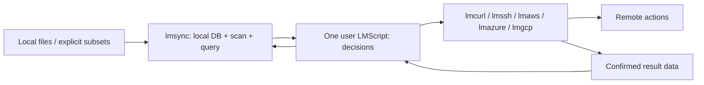

# lmsync: local believed-state manager

Status: **design only, brief v2 with current-product API correction**. This is the only current sync design. It
consolidates the useful publication examples from root `SYNC_DESIGN.md` at
`d0f033f`, replacing its integrated sync/policy engine with the boundary below.
No implementation, AWS command, remote-host test, workflow dispatch, benchmark or repository creation
is performed here. The future `lmctl-ai/lmsync` repository is not created now.

Contents: [boundary](#definition-and-boundary), [API](#1-core-api-and-neutral-data),
[belief/verification](#2-believed-state-and-verification-scripts),
[optional logs](#3-optional-planresult-log-glue),
[durability](#4-durable-db-and-failure-injection),
[Java stores](#5-java-implementation-and-scale-tier-storage),
[three example pairings and host gaps](#6-three-pairings-one-script-per-job),
[multi-host milestone](#7-one-lmscript-two-hosts-first-milestone),
[benchmarks](#8-benchmark-plan-proving-the-local-state-claim),
[implementation](#9-positioning-risks-and-implementation-breakdown).

## Definition and boundary

lmsync is the local **registry**: a model of believed remote state. It provides a Java
lmcode host/library for DB access, local scanning, neutral comparisons, recording
and optional local log helpers. It makes **zero remote calls, ever**: no list,
remote stat, HEAD, credential resolution, cloud client or SSH connection. A query
about an arbitrary subset reads local state; it does not enumerate a target tree.

**One sync job is one user-authored LMScript.** That script calls lmsync for state
and lmcurl/cloud hosts for actions, then reports the results to lmsync. lmaws keeps
its existing Java/GraalVM host and SDK v2; lmazure and lmgcp keep their own hosts.
There is no C++, JNI, native sidecar or full-host rewrite **for the registry**.
lmcurl, lmssh and lmaws are existing action hosts; lmsync does not implement
or redesign their transports.

| lmsync owns | The job script owns | The transfer host owns |
|---|---|---|
| DB durability, local file observations, hashes, snapshots, comparisons, set differences, record/forget, import/export, integrity queries | Key mapping; include/exclude choices; what to add/delete; cache/freshness; safety thresholds; budgets; verification sample/rate; when to rebuild; retention; invalidation | Provider/SSH protocol, remote actions explicitly requested by the script, credentials, host-key/ownership checks, service limits, transfer receipts and provider cost ledger |

There is **no config-file-driven rules engine**, automatic upload/delete choice,
record-age warning, quota policy or cloud-specific target validation in lmsync.
A page may be unchanged for years. Operational tuning parameters (batch size,
store cache, hash mode, scan globs) are ordinary API arguments, not rules that
trigger remote work. Script templates may choose defaults; core does not impose
them. A no-op job can avoid invoking its transfer host entirely. If that host is
invoked, count its security/metadata calls as well as transfers; never market
zero decision requests as zero total requests for a script that chose verification.



## 1. Core API and neutral data

All signatures below are proposed, not existing bindings. The canonical enum is
`CompareState { UNKNOWN, SAME_AS_RECORDED, CHANGED, RECORDED_BUT_MISSING_LOCALLY }`. Parameters are typed
lmcode values/handles; enum values are distinct from strings. Streaming cursors
and bounded batches are the main interface; convenience arrays are size-bounded.

```text
sync.open(path: string, namespace: string, options: OpenOptions) -> StateDB
StateDB.close() -> CloseReceipt
StateDB.target(namespace: string) -> Target
StateDB.scan(root: string, options: ScanOptions) -> ScanRun
StateDB.scan_paths(paths: PathSource, options: ScanOptions) -> ScanRun
ScanRun.next_batch(max_rows: int) -> ObservationBatch
ScanRun.finish() -> ScanReceipt
StateDB.hash_paths(paths: PathSource, algorithm: HashAlgorithm) -> ObservationCursor
StateDB.query(target: Target, paths: PathSource) -> StateCursor
StateDB.query_batch(target: Target, paths: PathBatch) -> StateBatch
StateDB.local_not_recorded(target: Target, scope: PathScope) -> StateCursor
StateDB.recorded_not_local(target: Target, scope: PathScope) -> StateCursor
StateDB.records(target: Target, scope: PathScope) -> RecordCursor
StateDB.record(target: Target, path: PathId, result: RecordMetadata) -> RecordReceipt
StateDB.forget(target: Target, path: PathId) -> RecordReceipt
StateDB.mark_suspect(target: Target, paths: PathSource, note: string) -> RecordReceipt
StateDB.set_suspect(target: Target, paths: PathSource, value: bool, note: string) -> RecordReceipt
StateDB.begin() -> WriteBatch
WriteBatch.record / forget / mark_suspect(...) -> WriteBatch
WriteBatch.commit() -> CommitReceipt
WriteBatch.rollback() -> void
StateDB.import_records(source: LocalRecordSource, options: ImportOptions) -> ImportReceipt
StateDB.export_records(target: Target, output: string, options: ExportOptions) -> ExportReceipt
StateDB.snapshot() -> ReadSnapshot
StateDB.doctor(options: DoctorOptions) -> IntegrityReport
```

Cursors expose `has_next`, `next_batch`, streaming JSONL/CSV output and `close`.
Default batches may be 4,096 records, with a caller-provided memory ceiling. Byte budgets can shorten a batch below max_rows; oversized metadata uses bounded
streaming/blob references. No million-row array is required. Explicit path lists, stdin/NUL lists, globs, git
changes, manifests and unrelated directories are adapters producing PathSource;
the core need not run git or understand a build system. The script turns a git
diff or manifest into paths. scan_paths observes only those local paths.

`PathId` is a local root identity plus relative path, or a caller-named logical
path for non-file events. Multiple roots allow unrelated directories and prevent
same-basename confusion. Local filesystem paths and caller-supplied target names
are separate. A Target is an **opaque namespace**, such as `site-production` or
`sftp-staging`, optionally with a caller-stored descriptor. The core does not
parse S3 buckets, enforce `lmaws-*`, perform flatten/strip/add-prefix mapping, or
resolve a hostname. Those choices and their collision checks are script/host work.
One local path can have a separate record for every target in the same DB.

### Comparison semantics

Query compares the latest local observation with the source fingerprint attached
to the recorded result; it performs no remote I/O and no implicit local tree scan.
The script calls scan or scan_paths first when it wants refreshed observations.
Query returns the local and recorded observations, comparison basis (`stat` or
`digest`), hash availability, explicit suspect annotation and record metadata.

| Neutral state | Exact meaning |
|---|---|
| `unknown` | No record, or insufficient local observation to compare; reason distinguishes these cases. It does not assert absence on the remote |
| `same-as-recorded` | The compared local fingerprint agrees with the one the script last recorded, under the disclosed stat/hash basis |
| `changed` | The local comparison differs; if hashing was deferred, this may mean changed stat inputs rather than proven different bytes |
| `recorded-but-missing-locally` | A recorded path has an explicitly observed local absence, from a completed scope scan or scan_paths result |

A scan receipt includes its root, filter/traversal parameters and completed coverage.
Excluded/unvisited paths are not marked absent, and changing include/exclude
parameters is not evidence that previously observed files disappeared.
A path not yet observed is not declared missing. A failed/partial scan exposes its
incomplete scope; set differences cannot describe that unobserved portion as
confirmed absence. The helpers compare local DB sets, not the remote namespace. Old upload-index
policy verdicts such as new/key-conflict/stale are not core states; the script can
distinguish absent-record vs unobserved-local reason data and map them as it wishes.
None of the four states means upload, delete, warn, refuse or rebuild. Even a
`same-as-recorded` file may need a script-chosen action because its desired remote
key or HTTP metadata changed. Conversely `changed` does not require an upload.
A suspect flag is data set by the script, not a fifth policy verdict or a TTL.

### Scan and hash cost

ScanOptions supplies include/exclude globs, symlink handling, hash algorithm/mode,
worker/batch limits and local scope. Empty filter choices mean no caller filter;
there is no built-in project/deploy exclusion policy. Hash modes are ON_CHANGE,
ON_DEMAND and ALWAYS; size/mtime checks reuse known hashes where applicable.
Record timestamp precision and optional ctime/file identity. If a stat change
hashes to the same content, disclose both facts. Never equate an opaque provider
ETag with a local content hash.

Use bounded per-directory/shard queues, streaming observations and spill files,
not a whole-tree list in memory. Directory mtimes can help detect name changes;
descendant content edits need not alter a parent directory mtime. Do not skip
children on that evidence alone. An optional local watcher is just an observation
accelerator; JDK WatchService can use Linux inotify without a new native binding.
Overflow, a stopped watcher or an interrupted scan is returned as a local
observation gap. The script chooses whether/how to rescan; no cloud verification
or record-age policy follows automatically.

A same-size edit with preserved timestamps can evade stat-based comparison. The
script can request ALWAYS hashing or an immutable source snapshot when that
matters. Re-stat around hashing and report local mutation rather than publishing
a misleading digest. The core does not certify that a later transfer read the
same bytes: the action host must report the actual transferred fingerprint.

### Record and forget

RecordMetadata carries an immutable **source fingerprint for the bytes reported
transferred**, an action/event ID and an opaque result payload. It can hold an
ETag/version, remote path, content type, Cache-Control, upload ID, SFTP attributes,
phase/status or arbitrary caller data; core does not interpret these business
fields. A logical action/event may have no source-file fingerprint.

`record` must not implicitly attach today's local fingerprint to yesterday's
transfer. Callers pass the plan/source snapshot or actual transferred hash. If a
file changed while/after uploading, a subsequent scan must still compare against
the bytes actually reported uploaded. `forget` removes believed state via a local
transaction/tombstone; it never deletes a remote path. The caller is free to
record or forget directly without any plan/log mechanism.

## 2. Believed state and verification scripts

Outside changes are invisible until a script chooses to check. Age alone does
not make a record suspect, and opening/querying never calls the remote. A DB can
faithfully preserve a mistaken user report; it cannot independently certify a
remote effect. Document these limits instead of implying a local remote oracle.

A verification script chooses N recorded paths, calls lmaws HEAD (or another
host's equivalent), compares returned data using its own policy, then explicitly
marks suspect, records revised metadata, forgets or does nothing. Sampling rate,
selection seed, cost cap, checksums and behavior on mismatch all belong to that
script. A failed sample cannot certify unsampled paths. Multipart/composite ETags,
metadata changes and encrypted objects need explicit interpretation by the host/
script, not a content-equivalence rule hidden in lmsync.

A rebuild script can fetch a listing, S3 Inventory or other records with its cloud
host, then call import_records on a **local** stream. lmsync never fetches a URL or
creates Inventory. The script chooses prefix fan-out/concurrency, coverage,
pricing/admission, validation and whether to replace or merge a target snapshot.
ImportOptions provides mechanical append/upsert/replace and transaction choices;
a replace is local state replacement, not remote deletion. Preserve import
provenance in caller metadata. A listing does not necessarily recover source paths
through a non-invertible flatten/custom mapping, and Inventory may not contain
custom metadata or checksum values. Unknown information stays unknown.

No watcher detects outside remote edits. Multiple machines can hold different
beliefs; any remote coordination/leases or conditional-write policy belongs in
the job and action host. Local single-writer locking only protects this DB.

## 3. Optional plan/result log glue

This is a **thin file codec/helper library**, not a mandatory workflow, scheduler
or executor. A script may use direct record() calls instead. A plan is data the
script wrote; lmsync never synthesizes upload/delete instructions from a state.

Proposed helpers: `plan_writer`, `result_writer`, `read_instructions`,
`read_results`, `unconfirmed(plan, results)`, and `apply_records(db, results)`.
The last helper applies only explicit record/forget projections supplied by the
script. It does not infer a projection from a verb such as `delete` or `invalidate`.
All readers/writers stream in bounded batches and return data/receipts.

### Wire grammar

Versioned UTF-8 JSON Lines; one compact object per line, LF terminator. Strings
use JSON escaping, so spaces, quotes, tabs, backslashes and embedded newlines in
path names are unambiguous. Never use whitespace-separated shell instructions or
shell interpolation. Metadata is bounded per line; large payloads refer to a
local blob plus digest. Store nanosecond timestamps, byte counters/IDs that may
exceed JavaScript's exact integer range as decimal strings. Timestamps are UTC
RFC3339 data, not expiration instructions.

Each managed line has `v`, `kind`, `job`, `op`, `payload` and a checksum. Result
lines additionally have an immutable `result_id` and explicit
`completes_instruction` boolean; separate accepted/completed/progress projections
can share an instruction op but use different result IDs. The helper
uses its versioned canonical JSON encoding of payload for CRC32C and instruction
SHA-256; all hosts share the codec conformance fixtures. Logs from external tools
may be imported explicitly, but are not silently treated as managed crash receipts.
The examples below omit computed checksums for readability; actual helper output
includes them and each result binds the full instruction digest.

```json
{"v":1,"kind":"instruction","job":"example","op":"add-a","payload":{"verb":"add","target":"site","path":"assets/a b \"quoted\".css","source_fingerprint":{"size":"3","mtime_ns":"<decimal-int64>","hash":"<digest>"},"args":{"remote_path":"assets/a.css"},"record_projection":"record"}}
{"v":1,"kind":"instruction","job":"example","op":"delete-b","payload":{"verb":"delete","target":"site","path":"old.css","args":{"remote_path":"old.css"},"record_projection":"forget"}}
{"v":1,"kind":"instruction","job":"example","op":"event-c","payload":{"verb":"cloudfront.invalidate","target":"events","path":"invalidation/event-c","args":{"paths":["/*"]},"record_projection":"record"}}
{"v":1,"kind":"result","job":"example","op":"add-a","result_id":"add-a-complete","completes_instruction":true,"payload":{"instruction_digest":"<sha256>","confirmed":true,"timestamp":"2026-01-01T00:00:00Z","projection":{"kind":"record","target":"site","path":"assets/a b \"quoted\".css","source_fingerprint":{"hash":"<actually-transferred-digest>"},"metadata":{"remote_path":"assets/a.css","phase":"uploaded","etag":"<opaque>"}}}}
```

`verb` is an arbitrary caller string; `args` and result metadata are caller data.
The only projection primitives are local `record`, `forget` or `none`. Metadata
can describe an accepted/pending remote action if that is what the script reports;
it must not thereby be presented as completed publication. Job/op identifiers and
instruction digest detect conflicting reuse. Replaying the same confirmed `(job,result_id)` is idempotent; a different
payload for that same result ID is an integrity conflict. Only the caller's
explicit completes_instruction marker removes an instruction from the unconfirmed
set. Progress/event data need not imply a fully uploaded file. A transaction commits its result-log replay offset and record changes
together, so a crash cannot skip a result or double-apply it.

A writer fsyncs a complete confirmed result before declaring that receipt durable.
A torn final line is retained/ignored as unconfirmed and can be truncated only to
the last verified line boundary. Corruption in a middle line is an error, not an
excuse to skip later results. Plan files commit atomically; appending to a journal
is single-writer. The helper never executes any verb or invokes a provider.

### Resume and the confirmation gap

Resume means the script re-plans the unconfirmed remainder. Completed results
replay into the DB even if the process died before its DB update. A transfer that
completed remotely but crashed **before** producing a durable confirmation remains
unconfirmed: lmsync cannot infer success without a report. Its instruction is not
lost, and the script can safely retry with provider idempotency/conditional writes
or explicitly reconcile the known path. It may repeat transfer work or cost.

Scripts should store multipart/progress events without a completed-file source
fingerprint until they actually report that full-file success. The core does not
interpret phase strings.

The invariant is no lost **durably reported** success and no false unchanged
inferred from intent, a start record, file existence or a partial line. Exactly-once
remote effects across a process/network/filesystem crash are not promised. A
script that reports an incorrect result can corrupt its own belief; the library
must not manufacture confirmation. Changed local sources are re-planned rather
than marked uploaded with a newly observed fingerprint. Optional log glue is not
required for small direct-call jobs, but those jobs accept a larger confirmation
window unless the action host emits its own durable result receipt.

## 4. Durable DB and failure injection

Logical records: local paths/observations; target namespaces; `(target,path)`
recorded source fingerprint and opaque metadata; explicit suspect notes; local
forget tombstones; import provenance; generations/transaction IDs; optional replay
IDs and offsets. Keep local observations separate from recorded state so scanning
never overwrites believed transfer success. Provider-specific key/hash indexes,
quota counters and release catalogs are user data or script-side structures, not
core business tables.

Use transactional/WAL storage, checksummed pages/records, monotonic committed
sequence numbers and versioned codecs. On open, validate the manifest, recover
committed WAL transactions, discard only incomplete tail records and report
structural corruption. Do not silently open an empty DB or forget records when a
file is corrupt. Compaction writes/fsyncs a new generation, atomically commits its
manifest and only then releases old unpinned files. Compaction drops superseded
records/tombstones only when snapshots no longer need them; it never expires a
path because of age. Export/backup produces a consistent checksummed snapshot;
import validates it into a staging generation before an explicit local commit.

Single writer uses an OS file lock plus diagnostic PID/process-start/instance data.
The OS releases the lock after a crash. Stale text in a lock file can be replaced
only after acquiring the real lock; do not unlink/recreate an actively locked file
or use a timeout to steal a live writer's lock. Refuse filesystems without the
required locking/atomic-rename/fsync guarantees. Concurrent readers see stable
snapshots, not partial writes. Same-process MVCC readers are the first milestone;
other processes use immutable exported/pinned generations or an explicitly
qualified snapshot protocol. Do not promise concurrent live MVStore opens across
processes without testing it. Reader crash releases OS pins/handles; compaction
never deletes a generation still pinned by a live reader.

Doctor reports local checksum/manifest/sequence/index consistency, dangling
references, transaction/replay integrity and storage statistics. It performs no
HEAD, rebuild or provider verification, and returns data for the script to handle.
Opening old-format data requires a versioned migration, not automatic semantic
policy changes. Memory, disk space, file offsets and malformed-input limits are
implementation/resource constraints, not upload/delete policy.

A deterministic kill-point harness will exercise these boundaries:

| Kill/fault point | Required observation after reopen |
|---|---|
| After plan commit, before any transfer | DB unchanged; all instructions unconfirmed |
| Mid-transfer/part | No completed record; script can use stored opaque provider resume data or retry |
| After remote transfer, before result append | Unconfirmed intent retained; no fabricated same-as-recorded |
| After fsynced result, before DB record | Replay restores exactly that reported source snapshot/result |
| During DB transaction/replay-offset commit | Both record and offset commit, or neither |
| Mid-compaction/manifest swap | Last complete committed generation remains readable |
| Disk full / failed fsync | No success acknowledgment for an undurable transaction |
| Truncated last log line | Previous verified receipts replay; last operation stays unconfirmed |
| Corrupt middle log/page/index record | Doctor/open reports corruption; no silent row loss |
| Stale lock metadata / crashed writer | OS lock can be reacquired safely; live locks cannot be stolen |
| Reader crash / active snapshot during compaction | No use-after-delete; obsolete files reclaimed only after pin release |

Compare recovered state to an independent model oracle at every kill point.
Test large offsets, empty DB, duplicate/conflicting operation IDs, arbitrary path
quoting, many targets and millions of streamed rows in JVM and native-image runs.

## 5. Java implementation and scale-tier storage

Implement lmsync as a Java lmcode host with JDK local I/O/hash primitives. GraalVM
native-image remains the deployment route; no AWS SDK, SSH client or cloud ledger
belongs in its dependency graph. TransferManager is an **lmaws** concern. No new C++
or external native state component is selected for lmsync, and there is no JNI
fallback. Existing lmcurl/lmssh/lmaws keep their own implementations; this
design adds no transport dependency to the registry.

| Store | Primary-source evidence / uncertainty | Recommendation |
|---|---|---|
| Direct H2 MVStore | Java file-backed log-structured maps, MVCC and configurable cache; our native-image/large-file/crash workload still needs qualification | Small-tier candidate using explicit byte codecs, no SQL/server or object serialization |
| Custom sorted runs + sparse fences + Bloom filters | Implementable with Java NIO; immutable generations, WAL and compaction are our engineering responsibility | Recommended 100M/1B path; small-tier fallback/common export format |
| iq80 Java LevelDB / embedded LSM | Java port with batches/snapshots/cache controls; reviewed README describes limited testing, and no representative native-image qualification was found | Prototype/benchmark alternative, not an assumed production dependency |
| MapDB | JVM file-backed collections; exact dependency/reachability/durability behavior needs testing | Optional candidate; no unmeasured native-image claim |
| Xerial SQLite JDBC | Native-image support exists, but SQLite is loaded from platform native libraries through JNI | Not compatible with this brief's Java-only/no-JNI requirement |
| RocksDB JNI | Adds native libraries and per-platform JNI packaging/testing | Not needed by the proposed Java design; only reconsider with explicit new user direction if every viable Java approach fails |

Sources: [MVStore](https://h2database.github.io/html/mvstore.html),
[iq80](https://github.com/dain/leveldb), [MapDB](https://mapdb.org/doc/),
[SQLite JDBC](https://github.com/xerial/sqlite-jdbc). These provide feature evidence,
not measured lmsync results. Check pinned-version reachability and file locking
in the actual GraalVM binary; a working JVM test is not native-image certification.
No dependency is added by this design.

Sizing model: average path 96 UTF-8 bytes, one local observation plus one target
record, SHA-256 when known, roughly 128 bytes of opaque result metadata and
amortized lookup/filter overhead. Estimate **400–700 bytes per path-target pair**;
long metadata, many targets, snapshots and logs increase it. This is a planning
model, not measured codec output. Shared local observations amortize across targets.

| Tier | Proposed store | Estimated live disk at limit | Index working memory target | Proposed pre-observed 1M-query latency on recorded NVMe hardware |
|---|---|---:|---:|---|
| <=1M paths | Qualified MVStore, sorted-run fallback | 0.4–0.7 GB | 64–192 MiB | <=20 s warm / <=60 s cold |
| <=100M | Sharded sorted runs/WAL/manifest | 40–70 GB | <=512 MiB | <=20 s warm / <=120 s cold |
| <=1B | Same, bounded open shards and on-disk index/filter partitions | 400–700 GB | <=1,024 MiB | Target <=30 s warm / <=180 s cold; projection until tested |

All latency figures are **acceptance goals, not measurements**. Budget at least
2x live disk for compaction, plus configured WAL/snapshot/export headroom. At 1B
this is roughly 0.8–1.4 TB before extra retained data. Report heap, direct buffers,
RSS and OS page cache separately; no all-RAM object map or hidden unlimited mmap.
A 10-bit/key Bloom set uses about 1.25 GB at 1B, so filters/fences must be partitioned
on disk and cached, not all loaded. False positives always check full keys.

Cap memtable, block/filter caches, open shards/files and compaction workers through
plain resource options. Use checksummed blocks, explicit encodings, bounded merge
buffers, 64-bit offsets and versioned manifests. These limits bound local resources;
they never decide which remote action a script should take. Migration is a
streaming local operation retaining the prior generation until commit. Qualify
Linux x64 dynamic-glibc native images first, then macOS and Windows; retain the
existing Java cloud hosts. If Java options fail, present actual evidence and
native/JNI package-size, platform and maintenance costs before any new decision.
Do not assert RocksDB is necessary while a viable Java sorted-store design exists.

## 6. Three pairings using existing products

**lmcurl, lmssh and lmaws already exist.** Only the registry is the new product.
One job is one `.lms` containing its choices and typed calls to the registry and
an existing action host. Do not build another downloader, uploader or SSH transport
inside lmsync. No libssh2-enablement or Java-SSH proposal is part of this design.

The API audit used each product's current README, durable-memory API notes,
schema/registry and existing examples. Local source references were lmcurl
`8e65448` and lmssh `68e6159`; lmaws was the current main worktree and its checked
schema. Five action-host example blocks below were compiled against schemas
printed by the local executables (`lmcurl`, `lmssh`, `lmaws`); only compile/check
was performed, never the block bodies. Metadata-only `--help`/schema queries were
used where useful; no HTTP request, SSH session or AWS action was run. Native
binaries and source can differ, so future examples bind to their executable's
schema with `cli=...`; the existing examples below are concrete reference points.

Demo/dry-run output is not confirmation of a real action. Jobs use separate
synthetic target namespaces for fixtures and never record a dry-run's apparent
success into production belief. The script knows whether it requested a preview;
core does not infer provider mode or grant a report more authority.

Registry calls remain proposed until lmsync exists. Every action-host method shown
as available below is a current method. A narrowly missing call is listed once in
“small additions needed”; the examples must disclose that blocker rather than
pretend a proposed API already exists. These are design examples, not new runnable
job files in this change.

### A. DOWNLOAD MANAGER — registry + lmcurl

`download_http.lms` reads its chosen URL/path manifest and registry data, skips a
trusted complete local copy, and otherwise uses existing lmcurl requests. The
script owns ETag/Last-Modified revalidation, retries, parallelism, gone handling
and when to request anything again. Zero re-requests means skipped trusted items;
a conditional GET returning 304 still counts as one request. Outside changes are
invisible when the script chooses not to revalidate.

Current lmcurl calls for a bounded public-text fixture, inside this one job:

```text
request_program = _lmcode_ cli="lmcurl";
let s = curl.session(${BASE_URL});
let request = s.get(${URL_PATH}).timeout(10000).limit(1048576).retry(3, 500);
if (${RECORDED_ETAG} != "") {
  request = request.header("If-None-Match", ${RECORDED_ETAG});
} else {
  if (${RECORDED_LAST_MODIFIED} != "") {
    request = request.header("If-Modified-Since", ${RECORDED_LAST_MODIFIED});
  }
}
let response = request.send();
if (response.error() == "" && response.status() == 200) {
  response.save(${PART_PATH});
}
file_write(${STATUS_PATH}, str(response.status()));
file_write(${ERROR_PATH}, response.error());
file_write(${ETAG_PATH}, response.header("etag"));
file_write(${DATE_PATH}, response.header("last-modified"));
end _lmcode_
# Existing savedsl/dsl_cli/system runs this block. The user script then:
# 200 with empty error -> validate saved result and record its actual fingerprint;
# 304 -> retain/record only if the complete local copy is valid;
# 404/410 -> record gone data, without an automatic local deletion;
# failure/partial -> retain unconfirmed work, never record a complete file.
```

A bounded range-resume can also use **existing** `Request.header("Range", ...)`,
`header("If-Range", ...)`, `header("Accept-Encoding", "identity")`,
`Response.status()`, `header("content-range")`, `body()` and `file_append()`.
The script checks for a successful complete 206 response and the expected offset,
representation and validator before appending. A 200 restarts instead of appending;
416 is not automatic success. Validate the existing local prefix against the
recorded partial fingerprint before resuming. Weak/unknown source identity means
restart or an explicit verification choice, not a guessed safe append.

These operations buffer response bodies. `Response.save` and the standard
file-write/append wrappers also redact content; they are suitable for the checked
public-text examples, not a promise of byte-exact arbitrary binary artifacts.
The exact streaming/raw-artifact limitation is a small addition note below, not
an invitation to redesign lmcurl. `Request.stream(true)` is SSE behavior, not a
stream-to-file API. The script records actual saved bytes/checkpoints, not an
assumed raw response size.

Existing examples demonstrate these building blocks:
`lmcurl/examples/web_pagination.lms` and `web_site_mirror.lms` use get/options/send/
save; `retry_recovery.lms` exercises retries; `response_limits.lms` bounds responses.
`web_site_mirror.lms` and `web_feed_reader.lms` already use LMScript
`parallel([download(...), download(...)])`. Use fixed-width batches of those calls
for bounded parallelism; return plain per-file outcomes and durable receipt paths,
not live Session handles. `Suite.parallel(bool)` exists for suite requests; no
new parallel-download product is needed for this example.

The registry stores caller-reported validators, complete/partial/gone phase,
confirmed local offset and source fingerprint. No automatic re-request rule or
URL scheduler lives in core. The future picture shows skipped/200/304/206/gone/
failed counts from a loopback fixture, with interrupted and changed-validator cases.
Keep credentials in references and logs redacted; do not persist signed tokens,
userinfo or cookie values as registry receipts.

### B. UPLOAD MANAGER — registry + lmaws

lmaws already performs owned S3 writes and web publication. Its current checked
public surface includes `Run.bucket(string) -> Row`,
`Run.put(Row,string,string) -> void`, `Run.cleanup()`,
`Cloud.web_stack(string,string,string) -> Web`, `Web.step(string,string) -> Row`,
`Web.status()`, `Web.down()` and `Cloud.s3_presigned_put(...)`. Presigning is not
a file transfer. Run sandboxes clean their resources; they are not persistent
incremental site targets merely because the PUT method exists.

Current small text-write example (the existing sandbox API, not a new uploader):

```text
upload_program = _lmcode_ cli="lmaws";
let cloud = aws.demo();
let run = cloud.example_run();
let bucket = run.bucket("site-example");
run.put(bucket, "index.html", "<html><body>example</body></html>");
run.cleanup();
end _lmcode_
```

For persistent existing web scenarios, current calls are:

```text
web_program = _lmcode_ cli="lmaws";
let cloud = aws.demo();
let web = cloud.web_stack("cafe1234", "example.com", ".lmweblab-local/web.json");
let uploaded = web.step("bucket", "{\"site_dir\":\"./site\"}");
let distribution = web.step("distribution", "{}");
let cache = web.step("cache", "{\"default_ttl\":30,\"max_ttl\":60}");
end _lmcode_
```

These are current typed calls, but `bucket` uploads its fixed asset set and is a
journaled setup step; it is not a general per-key incremental PUT. The registry
must not claim it selected arbitrary keys while this step uploads other assets.
See existing lmaws sandbox recipes and the current lmweblab lmaws static-site
scripts, plus `lmaws/durable-memory/11-web-stack.md` for exact setup semantics.

The single-script registry examples are therefore scoped honestly:

- **`publish_ttl.lms`:** scan/query, make the script's per-file choices, ask lmaws
  to upload, record confirmed bytes. Current Run.put demonstrates bounded text
  writes; a persistent arbitrary-file job has the small PUT gap below. The user
  chooses short HTML TTL and headers; the registry does not.
- **`publish_hashed.lms`:** the script creates hashed files and rewrites supported
  references locally, queries those chosen artifacts and records lmaws results.
  The same generic PUT gap applies; hashing/reference policy needs no registry or
  lmaws redesign. Unknown dependencies/cycles are handled by script code.
- **`publish_release.lms`:** the script stages its manifest, records per-file
  results and requests a conditional activation/rollback. Current Web.step has no
  general OriginPath switch selector; that exact small gap is below. Retention,
  keep-last-N and deletion safety remain script choices, not core behavior.
- **`publish_git_diff.lms`:** git diff/manifests/cherry-picks produce the script's
  chosen path subset, including unrelated directories. Core query is local;
  mapping/conflict and delete decisions are in the script. Use the same PUT call
  when available; do not substitute a whole-bucket listing or whole-site step.
- **`verify_sample.lms`:** the user chooses N/seed and compares remote metadata,
  then calls registry mark_suspect/record explicitly. Generic per-object S3 HEAD
  is the small public-API gap below. No age rule is introduced.
- **`track_invalidations.lms`:** current `web.step("invalidate", "{}")` requests
  the owned distribution's wildcard invalidation. After a successful reported call,
  the script can record one known submitted path/event and sum its own UTC-month
  history. Check the existing `seconds_invalidate`/private step receipt so an
  idempotent step return is not counted as another submission; uncertain outcomes
  remain unknown. It cannot obtain an invalidation ID/completion/caller reference from
  this wrapper, or assume complete account-wide quota history. Do not fabricate
  those fields. This bounded example tracks submitted events only; it does not claim provider
  completion or design a new tracking API.

Freshness options remain **user script policies**, retaining the earlier design's
small-site TTL and large-site release/hashed/TTL recommendations. They are not
registry options, automatic size switches or a rules engine.

| User policy | Requests/cost | Freshness | Rollback / failure |
|---|---|---|---|
| `ttl` | Chosen changed PUTs/metadata operations; ordinary cache misses | User-selected entry/asset TTL | Re-publish retained bytes; mixed-cache/non-atomic multi-file windows |
| `hashed,ttl` | User transformation plus new assets/entries | New asset URLs; entry TTL still applies | Re-publish retained entry references; graph/SRI/old-asset retention are user concerns |
| `release,ttl` or `release,hashed,ttl` | Staging/copy/activation/retention work, including any physical-key amplification | Switch propagation and entry TTL | Immediate switch request, not simultaneous global viewer freshness; incomplete staging/conflicts remain visible |
| Explicit `invalidate` | Submitted paths, status calls where available, cache refill | Asynchronous; browser caches may remain | Script records what the current API reports; no inferred completion or guaranteed remaining free quota |

If the user script chooses invalidation, its path cap, wildcard choice, cost
preview and ledger handling belong with lmaws/script code. No such rule belongs
in lmsync. Existing host safety/ownership/profile limits remain in force. This
note does not change IAM grants or execute any operation.

### C. RSYNC ALTERNATIVE — registry + existing lmssh

**Use lmssh today**, not a proposed Java SSH library, lmcurl SFTP extension or
new transport product. lmssh bundles OpenSSH's ssh/scp/sftp clients. Its README,
`durable-memory/04-api.md`, generated schema and existing deploy/fetch examples
provide the current API. User scripts can select arbitrary path lists, skip trusted
recorded copies and transfer without a remote tree listing or checksum comparison.

Current upload pattern; defaults are set before `ssh.connect` copies them:

```text
sftp_upload = _lmcode_ cli="lmssh";
ssh.known_hosts(${KNOWN_HOSTS}).strict_host_key("yes")
   .identity(${KEY_FILE}).connect_timeout(10).timeout(120).reuse(true);
let s = ssh.connect(${DEST_ALIAS});
s.put(${LOCAL_FILE}, ${REMOTE_TEMP});
s.rename(${REMOTE_TEMP}, ${REMOTE_FINAL});
s.close();
end _lmcode_
```

Current download is `s.get(remote_path, local_part)` followed in the same outer
LMScript by `move_file(local_part, final_path)` on the same filesystem after its
validation choice. Current exact cleanup is `s.rm(path)`. `s.mkdir(path)` creates
one directory; for parent components a script can use `s.sftp(batch)` with explicit
OpenSSH `-mkdir` lines and let the subsequent transfer expose any real failure.
Only requested paths are touched; no `ls` is needed. Quote/reject unsafe batch
paths before constructing text; do not interpolate untrusted commands.

Resume is also available through the **current** raw SFTP batch API:

```text
resume = _lmcode_ cli="lmssh";
ssh.known_hosts(${KNOWN_HOSTS}).strict_host_key("yes")
   .identity(${KEY_FILE}).timeout(120).reuse(true);
let s = ssh.connect(${DEST_ALIAS});
let result = s.sftp(${QUOTED_REGET_OR_REPUT_BATCH});
result.require();
s.close();
end _lmcode_
```

The bundled OpenSSH source/help supports `reget remote [local]` and
`reput local [remote]`. Store source/temp/progress metadata in the registry and
choose these commands explicitly in the script. `reuse(true)` reuses a connection,
not a byte checkpoint. A simple `put/get` retry restarts that transfer. Do not
invent typed `Session.resume`/`stat` methods: none is needed to call existing
reget/reput. A remembered offset does not establish unchanged remote bytes; use a
trusted immutable source/temp contract or local expected digest, otherwise restart
or explicitly verify. No remote checksum round trip is mandatory. OpenSSH may
perform file-attribute work as part of transfer/resume; that is not remote tree
comparison and must be counted honestly.

Use `s.put`/`rename` from `lmssh/examples/deploy-file.lms`, but omit that example's
optional `s.output("sha256sum ...")` when implementing this no-remote-checksum
policy. `fetch-files.lms` already uses get. `mirror-dir.lms` uses ls and therefore
is **not** the template for the no-list registry job. `Session.sftp(batch)` returns
Result with `ok/status/stdout/stderr/timed_out/require`; ordinary put/get/rename
throw on failure. Only after the chosen action reports success does the user
script record the corresponding source snapshot/final-path result.

Host-key policy is explicit in these examples: strict_host_key("yes") plus trusted
known_hosts; do not copy accept-new/no settings for unattended publication. Key
files/config and the existing SSH agent can supply auth; lmssh has no new agent
server to build. `Session.password(io.env(...))` exists via askpass if a job needs
it, but examples prefer key/agent references and never print credential values.
Paths/agent settings remain private; no real remote target is used in this design.
Temp-name-then-rename is a job pattern, not a registry rule; atomicity depends on
server/filesystem guarantees. Known-host/auth/rename failures remain unconfirmed.

The synthetic picture shows upload/download, temp/final paths and zero tree/checksum
comparison calls. Existing lmssh local test conventions can validate the composed
job; this design does not start sshd or modify lmssh's transport/build.

### Small additions needed only for the blocked variants

These are narrow missing calls found in the current schemas/source—not new product
designs. Existing bounded examples use current APIs above. No addition is proposed
for a capability that can already be composed (conditional headers, retries,
fixed-call parallelism, reget/reput, mkdir/rename or local move_file).

| Blocked example variant | Exact small addition needed | Why the current call is insufficient |
|---|---|---|
| A: byte-exact arbitrary/large artifact download and append-resume | `Request.download_to_file(path, offset) -> Response` in lmcurl, a bounded raw artifact sink | Response.save/body/file_append buffer and redact output; they cannot promise arbitrary byte-exact streaming. Keep log redaction; do not redact artifact bytes |
| B1/B2/B4: persistent arbitrary-file S3 writes with script headers | `Cloud.s3_put_file(bucket,key,local_path,content_type,cache_control,run_id) -> Row` | Run.put is sandbox-owned string data; Web.step("bucket") uploads a fixed set, not the selected subset |
| B3: conditional release activation/rollback | `Web.step("origin_path", args_json) -> Row` selector on the existing Web API | That selector is absent today; current distribution/setup/cache methods do not perform this switch |
| B5: S3 spot-check | `Cloud.s3_head_object(bucket,key,run_id) -> Row` | No generic per-object HEAD is bound; bucket inventory or a PUT-presigned URL is not a substitute |

Keep any future implementation local to those existing hosts and their normal
safety/ledger contracts. COPY, per-key release GC, typed multipart-resume and richer invalidation
completion conveniences are not required by the bounded examples above; do not design them here merely because
they might be useful later. If a later job genuinely needs one, audit then name
that exact missing binding. There is no lmssh transport blocker for the shown jobs.

### Full pipeline: A -> user clean -> B, optionally C, in one `.lms`

The same file invokes its lmcurl block, applies explicit local cleanup/transform
code (existing lmhtml parsing blocks can help), invokes its lmaws block, and can
mirror selected output with its lmssh block. It calls registry record/replay
between phases. Import-only user helper functions are allowed; they are not new
products or separately scheduled jobs. Clean is user code, not lmsync.clean.

Use separate namespaces for download/partial/transform/S3/SFTP data. Do not publish
private registry files or credentials. Abort or continue after partial inputs only
as that script explicitly decides. Preserve each phase's confirmed results before
reporting failure. The generic persistent S3 stage carries the narrow PUT blocker
above; the document must not claim the complete pipeline runs today before the
new registry and that missing binding exist. Existing transports need no redesign.
The future picture labels actual API calls, recorded outcomes and any blocked step.

## 7. One LMScript, two hosts; first milestone

**Available today:** a `.lms` file can contain multiple `_lmcode_` / `_dsl_` blocks,
each compiled against its own `cli="host"` schema. `savedsl` writes bytecode;
`dsl_cli(program)` returns the matching executable argv; `system(argv, timeout)`
runs it. `${...}` interpolation supplies scalar strings/numbers/bools, so a file
path can bridge blocks. Schema-bound handles belong to their host process: do not
pass a StateDB/S3 handle to another host, merge schemas blindly or assume that
printing/serializing a compiled block transfers its live objects.

The existing lmweblab report scripts already demonstrate lmdraw and lmplot in one
LMScript. The source contract is in
`lmscript/durable-memory/lmscript_language_reference.md` (DSL blocks) and
`lmscript/lmscript.ts` in the existing monorepo; only local source inspection was
used, with no workflow dispatch. General orchestration is therefore available;
a new universal multi-host VM or cross-language JNI bridge is not required.

Illustrative orchestration shape, using existing runner mechanics but future
lmsync/provider APIs inside the marked bodies:

```text
# === CONFIG ===
let DB_PATH = ".lmsync-local/site.db";
let PLAN_PATH = ".lmsync-local/plan.jsonl";
let RESULT_PATH = ".lmsync-local/results.jsonl";
# === END CONFIG ===
state_program = _lmcode_ cli="lmsync";
  # future local scan/query API; user-written if/loop chooses instructions
end _lmcode_
savedsl(state_program, ".lmsync-local/state.dslb");
let a = system(concat(dsl_cli(state_program), ["--dsl", ".lmsync-local/state.dslb"]), 120000);
assert(a.code == 0);

transfer_program = _lmcode_ cli="lmcurl";
  # current get/header/retry/send/save calls selected by user-written policy
end _lmcode_
# save and run the transfer host only if this script selected actions

record_program = _lmcode_ cli="lmsync";
  # future local record/log-replay API consumes confirmed RESULT_PATH projections
end _lmcode_
# save and run, check every exit code, close resources, report this job's result
```

This is a mechanism sketch, not a currently executable lmsync script. Markers/
`cli` are supported aliases, but lmsync does not yet exist and has no installed
schema. Current `read_lines` returns an array: do not load a million-line plan
through it. Use the registry's proposed local bounded-batch helpers, or partition files into
bounded batches consumed with existing file APIs. Shared codec fixtures belong
with the optional registry log format, not a redesign of the action hosts. Process one batch or a streaming file in a host, not one process per
file. Keep policy in the `.lms` block's explicit code; helpers do not dispatch
verbs by themselves. Generic local codec APIs are the only common host glue.

lmazure and lmgcp use exactly the same local state/query/record data contract.
Replace the transfer block with their typed blob/object API and receipts; native
.NET/Go/Java implementations can read the versioned files without sharing live
objects or linking the DB. Provider names and Azure/GCP safety/cost rules remain
in those hosts/scripts. No lmsync provider plugin or cloud credential is needed.
SFTP uses a separate explicit `cli="lmssh"` block with the same reported-result
contract. A pipeline can call existing lmcurl, lmaws and lmssh in one script,
with lmsync handling local data only.

### What actually needs implementation

The runner and existing product calls do not need a new integration architecture.
Implement the new registry and its local bounded batch/file helpers. The script
can consume small batches with today's read_lines/read_json and invoke action
blocks; do not load million-line arrays at once. No provider-specific streaming
codec service, new SSH product, universal VM or new parallel-download product is
required to demonstrate the jobs. The few blocked variants are named in section 6.

### Smallest useful milestone

1. Java lmcode skeleton and a qualified small crash-safe store: open/close, local
   scan/scan_paths, hash-on-change/on-demand, neutral query, set differences,
   record/forget, bounded iteration and transactions.
2. Thin optional plan/result codec with direct-call alternative, idempotent
   confirmed replay, local import/export, doctor and the kill-point tests.
3. One complete `publish_ttl.lms` containing its own choices and two-host glue,
   plus a **local fake S3-like executor** returning deterministic receipts. Test
   first publish, no-op, one changed file, local deletion without automatic remote
   deletion, uncertain transfer, result-before-record crash and changed-source race.
4. Use current lmaws Run.bucket/put/cleanup for the bounded sandbox smoke; record
   reported PUT and cleanup/forget separately. Persistent arbitrary-file
   publication needs only the exact s3_put_file addition noted in section 6,
   verified when that blocked variant is implemented.
5. **Only after later explicit live authorization**, run that one job against one
   owned test bucket named `lmaws-*`, tagged `lmaws_test`, within lmaws ledger caps.
   The script explicitly cleans its known test objects/bucket in success and
   failure paths and records/reports outcomes. The existing sandbox API can serve
   the small smoke test; a persistent incremental site test must disclose the
   missing PUT binding. The real test is a future milestone,
   not executed or authorized by this design task.

No need to finish every script policy, large-store tier or inventory importer
before this local state primitive is useful. Existing lmssh already provides SFTP. The repo is created later;
this document does not create `lmctl-ai/lmsync` or dispatch any build/release job.

## 8. Benchmark plan proving the local-state claim

No measurements are fabricated here. Use deterministic synthetic fixtures and a
local protocol-recording fake endpoint first. A network-denying harness must prove
that all lmsync operations, including doctor/import/recovery, make **zero network
calls**. Benchmark transfer scripts separately, counting every host request,
security check, retry and byte. Emulator timing is not AWS timing.

### Query and request counts

Measure 1M queried paths as index-only lookups with existing local observations,
then separately end-to-end local scan/stat/hash + query. Include random and
localized sets, hits/misses, multiple targets, dirty stat records, unrelated roots
and streaming output. Compare HEAD-per-file and explicit list-and-compare via the
fake action host, not new network methods in lmsync. An arbitrary subset of M paths
need not correspond to a remote directory; enumerating N remote keys still leaves
the application to compare that subset. An existing local DB answers directly.

Expected decision counts below are **hypotheses for measurement**, excluding
separately reported transfer-host security checks. Assume full 1,000-object pages;
directory shape, short pages, retries and baseline options can add requests.

| No-change decision method | 10k files | 200k files | 1M queried paths with a 1B-object target |
|---|---|---|---|
| lmsync local query | 0 remote calls | 0 remote calls | 0 remote calls; 1M local comparisons |
| HEAD/stat per file baseline | 10k HEAD/stat | 200k HEAD/stat | 1M HEAD/stat |
| Flat list-and-compare | About 10 LIST | About 200 LIST | At least 1M LIST pages if enumerating the whole target |
| AWS CLI `s3 sync` tree workflow | Expect about 10 LIST plus measured extras | Expect about 200 LIST plus extras | Destination enumeration scales with the compared namespace |
| rclone ordinary sync | Page lower bound plus per-directory/metadata calls | Same caveat | Measure directory traversal, not only the flat lower bound |
| rclone fast-list sync | About 10 LIST plus measured checks | About 200 LIST plus checks | Enumeration and memory scale with destination |
| rclone no-traverse subset copy | Direct candidate checks measured; no full-tree listing expected | Same | A fair optimized subset competitor; usually trades traversal for direct checks |

Do not claim every tool always lists. Fix/document the exact baseline flags and
versions, including rclone modtime/HEAD-after-upload and fast-list memory choices.
Keep metadata, integrity checks, concurrency, part settings, byte sizes, latency,
region/endpoint and retry policy comparable; report tuned as well as default
baselines. [AWS CLI sync](https://docs.aws.amazon.com/cli/latest/reference/s3/sync.html),
[rclone S3 behavior](https://rclone.org/s3/), [rclone flags](https://rclone.org/flags/).
No baseline commands are executed here. A future non-lmaws AWS baseline requires
its own explicit authorization; loopback/fake comparisons need no real account.

ListObjectsV2 returns at most 1,000 keys/page. A billion keys implies at least a
million LIST requests, roughly $5 under an illustrative $0.005/1,000 request rate,
before other costs. At illustrative $0.0004/1,000 read requests, 1M HEADs cost $0.40;
lmsync's local query costs $0 in remote requests. These are arithmetic examples,
not invoices, performance measurements or hardcoded lmsync prices. Pricing belongs
to the script/action host. [ListObjectsV2](https://docs.aws.amazon.com/AmazonS3/latest/API/API_ListObjectsV2.html),
[AWS pricing example](https://docs.aws.amazon.com/solutions/latest/automated-security-response-on-aws/cost.html).

### 10k / 200k publication jobs

Create real local synthetic trees of 10k and 200k files with recorded distributions,
seed and digests. Measure first publication, no-change re-run, and 1% changes
(100 / 2,000 files), plus separate metadata-only, preserved-mtime and multipart
variants. Run the same user policy with state enabled and a Java transfer baseline
without remembered state to isolate DB benefits from SDK transfer throughput.

Collect scan/query/decision/transfer/record wall time, CPU/hash bytes, peak heap/RSS,
OS page cache, disk I/O, open-file peak, per-operation request counts, uploaded/copied
bytes and action-host estimated cost. Use at least three trials with hardware,
filesystem, dependency versions and JVM/native-image labels. A cold process is not
a cold filesystem cache; report the distinction. Any picture from fake trials is
clearly synthetic.

With a script that chooses only changed stable-key single-part uploads, expected
PUTs are N initially, 0 on no-op, and 0.01N for a 1% content change, plus host checks
and any verification the script deliberately selected. Release prefixes, hash
rewrites and script-selected verification can amplify these counts; show them as
separate policies, not hidden costs of the state primitive. A 200k first publish
can exceed the existing lmaws $0.25 per-run hard ceiling. Use the fake executor for
that experiment; any later live campaign needs explicit bounded batches, aggregate
cost disclosure and authorization, not a silent cap raise.

### 100M-entry local index test

Generate **100M local index path records**, realistic target records/opaque metadata
and required lookup families on disk, not 100M real local files or S3 objects.
Check free disk/headroom first (the sizing model calls for at least 200 GB for this
test plus extra retention as configured). Measure actual bytes per family, WAL,
filters/fences, compaction amplification, bulk ingest, open/recovery time and
1M-query warm/cold latency under fixed memory limits. Include 90/10 hit/miss mix,
localized/uniform random queries, multiple targets, 1% updates, forget tombstones,
concurrent snapshot readers and forced-kill recovery. Use 64-bit offsets and files
larger than 4 GiB. Compare JVM and shipped GraalVM binaries.

Publish measured size/lookup/RSS results before selecting the 100M tier as stable.
The 1B estimates remain projections until a separately qualified larger test;
do not create a billion remote objects. An all-in-memory microbenchmark is not
evidence for this disk tier. Store failures trigger a better Java codec/store
choice, not automatic JNI adoption or a full C++ rewrite.

## 9. Positioning, risks and implementation breakdown

The scripts provide three compositions: an aria2/`wget -c`-style download manager
with persistent complete/partial registry data and no needless repeat requests;
an upload manager comparable to aws s3 sync/rclone workflows without normal
remote enumeration; and an lmssh-based SFTP alternative to basic rsync transfer jobs with
no remote listing or checksum-comparison round trips. Explicit revalidation,
retries and transfer protocol work still cause requests. Safe resume has the
source/checkpoint guarantees described above; the registry does not create them.

lmsync itself remains a reusable remembered-state primitive, not an all-in-one
transport or policy product. aws s3 sync/rclone combine comparison and transfer workflows; rsync can
exchange remote file metadata and exploit transfer deltas. Those are useful
capabilities that lmsync does not replace. Its distinct contract is arbitrary
subset questions against a local believed model with zero remote calls, while
user scripts own policy and choose cloud/SFTP actions. Optimized no-traverse
baselines matter; do not pretend they cannot avoid directory enumeration.

| Risk/failure | Boundary and mitigation |
|---|---|
| Outside writer or years-old belief | No age heuristic or hidden query; script chooses explicit verification/reconciliation |
| Same-size preserved-mtime edit | Disclosed stat basis; caller can request hashing/immutable inputs |
| Script records wrong success/current instead of transferred fingerprint | Library must never auto-attach current fingerprint; retain reported source snapshot and test races; user reports remain the trust boundary |
| Remote completion before local confirmation | Intent remains unconfirmed; user retries/reconciles; no exactly-once remote promise |
| Partial scan mistaken for missing files | Incomplete scope is data; unobserved paths are not confirmed missing |
| Metadata/key mapping/freshness changes | Script compares its desired metadata and chooses actions; core same-as-recorded is not an upload decision |
| Multi-target/shared-key collisions | Script maps/checks physical destinations; core keeps separate namespace/path records |
| Disk full, checksum corruption, stale lock | Crash-safe commit, doctor, OS locking and validated backup/import; no silent empty-store fallback |
| Huge output or cached filter growth | Bounded cursors/spills/caches; no unbounded arrays or all-in-memory 1B map |
| Registry native-image/store compatibility | Qualify the new registry/store; reuse existing action products and label exact small API blockers |
| Incorrect free-quota assumptions | Script tracks known events, discloses incomplete history and uses host pricing/admission |
| Policy creeping into core | Review rejects auto-upload/delete/age/rebuild/cache/provider/ledger decisions in lmsync |

Implementation steps for registry coders:

1. Freeze the neutral types, target/path identities, comparison basis and reported
   confirmation semantics. Keep every provider/policy concept out of the core.
2. Qualify the Java store and implement durable DB operations, snapshots, local
   scan/query/set differences, record/forget, transactions and doctor.
3. Add bounded cursors/import/export and optional log replay. Run the crash/kill
   harness with no network client in the registry.
4. Author one-script examples using the current calls audited above. Bind/compile
   each product block against its real executable schema. Reuse existing lmcurl
   and lmssh example patterns; only new registry calls are proposed APIs.
5. Use fake endpoints/local test fixtures for the compositions. Test a trusted
   no-op, conditional response, retry, partial result and confirmed-replay case.
   No provider redesign or libssh2/Java-SSH work is part of this plan.
6. For a genuinely blocked example, add only the exact small host function in
   section 6 and verify it there; do not invent a new upload/download product.
   Keep current product APIs and examples valid. Later real AWS tests require
   separate authorization and the existing lmaws safety/ledger rules.
7. Qualify large sorted-store tiers and the local 100M benchmark. Measure the
   registry's disk/memory/query behavior rather than claiming unrun results.
8. Update registry schema/help/examples and synthetic pictures. No new repository,
   release or workflow dispatch is authorized by this documentation task.

Acceptance: core tests prove zero network attempts; every query returns neutral
state plus provenance; every reported confirmation survives a crash; uncertain
work never becomes unchanged; scripts can implement different policies without
changing lmsync. No default freshness, retention, invalidation, age or delete rule
is added to the core. This document is the consolidated design; root
`SYNC_DESIGN.md` is only a pointer.
