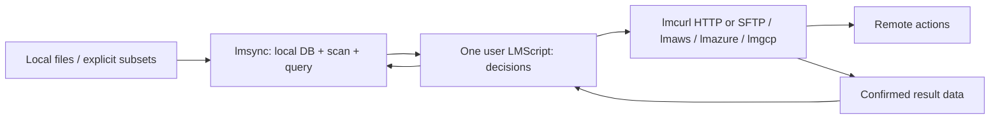

# lmsync: local believed-state manager

Status: **design only, brief v2 + addendum 2**. This is the only current sync design. It
consolidates the useful publication examples from root `SYNC_DESIGN.md` at
`d0f033f`, replacing its integrated sync/policy engine with the boundary below.
No implementation, AWS command, remote-host test, workflow dispatch, benchmark or repository creation
is performed here. The future `lmctl-ai/lmsync` repository is not created now.

Contents: [boundary](#definition-and-boundary), [API](#1-core-api-and-neutral-data),
[belief/verification](#2-believed-state-and-verification-scripts),
[optional logs](#3-optional-planresult-log-glue),
[durability](#4-durable-db-and-failure-injection),
[Java stores](#5-java-implementation-and-scale-tier-storage),
[three example pairings and host gaps](#6-three-pairings-one-script-per-job),
[multi-host milestone](#7-one-lmscript-two-hosts-first-milestone),
[benchmarks](#8-benchmark-plan-proving-the-local-state-claim),
[implementation](#9-positioning-risks-and-implementation-breakdown).

## Definition and boundary

lmsync is the local **registry**: a model of believed remote state. It provides a Java
lmcode host/library for DB access, local scanning, neutral comparisons, recording
and optional local log helpers. It makes **zero remote calls, ever**: no list,
remote stat, HEAD, credential resolution, cloud client or SSH connection. A query
about an arbitrary subset reads local state; it does not enumerate a target tree.

**One sync job is one user-authored LMScript.** That script calls lmsync for state
and lmcurl/cloud hosts for actions, then reports the results to lmsync. lmaws keeps
its existing Java/GraalVM host and SDK v2; lmazure and lmgcp keep their own hosts.
There is no C++, JNI, native sidecar or full-host rewrite **for the registry**.
The existing native lmcurl transport can add libssh2 inside its own build, without
adding native code or transport dependencies to lmsync.

| lmsync owns | The job script owns | The transfer host owns |
|---|---|---|
| DB durability, local file observations, hashes, snapshots, comparisons, set differences, record/forget, import/export, integrity queries | Key mapping; include/exclude choices; what to add/delete; cache/freshness; safety thresholds; budgets; verification sample/rate; when to rebuild; retention; invalidation | Provider/SSH protocol, remote actions explicitly requested by the script, credentials, host-key/ownership checks, service limits, transfer receipts and provider cost ledger |

There is **no config-file-driven rules engine**, automatic upload/delete choice,
record-age warning, quota policy or cloud-specific target validation in lmsync.
A page may be unchanged for years. Operational tuning parameters (batch size,
store cache, hash mode, scan globs) are ordinary API arguments, not rules that
trigger remote work. Script templates may choose defaults; core does not impose
them. A no-op job can avoid invoking its transfer host entirely. If that host is
invoked, count its security/metadata calls as well as transfers; never market
zero decision requests as zero total requests for a script that chose verification.



## 1. Core API and neutral data

All signatures below are proposed, not existing bindings. The canonical enum is
`CompareState { UNKNOWN, SAME_AS_RECORDED, CHANGED, RECORDED_BUT_MISSING_LOCALLY }`. Parameters are typed
lmcode values/handles; enum values are distinct from strings. Streaming cursors
and bounded batches are the main interface; convenience arrays are size-bounded.

```text
sync.open(path: string, namespace: string, options: OpenOptions) -> StateDB
StateDB.close() -> CloseReceipt
StateDB.target(namespace: string) -> Target
StateDB.scan(root: string, options: ScanOptions) -> ScanRun
StateDB.scan_paths(paths: PathSource, options: ScanOptions) -> ScanRun
ScanRun.next_batch(max_rows: int) -> ObservationBatch
ScanRun.finish() -> ScanReceipt
StateDB.hash_paths(paths: PathSource, algorithm: HashAlgorithm) -> ObservationCursor
StateDB.query(target: Target, paths: PathSource) -> StateCursor
StateDB.query_batch(target: Target, paths: PathBatch) -> StateBatch
StateDB.local_not_recorded(target: Target, scope: PathScope) -> StateCursor
StateDB.recorded_not_local(target: Target, scope: PathScope) -> StateCursor
StateDB.records(target: Target, scope: PathScope) -> RecordCursor
StateDB.record(target: Target, path: PathId, result: RecordMetadata) -> RecordReceipt
StateDB.forget(target: Target, path: PathId) -> RecordReceipt
StateDB.mark_suspect(target: Target, paths: PathSource, note: string) -> RecordReceipt
StateDB.set_suspect(target: Target, paths: PathSource, value: bool, note: string) -> RecordReceipt
StateDB.begin() -> WriteBatch
WriteBatch.record / forget / mark_suspect(...) -> WriteBatch
WriteBatch.commit() -> CommitReceipt
WriteBatch.rollback() -> void
StateDB.import_records(source: LocalRecordSource, options: ImportOptions) -> ImportReceipt
StateDB.export_records(target: Target, output: string, options: ExportOptions) -> ExportReceipt
StateDB.snapshot() -> ReadSnapshot
StateDB.doctor(options: DoctorOptions) -> IntegrityReport
```

Cursors expose `has_next`, `next_batch`, streaming JSONL/CSV output and `close`.
Default batches may be 4,096 records, with a caller-provided memory ceiling. Byte budgets can shorten a batch below max_rows; oversized metadata uses bounded
streaming/blob references. No million-row array is required. Explicit path lists, stdin/NUL lists, globs, git
changes, manifests and unrelated directories are adapters producing PathSource;
the core need not run git or understand a build system. The script turns a git
diff or manifest into paths. scan_paths observes only those local paths.

`PathId` is a local root identity plus relative path, or a caller-named logical
path for non-file events. Multiple roots allow unrelated directories and prevent
same-basename confusion. Local filesystem paths and caller-supplied target names
are separate. A Target is an **opaque namespace**, such as `site-production` or
`sftp-staging`, optionally with a caller-stored descriptor. The core does not
parse S3 buckets, enforce `lmaws-*`, perform flatten/strip/add-prefix mapping, or
resolve a hostname. Those choices and their collision checks are script/host work.
One local path can have a separate record for every target in the same DB.

### Comparison semantics

Query compares the latest local observation with the source fingerprint attached
to the recorded result; it performs no remote I/O and no implicit local tree scan.
The script calls scan or scan_paths first when it wants refreshed observations.
Query returns the local and recorded observations, comparison basis (`stat` or
`digest`), hash availability, explicit suspect annotation and record metadata.

| Neutral state | Exact meaning |
|---|---|
| `unknown` | No record, or insufficient local observation to compare; reason distinguishes these cases. It does not assert absence on the remote |
| `same-as-recorded` | The compared local fingerprint agrees with the one the script last recorded, under the disclosed stat/hash basis |
| `changed` | The local comparison differs; if hashing was deferred, this may mean changed stat inputs rather than proven different bytes |
| `recorded-but-missing-locally` | A recorded path has an explicitly observed local absence, from a completed scope scan or scan_paths result |

A scan receipt includes its root, filter/traversal parameters and completed coverage.
Excluded/unvisited paths are not marked absent, and changing include/exclude
parameters is not evidence that previously observed files disappeared.
A path not yet observed is not declared missing. A failed/partial scan exposes its
incomplete scope; set differences cannot describe that unobserved portion as
confirmed absence. The helpers compare local DB sets, not the remote namespace. Old upload-index
policy verdicts such as new/key-conflict/stale are not core states; the script can
distinguish absent-record vs unobserved-local reason data and map them as it wishes.
None of the four states means upload, delete, warn, refuse or rebuild. Even a
`same-as-recorded` file may need a script-chosen action because its desired remote
key or HTTP metadata changed. Conversely `changed` does not require an upload.
A suspect flag is data set by the script, not a fifth policy verdict or a TTL.

### Scan and hash cost

ScanOptions supplies include/exclude globs, symlink handling, hash algorithm/mode,
worker/batch limits and local scope. Empty filter choices mean no caller filter;
there is no built-in project/deploy exclusion policy. Hash modes are ON_CHANGE,
ON_DEMAND and ALWAYS; size/mtime checks reuse known hashes where applicable.
Record timestamp precision and optional ctime/file identity. If a stat change
hashes to the same content, disclose both facts. Never equate an opaque provider
ETag with a local content hash.

Use bounded per-directory/shard queues, streaming observations and spill files,
not a whole-tree list in memory. Directory mtimes can help detect name changes;
descendant content edits need not alter a parent directory mtime. Do not skip
children on that evidence alone. An optional local watcher is just an observation
accelerator; JDK WatchService can use Linux inotify without a new native binding.
Overflow, a stopped watcher or an interrupted scan is returned as a local
observation gap. The script chooses whether/how to rescan; no cloud verification
or record-age policy follows automatically.

A same-size edit with preserved timestamps can evade stat-based comparison. The
script can request ALWAYS hashing or an immutable source snapshot when that
matters. Re-stat around hashing and report local mutation rather than publishing
a misleading digest. The core does not certify that a later transfer read the
same bytes: the action host must report the actual transferred fingerprint.

### Record and forget

RecordMetadata carries an immutable **source fingerprint for the bytes reported
transferred**, an action/event ID and an opaque result payload. It can hold an
ETag/version, remote path, content type, Cache-Control, upload ID, SFTP attributes,
phase/status or arbitrary caller data; core does not interpret these business
fields. A logical action/event may have no source-file fingerprint.

`record` must not implicitly attach today's local fingerprint to yesterday's
transfer. Callers pass the plan/source snapshot or actual transferred hash. If a
file changed while/after uploading, a subsequent scan must still compare against
the bytes actually reported uploaded. `forget` removes believed state via a local
transaction/tombstone; it never deletes a remote path. The caller is free to
record or forget directly without any plan/log mechanism.

## 2. Believed state and verification scripts

Outside changes are invisible until a script chooses to check. Age alone does
not make a record suspect, and opening/querying never calls the remote. A DB can
faithfully preserve a mistaken user report; it cannot independently certify a
remote effect. Document these limits instead of implying a local remote oracle.

A verification script chooses N recorded paths, calls lmaws HEAD (or another
host's equivalent), compares returned data using its own policy, then explicitly
marks suspect, records revised metadata, forgets or does nothing. Sampling rate,
selection seed, cost cap, checksums and behavior on mismatch all belong to that
script. A failed sample cannot certify unsampled paths. Multipart/composite ETags,
metadata changes and encrypted objects need explicit interpretation by the host/
script, not a content-equivalence rule hidden in lmsync.

A rebuild script can fetch a listing, S3 Inventory or other records with its cloud
host, then call import_records on a **local** stream. lmsync never fetches a URL or
creates Inventory. The script chooses prefix fan-out/concurrency, coverage,
pricing/admission, validation and whether to replace or merge a target snapshot.
ImportOptions provides mechanical append/upsert/replace and transaction choices;
a replace is local state replacement, not remote deletion. Preserve import
provenance in caller metadata. A listing does not necessarily recover source paths
through a non-invertible flatten/custom mapping, and Inventory may not contain
custom metadata or checksum values. Unknown information stays unknown.

No watcher detects outside remote edits. Multiple machines can hold different
beliefs; any remote coordination/leases or conditional-write policy belongs in
the job and action host. Local single-writer locking only protects this DB.

## 3. Optional plan/result log glue

This is a **thin file codec/helper library**, not a mandatory workflow, scheduler
or executor. A script may use direct record() calls instead. A plan is data the
script wrote; lmsync never synthesizes upload/delete instructions from a state.

Proposed helpers: `plan_writer`, `result_writer`, `read_instructions`,
`read_results`, `unconfirmed(plan, results)`, and `apply_records(db, results)`.
The last helper applies only explicit record/forget projections supplied by the
script. It does not infer a projection from a verb such as `delete` or `invalidate`.
All readers/writers stream in bounded batches and return data/receipts.

### Wire grammar

Versioned UTF-8 JSON Lines; one compact object per line, LF terminator. Strings
use JSON escaping, so spaces, quotes, tabs, backslashes and embedded newlines in
path names are unambiguous. Never use whitespace-separated shell instructions or
shell interpolation. Metadata is bounded per line; large payloads refer to a
local blob plus digest. Store nanosecond timestamps, byte counters/IDs that may
exceed JavaScript's exact integer range as decimal strings. Timestamps are UTC
RFC3339 data, not expiration instructions.

Each managed line has `v`, `kind`, `job`, `op`, `payload` and a checksum. Result
lines additionally have an immutable `result_id` and explicit
`completes_instruction` boolean; separate accepted/completed/progress projections
can share an instruction op but use different result IDs. The helper
uses its versioned canonical JSON encoding of payload for CRC32C and instruction
SHA-256; all hosts share the codec conformance fixtures. Logs from external tools
may be imported explicitly, but are not silently treated as managed crash receipts.
The examples below omit computed checksums for readability; actual helper output
includes them and each result binds the full instruction digest.

```json
{"v":1,"kind":"instruction","job":"example","op":"add-a","payload":{"verb":"add","target":"site","path":"assets/a b \"quoted\".css","source_fingerprint":{"size":"3","mtime_ns":"<decimal-int64>","hash":"<digest>"},"args":{"remote_path":"assets/a.css"},"record_projection":"record"}}
{"v":1,"kind":"instruction","job":"example","op":"delete-b","payload":{"verb":"delete","target":"site","path":"old.css","args":{"remote_path":"old.css"},"record_projection":"forget"}}
{"v":1,"kind":"instruction","job":"example","op":"event-c","payload":{"verb":"cloudfront.invalidate","target":"events","path":"invalidation/event-c","args":{"paths":["/*"]},"record_projection":"record"}}
{"v":1,"kind":"result","job":"example","op":"add-a","result_id":"add-a-complete","completes_instruction":true,"payload":{"instruction_digest":"<sha256>","confirmed":true,"timestamp":"2026-01-01T00:00:00Z","projection":{"kind":"record","target":"site","path":"assets/a b \"quoted\".css","source_fingerprint":{"hash":"<actually-transferred-digest>"},"metadata":{"remote_path":"assets/a.css","phase":"uploaded","etag":"<opaque>"}}}}
```

`verb` is an arbitrary caller string; `args` and result metadata are caller data.
The only projection primitives are local `record`, `forget` or `none`. Metadata
can describe an accepted/pending remote action if that is what the script reports;
it must not thereby be presented as completed publication. Job/op identifiers and
instruction digest detect conflicting reuse. Replaying the same confirmed `(job,result_id)` is idempotent; a different
payload for that same result ID is an integrity conflict. Only the caller's
explicit completes_instruction marker removes an instruction from the unconfirmed
set. Progress/event data need not imply a fully uploaded file. A transaction commits its result-log replay offset and record changes
together, so a crash cannot skip a result or double-apply it.

A writer fsyncs a complete confirmed result before declaring that receipt durable.
A torn final line is retained/ignored as unconfirmed and can be truncated only to
the last verified line boundary. Corruption in a middle line is an error, not an
excuse to skip later results. Plan files commit atomically; appending to a journal
is single-writer. The helper never executes any verb or invokes a provider.

### Resume and the confirmation gap

Resume means the script re-plans the unconfirmed remainder. Completed results
replay into the DB even if the process died before its DB update. A transfer that
completed remotely but crashed **before** producing a durable confirmation remains
unconfirmed: lmsync cannot infer success without a report. Its instruction is not
lost, and the script can safely retry with provider idempotency/conditional writes
or explicitly reconcile the known path. It may repeat transfer work or cost.

Scripts should store multipart/progress events without a completed-file source
fingerprint until they actually report that full-file success. The core does not
interpret phase strings.

The invariant is no lost **durably reported** success and no false unchanged
inferred from intent, a start record, file existence or a partial line. Exactly-once
remote effects across a process/network/filesystem crash are not promised. A
script that reports an incorrect result can corrupt its own belief; the library
must not manufacture confirmation. Changed local sources are re-planned rather
than marked uploaded with a newly observed fingerprint. Optional log glue is not
required for small direct-call jobs, but those jobs accept a larger confirmation
window unless the action host emits its own durable result receipt.

## 4. Durable DB and failure injection

Logical records: local paths/observations; target namespaces; `(target,path)`
recorded source fingerprint and opaque metadata; explicit suspect notes; local
forget tombstones; import provenance; generations/transaction IDs; optional replay
IDs and offsets. Keep local observations separate from recorded state so scanning
never overwrites believed transfer success. Provider-specific key/hash indexes,
quota counters and release catalogs are user data or script-side structures, not
core business tables.

Use transactional/WAL storage, checksummed pages/records, monotonic committed
sequence numbers and versioned codecs. On open, validate the manifest, recover
committed WAL transactions, discard only incomplete tail records and report
structural corruption. Do not silently open an empty DB or forget records when a
file is corrupt. Compaction writes/fsyncs a new generation, atomically commits its
manifest and only then releases old unpinned files. Compaction drops superseded
records/tombstones only when snapshots no longer need them; it never expires a
path because of age. Export/backup produces a consistent checksummed snapshot;
import validates it into a staging generation before an explicit local commit.

Single writer uses an OS file lock plus diagnostic PID/process-start/instance data.
The OS releases the lock after a crash. Stale text in a lock file can be replaced
only after acquiring the real lock; do not unlink/recreate an actively locked file
or use a timeout to steal a live writer's lock. Refuse filesystems without the
required locking/atomic-rename/fsync guarantees. Concurrent readers see stable
snapshots, not partial writes. Same-process MVCC readers are the first milestone;
other processes use immutable exported/pinned generations or an explicitly
qualified snapshot protocol. Do not promise concurrent live MVStore opens across
processes without testing it. Reader crash releases OS pins/handles; compaction
never deletes a generation still pinned by a live reader.

Doctor reports local checksum/manifest/sequence/index consistency, dangling
references, transaction/replay integrity and storage statistics. It performs no
HEAD, rebuild or provider verification, and returns data for the script to handle.
Opening old-format data requires a versioned migration, not automatic semantic
policy changes. Memory, disk space, file offsets and malformed-input limits are
implementation/resource constraints, not upload/delete policy.

A deterministic kill-point harness will exercise these boundaries:

| Kill/fault point | Required observation after reopen |
|---|---|
| After plan commit, before any transfer | DB unchanged; all instructions unconfirmed |
| Mid-transfer/part | No completed record; script can use stored opaque provider resume data or retry |
| After remote transfer, before result append | Unconfirmed intent retained; no fabricated same-as-recorded |
| After fsynced result, before DB record | Replay restores exactly that reported source snapshot/result |
| During DB transaction/replay-offset commit | Both record and offset commit, or neither |
| Mid-compaction/manifest swap | Last complete committed generation remains readable |
| Disk full / failed fsync | No success acknowledgment for an undurable transaction |
| Truncated last log line | Previous verified receipts replay; last operation stays unconfirmed |
| Corrupt middle log/page/index record | Doctor/open reports corruption; no silent row loss |
| Stale lock metadata / crashed writer | OS lock can be reacquired safely; live locks cannot be stolen |
| Reader crash / active snapshot during compaction | No use-after-delete; obsolete files reclaimed only after pin release |

Compare recovered state to an independent model oracle at every kill point.
Test large offsets, empty DB, duplicate/conflicting operation IDs, arbitrary path
quoting, many targets and millions of streamed rows in JVM and native-image runs.

## 5. Java implementation and scale-tier storage

Implement lmsync as a Java lmcode host with JDK local I/O/hash primitives. GraalVM
native-image remains the deployment route; no AWS SDK, SSH client or cloud ledger
belongs in its dependency graph. TransferManager is an **lmaws** concern. No new C++
or external native state component is selected for lmsync, and there is no JNI
fallback. Existing native lmcurl may add libssh2 inside its own transport; that
does not change the registry implementation language or dependencies.

| Store | Primary-source evidence / uncertainty | Recommendation |
|---|---|---|
| Direct H2 MVStore | Java file-backed log-structured maps, MVCC and configurable cache; our native-image/large-file/crash workload still needs qualification | Small-tier candidate using explicit byte codecs, no SQL/server or object serialization |
| Custom sorted runs + sparse fences + Bloom filters | Implementable with Java NIO; immutable generations, WAL and compaction are our engineering responsibility | Recommended 100M/1B path; small-tier fallback/common export format |
| iq80 Java LevelDB / embedded LSM | Java port with batches/snapshots/cache controls; reviewed README describes limited testing, and no representative native-image qualification was found | Prototype/benchmark alternative, not an assumed production dependency |
| MapDB | JVM file-backed collections; exact dependency/reachability/durability behavior needs testing | Optional candidate; no unmeasured native-image claim |
| Xerial SQLite JDBC | Native-image support exists, but SQLite is loaded from platform native libraries through JNI | Not compatible with this brief's Java-only/no-JNI requirement |
| RocksDB JNI | Adds native libraries and per-platform JNI packaging/testing | Not needed by the proposed Java design; only reconsider with explicit new user direction if every viable Java approach fails |

Sources: [MVStore](https://h2database.github.io/html/mvstore.html),
[iq80](https://github.com/dain/leveldb), [MapDB](https://mapdb.org/doc/),
[SQLite JDBC](https://github.com/xerial/sqlite-jdbc). These provide feature evidence,
not measured lmsync results. Check pinned-version reachability and file locking
in the actual GraalVM binary; a working JVM test is not native-image certification.
No dependency is added by this design.

Sizing model: average path 96 UTF-8 bytes, one local observation plus one target
record, SHA-256 when known, roughly 128 bytes of opaque result metadata and
amortized lookup/filter overhead. Estimate **400–700 bytes per path-target pair**;
long metadata, many targets, snapshots and logs increase it. This is a planning
model, not measured codec output. Shared local observations amortize across targets.

| Tier | Proposed store | Estimated live disk at limit | Index working memory target | Proposed pre-observed 1M-query latency on recorded NVMe hardware |
|---|---|---:|---:|---|
| <=1M paths | Qualified MVStore, sorted-run fallback | 0.4–0.7 GB | 64–192 MiB | <=20 s warm / <=60 s cold |
| <=100M | Sharded sorted runs/WAL/manifest | 40–70 GB | <=512 MiB | <=20 s warm / <=120 s cold |
| <=1B | Same, bounded open shards and on-disk index/filter partitions | 400–700 GB | <=1,024 MiB | Target <=30 s warm / <=180 s cold; projection until tested |

All latency figures are **acceptance goals, not measurements**. Budget at least
2x live disk for compaction, plus configured WAL/snapshot/export headroom. At 1B
this is roughly 0.8–1.4 TB before extra retained data. Report heap, direct buffers,
RSS and OS page cache separately; no all-RAM object map or hidden unlimited mmap.
A 10-bit/key Bloom set uses about 1.25 GB at 1B, so filters/fences must be partitioned
on disk and cached, not all loaded. False positives always check full keys.

Cap memtable, block/filter caches, open shards/files and compaction workers through
plain resource options. Use checksummed blocks, explicit encodings, bounded merge
buffers, 64-bit offsets and versioned manifests. These limits bound local resources;
they never decide which remote action a script should take. Migration is a
streaming local operation retaining the prior generation until commit. Qualify
Linux x64 dynamic-glibc native images first, then macOS and Windows; retain the
existing Java cloud hosts. If Java options fail, present actual evidence and
native/JNI package-size, platform and maintenance costs before any new decision.
Do not assert RocksDB is necessary while a viable Java sorted-store design exists.

## 6. Three pairings: one script per job

(A) DOWNLOAD MANAGER is registry + lmcurl; (B) UPLOAD MANAGER is registry +
lmaws; (C) RSYNC ALTERNATIVE is registry + lmcurl SFTP. Each job is **one .lms**
using typed host registries/API only. All decisions remain user script code;
there is no rules engine in core and no protocol/credential dependency in lmsync.
The full pipeline below composes stages in one file, not several independent jobs.

These are design sketches, not new runnable files. Future examples follow the
existing CONFIG/import-only-helper conventions, picture-first README, lmdraw
architecture and lmplot result/request-count pictures, and short
`lmctl <raw-url>.lms` captions. All pictures/evidence use synthetic fixtures.

### A. DOWNLOAD MANAGER — registry + lmcurl

`download_http.lms` is one script, with its own URL manifest, destination mapping,
retry/parallel settings and trust/revalidation choices. lmsync stores only what
that script reports. It has no downloader, URL scheduler or re-request rule.

The script can skip a recorded complete download when its local file still agrees
with the recorded fingerprint: **zero re-requests for those trusted items**.
It cannot detect unseen upstream changes that way. If the script chooses explicit
revalidation, it issues a conditional GET with recorded ETag (`If-None-Match`) or
Last-Modified (`If-Modified-Since`); a 304 is still one remote request, not zero.
Prefer ETag when both are available. If 304 arrives but the local complete file is
missing or invalid, the script requests the body instead of recording success.
No mandatory HEAD-before-GET or pre-download remote listing is introduced.

The same script handles 200/full replacement, 206/resume, 304/validated local copy,
404/410/gone, redirects, retries and failures explicitly. A gone response is
recorded as data with time/status; it does not imply a local delete or a permanent
no-retry rule in core. The script chooses whether to keep an old file and when to
request a gone URL again. Neither a failed request nor a partial body becomes a
complete-download record.

Proposed one-job control flow (future file APIs; not runnable current bindings):

```text
# download_http.lms: one user-owned job
let work = registry_read_download_records(URL_MANIFEST);
for (item in work) {
  if (user_trusts_complete_local_copy(item)) { continue; }
  if (user_can_resume_recorded_partial(item)) {
    queue_lmcurl_download(item.url, item.partial_path, item.durable_offset,
                         item.strong_validator, item.expected_hash);
  } else {
    queue_lmcurl_conditional_get(item.url, item.recorded_etag,
                               item.recorded_last_modified, item.temp_path);
  }
}
let results = run_bounded_lmcurl_downloads();
# In this same .lms: record confirmed complete, partial, validated or gone data;
# retain unconfirmed work, and implement any retry/revalidation choices here.
registry_record_reported_results(results);
```

Use stable job/item IDs, an ignored sibling `.part` file, confirmed byte offsets,
local prefix digest and remote validator/expected size in the registry metadata.
Fsync a checkpoint before reporting its offset durable. HTTP resume sends Range
and a valid If-Range validator, requests an identity representation, and validates
206/Content-Range start and total size. A 200 response to a resume request restarts
the file; **never append it to an old partial**. Treat 416 by explicit size/validator
logic, not automatic completion. A weak ETag does not establish If-Range identity;
without a usable validator or immutable-source/expected-hash contract, restart.

On completion verify the script's expected hash when provided, fsync and atomically
rename the local temp file, then record the actual local fingerprint. A crash after
rename but before record remains unconfirmed and is reconciled by the script.
Progress uses distinct result IDs without a complete-file fingerprint until final
success; the registry stores offset/phase data without interpreting it. Retries
must roll back to a confirmed prefix rather than append duplicate failed bytes.
Bound concurrent files, connections, buffers, retries and backoff; honor redirects
without leaking auth across origins. Destination names come from the script, not
untrusted Content-Disposition paths. Logs redact secret headers/query values. Registry/log receipts store URL identity
or templates plus auth references, not userinfo, signed tokens, cookies or other
credential values; resolve those transiently in the action host.

The pictured example compares complete-skipped / conditional-304 / resumed-206 /
gone / failed cases, plus request counts. An interruption fixture proves restart
on changed validator, correct Range offsets and no false complete record. This is
aria2 / `wget -c` style orchestration with a persistent registry, not a claim to
replace their torrent/metalink/delta feature sets.

#### A: current lmcurl status and missing work

| Need | Available today | Additive work in lmcurl |
|---|---|---|
| Conditional GET | Request.header, Response.header/status can already express and inspect ETag/Last-Modified conditions | Typed conditional helper/result classification, safe 304 handling and persisted validator receipts; no mandatory HEAD |
| Retry and timeout | Request.retry and timeout already exist | Download-aware backoff/cancel/checkpoint behavior, retry receipts and byte bounds |
| File download | Response.save writes the already buffered body | Binary-safe streaming-to-file, bounded buffers, durable progress and temp-to-final rename receipts |
| Resume | No exposed durable file/range/If-Range resume contract | Explicit offset/validator options and 206/200/416 tests; registry-supplied checkpoint metadata |
| Parallel downloads | Suite.parallel and Curl.load serve tests/load; they are not a bounded multi-file downloader | Streaming DownloadBatch/cursor with bounded file/connection counts and per-file receipts, using libcurl multi or bounded independent handles |
| Gone objects | Status/headers available | Script records 404/410 data; helper must not erase files or hide negative outcomes |

Proposed additive lmcode surface in lmcurl (not implemented):

```text
Request.conditional(headers: ConditionalHeaders) -> Request
Request.download_to(temp_path: string, options: DownloadOptions) -> DownloadTransfer
Curl.download_batch(items: DownloadSource, options: ParallelOptions) -> DownloadCursor
DownloadTransfer.checkpoint() -> DownloadCheckpoint
DownloadTransfer.result() -> DownloadReceipt
DownloadCursor.next_batch(max_rows: int) -> DownloadReceiptBatch
DownloadCursor.close() -> CloseReceipt
```

ConditionalHeaders carries the script-supplied ETag/date; DownloadOptions carries
its offset/If-Range, expected digest, byte/deadline/retry/buffer choices. Receipts
return status, validators, actual bytes, durable offset and completion/partial
facts. The script chooses skip/revalidate/retry/gone handling and final promotion;
these APIs do not query the registry or decide which URLs belong in a job.

No change to lmsync is needed to recognize HTTP status: it simply records caller
metadata. lmcurl's HTTP protocol/redirect whitelist stays HTTP/HTTPS; enabling SFTP
must not allow an HTTP redirect to silently switch to SFTP/SCP.

### B. UPLOAD MANAGER — registry + lmaws

#### B1. `publish_ttl.lms`: static site with lmaws

Illustrative policy in one user script:

```text
CONFIG: root, DB path, target name, owned lmaws bucket receipt,
        entry globs, entry TTL=30, asset TTL=300, transfer concurrency, run cap.

lmsync block:
  open DB; scan root with the script's explicit scan options;
  query the site's paths against its recorded target;
  for each neutral row:
    script decides whether bytes or desired key/HTTP metadata warrant a PUT;
    if selected, append an add instruction with the source snapshot and headers;
  close DB / finish the optional plan file.

lmaws block, only if there are selected instructions:
  open the script's owned bucket target; admit costs using lmaws;
  stream binary PUTs with the script-selected headers and supported conditions;
  append/fsync confirmed results containing actually transferred fingerprints.

lmsync block:
  replay those explicit record projections, or call record per confirmed result;
  report query counts and recorded outcomes; close DB.
```

The essential policy appears in the future `publish_ttl.lms` itself, for example
(the factory/row/codec APIs are proposed; this is not a runnable current program):

```text
let ROOT = "./public";
let DB = ".lmsync-local/site.db";
let ENTRY_TTL = 30;
let ASSET_TTL = 300;
let CAP_USD = "0.05";

state = _lmcode_ cli="lmsync";
let db = sync.open(${DB}, "site", sync.open_options());
let scope = db.scan(${ROOT}, sync.scan_options().hash_on_change()).finish();
let target = db.target("site");
let rows = db.query(target, sync.paths_from_scan(scope));
let plan = logs.plan_writer(".lmsync-local/plan.jsonl");
while (rows.has_next()) {
  let batch = rows.next_batch(4096);
  let i = 0;
  while (i < batch.len()) {
    let row = batch.at(i);
    let key = row.path().relative();             # USER key mapping
    let ttl = ${ASSET_TTL};
    if (str_ends_with(key, ".html")) { ttl = ${ENTRY_TTL}; }
    let cache = "public,max-age=" + str(ttl);    # USER cache policy
    if (row.state() != CompareState.SAME_AS_RECORDED ||
        row.recorded().get("cache_control") != cache ||
        row.recorded().get("remote_path") != key) {
      plan.append("add", target, row.path(), row.source_snapshot(),
                  data.fields().set("key", key).set("cache_control", cache));
    }
    i = i + 1;
  }
  batch.close();
}
plan.close(); rows.close(); db.close();
end _lmcode_
# save/run state with the standard runner; stop if it failed

transfer = _lmcode_ cli="lmaws";
let cloud = aws.region("us-east-1");
let bucket = cloud.s3_target("lmaws-example-site", "<private owner receipt>");
let instructions = logs.read_instructions(".lmsync-local/plan.jsonl");
let results = logs.result_writer(".lmsync-local/results.jsonl");
while (instructions.has_next()) {
  let instruction = instructions.next();
  if (instruction.verb() == "add") {            # USER action choice
    let reply = bucket.put_file(instruction.get("key"), instruction.local_path(),
        cloud.put_options().cache_control(instruction.get("cache_control")));
    results.confirm_record(instruction, reply.source_fingerprint(), reply.metadata());
  }
}
results.close(); instructions.close();
end _lmcode_
# run only when the plan is nonempty, with CAP_USD admitted by lmaws;
# collect its exit code instead of skipping replay on partial transfer failure

recorded = _lmcode_ cli="lmsync";
let db = sync.open(${DB}, "site", sync.open_options());
logs.apply_records(db, ".lmsync-local/results.jsonl");
db.close();
end _lmcode_
# run replay even after a partial provider failure, then report that failure
```

Production implementation must include the script's preconditions and unknown-key
handling, expected source checksums, content-type mapping, error/result branches
and source-stability checks; the abbreviated example shows the ownership boundary.
No `sync.upload`, `sync.delete_remote` or `sync.execute_plan` function exists.

The script—not lmsync—chooses `changed`/`unknown` rows, maps source to keys, gives
HTML short max-age, skips other rows and refuses unsafe collisions. It does not
implicitly delete omitted objects. Core can return a same-as-recorded row while
the script detects changed desired headers in its stored metadata. A no-op script
skips lmaws; core and job decision work make zero remote queries. Live lmaws may
perform its mandatory security checks when the script requests a transfer; count
them separately. The picture shows scan/query -> chosen PUTs -> recorded receipts.

#### B2. `publish_hashed.lms`: content-hashed assets

This script hashes and transforms a supported reference graph, prepares immutable
asset paths and rewritten entries, then feeds those exact derived files/paths
through the same state API. The transformation/helper belongs to script code,
not the DB. Cache immutable assets for a year and entries briefly; the script
sets those headers in lmaws calls. Unsupported dynamic references, cycles and SRI
changes are handled explicitly by the script. It may fail or expand a previewed
dependency closure; lmsync never silently adds files outside the queried subset.
Record final-byte digests separately from source/build fingerprints. The synthetic
picture shows old/new asset URLs and entry-cache delay; assertions cover reference
rewriting and unchanged assets skipped by the script.

Policy sketch inside this single `publish_hashed.lms` (not a core option):

```text
let source = observe_build_inputs();             # local script/helper calls
let derived = rewrite_and_hash_supported_graph(source);
for (asset in derived.assets) {
  let key = "assets/" + asset.final_hash + asset.extension;
  # query its state; USER chooses a PUT/copy when needed
  put_with_lmaws_and_record(asset, key, "public,max-age=31536000,immutable");
}
for (entry in derived.entries) {
  put_with_lmaws_and_record(entry, entry.name, "public,max-age=30");
}
```

Here `rewrite_and_hash_supported_graph` and `put_with_lmaws_and_record` are explicitly
user-owned `.lms` helpers implementing that job's policy/host calls, not lmsync
functions. They stream/batch rather than build an unbounded in-memory graph.

#### B3. `publish_release.lms`: prefix activation and rollback

The script stages a complete manifest under a release prefix, records each action,
then asks lmaws to conditionally switch an owned CloudFront origin path or an
explicitly implemented routing pointer. A pointer is not automatically interpreted
by CloudFront. Journal activation as another user-chosen event. Retain previous
complete releases and perform rollback by a new switch, not by re-uploading their
bytes. The switch is a single control-plane commit, not a transaction spanning
all objects/edge locations; entry TTL and distribution propagation remain.

The script chooses keep-last-N, grace time, pins, safety thresholds and exactly
which indexed release paths to delete. It must handle incomplete staging, switch/
record crash gaps and conditional conflicts. No release catalog, GC rule or
rollback action is built into lmsync. A new physical prefix can require PUT/COPY
of unchanged bytes: measure that amplification rather than promising 1% writes
in a mode that deliberately changes every destination key. The picture shows
stage/activate/previous/rollback and a simulated interrupted activation.

Its user-script control flow is explicit:

```text
let release = USER_SELECTED_RELEASE;
let complete = stage_release_with_lmaws_and_record(release);
assert(complete);
let before = read_user_recorded_activation();
let switched = lmaws_switch_origin_path_with_etag(release, before.config_etag);
record_user_activation_event(release, before.release, switched);
# An explicit rollback branch switches to before.release and records that action.
# A separate USER decision computes retained releases and chosen exact GC paths.
```

These helpers are policy-bearing script code. lmsync only stores/retrieves the
reported per-file and activation-event metadata; it does not understand release IDs.

#### B3.1. Freshness policies retained from the earlier design

These are selectable **script templates/options**, not core enums/rules. A script
may expose flags or variables named `ttl`, `hashed`, `release`, `invalidate`, or
combinations. It implements their meaning and passes only plain scan parameters,
state operations and explicit cloud actions to the hosts. Small-site template
recommendation: TTL. Large-site template recommendation retained from the prior
design: release + hashed assets + short-TTL entries, with its staging/retention
tradeoff shown. Hashed + TTL remains a lower-write-amplification alternative.
Neither recommendation is automatically selected by lmsync based on size.

| Script policy | Cost/request implications | Freshness delay | Rollback | Failure modes |
|---|---|---|---|---|
| `ttl` | Changed PUT/metadata operations; ordinary cache misses; no invalidation fee | Entry/asset TTL selected by script | Re-publish retained prior bytes | Mixed caches and non-atomic multi-file publication |
| `hashed,ttl` | Hash/transform CPU, new asset objects and rewritten entry PUTs; keep old referenced assets | New asset URLs avoid stale bytes; entries still wait TTL | Re-publish retained entries pointing at retained assets | Unsupported references, cycles/SRI, premature old-asset deletion |
| `release,ttl` | Stage/copy release objects, one switch plus polls, retention and chosen GC | Switch propagation plus unversioned-entry TTL | Immediate rollback request to retained prefix; not instant global viewer freshness | Incomplete release, switch/record gap, conflicting update, stale entry caches |
| `release,hashed,ttl` | Above plus transformation; exact reuse/copy scheme is script policy | Same switch/entry delay, coherent immutable references | Same switch | Combined graph/activation issues and additional physical keys |
| Explicit `invalidate` combined with any policy | Submitted paths and potential cache-refill cost, plus status calls | Asynchronous completion; browser caches may remain | Whatever the base script implements; invalidating rollback is another explicit action | IAM denial, cap refusal, uncertain completion or broader cold-cache load |

The invalidation example can choose cap 100, prefer one safe wildcard when cheaper,
print a cost estimate first, use the lmaws ledger and allow a separate explicit
cap override. Those choices are visible script policy; no lmsync method enforces
or defaults them. Preserve optional scoped IAM grant via the existing lmaws grant
recipe; remove the current default policy-builder CreateInvalidation grant during
that host's implementation work if adopting this example policy. No policy is
changed by this design. Existing explicit host APIs remain compatible through a
properly guarded/costed implementation; no default job invalidates implicitly.

#### B4. `publish_git_diff.lms`: arbitrary cherry-pick

The script obtains a NUL-delimited git diff against its chosen deployed revision,
or accepts an explicit list/manifest/stdin paths, observes only those local paths,
queries them and selects transfers. It can combine unrelated root aliases and
map them to a bucket/prefix chosen in the script. It checks flatten/key collisions
itself before execution. Renames/deleted source entries do not automatically
become remote deletes; the script decides. Its synthetic picture compares the
small chosen subset with a large recorded namespace and shows zero remote
queries by lmsync. The recipe can also demonstrate build-manifest and one-off
file lists without adding corresponding core policy concepts.

For example, the job—not the state library—chooses the candidate list:

```text
let diff = system(["git", "diff", "--name-status", "-z", DEPLOYED_REV, "HEAD"], 30000);
assert(diff.code == 0);
write_file(".lmsync-local/git-paths.nul", diff.stdout);
let candidates = parse_git_diff_as_paths(".lmsync-local/git-paths.nul");
# lmsync scan_paths/query -> USER selection -> lmaws PUT -> lmsync record.
# USER may instead supply a build manifest or a cherry-pick list from several roots.
```

NUL parsing preserves whitespace/quotes; the job handles rename/deletion statuses.
The git invocation is illustrative and was not executed for this design.

#### B5. `verify_sample.lms`: user-chosen verification

The script selects N random recorded objects with a visible seed and sampling
policy, calls lmaws HEAD with its own ledger allowance, compares metadata/checksum
semantics, and explicitly marks selected records suspect or updates their data.
N, the rate, what constitutes mismatch and any follow-up rebuild are script code.
No core warning appears because a record is old. HEAD cannot always establish
full byte equality; unknown/missing checksum evidence is handled by that script.
Its picture labels sampled vs untested records and shows the actual HEAD count.

The verification choice is visible in the `.lms` source:

```text
let selected = user_reservoir_sample(recorded_paths, N, SEED);
for (path in selected) {
  let actual = lmaws_head(path.recorded_remote_path);  # explicit paid remote action
  if (user_metadata_comparison_says_mismatch(path, actual)) {
    lmsync_mark_suspect(path, "sample mismatch");
  }
}
```

The sample helper, N, seed and comparison are user script code. lmsync provides
record iteration and mark_suspect, not a sampling schedule or verification policy.

#### B6. `track_invalidations.lms`: user actions and monthly quota

This job obtains paths from its own logic, chooses exact vs wildcard, counts
submitted paths (a wildcard counts as one), prints cost, admits it through lmaws,
then calls CreateInvalidation with a stable caller reference. It records accepted
and later completed phases in an opaque event namespace using record(), just as
for any other reported action. lmsync has no CloudFront verb handler or monthly
quota counter. The script groups its recorded event metadata by UTC month and
sums accepted path quantities, deduplicating the provider/caller identity.

The account-wide allowance is shared across distributions and outside callers.
Local event history can report **known recorded usage**, not guarantee remaining
free quota. Missing history, other writers and a crash before recording can make
that count incomplete. The script can reconcile/retry a known caller reference
or import reviewed receipts; it cannot assume zero outside usage. Conservative
cost estimation prices paths without assuming remaining allowance. Failed-before-
acceptance attempts are not silently recorded as successful quota use; uncertain
outcomes remain explicit until the script reconciles them. The picture shows
known monthly paths, uncertainty and estimated charge; no real billing evidence.
[AWS invalidation billing](https://docs.aws.amazon.com/AmazonCloudFront/latest/DeveloperGuide/PayingForInvalidation.html).

For example, the user's job can express its monthly accounting as:

```text
let known_used = user_sum_recorded_accepted_paths(UTC_MONTH);
let paths = user_selects_and_deduplicates_paths();
let charge = user_estimate_with_uncertain_free_allowance(known_used, paths);
print_estimate_before_call(charge, paths);
let reply = lmaws_create_invalidation(paths, STABLE_CALLER_REFERENCE);
lmsync_record_event("invalidation/" + STABLE_CALLER_REFERENCE,
                   reply.phase, reply.timestamp, paths.count(), reply.metadata);
```

The host ledger still admits the request. The user may expose cap/override flags
in this script; none of those helpers or constants becomes lmsync business logic.

#### B: exact lmaws actions needed and current gaps

This audit uses the checked `schema/lmaws.dsl.json`, CloudHost registry and
WebStackAws implementation. Names in the proposed column are design names,
not claims that they exist today.

| Script need | Current lmaws surface | Proposed additive transfer-host work |
|---|---|---|
| Persistent owned bucket access | Run.bucket and Run.put(Row,string,string) exist for sandbox/string writes; Web.step uploads a fixed set of site assets | `s3_target(bucket, owner_receipt)` persistent handle with existing prefix/tag/profile guards; explicit lifetime, no implicit deletion on successful close |
| Arbitrary binary PUT with caller headers | Private WebStackAws file upload exists; no general typed file PUT API | `S3Target.put_file(key, local_path, PutOptions) -> TransferReceipt`, content type/Cache-Control/storage class/checksum/conditions chosen by script |
| Streaming multi-file transfer | Current backend uses synchronous URLConnection; no general TransferManager API | SDK v2 S3TransferManager with explicit Java multipart async client and bounded transfer/request/byte options; no CRT |
| DELETE exact objects | Sandbox cleanup/Web.down exist; no general typed per-key receipt-oriented DELETE | `delete_object(key, DeleteOptions) -> ActionReceipt`; expose version/condition outcomes, do not invent a deletion policy |
| Server-side COPY | No general typed COPY binding | `copy_object(source, destination, CopyOptions) -> TransferReceipt`; expose checksum/version/source and destination conditions and full SDK result |
| HEAD for verification | No general typed per-object HEAD binding | `head_object(key, HeadOptions) -> ObjectMetadata`, with absence/denial distinguished and checksums interpreted explicitly |
| Multipart resume | No general typed multipart/resumable receipt surface | Expose opaque resumable state or start/part/complete/abort actions; the script stores upload ID, part receipts, source snapshot and phase in record metadata/logs |
| Release switch/rollback | Web.step builds distributions/cache settings; no general owned origin-path/pointer CAS operation | `distribution_config` + conditional `set_origin_path` or explicit pointer PUT, with opaque config/version receipts and bounded status wait |
| Chosen invalidation paths/status | Web.step("invalidate",...) reaches a private wildcard-only helper | Typed `create_invalidation(paths, caller_reference)` and `get_invalidation`; expose counts/cost/receipt, route through host ledger and optional IAM grant |

The scripts need S3 PutObject/DeleteObject/GetObject (HEAD/copy source), relevant
multipart actions (including abort; ListParts only if that script explicitly
reconciles a known upload), and object version permissions only when selected.
The host validates the exact action/resource request and records its service cost;
lmsync stores only the supplied data. COPY must inspect the complete result, not
assume every HTTP 200 means success, and expose supported preconditions; if the
pinned SDK cannot express a required condition, the script must choose a safe
alternative instead of an unguarded write. [CopyObject API](https://docs.aws.amazon.com/AmazonS3/latest/API/API_CopyObject.html).

For examples (a)–(g), preserve `lmaws-*` bucket names and `lmaws_test` ownership in
lmaws, AWS_PROFILE=lmaws for live actions and the existing cost ledger. No such
prefix/profile/cap rule lives in lmsync. TransferManager, its Java async transport,
resumable-state tests and the generic file APIs are missing integration work,
not a reason to replace the Java host. [Java multipart client](https://docs.aws.amazon.com/sdk-for-java/latest/developer-guide/s3-async-client-multipart.html),
[TransferManager](https://docs.aws.amazon.com/java/api/latest/software/amazon/awssdk/transfer/s3/S3TransferManager.html).

### C. RSYNC ALTERNATIVE — registry + lmcurl SFTP

**Replace the former Java SSH-library proposal.** SFTP/SCP transport belongs in
existing libcurl-based lmcurl through **libssh2**, not SSHJ/JSch/MINA or JNI in
lmsync. `sftp_copy.lms` is one job, selecting upload or download over SFTP. It
compares a chosen local/manifest subset to recorded state and performs only its
selected transfers: no remote tree enumeration and no remote checksum-comparison
round trips. Files can come from unrelated directories; a directory mirror is
one possible user policy, not the required input shape.

A known-complete unchanged item can be skipped without reconnecting. This trusts
the recorded belief; outside SFTP edits remain invisible until a user-chosen
verification. Do not claim rsync's remote delta algorithm or automatic detection
of unseen remote edits. SSH handshake, opens, write acknowledgments, rename and
any libcurl-required file metadata are protocol work, not a claim of zero packets.
Optional explicit stat/list APIs exist for verification scripts, not normal
comparison. Count any stat used to reconcile a partial separately.

Single-job sketch, with the same registry/action/record phases:

```text
# sftp_copy.lms: DIRECTION, chosen paths, mapping, auth refs and resume policy here
let work = user_selects_from_registry_and_local_manifest();
let connection = lmcurl_sftp_connect(USER_HOST_ENV, KNOWN_HOSTS_FILE, AUTH_REFS);
for (item in work) {
  if (DIRECTION == "upload") {
    let temp = user_unique_sibling_temp_name(item.remote_path, item.op_id);
    lmcurl_sftp_mkdir_parents(item.remote_parent);
    let receipt = lmcurl_sftp_put(item.local_path, temp, item.recorded_checkpoint);
    lmcurl_sftp_rename(temp, item.remote_path, USER_RENAME_OPTIONS);
    registry_record_confirmed_final_result(item, receipt);
  } else {
    let receipt = lmcurl_sftp_get(item.remote_path, item.local_part_path,
                                item.recorded_checkpoint, item.expected_hash);
    user_verify_fsync_and_rename_local_file(receipt);
    registry_record_confirmed_final_result(item, receipt);
  }
}
```

These are proposed host/user-helper names, not current runnable APIs. Upload uses
a private unique temp file, mkdir-p semantics for only the requested parents, then
rename after confirmed transfer. No remote shell `mkdir -p` or arbitrary SSH shell
is needed. The API implements SFTP operations with correct path escaping; reject
paths it cannot represent instead of interpolating quote commands unsafely. Expose
atomic-rename/fsync support as capabilities; fail or explicitly report a weaker
operation if the server lacks the required extension. A cross-filesystem move is
not silently called atomic. Missing files, denied mkdir and rename collisions
must remain distinct from success.

Download writes a local `.part`, uses the registry's durable offset and expected
source identity, then verifies and renames locally. Upload resume uses a recorded
source snapshot and a private operation-specific remote temp, not blind append to
the published path. SFTP has no universal HTTP-style content validator. Safe resume
requires a trusted immutable source/checkpoint or a strong expected final digest;
otherwise the script restarts or explicitly verifies. A remembered offset alone
cannot prove that a remote prefix survived or was not changed. Never seek past a
missing/truncated temp and create a hole. A requested stat/reconciliation or restart
is safer than inventing remote prefix integrity. No checksum round trip is required
by the registry; expected-hash validation is local after receiving bytes.

Store confirmed progress, temp paths, direction, source snapshot/digest and phase
as opaque registry metadata. Do not attach a completed-file fingerprint while
progress is partial. Acknowledged writes are not proof of server fsync; require its
extension when relying on a durable remote checkpoint. The script handles uncertain
rename outcomes and cleanup/retry. The picture shows both directions, checkpointed
temps, final rename and zero remote traversal/checksum comparison requests.

#### C: lmcurl implementation, crypto and packaging

At the source audit (`lmcurl` commit `8e65448`, relevant files clean),
CMakeLists.txt has `CURL_USE_LIBSSH=OFF` at CMakeLists.txt line 150 and
`CURL_USE_LIBSSH2=OFF` at line 155. Therefore lmcurl has **no SFTP today**. Its HTTP
request path also hard-restricts protocols to HTTP/HTTPS. Enabling a build option
alone does not add the typed API, authentication, safe resume or streaming files.

The implementation step is to pin a libssh2 release/archive hash in lmcurl's
existing dependency lock/sync/verify mechanism, build it static like other
application libraries, set `CURL_USE_LIBSSH2=ON`, and keep libssh disabled. Add its
BSD-3-Clause copyright/license text to THIRD_PARTY_NOTICES and embedded notices;
record any crypto/compression dependency notices as well. Do not select libgcrypt
or another backend by accidental autodetection. [libssh2 license](https://libssh2.org/license.html),
[libssh2 build backends](https://github.com/libssh2/libssh2/blob/master/CMakeLists.txt).

| Platform | Existing inspected state | Planned SSH crypto / status |
|---|---|---|
| Linux x64/arm64 | Full host, pinned static OpenSSL, dynamic glibc | Link static libssh2 to the **same** pinned OpenSSL libcrypto; reuse zlib only if enabled. No extra libssh2/libcrypto shared-library deployment; preserve the existing dynamic-glibc rule, not fully static glibc or musl |
| macOS x64/arm64 | Metadata-only no-network stubs currently return before full dependency setup; full-client CMake intent is SecureTransport | libssh2 has no SecureTransport crypto backend. When the full host is implemented, retain HTTPS SecureTransport and use bundled/pinned static OpenSSL libcrypto for SSH; do not invent a SecureTransport SSH backend. Qualify both architectures before claiming SFTP support |
| Windows x64 | Metadata-only stub currently; full-client CMake intent is Schannel | Prefer libssh2 WinCNG to align with native Windows crypto. Qualify key/agent/algorithm coverage and remaining full-host dependencies; unsupported algorithms/auth must fail clearly. Stub is not a successful transfer implementation |

The Java-only restriction applies to the registry; this is a dependency inside the
already native C++ lmcurl transport, not a new component or JNI bridge in lmsync.
Linux linkage tests must reject unintended libssh2/OpenSSL shared dependencies and
retain the current glibc compatibility floor. Expose compiled protocol/capability
metadata and report unsupported platforms/features honestly.

Planning budget, **not measured**: libssh2 plus wrappers may add roughly 0.3–2 MiB
to a stripped full Linux executable and 15–120 seconds to a warm two-core build,
when existing crypto archives are reused. A newly bundled macOS libcrypto could
add several MiB and additional minutes; measure the entire full-host transition
separately from SSH. Windows WinCNG reuses system crypto, but the stub-to-full-host
size/time delta is not yet known. Capture before/after stripped size, clean and
incremental build time, dependency graph and linkage on each real build. Do not
present estimates as release results or weaken host-key checks to meet a size goal.

#### C: host verification, authentication and API

Mandatory known_hosts or an explicitly trusted SHA-256 host-key pin is checked
before credentials/data are sent. Unknown/mismatched keys fail; no accept-all or
automatic TOFU fallback, and HTTP Request.insecure must not disable SSH verification.
Select one mandatory known-host/pin policy; conflicting verification inputs are
an error, not a trust fallback. Use libcurl's interfaces and test hashed
known_hosts as well. Pool
connections by host/port, user/auth reference and verification policy/digest; a
changed known_hosts/pin policy must force fresh verification, not reuse a connection
vetted under old settings. [known-host behavior](https://curl.se/libcurl/c/CURLOPT_SSH_KNOWNHOSTS.html),
[SHA-256 pin option](https://curl.se/libcurl/c/CURLOPT_SSH_HOST_PUBLIC_KEY_SHA256.html).

Support private/public key-file authentication and SSH agent authentication where
the backend/platform supports it. User, passphrase/password and agent-socket
settings use private environment references or approved key-file paths; never
literal secrets in script argv, URLs, logs, pictures, registry metadata or recorded receipts. Examples
name environment variables/key paths only. Redact credential values, verbose SSH/
curl traces, URL userinfo and sensitive query/header values. Agent support failures
must be explicit, not silently downgraded to password or trust-all auth.

Proposed typed API in **lmcurl**, all additive and capability-checked:

```text
curl.sftp_session(host_env, port, HostVerification, AuthReferences) -> SftpSession
SftpSession.put_file(local_path, remote_temp, TransferOptions) -> FileTransfer
SftpSession.get_file(remote_path, local_part, TransferOptions) -> FileTransfer
SftpSession.rename(source, destination, RenameOptions) -> ActionReceipt
SftpSession.mkdir(path, parents: bool) -> ActionReceipt
SftpSession.delete_file(path) -> ActionReceipt
SftpSession.stat(path) -> RemoteAttributes             # explicit optional verify/reconcile
SftpSession.list(path, ListOptions) -> RemoteCursor    # explicit verify only
SftpSession.close() -> CloseReceipt
FileTransfer.checkpoint() / result() -> TransferReceipt
```

TransferOptions exposes supplied offsets, expected source identity/digest, bounded
stream buffers, deadline/retry/cancel and progress-result output. Add bounded
parallel file/connection helpers with independent easy handles or libcurl multi;
do not share a mutable easy handle between threads. Separate HTTP and SFTP session
factories and keep HTTP redirects from switching protocols. File methods accept
literal file paths, not automatic wildcard expansion or trailing-directory URLs
that would trigger a listing. Listing is a separate explicit verify call. SCP capability may
exist in the bundled backend, but this milestone exposes/tests SFTP first rather
than silently accepting all new protocols.

Known-offset resume may use libcurl seek/resume facilities, but qualify actual
SFTP behavior, including missing/truncated remote temps and required stat calls.
Do not assume an HTTP resume option resumes HTTP PUT or implements SFTP state
validation. Parent creation, rename/delete/mkdir quoting and any protocol-required
attributes need operation-specific tests. [resume option](https://curl.se/libcurl/c/CURLOPT_RESUME_FROM_LARGE.html),
[parent creation](https://curl.se/libcurl/c/CURLOPT_FTP_CREATE_MISSING_DIRS.html).

#### C: local-only transport test plan

The implementer changes lmcurl directly—no owner hunting or handoff-only bug list.
Use an isolated local sshd/test container on a loopback high port, disposable
fixture users/keys/known_hosts, private temp directories and no real remote hosts.
Test put/get, both resume directions, mkdir parents, exact delete, rename, optional
stat/list (only in an explicit verify test), spaces/quotes/Unicode paths, unknown
and changed host key, hashed known_hosts, wrong pin, key and agent auth, missing
agent, permission denial, missing/truncated temp, connection loss, server restart,
source mutation, fsync/rename unsupported, bounded parallelism and cancellation.

Kill between transfer, rename, result-log fsync and registry record. Verify that
partial/uncertain work never becomes complete and that confirmed results replay.
Instrument protocol actions: normal subset comparison performs no remote listing
or checksum-comparison command; count transfer/resume metadata honestly. Check
redaction of all auth references' values, dependency pins/notices and Linux linkage.
Keep existing HTTP tests green. macOS/Windows stub tests must report unsupported;
full-platform SFTP tests become mandatory when those full transports are built.
No local sshd, build, cloud call or remote-host test is executed by this design task.

### Full pipeline — A, then clean, then B, optionally C, in one script

`download_clean_publish.lms` contains the orchestration and policy for all stages:

```text
# One .lms job; helpers are import-only functions, not independent scheduled jobs.
let acquired = A_download_with_lmcurl_and_record(REGISTRY, INPUT_URL_MANIFEST);
assert(user_required_inputs_are_complete(acquired));
let cleaned = user_clean_transform_locally(acquired, TRANSFORM_VERSION);
record_local_transform_results(REGISTRY, cleaned);  # generic local reported data
let uploaded = B_publish_with_lmaws_and_record(REGISTRY, cleaned, SITE_POLICY);
if (USER_WANTS_SFTP_MIRROR) {
  C_sftp_put_with_lmcurl_and_record(REGISTRY, cleaned, SFTP_TARGET);
}
```

A C-download source can feed the same clean/B path too. “Clean” is user-authored
local transformation/selection, optionally calling existing local parsing tools;
there is no lmsync.clean rule or implicit remote cleanup. Use separate target/event
namespaces for downloads, partial checkpoints, transformations, S3 publication and
SFTP. Store source/transform fingerprints so the script can skip work it trusts.
Only cleaned approved artifacts reach B/C, never credentials, private registry
files or arbitrary server-supplied paths. Import each phase's confirmed results
before reporting failure; a partial A does not automatically publish an incomplete
site unless the user explicitly programmed that policy. Picture the full graph
and per-stage request/record counts with synthetic fixtures.

## 7. One LMScript, two hosts; first milestone

**Available today:** a `.lms` file can contain multiple `_lmcode_` / `_dsl_` blocks,
each compiled against its own `cli="host"` schema. `savedsl` writes bytecode;
`dsl_cli(program)` returns the matching executable argv; `system(argv, timeout)`
runs it. `${...}` interpolation supplies scalar strings/numbers/bools, so a file
path can bridge blocks. Schema-bound handles belong to their host process: do not
pass a StateDB/S3 handle to another host, merge schemas blindly or assume that
printing/serializing a compiled block transfers its live objects.

The existing lmweblab report scripts already demonstrate lmdraw and lmplot in one
LMScript. The source contract is in
`lmscript/durable-memory/lmscript_language_reference.md` (DSL blocks) and
`lmscript/lmscript.ts` in the existing monorepo; only local source inspection was
used, with no workflow dispatch. General orchestration is therefore available;
a new universal multi-host VM or cross-language JNI bridge is not required.

Illustrative orchestration shape, using existing runner mechanics but future
lmsync/provider APIs inside the marked bodies:

```text
# === CONFIG ===
let DB_PATH = ".lmsync-local/site.db";
let PLAN_PATH = ".lmsync-local/plan.jsonl";
let RESULT_PATH = ".lmsync-local/results.jsonl";
# === END CONFIG ===
state_program = _lmcode_ cli="lmsync";
  # future local scan/query API; user-written if/loop chooses instructions
end _lmcode_
savedsl(state_program, ".lmsync-local/state.dslb");
let a = system(concat(dsl_cli(state_program), ["--dsl", ".lmsync-local/state.dslb"]), 120000);
assert(a.code == 0);

transfer_program = _lmcode_ cli="lmaws";
  # future file/receipt API; user-written policy consumes PLAN_PATH and writes RESULT_PATH
end _lmcode_
# save and run the transfer host only if this script selected actions

record_program = _lmcode_ cli="lmsync";
  # future local record/log-replay API consumes confirmed RESULT_PATH projections
end _lmcode_
# save and run, check every exit code, close resources, report this job's result
```

This is a mechanism sketch, not a currently executable lmsync script. Markers/
`cli` are supported aliases, but lmsync does not yet exist and has no installed
schema. Current `read_lines` returns an array: do not load a million-line plan
through it. Add thin streaming/bounded file-reader/writer helpers and shared
codec fixtures to participating hosts, or partition local files into bounded
batches. Process one batch or a streaming file in a host, not one process per
file. Keep policy in the `.lms` block's explicit code; helpers do not dispatch
verbs by themselves. Generic local codec APIs are the only common host glue.

lmazure and lmgcp use exactly the same local state/query/record data contract.
Replace the transfer block with their typed blob/object API and receipts; native
.NET/Go/Java implementations can read the versioned files without sharing live
objects or linking the DB. Provider names and Azure/GCP safety/cost rules remain
in those hosts/scripts. No lmsync provider plugin or cloud credential is needed.
SFTP uses a separate explicit `cli="lmcurl"` block with the same reported-result
contract as its HTTP downloads. Both are action-host functions, never registry
methods. A pipeline can reuse lmcurl in multiple phases and lmaws in another.

### Per-pairing integration gaps

| Pairing | lmcurl work | lmaws work | LMScript/core glue |
|---|---|---|---|
| A: download | Existing headers/retry/status are usable; add streaming-to-file, validator/conditional helpers, safe durable resume and bounded parallel file downloads | None for generic HTTP acquisition | Existing multi-host block runner works; add bounded record/receipt file helpers. Registry stores reported HTTP/partial data only |
| B: upload | Optional A precursor only | Generic binary PUT/COPY/DELETE and persistent targets; TransferManager/multipart resume receipts, release-switch and chosen invalidation APIs as detailed above | Same file/record glue; user script supplies key/cache/spot-check policies |
| C: SFTP | Enable/pin libssh2, platform crypto/notices, verified auth, typed put/get/rename/mkdir/delete, explicit stat/list and safe resume/parallelism | None for SFTP transport | Existing lmcurl block runner; opaque checkpoint/results pass through registry. No Java SSH library |
| A -> clean -> B (+ C) | A/C capabilities above | B capabilities above | One script orchestrates phases and explicit local clean helpers; no new scheduler or policy engine |

There is no missing fundamental ability to call two hosts today. What is missing
is the future lmsync schema/implementation and transport/streaming APIs identified
in the table, plus bounded file-codec helpers; do not claim these examples already
run with today's binaries.

### Smallest useful milestone

1. Java lmcode skeleton and a qualified small crash-safe store: open/close, local
   scan/scan_paths, hash-on-change/on-demand, neutral query, set differences,
   record/forget, bounded iteration and transactions.
2. Thin optional plan/result codec with direct-call alternative, idempotent
   confirmed replay, local import/export, doctor and the kill-point tests.
3. One complete `publish_ttl.lms` containing its own choices and two-host glue,
   plus a **local fake S3-like executor** returning deterministic receipts. Test
   first publish, no-op, one changed file, local deletion without automatic remote
   deletion, uncertain transfer, result-before-record crash and changed-source race.
4. Add the smallest lmaws persistent-target/binary-PUT/receipt APIs needed for
   the same script. Test real SDK serialization against loopback transports.
5. **Only after later explicit live authorization**, run that one job against one
   owned test bucket named `lmaws-*`, tagged `lmaws_test`, within lmaws ledger caps.
   The script explicitly cleans its known test objects/bucket in success and
   failure paths and records/report outcomes. The real test is a future milestone,
   not executed or authorized by this design task.

No need to finish every cache policy, SFTP provider, large-store tier or inventory
importer before this local state primitive is useful. The repo is created later;
this document does not create `lmctl-ai/lmsync` or dispatch any build/release job.

## 8. Benchmark plan proving the local-state claim

No measurements are fabricated here. Use deterministic synthetic fixtures and a
local protocol-recording fake endpoint first. A network-denying harness must prove
that all lmsync operations, including doctor/import/recovery, make **zero network
calls**. Benchmark transfer scripts separately, counting every host request,
security check, retry and byte. Emulator timing is not AWS timing.

### Query and request counts

Measure 1M queried paths as index-only lookups with existing local observations,
then separately end-to-end local scan/stat/hash + query. Include random and
localized sets, hits/misses, multiple targets, dirty stat records, unrelated roots
and streaming output. Compare HEAD-per-file and explicit list-and-compare via the
fake action host, not new network methods in lmsync. An arbitrary subset of M paths
need not correspond to a remote directory; enumerating N remote keys still leaves
the application to compare that subset. An existing local DB answers directly.

Expected decision counts below are **hypotheses for measurement**, excluding
separately reported transfer-host security checks. Assume full 1,000-object pages;
directory shape, short pages, retries and baseline options can add requests.

| No-change decision method | 10k files | 200k files | 1M queried paths with a 1B-object target |
|---|---|---|---|
| lmsync local query | 0 remote calls | 0 remote calls | 0 remote calls; 1M local comparisons |
| HEAD/stat per file baseline | 10k HEAD/stat | 200k HEAD/stat | 1M HEAD/stat |
| Flat list-and-compare | About 10 LIST | About 200 LIST | At least 1M LIST pages if enumerating the whole target |
| AWS CLI `s3 sync` tree workflow | Expect about 10 LIST plus measured extras | Expect about 200 LIST plus extras | Destination enumeration scales with the compared namespace |
| rclone ordinary sync | Page lower bound plus per-directory/metadata calls | Same caveat | Measure directory traversal, not only the flat lower bound |
| rclone fast-list sync | About 10 LIST plus measured checks | About 200 LIST plus checks | Enumeration and memory scale with destination |
| rclone no-traverse subset copy | Direct candidate checks measured; no full-tree listing expected | Same | A fair optimized subset competitor; usually trades traversal for direct checks |

Do not claim every tool always lists. Fix/document the exact baseline flags and
versions, including rclone modtime/HEAD-after-upload and fast-list memory choices.
Keep metadata, integrity checks, concurrency, part settings, byte sizes, latency,
region/endpoint and retry policy comparable; report tuned as well as default
baselines. [AWS CLI sync](https://docs.aws.amazon.com/cli/latest/reference/s3/sync.html),
[rclone S3 behavior](https://rclone.org/s3/), [rclone flags](https://rclone.org/flags/).
No baseline commands are executed here. A future non-lmaws AWS baseline requires
its own explicit authorization; loopback/fake comparisons need no real account.

ListObjectsV2 returns at most 1,000 keys/page. A billion keys implies at least a
million LIST requests, roughly $5 under an illustrative $0.005/1,000 request rate,
before other costs. At illustrative $0.0004/1,000 read requests, 1M HEADs cost $0.40;
lmsync's local query costs $0 in remote requests. These are arithmetic examples,
not invoices, performance measurements or hardcoded lmsync prices. Pricing belongs
to the script/action host. [ListObjectsV2](https://docs.aws.amazon.com/AmazonS3/latest/API/API_ListObjectsV2.html),
[AWS pricing example](https://docs.aws.amazon.com/solutions/latest/automated-security-response-on-aws/cost.html).

### 10k / 200k publication jobs

Create real local synthetic trees of 10k and 200k files with recorded distributions,
seed and digests. Measure first publication, no-change re-run, and 1% changes
(100 / 2,000 files), plus separate metadata-only, preserved-mtime and multipart
variants. Run the same user policy with state enabled and a Java transfer baseline
without remembered state to isolate DB benefits from SDK transfer throughput.

Collect scan/query/decision/transfer/record wall time, CPU/hash bytes, peak heap/RSS,
OS page cache, disk I/O, open-file peak, per-operation request counts, uploaded/copied
bytes and action-host estimated cost. Use at least three trials with hardware,
filesystem, dependency versions and JVM/native-image labels. A cold process is not
a cold filesystem cache; report the distinction. Any picture from fake trials is
clearly synthetic.

With a script that chooses only changed stable-key single-part uploads, expected
PUTs are N initially, 0 on no-op, and 0.01N for a 1% content change, plus host checks
and any verification the script deliberately selected. Release prefixes, hash
rewrites and script-selected verification can amplify these counts; show them as
separate policies, not hidden costs of the state primitive. A 200k first publish
can exceed the existing lmaws $0.25 per-run hard ceiling. Use the fake executor for
that experiment; any later live campaign needs explicit bounded batches, aggregate
cost disclosure and authorization, not a silent cap raise.

### 100M-entry local index test

Generate **100M local index path records**, realistic target records/opaque metadata
and required lookup families on disk, not 100M real local files or S3 objects.
Check free disk/headroom first (the sizing model calls for at least 200 GB for this
test plus extra retention as configured). Measure actual bytes per family, WAL,
filters/fences, compaction amplification, bulk ingest, open/recovery time and
1M-query warm/cold latency under fixed memory limits. Include 90/10 hit/miss mix,
localized/uniform random queries, multiple targets, 1% updates, forget tombstones,
concurrent snapshot readers and forced-kill recovery. Use 64-bit offsets and files
larger than 4 GiB. Compare JVM and shipped GraalVM binaries.

Publish measured size/lookup/RSS results before selecting the 100M tier as stable.
The 1B estimates remain projections until a separately qualified larger test;
do not create a billion remote objects. An all-in-memory microbenchmark is not
evidence for this disk tier. Store failures trigger a better Java codec/store
choice, not automatic JNI adoption or a full C++ rewrite.

## 9. Positioning, risks and implementation breakdown

The scripts provide three compositions: an aria2/`wget -c`-style download manager
with persistent complete/partial registry data and no needless repeat requests;
an upload manager comparable to aws s3 sync/rclone workflows without normal
remote enumeration; and an SFTP alternative to basic rsync transfer jobs with
no remote listing or checksum-comparison round trips. Explicit revalidation,
retries and transfer protocol work still cause requests. Safe resume has the
source/checkpoint guarantees described above; the registry does not create them.

lmsync itself remains a reusable remembered-state primitive, not an all-in-one
transport or policy product. aws s3 sync/rclone combine comparison and transfer workflows; rsync can
exchange remote file metadata and exploit transfer deltas. Those are useful
capabilities that lmsync does not replace. Its distinct contract is arbitrary
subset questions against a local believed model with zero remote calls, while
user scripts own policy and choose cloud/SFTP actions. Optimized no-traverse
baselines matter; do not pretend they cannot avoid directory enumeration.

| Risk/failure | Boundary and mitigation |
|---|---|
| Outside writer or years-old belief | No age heuristic or hidden query; script chooses explicit verification/reconciliation |
| Same-size preserved-mtime edit | Disclosed stat basis; caller can request hashing/immutable inputs |
| Script records wrong success/current instead of transferred fingerprint | Library must never auto-attach current fingerprint; retain reported source snapshot and test races; user reports remain the trust boundary |
| Remote completion before local confirmation | Intent remains unconfirmed; user retries/reconciles; no exactly-once remote promise |
| Partial scan mistaken for missing files | Incomplete scope is data; unobserved paths are not confirmed missing |
| Metadata/key mapping/freshness changes | Script compares its desired metadata and chooses actions; core same-as-recorded is not an upload decision |
| Multi-target/shared-key collisions | Script maps/checks physical destinations; core keeps separate namespace/path records |
| Disk full, checksum corruption, stale lock | Crash-safe commit, doctor, OS locking and validated backup/import; no silent empty-store fallback |
| Huge output or cached filter growth | Bounded cursors/spills/caches; no unbounded arrays or all-in-memory 1B map |
| Native-image/store/SSH compatibility | Qualify registry/store binaries and explicit lmcurl/libssh2 builds separately; no implicit JNI dependency or untested transport fallback |
| Incorrect free-quota assumptions | Script tracks known events, discloses incomplete history and uses host pricing/admission |
| Policy creeping into core | Review rejects auto-upload/delete/age/rebuild/cache/provider/ledger decisions in lmsync |

Implementation steps for coders:

1. Freeze the neutral value types, comparison basis, target/path identity, local
   record metadata and result confirmation semantics. Publish codec fixtures.
2. Qualify Java small-store candidates under native-image; implement crash-safe
   open/transactions/record/forget, writer locking, snapshot readers and doctor.
3. Implement bounded scan/scan_paths/hash/query/set-difference cursors and local
   import/export. Test empty/missing/unobserved states and arbitrary subsets.
4. Add optional generic plan/result codecs and replay offsets. Run the complete
   kill-point/model-oracle harness; no provider dependency is permitted.
5. Build pairing B1 (`publish_ttl.lms`) as **one LMScript** with a fake executor and pictures. Add the
   minimal lmaws file/receipt APIs, then later the explicitly authorized test-bucket
   milestone. Do not create the lmsync repo or execute that milestone in this task.
6. Implement pairings A/B/C and the one-script pipeline. The implementer directly
   updates lmcurl's dependency lock/CMake/notices and API for libssh2 SFTP plus the
   HTTP download/resume/parallel helpers; do not defer through owner hunting.
   Keep choices in script source and costs/security in their action hosts. Preserve all
   existing examples and host APIs. No config-driven policy engine is introduced.
7. Execute lmcurl's local-sshd test plan (no real remote hosts) and the local HTTP
   range/conditional/retry fixtures. Implement/qualify sorted-run large tiers, the
   local 100M benchmark and format migration. Record measurements and limits; enable advertised tiers only after
   durability/memory/lookup evidence, not optimistic extrapolation.
8. Integrate schema/help/signatures, native-image packaging and repeatable fake
   tests across platforms. Review core purity and existing recipe conventions.
   Live cloud trials and release/workflow actions remain separately authorized.

Acceptance: core tests prove zero network attempts; every query returns neutral
state plus provenance; every reported confirmation survives a crash; uncertain
work never becomes unchanged; scripts can implement different policies without
changing lmsync. No default freshness, retention, invalidation, age or delete rule
is added to the core. This document is the consolidated design; root
`SYNC_DESIGN.md` is only a pointer.
