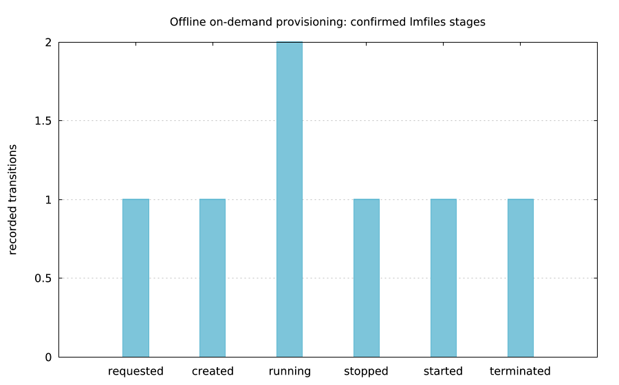

# On-demand provisioning job



`lmctl https://raw.githubusercontent.com/lmctl-ai/lmaws/main/examples/provision_job.lms`

The example runs actual demo bindings, released lmfiles and lmplot across separate
executors. The picture counts confirmed stages. Live mode is explicitly disabled.
These bindings require main until the Lead's next release; no live campaign has run.

## Commands and CONFIG

```sh
lmctl recipes/provision.lms create demo-001 --config recipes/provision.config.json
lmctl recipes/provision.lms status demo-001
lmctl recipes/provision.lms stop demo-001 --dry
lmctl recipes/provision.lms stop demo-001
lmctl recipes/provision.lms start demo-001
lmctl recipes/provision.lms console demo-001
lmctl recipes/provision.lms errors demo-001
lmctl recipes/provision.lms terminate demo-001
lmctl recipes/provision.lms verify demo-001
```

Commands are synthetic unless `--live` is explicit. `--preview` creates no state.
`--dry`/`--dry-run` uses AWS DryRun when live; real writes also need `--apply`.
The job's live plan accepts only default; the host permits default/lmaws/lmaws-ec2/
lmaws-web and refuses admin/unknown profiles, including fakes. No AWS CLI or SSH.

`recipes/provision.config.json` supplies defaults from the checkout. Explicit
`--config PATH` or `LMPROV_CONFIG` refuses a missing file. Empty-directory URL runs
use matching inline defaults. ID: positional, `--lmprov-id`, or `LMPROV_ID`.
Overrides: `--instance-type`, `--volume-gib`, `--ami-parameter`, `--region`,
`--owner`, `--purpose`, `--cap`, `--profile`. `--operation OP` also works.

Defaults: on-demand t4g.nano, us-east-1, 10 GiB gp3, Canonical Ubuntu 24.04 arm64
public SSM parameter, public_ipv4=false, max_runtime_seconds=3600, cap_usd=0.25.
Only t4g.nano/us-east-1, integral 1–20 GiB (at least the AMI snapshot minimum),
Canonical 24.04/noble arm64 parameters and 60–3600-second projections are accepted.
Unknown keys fail closed. No supplied AMI ID, key pair, IAM instance profile, spot,
EIP, user-data replacement, subnet or security-group override. The image's Canonical
owner/architecture/availability/EBS/HVM metadata is verified. Launch uses the default
VPC/subnet/security group, IMDSv2, and DeleteOnTermination root volume/primary ENI.
Existing network rules are never changed.

## API and durable recovery

All eight methods return JSON strings:

```text
ec2_provision_run(config_json)
ec2_provision_describe(lmprov_id)
ec2_provision_stop(lmprov_id)
ec2_provision_start(lmprov_id)
ec2_provision_terminate(lmprov_id)
ec2_provision_console(lmprov_id)
ec2_provision_dry_run(lmprov_id, operation)  # stop/start/terminate
ec2_provision_verify(lmprov_id)
```

Instance, volume and ENI receive provisioner=lmprov, lmprov_id, Name, owner and
purpose at creation. Mutations re-describe ownership and check returned tags;
filters alone are not authority. Missing/foreign tags, duplicate IDs, changed root
volumes and awsspot are refused. Attached root/ENI tags are checked before mutation.
`verify` independently scans tagged instances/volumes/ENIs and checks recorded child
IDs. Read denials are errors, never absence. Terminated instance tombstones do not
count as leftovers. A terminated ID cannot create another instance.

`ProvisionJournal` holds per-ID OS/JVM locks and fsyncs checksummed JSONL state,
requests and receipts. It persists config/hash, selected AMI/network and client token
before launch. A killed executor re-describes tags and, if still invisible, retries
identical parameters/token. Missing tags on a recorded instance refuse recreation.
SDK mutation retries are disabled; torn/corrupt journals fail closed. Demo/AWS roots
are separate. The job defaults to `.lmaws-local/provision/host/`; override with
`LMPROV_LEDGER_DIR`. Keep this directory for recovery. Bounds: 16 MiB per journal,
256 KiB per line, bounded inventories/pagination and console output.

## Registry record and receipts

On Linux/macOS the job creates its registry directory with mode 0700 and refuses symlinks. Live job ACL setup on Windows is unqualified and refused (the synthetic example remains usable).

The authoritative record is `.lmaws-local/provision/<id>.mv`, an lmfiles registry
in namespace provision with alias kind lmprov_id, namespace provision, value ID.
The JSON copy is for inspection; continuation reads the registry. One ID owns one
registry item and one fixed demo/AWS mode; mixing modes is refused before host execution. Stages: requested, created, running, stopped, started, terminated,
failed. Requested is synced before initial create. Queued operations stay pending
until observation confirms their state. Failures retain the last confirmed state;
dry runs, console, verification and error inspection do not advance lifecycle stages.

Metadata includes CONFIG/type/GiB/region, config hash, AMI/instance/volume IDs,
last status/error, timestamps, last receipt, pending operation and the most recent 64 stage-history entries (with a trim counter). lmfiles events and the checksummed host journal retain the full operation evidence; errors reads error receipts from the validated journal.
Host receipts include ok/status/state/confirmed/pending, operation/action, HTTP
status/request ID, error code/classification/message, ambiguity, timestamps,
resource IDs/config hash and cost summary. Capacity, quota, throttling, invalid
parameter, authorization and state-transition failures are structured. Encoded
authorization failures are decoded when permitted; otherwise detail is unknown.
Status includes StateReason/StateTransitionReason, both checks and console diagnostics
on failures. Console requests latest Base64-decoded output. Account/access-key IDs
are masked; provider state/evidence stays private and is never committed.

Prices are estimates: t4g.nano $0.0042/hour, gp3 $0.08/GiB-month (30-day model),
public IPv4 $0.005/hour when enabled. Compute minimums, stopped-disk costs and elapsed
lifetime persist across executors. EC2/SSM/STS control-plane requests are journaled
at $0.00. Admission checks projected cost against the per-ID hard $0.25 ceiling and
honors LMAWS_MAX_COST_USD. Exhausted budgets refuse start but permit cleanup.
Receipts include ongoing-cost reminders. This is an operation-time guard, not an
AWS billing limit or background expiry service: unattended resources keep billing.

References: [AWS Graviton AMIs](https://aws.github.io/graviton/amis_cf_sm.html),
[cloud-init boothook](https://docs.cloud-init.io/en/latest/explanation/format/boothook.html),
[GetConsoleOutput](https://docs.aws.amazon.com/AWSEC2/latest/APIReference/API_GetConsoleOutput.html).
The hook appends /var/lib/lmprov/boots every boot and writes LMPROV boot=N id=ID
to /dev/console. The offline shell test executes the actual generated hook twice.

## Deferred live checklist — wait for Lead GO

Only AWS_PROFILE=default, one fresh ID, t4g.nano, 10 GiB gp3, us-east-1,
under one hour and $0.25. Preserve the private registry/journal throughout.

1. Review CONFIG/preview. After the grant, create with --live --dry and require actual
   DryRunOperation; then create with --live --apply.
2. Poll status every 10 seconds, at most 10 minutes. Require running and both checks
   ok. Poll console for boot=1 and retain the root ID.
3. Run stop/terminate DryRuns against the existing target before writes. Stop and
   wait stopped; verify the same root volume is attached.
4. Run start DryRun against the stopped target, start, wait running/checks ok and
   console boot=2 with the exact same volume ID. Lifecycle DryRuns need a real target
   and therefore precede their own writes rather than using invented IDs.
5. Terminate, wait terminated, verify zero tagged active instances/volumes/ENIs and
   exact root-volume/ENI absence. Save timings, receipts, stages and cost privately.
6. On AccessDenied, stop that scenario and report action, resource and condition.
   Use only already-granted cleanup. If cleanup is denied, report tagged leftovers
   to the Lead. Never use admin or change credentials, IAM, profiles or ~/.aws.

Metadata needs public SSM GetParameter, EC2 DescribeImages/Vpcs/Subnets/SecurityGroups/
Instances/InstanceStatus/Volumes/NetworkInterfaces and GetConsoleOutput; mutations
need tagged RunInstances/CreateTags-on-create/Start/Stop/Terminate. Optional
sts:DecodeAuthorizationMessage affects diagnostics only. No grant is applied here.
