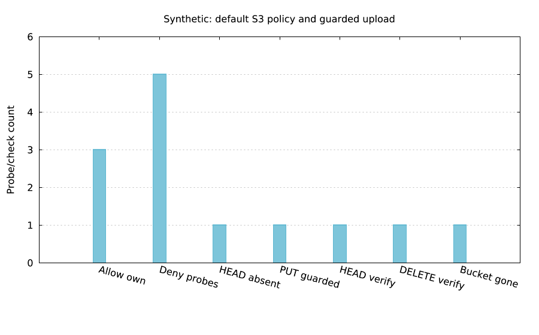

`lmctl https://raw.githubusercontent.com/lmctl-ai/lmaws/main/examples/recipe_check_s3_upload.lms`

# Check the default profile's S3 upload permission

`recipes/check_s3_upload.lms` defaults to offline policy evaluation. With no file it uses a synthetic fixture. Supply the session document explicitly to check it without making AWS calls:

```sh
lmctl recipes/check_s3_upload.lms --policy-file /path/to/session.json --bucket example-bucket --key example.txt
```

The result prints the decision and matching statement Sid for owned/foreign `PutObject` and `AbortMultipartUpload`, owned `ListMultipartUploadParts`, and denied `DeleteObject`, `PutObjectAcl` and `CreateBucket`. Ownership is supplied as probe context; an S3 object ARN does not encode its owner's account. The own-account context comes from the document's `s3:ResourceAccount` condition, or a private `--account-id` argument. The simulator does not prove the permissions of an issued session or include other policy layers such as SCPs, bucket policies and KMS key policies.

`--managed-policy ARN --account-id ID` optionally reads a managed policy through `default` using `GetPolicy`/`GetPolicyVersion`, then evaluates it locally. It never invokes the IAM simulator or falls back to admin. Federated sessions commonly cannot read IAM; use a policy file when this read is unavailable.

## Explicit live verification

Use a current main source build on PATH for the new S3 check APIs; a version label alone does not establish that they are present.

```sh
lmctl recipes/check_s3_upload.lms --policy-file /path/to/session.json --live --region us-east-1
```

The controller uses `lmaws` to create exactly one fresh `lmaws-s3check-<run>` bucket with tag `lmaws_test=<run>`. It checks that `default` and `lmaws` belong to the same account. Separate SDK profile providers route these steps:

1. `default` HEAD: the generated `lmaws-s3check/<run>.txt` key must return 404; 403 is a failure, not evidence of absence.
2. `default` PUT: one byte, `If-None-Match: *`, Content-MD5 and ExpectedBucketOwner. A denied PUT is recorded; no alternate profile attempts the upload.
3. `default` HEAD: size and ETag must match the PUT response; the unversioned sandbox also verifies the payload MD5.
4. `lmaws` DELETE with the saved ETag; `default` HEAD must confirm absence.
5. `lmaws` deletes its empty bucket, verifies HEAD 404 and checks independent bucket inventory.

The backend retains a private pre-write journal under `.lmaws-local/s3-upload-check/`, refuses reuse, and attempts owned cleanup after failures. It does not empty a bucket containing untracked objects or delete a changed object. Unknown cleanup is reported as unknown, never zero. The default cap is $0.05, with the existing shared $0.25 ceiling and cost ledger. This tiny verification normally estimates about $0.00; prices vary and estimates are not invoices.

`--bucket NAME --allow-leave-object --live` is the explicit existing-bucket path. It never creates or deletes that bucket, and never deletes the uploaded object. A warning and the generated key are printed. The key must be absent and the conditional PUT remains mandatory. `--key` affects policy probes only; the live key is always generated. No existing-bucket path is run by this task's default sandbox test.

If interrupted, compose `cloud.s3_upload_cleanup(runId, journalPath)` under `lmaws`. It accepts only the matching acknowledged sandbox creation journal, expected namespace, ownership tag and saved object ETag. It refuses journals for explicit existing buckets.

Import without executing anything:

```javascript
import "https://raw.githubusercontent.com/lmctl-ai/lmaws/main/recipes/lib/s3_upload.lms";
let report=recipe_check_s3_upload({file:"session.json",profile:"default",live:false,output:".lmaws-local/probes"});
```

## Policy recommendation — review only

The current default-session allow covers **every bucket owned by the account**. An unconstrained `s3:PutObject` can overwrite existing objects; this recipe's conditional request protects this test, not every other client.

Prefer an approved bucket/prefix allow-list instead of `arn:aws:s3:::*/*`. Split `PutObject` from abort/list-parts permissions and require the conditional header for object creation. AWS documents `s3:if-none-match`: `Null: {"s3:if-none-match":"false"}` requires its presence (the client sends `*`). To prevent a future broad allow from bypassing this requirement, an explicit deny for missing headers can combine `Null: {"s3:if-none-match":"true"}` with `Bool: {"s3:ObjectCreationOperation":"true"}` on the approved object resources.

Multipart setup/part operations do not accept these headers; AWS documents `s3:ObjectCreationOperation=false` for those exceptions, while completion remains guarded. Keep `AbortMultipartUpload` and `ListMultipartUploadParts` permissions separate. Review copy workflows too: AWS documents limitations for `CopyObject` under this enforcement. No policy is edited or applied by the check. [AWS conditional-write enforcement](https://docs.aws.amazon.com/AmazonS3/latest/userguide/conditional-writes-enforce.html), [S3 permission requirements](https://docs.aws.amazon.com/AmazonS3/latest/userguide/using-with-s3-policy-actions.html).

## Verified sandbox result

All eight real-document probes matched their expected statement Sids. The local default profile then passed the conditional upload check. Only the owned sandbox branch was run live.

| Create | Default HEAD absent | Default PUT | Default HEAD verification | Lmaws cleanup | Whole recipe |
|---:|---:|---:|---:|---:|---:|
| 569 ms | 1164 ms | 100 ms | 86 ms | 988 ms | 9.433 s |

The one-byte size and ETag matched, the object and bucket were removed, and a fresh read-only prefix search found zero leftovers. Ledger estimate: **$0.00001281**; independent audit estimate: **$0.00001090**; combined **$0.00002371**. These are price-table estimates, not an invoice. [Sanitized proof](../evidence/s3-upload-check.json). Raw policy data, bucket/key names and journals stay local and ignored.
