# lmaws recipes

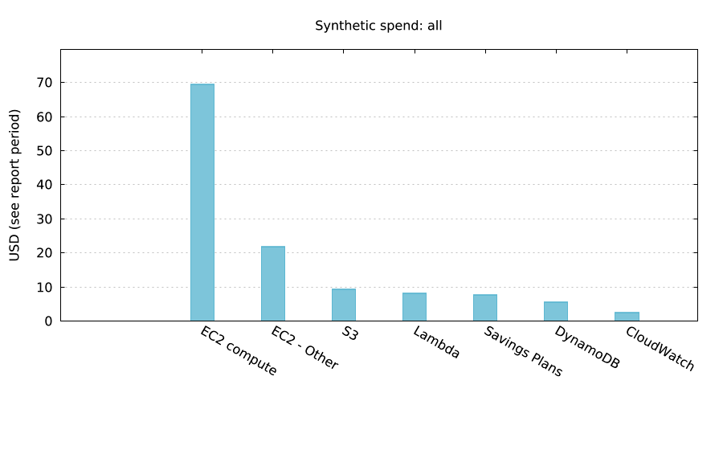

`lmctl https://raw.githubusercontent.com/lmctl-ai/lmaws/main/examples/recipe_spend_detail.lms`

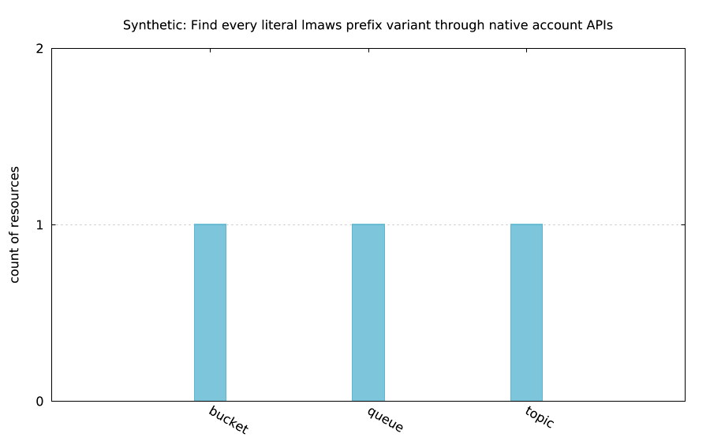

`lmctl https://raw.githubusercontent.com/lmctl-ai/lmaws/main/examples/recipe_prefix_search.lms`

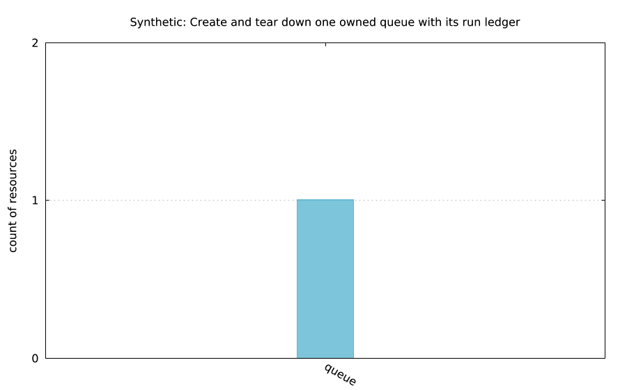

`lmctl https://raw.githubusercontent.com/lmctl-ai/lmaws/main/examples/recipe_sandbox_queue.lms`

Reusable LMScript recipes for audits, inventory, spend review and safely owned sandboxes.
The access column describes AWS permissions; local reports are written only when a recipe is called.
Each generated entry is self-contained and runnable directly. Import the paired library from its raw URL when composing recipes; entry scripts perform the execution step.
Use `lmaws`, never the `aws` CLI. Read-only recipes use `default`; writes require
`AWS_PROFILE=lmaws`, the ownership prefix/tag, a ledger and teardown.

All executable recipes default to synthetic fixtures. Use `--preview` for a no-call plan,
or the runner's `lmctl script --dry-run recipes/<name>.lms`. Live inventory needs `--live`;
live sandboxes also require `--apply --profile lmaws`. Prefix discovery is read-only; sweeper deletion
requires --delete, the lmaws profile, matching run tags and original creation-ledger proof.

Arguments override defaults. `AWS_PROFILE` / `AWS_REGION` and `LMAWS_RECIPE_PERIOD`,
`LMAWS_RECIPE_TOP`, `LMAWS_RECIPE_PREFIX` supply environment defaults. Period is used
by spend recipes; prefix filters inventory when explicitly supplied. All examples force
synthetic mode and their committed pictures contain no real account data.

Inventory/sandbox caps default to $0.05. Spend reports default to the explicit $0.25
spend cap; `--cap` or `LMAWS_MAX_COST_USD` overrides it. A script reserves each live
recipe's full cap against a shared $0.25 ceiling before dispatch. Compose recipes
sequentially and choose smaller individual caps for a multi-report live run.
Synthetic spend estimates model billable requests but make no AWS calls and spend no
real money. Read `metadata.status` in reports: missing, partial or budget-exhausted
data must not be read as an observed zero. Live spend costs have not been measured
as part of this recipe presentation work.

Price references: [Cost Explorer](https://aws.amazon.com/aws-cost-management/aws-cost-explorer/pricing/)
and [CloudWatch GetMetricData](https://docs.aws.amazon.com/AmazonCloudWatch/latest/monitoring/metrics-classic-getdata.html).

Import-only composition example (functions do not execute on import):

```javascript
import "https://raw.githubusercontent.com/lmctl-ai/lmaws/main/recipes/lib/inventory.lms";
let report=recipe_inventory({task:"queues",top:5,output:"data/my-queues",live:false});
println("matched rows:",len(report.rows));
```


## Identity and access posture

| File | What it does | Access | Arguments | Typical cost |
|---|---|---|---|---|
| [`fleet_roles.lms`](fleet_roles.lms) | Plan, lint, apply (one instance at a time) and roll back least-privilege operational IAM roles and mandatory permissions boundary for fleet instances t4g1 and t4g2 | Write with the admin profile | --profile default --output data/fleet_roles [--live] [--apply --profile admin --i-am-the-admin-human] [--rollback FILE] | $0.00 synthetic plan; live read-only discovery uses default; apply requires AWS_PROFILE=admin, LMAWS_ADMIN_GRANT=1, --apply and --i-am-the-admin-human |
| [`grant_lambda_role.lms`](grant_lambda_role.lms) | Preview or apply the pre-built lmaws_lambda_exec execution role with the mandatory boundary and scoped data access | Write with the admin profile | --role lmaws_lambda_exec --profile admin [--live] [--apply] [--output .lmaws-local/iam-role/report] | $0.00 synthetic; live IAM metadata only; apply requires AWS_PROFILE=admin, LMAWS_ADMIN_GRANT=1 and --apply |
| [`grant_session_policy.lms`](grant_session_policy.lms) | Preview statement-level diff or grant the lmaws_session customer-managed IAM policy | Write with the admin profile | --policy lmaws_session --file POLICY.json --profile admin --top 20 --output data/grant_session_policy [--live] [--apply] | $0.00 IAM metadata; live apply requires AWS_PROFILE=admin and LMAWS_ADMIN_GRANT=1 |
| [`inventory_identity.lms`](inventory_identity.lms) | Inspect bounded identity metadata (synthetic only; federated IAM cases skipped live) | Read-only | --task TASK --period 30 --top 10 --prefix lmaws --region us-east-1 --profile default --output data/inventory_identity [--live] | $0.00 synthetic; live capped request estimate in ledger |
| [`inventory_roles.lms`](inventory_roles.lms) | Inspect bounded roles metadata (synthetic only; federated IAM cases skipped live) | Read-only | --task TASK --period 30 --top 10 --prefix lmaws --region us-east-1 --profile default --output data/inventory_roles [--live] | $0.00 synthetic; live capped request estimate in ledger |
| [`inventory_security_groups.lms`](inventory_security_groups.lms) | Inspect bounded security groups metadata | Read-only | --task TASK --period 30 --top 10 --prefix lmaws --region us-east-1 --profile default --output data/inventory_security_groups [--live] | $0.00 synthetic; live capped request estimate in ledger |
| [`open_ports.lms`](open_ports.lms) | Security groups open to the internet, by port, with admin/database ports flagged | Read-only | --region us-east-1 --profile default --output data/open_ports [--live] | $0.00 synthetic; live Describe/List calls are free; cap $0.05 |
| [`policy_lint.lms`](policy_lint.lms) | Validate and lint an IAM managed policy JSON document offline against lmaws guardrails | Read-only | --file POLICY.json --top 20 --output data/policy_lint | $0.00 offline lint |
| [`secret_age.lms`](secret_age.lms) | Secrets not changed for 90+ days (values are never read) | Read-only | --region us-east-1 --profile default --output data/secret_age [--live] | $0.00 synthetic; live Describe/List calls are free; cap $0.05 |
| [`session_doctor.lms`](session_doctor.lms) | Inspect profile session types, 0600 credential cache expiry and dry-run/read-only permission probes | Read-only | --profile lmaws --region us-east-1 --top 20 --output data/session_doctor [--live] | $0.00 synthetic; live read and EC2 DryRun probes create no resources; cap $0.05 |
| [`which_profile.lms`](which_profile.lms) | Which AWS profile and flags each kind of recipe needs | Read-only | --output data/which_profile | $0.00 synthetic and offline |

## Permission builder and IAM analysis

| File | What it does | Access | Arguments | Typical cost |
|---|---|---|---|---|
| [`policy_billing_viewer.lms`](policy_billing_viewer.lms) | Build a read-only Cost Explorer, Budgets, Pricing and CloudWatch metrics viewer policy | Read-only | --prefix lmaws --region us-east-1 --output data/policy_billing_viewer | $0.00 offline policy compilation |
| [`policy_break_glass.lms`](policy_break_glass.lms) | Build an MFA-gated, time-windowed and bastion-IP-locked emergency break-glass policy | Read-only | --cidr 203.0.113.10/32 --from 2026-01-01T00:00:00Z --to 2026-01-01T04:00:00Z --output data/policy_break_glass | $0.00 offline policy compilation |
| [`policy_cheat_sheet.lms`](policy_cheat_sheet.lms) | Map every lmaws capability to its exact IAM statement Sids, scope rationale, missing-permission error and minimal builder fix | Read-only | --policy lmaws_session --prefix lmaws --domain example.com --output data/policy_cheat_sheet | $0.00 offline IAM cheat sheet |
| [`policy_ci_bucket_deployer.lms`](policy_ci_bucket_deployer.lms) | Build a least-privilege CI static asset uploader and CloudFront invalidation policy | Read-only | --prefix lmaws --region us-east-1 --output data/policy_ci_bucket_deployer | $0.00 offline policy compilation |
| [`policy_deny_untagged_delete.lms`](policy_deny_untagged_delete.lms) | Build a defense-in-depth policy pairing request-tag creation gates with explicit Denies on untagged deletes | Read-only | --prefix lmaws --region us-east-1 --output data/policy_deny_untagged_delete | $0.00 offline policy compilation |
| [`policy_diff_review.lms`](policy_diff_review.lms) | Compare two policy versions statement-by-statement and report added, modified, removed and unchanged rules | Read-only | --prefix lmaws --region us-east-1 --output data/policy_diff_review | $0.00 offline statement diff |
| [`policy_dynamodb_sandbox.lms`](policy_dynamodb_sandbox.lms) | Build a prefix-scoped DynamoDB table sandbox policy with account-boundary and region-lock guardrails | Read-only | --prefix lmaws --region us-east-1 --output data/policy_dynamodb_sandbox | $0.00 offline policy compilation |
| [`policy_ec2_spot_sandbox.lms`](policy_ec2_spot_sandbox.lms) | Build a tag-gated EC2 spot nano sandbox policy with instance-type and 8 GiB volume caps | Read-only | --prefix lmaws --types t4g.nano,t3.nano --max-gib 8 --region us-east-1 --output data/policy_ec2_spot_sandbox | $0.00 offline policy compilation |
| [`policy_explain_denial.lms`](policy_explain_denial.lms) | Parse an AWS AccessDenied message, identify the failing statement/condition and emit a minimal builder fix | Read-only | [--error TEXT] --output data/policy_explain_denial | $0.00 offline denial analysis |
| [`policy_fit_inline.lms`](policy_fit_inline.lms) | Compact a multi-statement policy into the 2048-character STS inline session limit and report byte savings | Read-only | --prefix lmaws --region us-east-1 --output data/policy_fit_inline | $0.00 offline policy compaction |
| [`policy_from_ledger.lms`](policy_from_ledger.lms) | Synthesize a least-privilege IAM policy and fluent builder program from observed SDK calls in run ledgers | Read-only | [--ledger FILE] --output data/policy_from_ledger | $0.00 offline ledger synthesis |
| [`policy_ip_restricted.lms`](policy_ip_restricted.lms) | Build a corporate/bastion CIDR-locked policy with single-host /32 security-group ingress enforcement | Read-only | --prefix lmaws --cidr 203.0.113.10/32 --output data/policy_ip_restricted | $0.00 offline policy compilation |
| [`policy_lambda_deployer.lms`](policy_lambda_deployer.lms) | Build a prefix- and tag-scoped Lambda function and EventBridge rule deployer policy | Read-only | --prefix lmaws --region us-east-1 --output data/policy_lambda_deployer | $0.00 offline policy compilation |
| [`policy_logs_sandbox.lms`](policy_logs_sandbox.lms) | Build a prefix-scoped CloudWatch Logs sandbox policy with account-boundary and region-lock guardrails | Read-only | --prefix lmaws --region us-east-1 --output data/policy_logs_sandbox | $0.00 offline policy compilation |
| [`policy_mfa_deletes.lms`](policy_mfa_deletes.lms) | Build a sandbox policy that requires hardware/virtual MFA for every destructive delete or terminate action | Read-only | --prefix lmaws --region us-east-1 --output data/policy_mfa_deletes | $0.00 offline policy compilation |
| [`policy_migrate_json.lms`](policy_migrate_json.lms) | Migrate hand-written IAM policy JSON into a typed fluent lmaws permission builder program | Read-only | [--file POLICY.json] --output data/policy_migrate_json | $0.00 offline JSON migration |
| [`policy_permission_boundary.lms`](policy_permission_boundary.lms) | Build a maximum IAM permission boundary capping delegated roles to prefix, tag, nano and region guardrails | Read-only | --prefix lmaws --region us-east-1 --output data/policy_permission_boundary | $0.00 offline policy compilation |
| [`policy_read_only_auditor.lms`](policy_read_only_auditor.lms) | Build a zero-secret read-only inventory and posture auditor policy with region lock | Read-only | --prefix lmaws --region us-east-1 --output data/policy_read_only_auditor | $0.00 offline policy compilation |
| [`policy_region_lock.lms`](policy_region_lock.lms) | Build a regional policy with an explicit NotAction exemption list for global AWS control planes | Read-only | --prefix lmaws --region us-east-1 --output data/policy_region_lock | $0.00 offline policy compilation |
| [`policy_s3_sandbox.lms`](policy_s3_sandbox.lms) | Build a prefix-scoped S3 bucket and object sandbox policy with account-boundary and tagged-delete guardrails | Read-only | --prefix lmaws --region us-east-1 --output data/policy_s3_sandbox | $0.00 offline policy compilation |
| [`policy_simulate_probes.lms`](policy_simulate_probes.lms) | Evaluate allow and deny security probes against a policy offline or via IAM SimulateCustomPolicy | Read-only | --policy lmaws_session [--probes SPEC] [--live --profile admin] --output data/policy_simulate_probes | $0.00 offline; live IAM simulator requires AWS_PROFILE=admin |
| [`policy_sns_sandbox.lms`](policy_sns_sandbox.lms) | Build a prefix-scoped SNS topic sandbox policy with account-boundary and region-lock guardrails | Read-only | --prefix lmaws --region us-east-1 --output data/policy_sns_sandbox | $0.00 offline policy compilation |
| [`policy_split_managed.lms`](policy_split_managed.lms) | Split a large policy into balanced <= 6144-char managed policy parts while preserving Deny guardrails | Read-only | --policy lmaws_session --domain example.com --output data/policy_split_managed | $0.00 offline policy splitting |
| [`policy_sqs_sandbox.lms`](policy_sqs_sandbox.lms) | Build a prefix-scoped SQS queue sandbox policy with account-boundary and region-lock guardrails | Read-only | --prefix lmaws --region us-east-1 --output data/policy_sqs_sandbox | $0.00 offline policy compilation |
| [`policy_ssm_sandbox.lms`](policy_ssm_sandbox.lms) | Build a prefix-scoped SSM Parameter Store sandbox policy with public parameter read access | Read-only | --prefix lmaws --region us-east-1 --output data/policy_ssm_sandbox | $0.00 offline policy compilation |
| [`policy_tag_operator.lms`](policy_tag_operator.lms) | Build a tag discovery and tag-gated resource tagging operator policy | Read-only | --prefix lmaws --region us-east-1 --output data/policy_tag_operator | $0.00 offline policy compilation |
| [`policy_web_stack.lms`](policy_web_stack.lms) | Build a static site stack policy (S3 bucket + CloudFront OAC + ACM + Route53 record pattern lock) | Read-only | --prefix lmaws --domain example.com --region us-east-1 --output data/policy_web_stack | $0.00 offline policy compilation |
| [`session_policy.lms`](session_policy.lms) | Generate the 25-statement lmaws_session IAM managed policy with the fluent builder, statement size report and optional snapshot diff | Read-only | --policy lmaws_session --prefix lmaws --domain example.com --region us-east-1 --types t4g.nano,t3.nano --max-gib 8 [--file SNAPSHOT.json] --output data/session_policy | $0.00 offline policy compilation and diff |

## Inventory

| File | What it does | Access | Arguments | Typical cost |
|---|---|---|---|---|
| [`inventory.lms`](inventory.lms) | Review all supported inventories; IAM entries are skipped live | Read-only | --task TASK --period 30 --top 10 --prefix lmaws --region us-east-1 --profile default --output data/inventory [--live] | $0.00 synthetic; live request cap $0.05 |
| [`inventory_alarms.lms`](inventory_alarms.lms) | Inspect bounded alarms metadata | Read-only | --task TASK --period 30 --top 10 --prefix lmaws --region us-east-1 --profile default --output data/inventory_alarms [--live] | $0.00 synthetic; live capped request estimate in ledger |
| [`inventory_buckets.lms`](inventory_buckets.lms) | Inspect bounded buckets metadata | Read-only | --task TASK --period 30 --top 10 --prefix lmaws --region us-east-1 --profile default --output data/inventory_buckets [--live] | $0.00 synthetic; live capped request estimate in ledger |
| [`inventory_clusters.lms`](inventory_clusters.lms) | Inspect bounded clusters metadata | Read-only | --task TASK --period 30 --top 10 --prefix lmaws --region us-east-1 --profile default --output data/inventory_clusters [--live] | $0.00 synthetic; live capped request estimate in ledger |
| [`inventory_functions.lms`](inventory_functions.lms) | Inspect bounded functions metadata | Read-only | --task TASK --period 30 --top 10 --prefix lmaws --region us-east-1 --profile default --output data/inventory_functions [--live] | $0.00 synthetic; live capped request estimate in ledger |
| [`inventory_instances.lms`](inventory_instances.lms) | Inspect bounded instances metadata | Read-only | --task TASK --period 30 --top 10 --prefix lmaws --region us-east-1 --profile default --output data/inventory_instances [--live] | $0.00 synthetic; live capped request estimate in ledger |
| [`inventory_log_groups.lms`](inventory_log_groups.lms) | Inspect bounded log groups metadata | Read-only | --task TASK --period 30 --top 10 --prefix lmaws --region us-east-1 --profile default --output data/inventory_log_groups [--live] | $0.00 synthetic; live capped request estimate in ledger |
| [`inventory_parameters.lms`](inventory_parameters.lms) | Inspect bounded parameters metadata | Read-only | --task TASK --period 30 --top 10 --prefix lmaws --region us-east-1 --profile default --output data/inventory_parameters [--live] | $0.00 synthetic; live capped request estimate in ledger |
| [`inventory_queues.lms`](inventory_queues.lms) | Inspect bounded queues metadata | Read-only | --task TASK --period 30 --top 10 --prefix lmaws --region us-east-1 --profile default --output data/inventory_queues [--live] | $0.00 synthetic; live capped request estimate in ledger |
| [`inventory_secrets.lms`](inventory_secrets.lms) | Inspect bounded secrets metadata | Read-only | --task TASK --period 30 --top 10 --prefix lmaws --region us-east-1 --profile default --output data/inventory_secrets [--live] | $0.00 synthetic; live capped request estimate in ledger |
| [`inventory_tables.lms`](inventory_tables.lms) | Inspect bounded tables metadata | Read-only | --task TASK --period 30 --top 10 --prefix lmaws --region us-east-1 --profile default --output data/inventory_tables [--live] | $0.00 synthetic; live capped request estimate in ledger |
| [`inventory_topics.lms`](inventory_topics.lms) | Inspect bounded topics metadata | Read-only | --task TASK --period 30 --top 10 --prefix lmaws --region us-east-1 --profile default --output data/inventory_topics [--live] | $0.00 synthetic; live capped request estimate in ledger |
| [`inventory_vpcs.lms`](inventory_vpcs.lms) | Inspect bounded vpcs metadata | Read-only | --task TASK --period 30 --top 10 --prefix lmaws --region us-east-1 --profile default --output data/inventory_vpcs [--live] | $0.00 synthetic; live capped request estimate in ledger |
| [`inventory_zones.lms`](inventory_zones.lms) | Inspect bounded zones metadata | Read-only | --task TASK --period 30 --top 10 --prefix lmaws --region us-east-1 --profile default --output data/inventory_zones [--live] | $0.00 synthetic; live capped request estimate in ledger |
| [`quickstart.lms`](quickstart.lms) | Quickstart: one command to an account snapshot picture (resources per service) | Read-only | --region us-east-1 --profile default --output data/quickstart [--live] | $0.00 synthetic; live Describe/List calls are free; cap $0.05 |

## Cost and spend

| File | What it does | Access | Arguments | Typical cost |
|---|---|---|---|---|
| [`bandwidth.lms`](bandwidth.lms) | Break down billed transfer categories and network counters | Read-only | --period 30 --top 10 --region us-east-1 --profile default --cap 0.25 [--live] [--output PRIVATE_DIR] | Synthetic actual $0.00; live CE $0.01/request plus metrics; default/hard cap $0.25 |
| [`dynamodb_spend.lms`](dynamodb_spend.lms) | Review DynamoDB usage and spend signals | Read-only | --period 30 --top 10 --region us-east-1 --profile default --cap 0.25 [--live] [--output PRIVATE_DIR] | Synthetic actual $0.00; live CE $0.01/request plus metrics; default/hard cap $0.25 |
| [`ebs_audit.lms`](ebs_audit.lms) | Review EBS attachments and snapshot retention signals | Read-only | --period 30 --top 10 --region us-east-1 --profile default --cap 0.25 [--live] [--output PRIVATE_DIR] | Synthetic actual $0.00; live CE $0.01/request plus metrics; default/hard cap $0.25 |
| [`ec2_spend.lms`](ec2_spend.lms) | Break down EC2 compute spend and current resource signals | Read-only | --period 30 --top 10 --region us-east-1 --profile default --cap 0.25 [--live] [--output PRIVATE_DIR] | Synthetic actual $0.00; live CE $0.01/request plus metrics; default/hard cap $0.25 |
| [`eip_audit.lms`](eip_audit.lms) | Review idle public IPv4 allocations and estimated run-rate | Read-only | --period 30 --top 10 --region us-east-1 --profile default --cap 0.25 [--live] [--output PRIVATE_DIR] | Synthetic actual $0.00; live CE $0.01/request plus metrics; default/hard cap $0.25 |
| [`lambda_spend.lms`](lambda_spend.lms) | Review Lambda usage and spend signals | Read-only | --period 30 --top 10 --region us-east-1 --profile default --cap 0.25 [--live] [--output PRIVATE_DIR] | Synthetic actual $0.00; live CE $0.01/request plus metrics; default/hard cap $0.25 |
| [`savings_plans.lms`](savings_plans.lms) | Review Savings Plans and Reserved Instance utilization and coverage | Read-only | --period 30 --top 10 --region us-east-1 --profile default --cap 0.25 [--live] [--output PRIVATE_DIR] | Synthetic actual $0.00; live CE $0.01/request plus metrics; default/hard cap $0.25 |
| [`spend_detail.lms`](spend_detail.lms) | Review account spend detail and optimization signals | Read-only | --period 30 --top 10 --region us-east-1 --profile default --cap 0.25 [--live] [--output PRIVATE_DIR] | Synthetic actual $0.00; live CE $0.01/request plus metrics; default/hard cap $0.25 |

## Idle and waste detection

| File | What it does | Access | Arguments | Typical cost |
|---|---|---|---|---|
| [`idle_instances.lms`](idle_instances.lms) | Flag stopped-instance state for further review; never delete | Read-only | --task TASK --period 30 --top 10 --prefix lmaws --region us-east-1 --profile default --output data/idle_instances [--live] | $0.00 synthetic; live request cap $0.05 |
| [`log_retention_audit.lms`](log_retention_audit.lms) | Log groups that never expire, grouped by retention | Read-only | --region us-east-1 --profile default --output data/log_retention_audit [--live] | $0.00 synthetic; live Describe/List calls are free; cap $0.05 |
| [`public_ipv4_cost.lms`](public_ipv4_cost.lms) | Every billed public IPv4 address (Elastic and auto-assigned) and its monthly cost | Read-only | --region us-east-1 --profile default --output data/public_ipv4_cost [--live] | $0.00 synthetic; live Describe/List calls are free; cap $0.05 |
| [`unattached_volumes.lms`](unattached_volumes.lms) | Unattached EBS volumes with size and monthly cost (never deletes) | Read-only | --region us-east-1 --profile default --output data/unattached_volumes [--live] | $0.00 synthetic; live Describe/List calls are free; cap $0.05 |

## Tag and naming compliance

| File | What it does | Access | Arguments | Typical cost |
|---|---|---|---|---|
| [`naming_compliance.lms`](naming_compliance.lms) | Check case-sensitive lmaws_ and lmaws- naming among prefix candidates | Read-only | --task TASK --period 30 --top 10 --prefix lmaws --region us-east-1 --profile default --output data/naming_compliance [--live] | $0.00 synthetic; live request cap $0.05 |
| [`tag_compliance.lms`](tag_compliance.lms) | Report missing and unknown tag presence without assuming compliance | Read-only | --task TASK --period 30 --top 10 --prefix lmaws --region us-east-1 --profile default --output data/tag_compliance [--live] | $0.00 synthetic; live request cap $0.05 |

## Leftover search and cleanup by prefix

| File | What it does | Access | Arguments | Typical cost |
|---|---|---|---|---|
| [`leftover_report.lms`](leftover_report.lms) | Inspect account resources by age and their creation-ledger proof | Read-only | --task TASK --period 30 --top 10 --prefix lmaws --region us-east-1 --profile default --output data/leftover_report [--live] --ledger-dir .lmaws-local/recipes/ledgers --older-hours 24 [--delete --profile lmaws] | $0.00 synthetic; live request cap $0.05 |
| [`prefix_search.lms`](prefix_search.lms) | Find every literal lmaws prefix variant through native account APIs | Read-only | --task TASK --period 30 --top 10 --prefix lmaws --region us-east-1 --profile default --output data/prefix_search [--live] --ledger-dir .lmaws-local/recipes/ledgers --older-hours 24 [--delete --profile lmaws] | $0.00 synthetic; live request cap $0.05 |
| [`sweeper.lms`](sweeper.lms) | Plan account cleanup; explicit delete checks prefix, tag and run ledger | Read-only | --task TASK --period 30 --top 10 --prefix lmaws --region us-east-1 --profile default --output data/sweeper [--live] --ledger-dir .lmaws-local/recipes/ledgers --older-hours 24 [--delete --profile lmaws] | $0.00 synthetic; live request cap $0.05 |

## Safe lifecycle sandboxes

| File | What it does | Access | Arguments | Typical cost |
|---|---|---|---|---|
| [`lifecycle.lms`](lifecycle.lms) | Select a disposable queue/topic/table/bucket/parameter/log-group lifecycle | Write with the lmaws profile | --task TASK --period 30 --top 10 --prefix lmaws --region us-east-1 --profile lmaws --output data/lifecycle [--live] [--apply] | Synthetic $0.00; live generally below $0.0001; cap $0.05 |
| [`sandbox_bucket.lms`](sandbox_bucket.lms) | Create and tear down one owned bucket with its run ledger | Write with the lmaws profile | --task TASK --period 30 --top 10 --prefix lmaws --region us-east-1 --profile lmaws --output data/sandbox_bucket [--live] [--apply] | Synthetic $0.00; live generally below $0.0001; cap $0.05 |
| [`sandbox_log_group.lms`](sandbox_log_group.lms) | Create and tear down one owned log group with its run ledger | Write with the lmaws profile | --task TASK --period 30 --top 10 --prefix lmaws --region us-east-1 --profile lmaws --output data/sandbox_log_group [--live] [--apply] | Synthetic $0.00; live generally below $0.0001; cap $0.05 |
| [`sandbox_parameter.lms`](sandbox_parameter.lms) | Create and tear down one owned parameter with its run ledger | Write with the lmaws profile | --task TASK --period 30 --top 10 --prefix lmaws --region us-east-1 --profile lmaws --output data/sandbox_parameter [--live] [--apply] | Synthetic $0.00; live generally below $0.0001; cap $0.05 |
| [`sandbox_queue.lms`](sandbox_queue.lms) | Create and tear down one owned queue with its run ledger | Write with the lmaws profile | --task TASK --period 30 --top 10 --prefix lmaws --region us-east-1 --profile lmaws --output data/sandbox_queue [--live] [--apply] | Synthetic $0.00; live generally below $0.0001; cap $0.05 |
| [`sandbox_table.lms`](sandbox_table.lms) | Create and tear down one owned table with its run ledger | Write with the lmaws profile | --task TASK --period 30 --top 10 --prefix lmaws --region us-east-1 --profile lmaws --output data/sandbox_table [--live] [--apply] | Synthetic $0.00; live generally below $0.0001; cap $0.05 |
| [`sandbox_topic.lms`](sandbox_topic.lms) | Create and tear down one owned topic with its run ledger | Write with the lmaws profile | --task TASK --period 30 --top 10 --prefix lmaws --region us-east-1 --profile lmaws --output data/sandbox_topic [--live] [--apply] | Synthetic $0.00; live generally below $0.0001; cap $0.05 |

## Compute and fleet

| File | What it does | Access | Arguments | Typical cost |
|---|---|---|---|---|
| [`ami_lookup.lms`](ami_lookup.lms) | Latest Ubuntu 24.04 and Amazon Linux 2023 AMIs (arm64, x86_64) from public SSM parameters | Read-only with the lmaws-ec2 profile | --region us-east-1 --profile lmaws-ec2 --output data/ami_lookup [--live] | $0.00 (public SSM parameters are free) |
| [`cpu_credits.lms`](cpu_credits.lms) | CPU credit balance, usage, surplus and headroom of burstable instances, without SSH | Read-only | --tag-key Project --tag-value VALUE --instance ID --hours 24 --region us-east-1 --profile default --output data/cpu_credits [--live] | $0.00 synthetic; live CloudWatch statistics about $0.00005 per instance; cap $0.05 |
| [`ebs_roots.lms`](ebs_roots.lms) | EBS volumes, attachments, root DeleteOnTermination and the AZ lock, as a report | Read-only | --region us-east-1 --profile default --output data/ebs_roots [--live] | $0.00 synthetic; live Describe calls are free; cap $0.05 |
| [`eip_map.lms`](eip_map.lms) | Map Elastic IPs to instances, flag idle ones, report pinned addresses (never releases) | Read-only | --tag-key Project --region us-east-1 --profile default --output data/eip_map [--live] | $0.00 synthetic; live Describe calls are free; cap $0.05 |
| [`fleet_status.lms`](fleet_status.lms) | Discover tagged instances: state, type, addresses and root-storage policy | Read-only | --tag-key Project --tag-value VALUE --region us-east-1 --profile default --output data/fleet_status [--live] | $0.00 synthetic; live EC2 Describe calls are free; cap $0.05 |
| [`spot_nano_lifecycle.lms`](spot_nano_lifecycle.lms) | Launch one tagged no-public-IP spot nano, check it, terminate it and prove zero leftovers | Write with the lmaws-ec2 profile | --region us-east-1 --profile lmaws-ec2 --output .lmaws-local/compute/spot_nano_lifecycle [--live --apply] | Synthetic $0.00; live about $0.0005 (spot nano minutes + 8 GiB gp3); cap $0.05 |
| [`spot_prices.lms`](spot_prices.lms) | Spot price history per AZ for nano types, cheapest AZ and saving vs On-Demand | Read-only | --types t4g.nano,t3.nano --hours 3 --region us-east-1 --profile default --output data/spot_prices [--live] | $0.00 synthetic; live Describe calls are free; cap $0.05 |

## Picture-first examples

Each recipe points at an offline synthetic example so its output can be previewed safely.

### fleet_roles

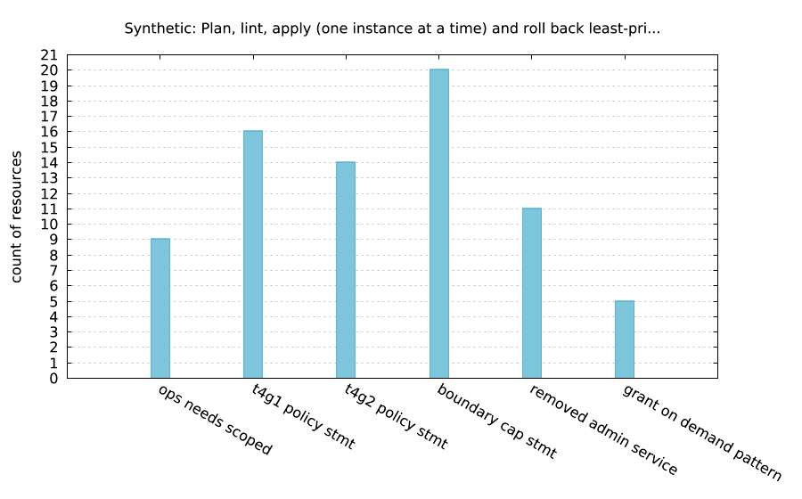

`lmctl https://raw.githubusercontent.com/lmctl-ai/lmaws/main/examples/recipe_fleet_roles.lms`

Example: [`examples/recipe_fleet_roles.lms`](../examples/recipe_fleet_roles.lms).
Import library: `https://raw.githubusercontent.com/lmctl-ai/lmaws/main/recipes/lib/fleet_roles.lms`; function `recipe_fleet_roles`.

### grant_lambda_role

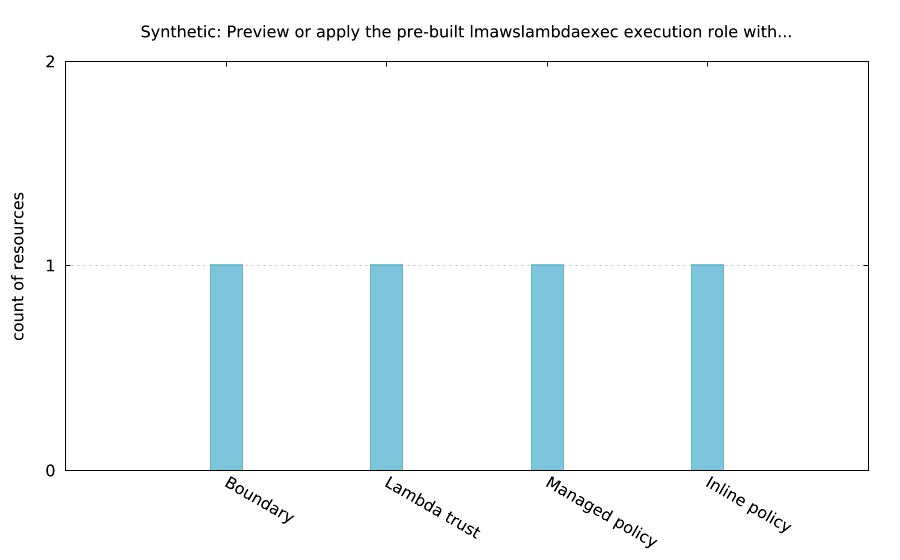

`lmctl https://raw.githubusercontent.com/lmctl-ai/lmaws/main/examples/recipe_grant_lambda_role.lms`

Example: [`examples/recipe_grant_lambda_role.lms`](../examples/recipe_grant_lambda_role.lms).
Import library: `https://raw.githubusercontent.com/lmctl-ai/lmaws/main/recipes/lib/iam_role.lms`; function `recipe_grant_lambda_role`.

### grant_session_policy

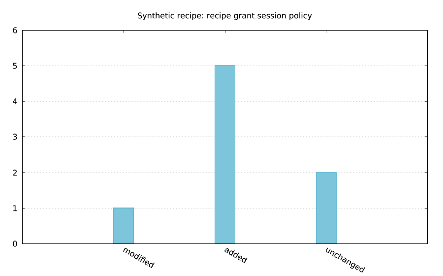

`lmctl https://raw.githubusercontent.com/lmctl-ai/lmaws/main/examples/recipe_grant_session_policy.lms`

Example: [`examples/recipe_grant_session_policy.lms`](../examples/recipe_grant_session_policy.lms).
Import library: `https://raw.githubusercontent.com/lmctl-ai/lmaws/main/recipes/lib/iam_policy.lms`; function `recipe_grant_session_policy`.

### inventory_identity

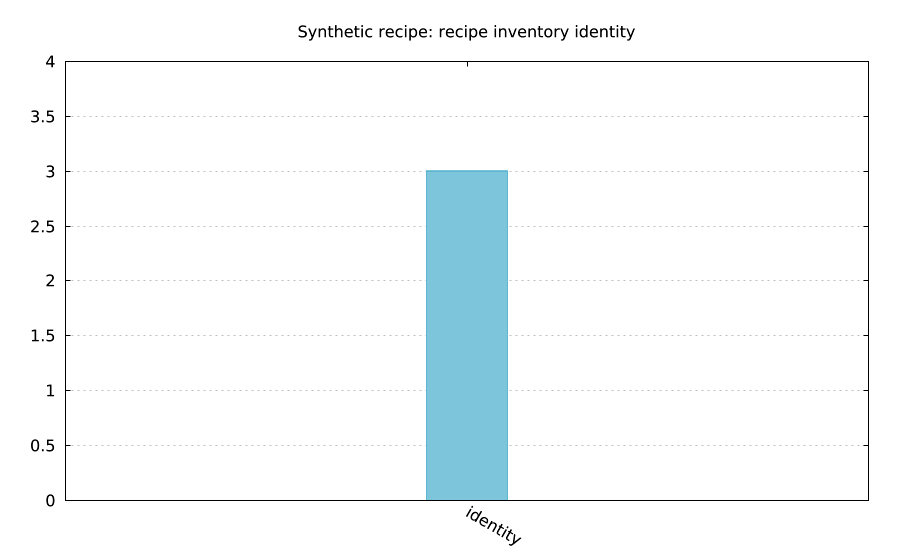

`lmctl https://raw.githubusercontent.com/lmctl-ai/lmaws/main/examples/recipe_inventory_identity.lms`

Example: [`examples/recipe_inventory_identity.lms`](../examples/recipe_inventory_identity.lms).
Import library: `https://raw.githubusercontent.com/lmctl-ai/lmaws/main/recipes/lib/inventory.lms`; function `recipe_inventory`.

### inventory_roles

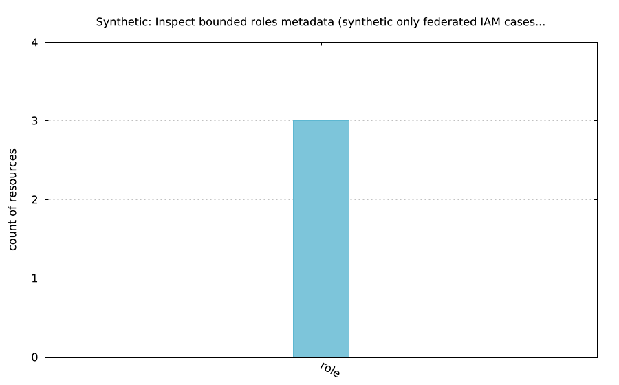

`lmctl https://raw.githubusercontent.com/lmctl-ai/lmaws/main/examples/recipe_inventory_roles.lms`

Example: [`examples/recipe_inventory_roles.lms`](../examples/recipe_inventory_roles.lms).
Import library: `https://raw.githubusercontent.com/lmctl-ai/lmaws/main/recipes/lib/inventory.lms`; function `recipe_inventory`.

### inventory_security_groups

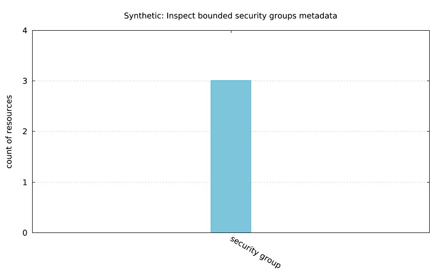

`lmctl https://raw.githubusercontent.com/lmctl-ai/lmaws/main/examples/recipe_inventory_security_groups.lms`

Example: [`examples/recipe_inventory_security_groups.lms`](../examples/recipe_inventory_security_groups.lms).
Import library: `https://raw.githubusercontent.com/lmctl-ai/lmaws/main/recipes/lib/inventory.lms`; function `recipe_inventory`.

### open_ports

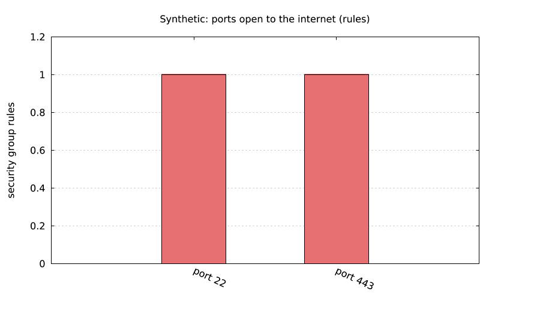

`lmctl https://raw.githubusercontent.com/lmctl-ai/lmaws/main/examples/recipe_open_ports.lms`

Example: [`examples/recipe_open_ports.lms`](../examples/recipe_open_ports.lms).
Import library: `https://raw.githubusercontent.com/lmctl-ai/lmaws/main/recipes/lib/hygiene.lms`; function `recipe_open_ports`.

### policy_lint

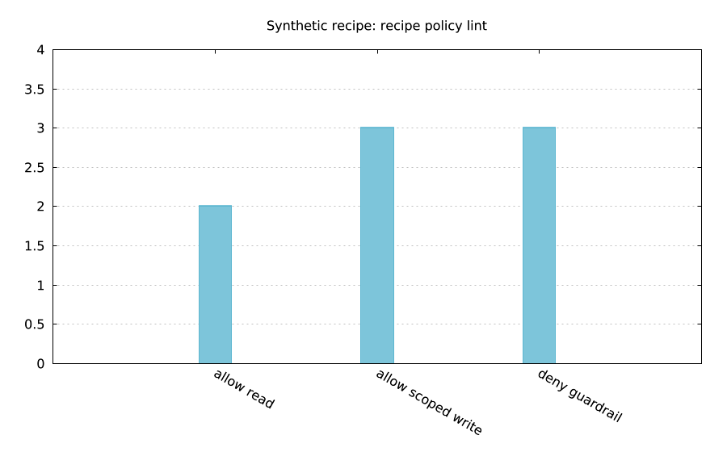

`lmctl https://raw.githubusercontent.com/lmctl-ai/lmaws/main/examples/recipe_policy_lint.lms`

Example: [`examples/recipe_policy_lint.lms`](../examples/recipe_policy_lint.lms).
Import library: `https://raw.githubusercontent.com/lmctl-ai/lmaws/main/recipes/lib/iam_policy.lms`; function `recipe_policy_lint`.

### secret_age

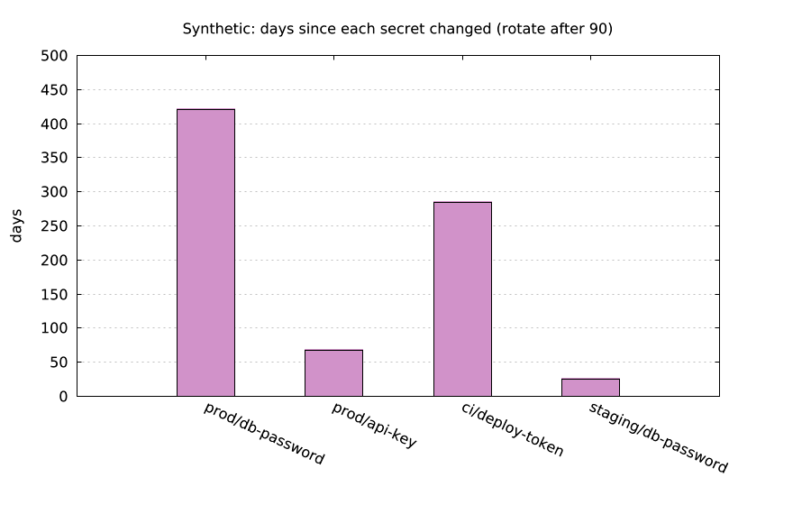

`lmctl https://raw.githubusercontent.com/lmctl-ai/lmaws/main/examples/recipe_secret_age.lms`

Example: [`examples/recipe_secret_age.lms`](../examples/recipe_secret_age.lms).
Import library: `https://raw.githubusercontent.com/lmctl-ai/lmaws/main/recipes/lib/hygiene.lms`; function `recipe_secret_age`.

### session_doctor

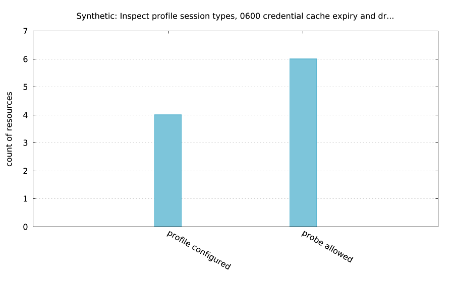

`lmctl https://raw.githubusercontent.com/lmctl-ai/lmaws/main/examples/recipe_session_doctor.lms`

Example: [`examples/recipe_session_doctor.lms`](../examples/recipe_session_doctor.lms).
Import library: `https://raw.githubusercontent.com/lmctl-ai/lmaws/main/recipes/lib/iam_policy.lms`; function `recipe_session_doctor`.

### which_profile

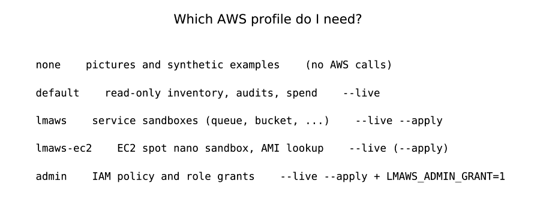

`lmctl https://raw.githubusercontent.com/lmctl-ai/lmaws/main/examples/recipe_which_profile.lms`

Example: [`examples/recipe_which_profile.lms`](../examples/recipe_which_profile.lms).
Import library: `https://raw.githubusercontent.com/lmctl-ai/lmaws/main/recipes/lib/hygiene.lms`; function `recipe_which_profile`.

### policy_billing_viewer

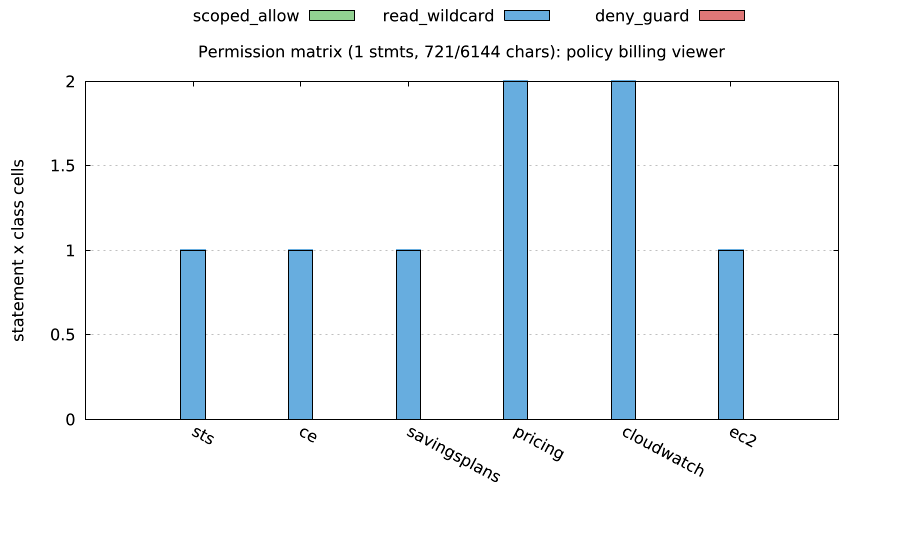

`lmctl https://raw.githubusercontent.com/lmctl-ai/lmaws/main/examples/recipe_policy_billing_viewer.lms`

Example: [`examples/recipe_policy_billing_viewer.lms`](../examples/recipe_policy_billing_viewer.lms).
Import library: `https://raw.githubusercontent.com/lmctl-ai/lmaws/main/recipes/lib/policy_builder.lms`; function `recipe_policy_builder`.

### policy_break_glass

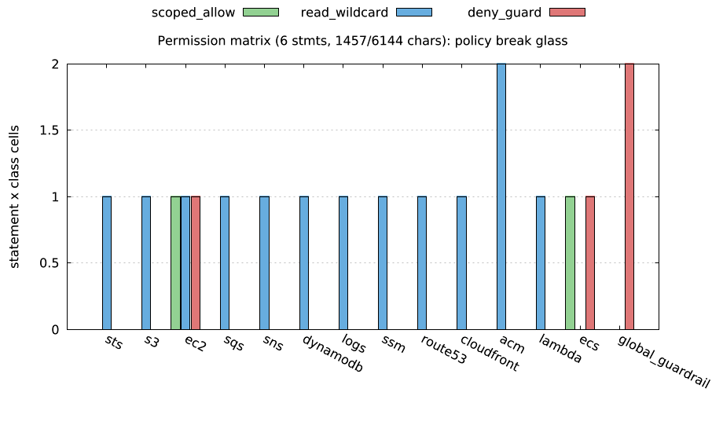

`lmctl https://raw.githubusercontent.com/lmctl-ai/lmaws/main/examples/recipe_policy_break_glass.lms`

Example: [`examples/recipe_policy_break_glass.lms`](../examples/recipe_policy_break_glass.lms).
Import library: `https://raw.githubusercontent.com/lmctl-ai/lmaws/main/recipes/lib/policy_builder.lms`; function `recipe_policy_builder`.

### policy_cheat_sheet

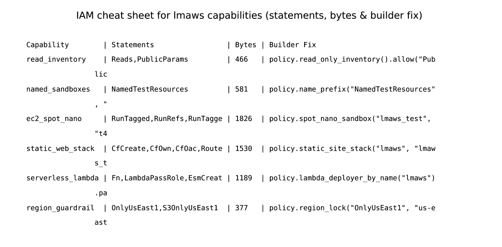

`lmctl https://raw.githubusercontent.com/lmctl-ai/lmaws/main/examples/recipe_policy_cheat_sheet.lms`

Example: [`examples/recipe_policy_cheat_sheet.lms`](../examples/recipe_policy_cheat_sheet.lms).
Import library: `https://raw.githubusercontent.com/lmctl-ai/lmaws/main/recipes/lib/policy_builder.lms`; function `recipe_policy_builder`.

### policy_ci_bucket_deployer

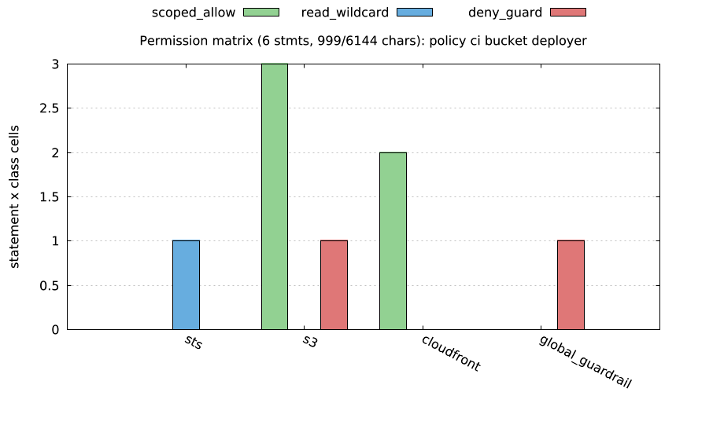

`lmctl https://raw.githubusercontent.com/lmctl-ai/lmaws/main/examples/recipe_policy_ci_bucket_deployer.lms`

Example: [`examples/recipe_policy_ci_bucket_deployer.lms`](../examples/recipe_policy_ci_bucket_deployer.lms).
Import library: `https://raw.githubusercontent.com/lmctl-ai/lmaws/main/recipes/lib/policy_builder.lms`; function `recipe_policy_builder`.

### policy_deny_untagged_delete

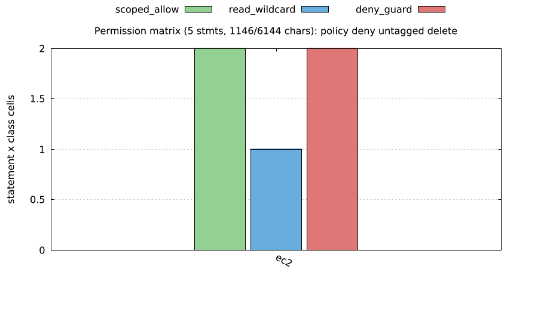

`lmctl https://raw.githubusercontent.com/lmctl-ai/lmaws/main/examples/recipe_policy_deny_untagged_delete.lms`

Example: [`examples/recipe_policy_deny_untagged_delete.lms`](../examples/recipe_policy_deny_untagged_delete.lms).
Import library: `https://raw.githubusercontent.com/lmctl-ai/lmaws/main/recipes/lib/policy_builder.lms`; function `recipe_policy_builder`.

### policy_diff_review

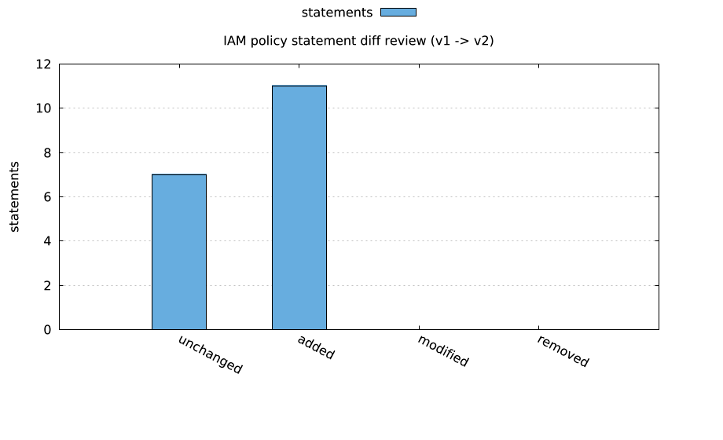

`lmctl https://raw.githubusercontent.com/lmctl-ai/lmaws/main/examples/recipe_policy_diff_review.lms`

Example: [`examples/recipe_policy_diff_review.lms`](../examples/recipe_policy_diff_review.lms).
Import library: `https://raw.githubusercontent.com/lmctl-ai/lmaws/main/recipes/lib/policy_builder.lms`; function `recipe_policy_builder`.

### policy_dynamodb_sandbox

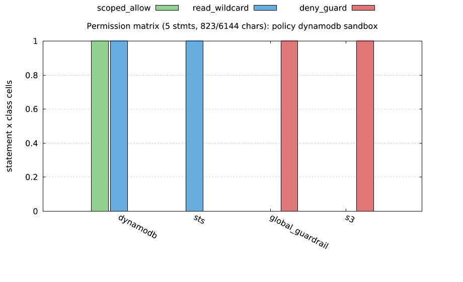

`lmctl https://raw.githubusercontent.com/lmctl-ai/lmaws/main/examples/recipe_policy_dynamodb_sandbox.lms`

Example: [`examples/recipe_policy_dynamodb_sandbox.lms`](../examples/recipe_policy_dynamodb_sandbox.lms).
Import library: `https://raw.githubusercontent.com/lmctl-ai/lmaws/main/recipes/lib/policy_builder.lms`; function `recipe_policy_builder`.

### policy_ec2_spot_sandbox

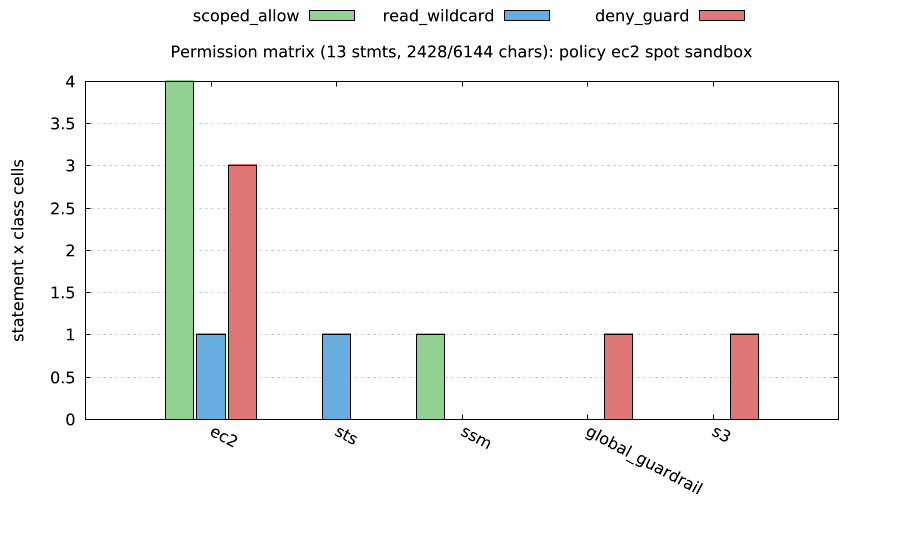

`lmctl https://raw.githubusercontent.com/lmctl-ai/lmaws/main/examples/recipe_policy_ec2_spot_sandbox.lms`

Example: [`examples/recipe_policy_ec2_spot_sandbox.lms`](../examples/recipe_policy_ec2_spot_sandbox.lms).
Import library: `https://raw.githubusercontent.com/lmctl-ai/lmaws/main/recipes/lib/policy_builder.lms`; function `recipe_policy_builder`.

### policy_explain_denial

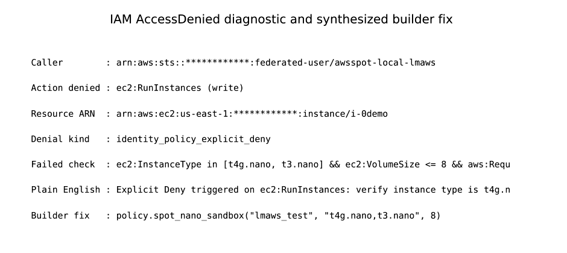

`lmctl https://raw.githubusercontent.com/lmctl-ai/lmaws/main/examples/recipe_policy_explain_denial.lms`

Example: [`examples/recipe_policy_explain_denial.lms`](../examples/recipe_policy_explain_denial.lms).
Import library: `https://raw.githubusercontent.com/lmctl-ai/lmaws/main/recipes/lib/policy_builder.lms`; function `recipe_policy_builder`.

### policy_fit_inline

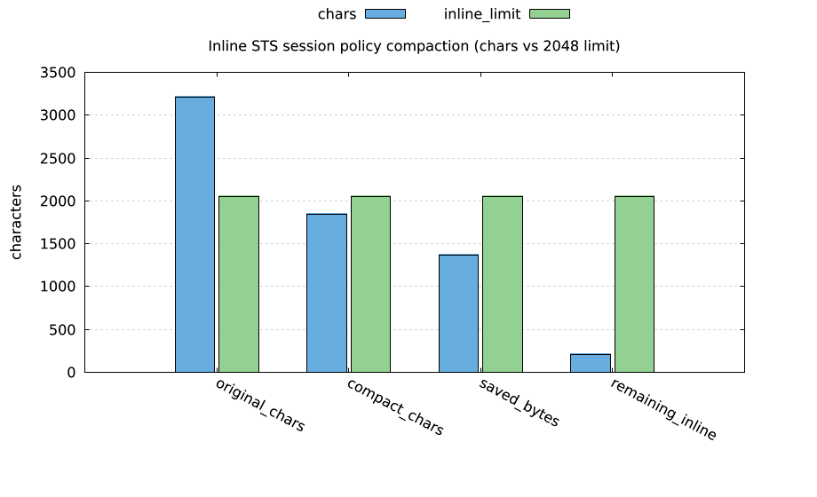

`lmctl https://raw.githubusercontent.com/lmctl-ai/lmaws/main/examples/recipe_policy_fit_inline.lms`

Example: [`examples/recipe_policy_fit_inline.lms`](../examples/recipe_policy_fit_inline.lms).
Import library: `https://raw.githubusercontent.com/lmctl-ai/lmaws/main/recipes/lib/policy_builder.lms`; function `recipe_policy_builder`.

### policy_from_ledger

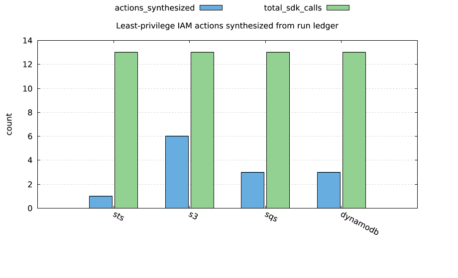

`lmctl https://raw.githubusercontent.com/lmctl-ai/lmaws/main/examples/recipe_policy_from_ledger.lms`

Example: [`examples/recipe_policy_from_ledger.lms`](../examples/recipe_policy_from_ledger.lms).
Import library: `https://raw.githubusercontent.com/lmctl-ai/lmaws/main/recipes/lib/policy_builder.lms`; function `recipe_policy_builder`.

### policy_ip_restricted

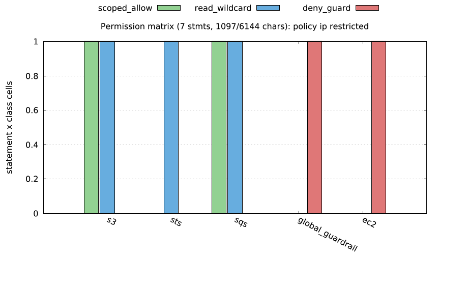

`lmctl https://raw.githubusercontent.com/lmctl-ai/lmaws/main/examples/recipe_policy_ip_restricted.lms`

Example: [`examples/recipe_policy_ip_restricted.lms`](../examples/recipe_policy_ip_restricted.lms).
Import library: `https://raw.githubusercontent.com/lmctl-ai/lmaws/main/recipes/lib/policy_builder.lms`; function `recipe_policy_builder`.

### policy_lambda_deployer

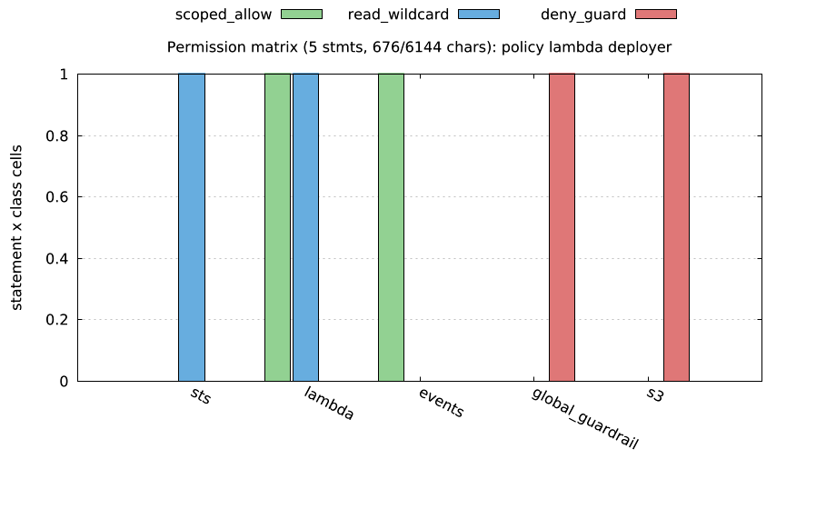

`lmctl https://raw.githubusercontent.com/lmctl-ai/lmaws/main/examples/recipe_policy_lambda_deployer.lms`

Example: [`examples/recipe_policy_lambda_deployer.lms`](../examples/recipe_policy_lambda_deployer.lms).
Import library: `https://raw.githubusercontent.com/lmctl-ai/lmaws/main/recipes/lib/policy_builder.lms`; function `recipe_policy_builder`.

### policy_logs_sandbox

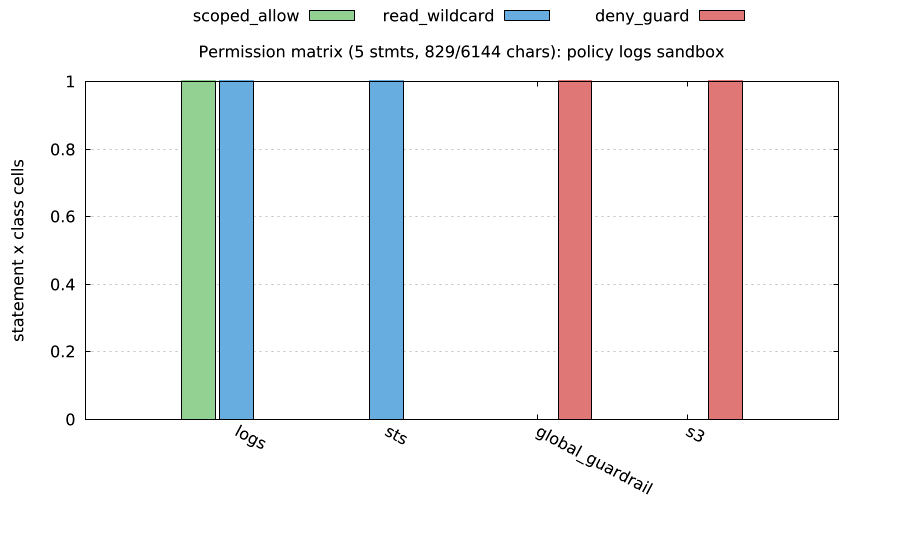

`lmctl https://raw.githubusercontent.com/lmctl-ai/lmaws/main/examples/recipe_policy_logs_sandbox.lms`

Example: [`examples/recipe_policy_logs_sandbox.lms`](../examples/recipe_policy_logs_sandbox.lms).
Import library: `https://raw.githubusercontent.com/lmctl-ai/lmaws/main/recipes/lib/policy_builder.lms`; function `recipe_policy_builder`.

### policy_mfa_deletes

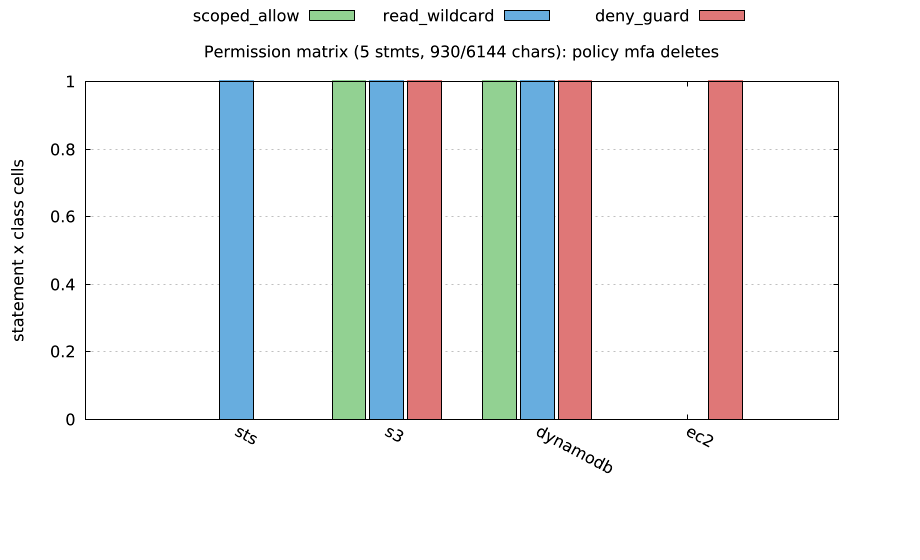

`lmctl https://raw.githubusercontent.com/lmctl-ai/lmaws/main/examples/recipe_policy_mfa_deletes.lms`

Example: [`examples/recipe_policy_mfa_deletes.lms`](../examples/recipe_policy_mfa_deletes.lms).
Import library: `https://raw.githubusercontent.com/lmctl-ai/lmaws/main/recipes/lib/policy_builder.lms`; function `recipe_policy_builder`.

### policy_migrate_json

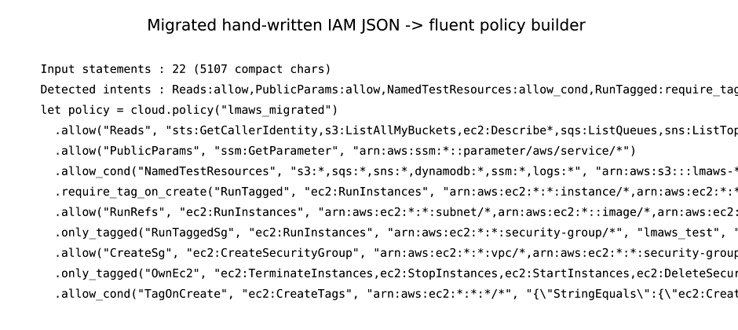

`lmctl https://raw.githubusercontent.com/lmctl-ai/lmaws/main/examples/recipe_policy_migrate_json.lms`

Example: [`examples/recipe_policy_migrate_json.lms`](../examples/recipe_policy_migrate_json.lms).
Import library: `https://raw.githubusercontent.com/lmctl-ai/lmaws/main/recipes/lib/policy_builder.lms`; function `recipe_policy_builder`.

### policy_permission_boundary

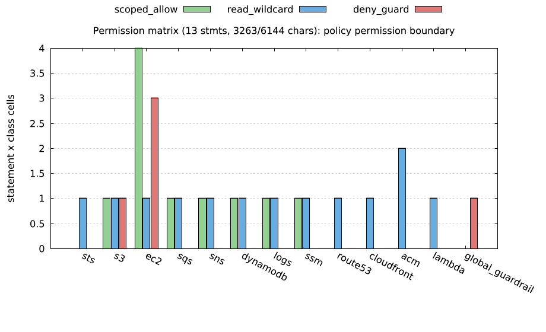

`lmctl https://raw.githubusercontent.com/lmctl-ai/lmaws/main/examples/recipe_policy_permission_boundary.lms`

Example: [`examples/recipe_policy_permission_boundary.lms`](../examples/recipe_policy_permission_boundary.lms).
Import library: `https://raw.githubusercontent.com/lmctl-ai/lmaws/main/recipes/lib/policy_builder.lms`; function `recipe_policy_builder`.

### policy_read_only_auditor

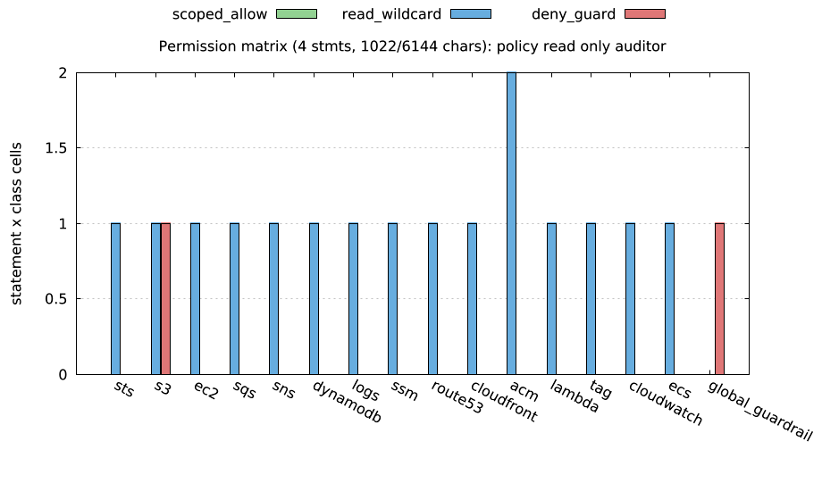

`lmctl https://raw.githubusercontent.com/lmctl-ai/lmaws/main/examples/recipe_policy_read_only_auditor.lms`

Example: [`examples/recipe_policy_read_only_auditor.lms`](../examples/recipe_policy_read_only_auditor.lms).
Import library: `https://raw.githubusercontent.com/lmctl-ai/lmaws/main/recipes/lib/policy_builder.lms`; function `recipe_policy_builder`.

### policy_region_lock

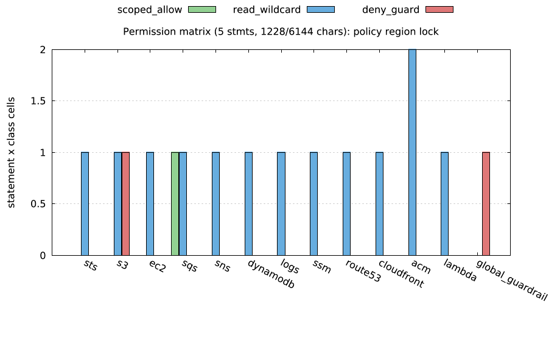

`lmctl https://raw.githubusercontent.com/lmctl-ai/lmaws/main/examples/recipe_policy_region_lock.lms`

Example: [`examples/recipe_policy_region_lock.lms`](../examples/recipe_policy_region_lock.lms).
Import library: `https://raw.githubusercontent.com/lmctl-ai/lmaws/main/recipes/lib/policy_builder.lms`; function `recipe_policy_builder`.

### policy_s3_sandbox

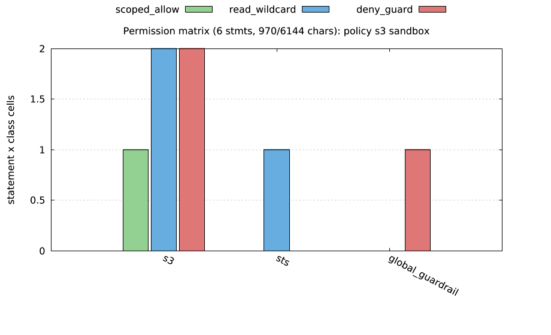

`lmctl https://raw.githubusercontent.com/lmctl-ai/lmaws/main/examples/recipe_policy_s3_sandbox.lms`

Example: [`examples/recipe_policy_s3_sandbox.lms`](../examples/recipe_policy_s3_sandbox.lms).
Import library: `https://raw.githubusercontent.com/lmctl-ai/lmaws/main/recipes/lib/policy_builder.lms`; function `recipe_policy_builder`.

### policy_simulate_probes

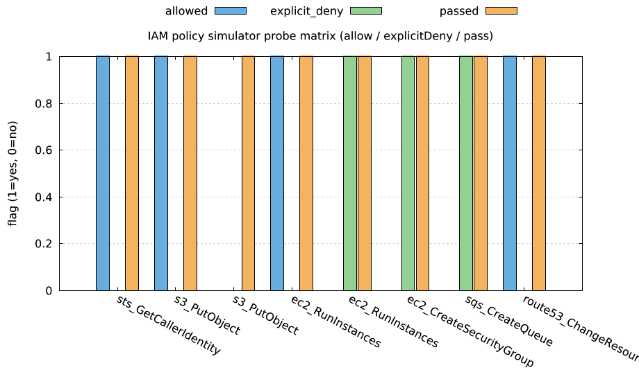

`lmctl https://raw.githubusercontent.com/lmctl-ai/lmaws/main/examples/recipe_policy_simulate_probes.lms`

Example: [`examples/recipe_policy_simulate_probes.lms`](../examples/recipe_policy_simulate_probes.lms).
Import library: `https://raw.githubusercontent.com/lmctl-ai/lmaws/main/recipes/lib/policy_builder.lms`; function `recipe_policy_builder`.

### policy_sns_sandbox

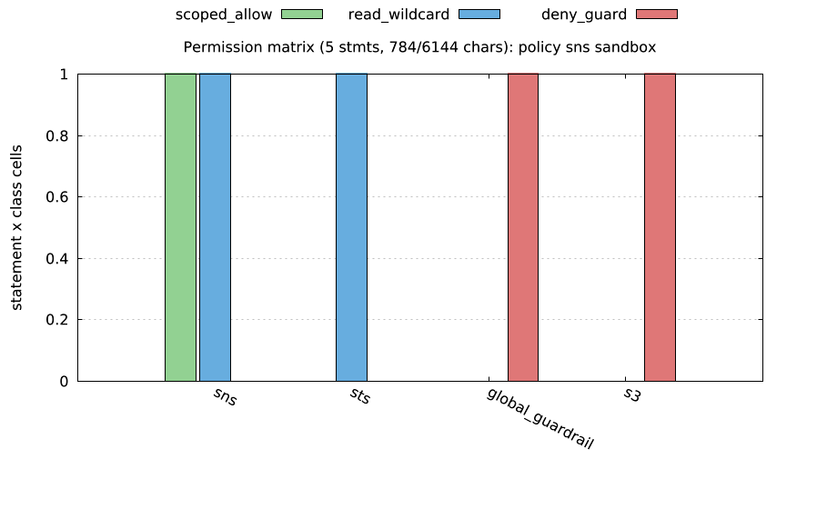

`lmctl https://raw.githubusercontent.com/lmctl-ai/lmaws/main/examples/recipe_policy_sns_sandbox.lms`

Example: [`examples/recipe_policy_sns_sandbox.lms`](../examples/recipe_policy_sns_sandbox.lms).
Import library: `https://raw.githubusercontent.com/lmctl-ai/lmaws/main/recipes/lib/policy_builder.lms`; function `recipe_policy_builder`.

### policy_split_managed

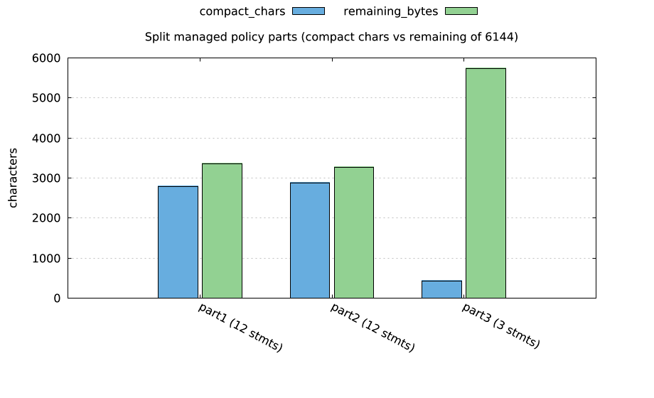

`lmctl https://raw.githubusercontent.com/lmctl-ai/lmaws/main/examples/recipe_policy_split_managed.lms`

Example: [`examples/recipe_policy_split_managed.lms`](../examples/recipe_policy_split_managed.lms).
Import library: `https://raw.githubusercontent.com/lmctl-ai/lmaws/main/recipes/lib/policy_builder.lms`; function `recipe_policy_builder`.

### policy_sqs_sandbox


`lmctl https://raw.githubusercontent.com/lmctl-ai/lmaws/main/examples/recipe_policy_sqs_sandbox.lms`

Example: [`examples/recipe_policy_sqs_sandbox.lms`](../examples/recipe_policy_sqs_sandbox.lms).
Import library: `https://raw.githubusercontent.com/lmctl-ai/lmaws/main/recipes/lib/policy_builder.lms`; function `recipe_policy_builder`.

### policy_ssm_sandbox

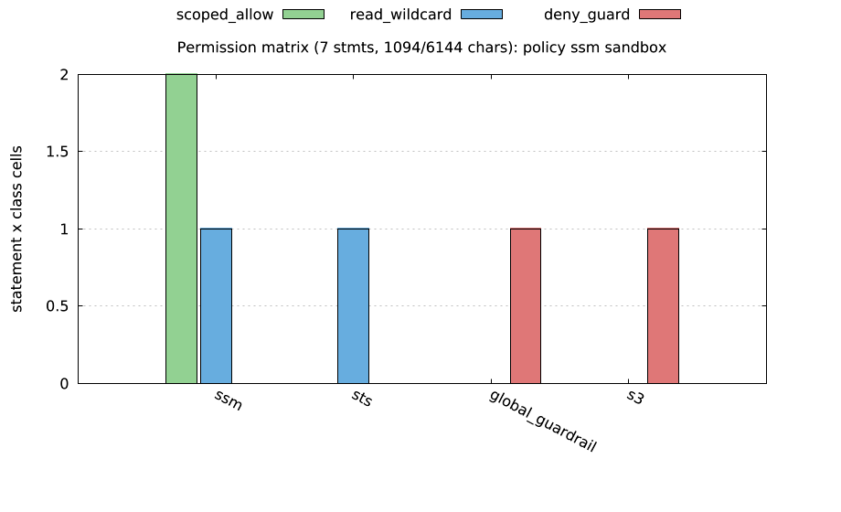

`lmctl https://raw.githubusercontent.com/lmctl-ai/lmaws/main/examples/recipe_policy_ssm_sandbox.lms`

Example: [`examples/recipe_policy_ssm_sandbox.lms`](../examples/recipe_policy_ssm_sandbox.lms).
Import library: `https://raw.githubusercontent.com/lmctl-ai/lmaws/main/recipes/lib/policy_builder.lms`; function `recipe_policy_builder`.

### policy_tag_operator

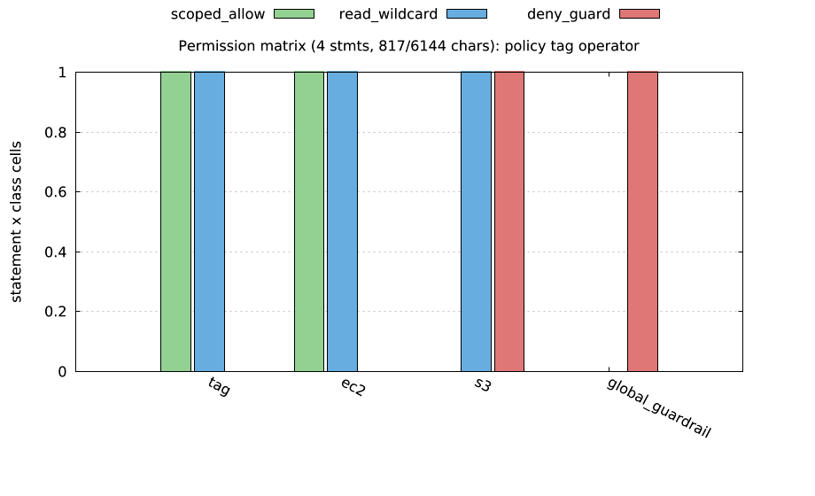

`lmctl https://raw.githubusercontent.com/lmctl-ai/lmaws/main/examples/recipe_policy_tag_operator.lms`

Example: [`examples/recipe_policy_tag_operator.lms`](../examples/recipe_policy_tag_operator.lms).
Import library: `https://raw.githubusercontent.com/lmctl-ai/lmaws/main/recipes/lib/policy_builder.lms`; function `recipe_policy_builder`.

### policy_web_stack

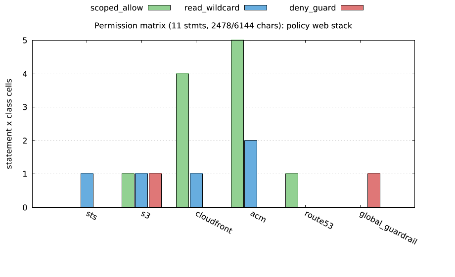

`lmctl https://raw.githubusercontent.com/lmctl-ai/lmaws/main/examples/recipe_policy_web_stack.lms`

Example: [`examples/recipe_policy_web_stack.lms`](../examples/recipe_policy_web_stack.lms).
Import library: `https://raw.githubusercontent.com/lmctl-ai/lmaws/main/recipes/lib/policy_builder.lms`; function `recipe_policy_builder`.

### session_policy

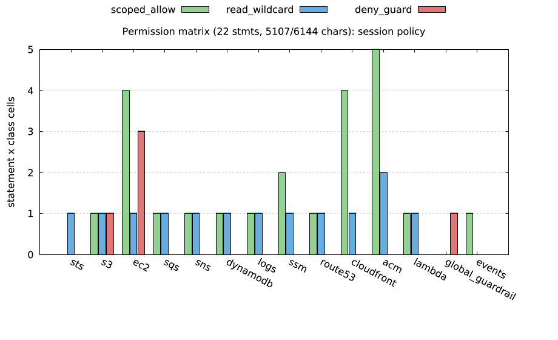

`lmctl https://raw.githubusercontent.com/lmctl-ai/lmaws/main/examples/recipe_session_policy.lms`

Example: [`examples/recipe_session_policy.lms`](../examples/recipe_session_policy.lms).
Import library: `https://raw.githubusercontent.com/lmctl-ai/lmaws/main/recipes/lib/policy_builder.lms`; function `recipe_policy_builder`.

### inventory

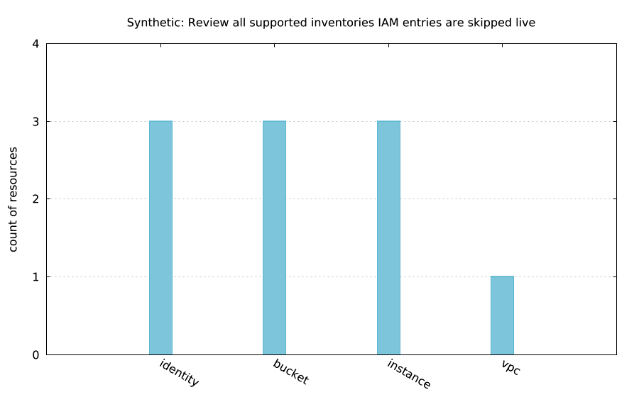

`lmctl https://raw.githubusercontent.com/lmctl-ai/lmaws/main/examples/recipe_inventory.lms`

Example: [`examples/recipe_inventory.lms`](../examples/recipe_inventory.lms).
Import library: `https://raw.githubusercontent.com/lmctl-ai/lmaws/main/recipes/lib/inventory.lms`; function `recipe_inventory`.

### inventory_alarms

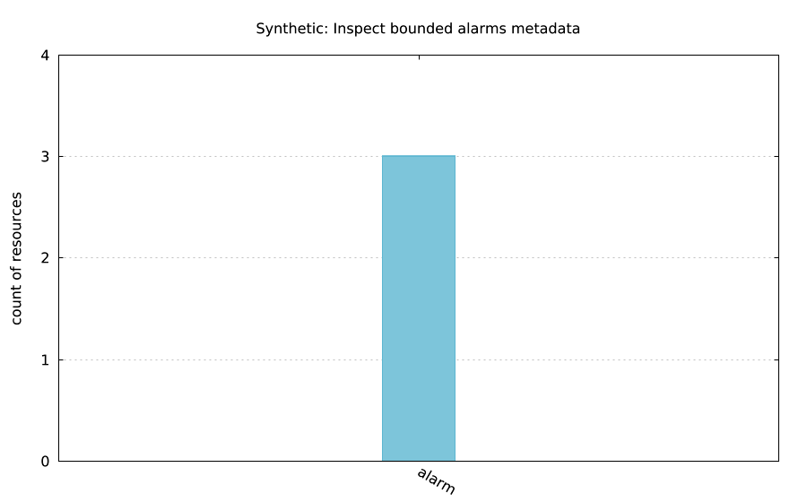

`lmctl https://raw.githubusercontent.com/lmctl-ai/lmaws/main/examples/recipe_inventory_alarms.lms`

Example: [`examples/recipe_inventory_alarms.lms`](../examples/recipe_inventory_alarms.lms).
Import library: `https://raw.githubusercontent.com/lmctl-ai/lmaws/main/recipes/lib/inventory.lms`; function `recipe_inventory`.

### inventory_buckets

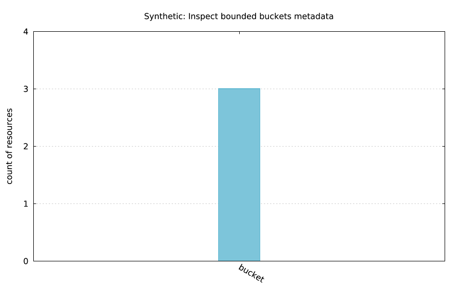

`lmctl https://raw.githubusercontent.com/lmctl-ai/lmaws/main/examples/recipe_inventory_buckets.lms`

Example: [`examples/recipe_inventory_buckets.lms`](../examples/recipe_inventory_buckets.lms).
Import library: `https://raw.githubusercontent.com/lmctl-ai/lmaws/main/recipes/lib/inventory.lms`; function `recipe_inventory`.

### inventory_clusters

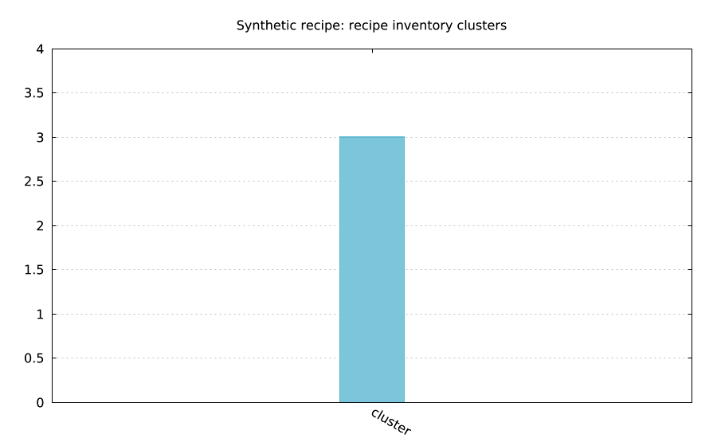

`lmctl https://raw.githubusercontent.com/lmctl-ai/lmaws/main/examples/recipe_inventory_clusters.lms`

Example: [`examples/recipe_inventory_clusters.lms`](../examples/recipe_inventory_clusters.lms).
Import library: `https://raw.githubusercontent.com/lmctl-ai/lmaws/main/recipes/lib/inventory.lms`; function `recipe_inventory`.

### inventory_functions


`lmctl https://raw.githubusercontent.com/lmctl-ai/lmaws/main/examples/recipe_inventory_functions.lms`

Example: [`examples/recipe_inventory_functions.lms`](../examples/recipe_inventory_functions.lms).
Import library: `https://raw.githubusercontent.com/lmctl-ai/lmaws/main/recipes/lib/inventory.lms`; function `recipe_inventory`.

### inventory_instances


`lmctl https://raw.githubusercontent.com/lmctl-ai/lmaws/main/examples/recipe_inventory_instances.lms`

Example: [`examples/recipe_inventory_instances.lms`](../examples/recipe_inventory_instances.lms).
Import library: `https://raw.githubusercontent.com/lmctl-ai/lmaws/main/recipes/lib/inventory.lms`; function `recipe_inventory`.

### inventory_log_groups

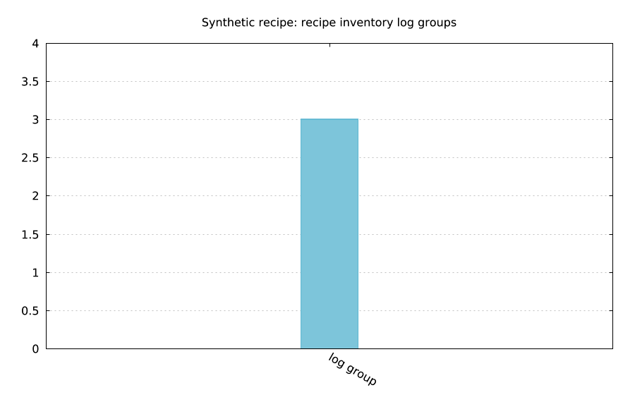

`lmctl https://raw.githubusercontent.com/lmctl-ai/lmaws/main/examples/recipe_inventory_log_groups.lms`

Example: [`examples/recipe_inventory_log_groups.lms`](../examples/recipe_inventory_log_groups.lms).
Import library: `https://raw.githubusercontent.com/lmctl-ai/lmaws/main/recipes/lib/inventory.lms`; function `recipe_inventory`.

### inventory_parameters

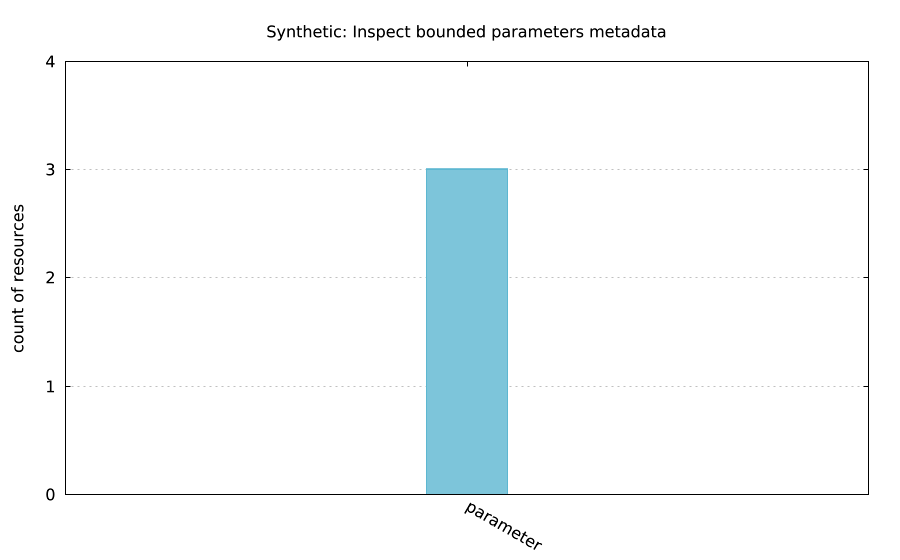

`lmctl https://raw.githubusercontent.com/lmctl-ai/lmaws/main/examples/recipe_inventory_parameters.lms`

Example: [`examples/recipe_inventory_parameters.lms`](../examples/recipe_inventory_parameters.lms).
Import library: `https://raw.githubusercontent.com/lmctl-ai/lmaws/main/recipes/lib/inventory.lms`; function `recipe_inventory`.

### inventory_queues

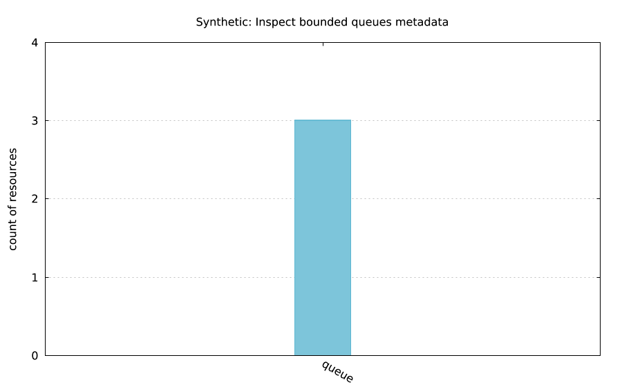

`lmctl https://raw.githubusercontent.com/lmctl-ai/lmaws/main/examples/recipe_inventory_queues.lms`

Example: [`examples/recipe_inventory_queues.lms`](../examples/recipe_inventory_queues.lms).
Import library: `https://raw.githubusercontent.com/lmctl-ai/lmaws/main/recipes/lib/inventory.lms`; function `recipe_inventory`.

### inventory_secrets


`lmctl https://raw.githubusercontent.com/lmctl-ai/lmaws/main/examples/recipe_inventory_secrets.lms`

Example: [`examples/recipe_inventory_secrets.lms`](../examples/recipe_inventory_secrets.lms).
Import library: `https://raw.githubusercontent.com/lmctl-ai/lmaws/main/recipes/lib/inventory.lms`; function `recipe_inventory`.

### inventory_tables

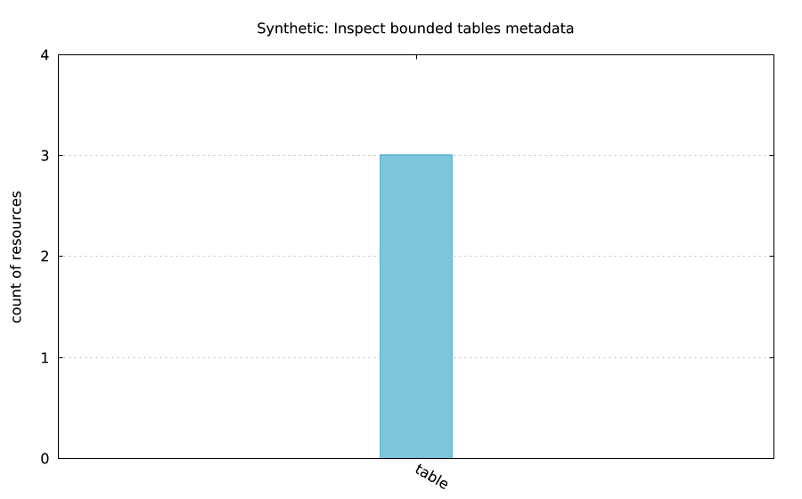

`lmctl https://raw.githubusercontent.com/lmctl-ai/lmaws/main/examples/recipe_inventory_tables.lms`

Example: [`examples/recipe_inventory_tables.lms`](../examples/recipe_inventory_tables.lms).
Import library: `https://raw.githubusercontent.com/lmctl-ai/lmaws/main/recipes/lib/inventory.lms`; function `recipe_inventory`.

### inventory_topics

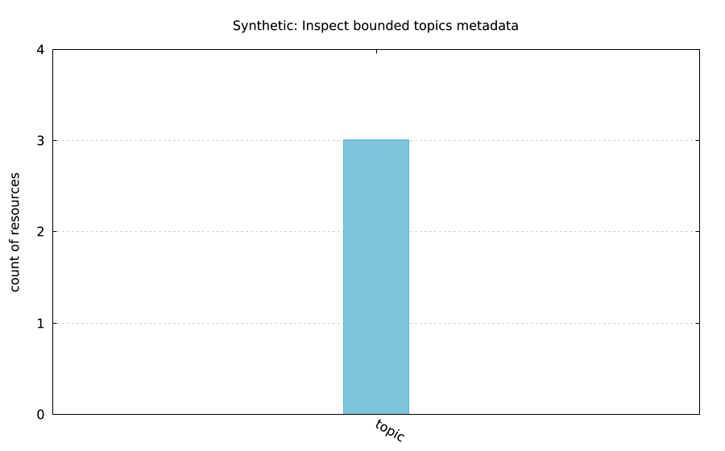

`lmctl https://raw.githubusercontent.com/lmctl-ai/lmaws/main/examples/recipe_inventory_topics.lms`

Example: [`examples/recipe_inventory_topics.lms`](../examples/recipe_inventory_topics.lms).
Import library: `https://raw.githubusercontent.com/lmctl-ai/lmaws/main/recipes/lib/inventory.lms`; function `recipe_inventory`.

### inventory_vpcs


`lmctl https://raw.githubusercontent.com/lmctl-ai/lmaws/main/examples/recipe_inventory_vpcs.lms`

Example: [`examples/recipe_inventory_vpcs.lms`](../examples/recipe_inventory_vpcs.lms).
Import library: `https://raw.githubusercontent.com/lmctl-ai/lmaws/main/recipes/lib/inventory.lms`; function `recipe_inventory`.

### inventory_zones


`lmctl https://raw.githubusercontent.com/lmctl-ai/lmaws/main/examples/recipe_inventory_zones.lms`

Example: [`examples/recipe_inventory_zones.lms`](../examples/recipe_inventory_zones.lms).
Import library: `https://raw.githubusercontent.com/lmctl-ai/lmaws/main/recipes/lib/inventory.lms`; function `recipe_inventory`.

### quickstart


`lmctl https://raw.githubusercontent.com/lmctl-ai/lmaws/main/examples/recipe_quickstart.lms`

Example: [`examples/recipe_quickstart.lms`](../examples/recipe_quickstart.lms).
Import library: `https://raw.githubusercontent.com/lmctl-ai/lmaws/main/recipes/lib/hygiene.lms`; function `recipe_quickstart`.

### bandwidth


`lmctl https://raw.githubusercontent.com/lmctl-ai/lmaws/main/examples/recipe_bandwidth.lms`

Example: [`examples/recipe_bandwidth.lms`](../examples/recipe_bandwidth.lms).
Import library: `https://raw.githubusercontent.com/lmctl-ai/lmaws/main/recipes/lib/spend.lms`; function `recipe_spend`.

### dynamodb_spend


`lmctl https://raw.githubusercontent.com/lmctl-ai/lmaws/main/examples/recipe_dynamodb_spend.lms`

Example: [`examples/recipe_dynamodb_spend.lms`](../examples/recipe_dynamodb_spend.lms).
Import library: `https://raw.githubusercontent.com/lmctl-ai/lmaws/main/recipes/lib/spend.lms`; function `recipe_spend`.

### ebs_audit


`lmctl https://raw.githubusercontent.com/lmctl-ai/lmaws/main/examples/recipe_ebs_audit.lms`

Example: [`examples/recipe_ebs_audit.lms`](../examples/recipe_ebs_audit.lms).
Import library: `https://raw.githubusercontent.com/lmctl-ai/lmaws/main/recipes/lib/spend.lms`; function `recipe_spend`.

### ec2_spend


`lmctl https://raw.githubusercontent.com/lmctl-ai/lmaws/main/examples/recipe_ec2_spend.lms`

Example: [`examples/recipe_ec2_spend.lms`](../examples/recipe_ec2_spend.lms).
Import library: `https://raw.githubusercontent.com/lmctl-ai/lmaws/main/recipes/lib/spend.lms`; function `recipe_spend`.

### eip_audit


`lmctl https://raw.githubusercontent.com/lmctl-ai/lmaws/main/examples/recipe_eip_audit.lms`

Example: [`examples/recipe_eip_audit.lms`](../examples/recipe_eip_audit.lms).
Import library: `https://raw.githubusercontent.com/lmctl-ai/lmaws/main/recipes/lib/spend.lms`; function `recipe_spend`.

### lambda_spend


`lmctl https://raw.githubusercontent.com/lmctl-ai/lmaws/main/examples/recipe_lambda_spend.lms`

Example: [`examples/recipe_lambda_spend.lms`](../examples/recipe_lambda_spend.lms).
Import library: `https://raw.githubusercontent.com/lmctl-ai/lmaws/main/recipes/lib/spend.lms`; function `recipe_spend`.

### savings_plans


`lmctl https://raw.githubusercontent.com/lmctl-ai/lmaws/main/examples/recipe_savings_plans.lms`

Example: [`examples/recipe_savings_plans.lms`](../examples/recipe_savings_plans.lms).
Import library: `https://raw.githubusercontent.com/lmctl-ai/lmaws/main/recipes/lib/spend.lms`; function `recipe_spend`.

### spend_detail


`lmctl https://raw.githubusercontent.com/lmctl-ai/lmaws/main/examples/recipe_spend_detail.lms`

Example: [`examples/recipe_spend_detail.lms`](../examples/recipe_spend_detail.lms).
Import library: `https://raw.githubusercontent.com/lmctl-ai/lmaws/main/recipes/lib/spend.lms`; function `recipe_spend`.

### idle_instances


`lmctl https://raw.githubusercontent.com/lmctl-ai/lmaws/main/examples/recipe_idle_instances.lms`

Example: [`examples/recipe_idle_instances.lms`](../examples/recipe_idle_instances.lms).
Import library: `https://raw.githubusercontent.com/lmctl-ai/lmaws/main/recipes/lib/audits.lms`; function `recipe_idle`.

### log_retention_audit


`lmctl https://raw.githubusercontent.com/lmctl-ai/lmaws/main/examples/recipe_log_retention_audit.lms`

Example: [`examples/recipe_log_retention_audit.lms`](../examples/recipe_log_retention_audit.lms).
Import library: `https://raw.githubusercontent.com/lmctl-ai/lmaws/main/recipes/lib/hygiene.lms`; function `recipe_log_retention_audit`.

### public_ipv4_cost


`lmctl https://raw.githubusercontent.com/lmctl-ai/lmaws/main/examples/recipe_public_ipv4_cost.lms`

Example: [`examples/recipe_public_ipv4_cost.lms`](../examples/recipe_public_ipv4_cost.lms).
Import library: `https://raw.githubusercontent.com/lmctl-ai/lmaws/main/recipes/lib/hygiene.lms`; function `recipe_public_ipv4_cost`.

### unattached_volumes


`lmctl https://raw.githubusercontent.com/lmctl-ai/lmaws/main/examples/recipe_unattached_volumes.lms`

Example: [`examples/recipe_unattached_volumes.lms`](../examples/recipe_unattached_volumes.lms).
Import library: `https://raw.githubusercontent.com/lmctl-ai/lmaws/main/recipes/lib/hygiene.lms`; function `recipe_unattached_volumes`.

### naming_compliance


`lmctl https://raw.githubusercontent.com/lmctl-ai/lmaws/main/examples/recipe_naming_compliance.lms`

Example: [`examples/recipe_naming_compliance.lms`](../examples/recipe_naming_compliance.lms).
Import library: `https://raw.githubusercontent.com/lmctl-ai/lmaws/main/recipes/lib/audits.lms`; function `recipe_naming`.

### tag_compliance


`lmctl https://raw.githubusercontent.com/lmctl-ai/lmaws/main/examples/recipe_tag_compliance.lms`

Example: [`examples/recipe_tag_compliance.lms`](../examples/recipe_tag_compliance.lms).
Import library: `https://raw.githubusercontent.com/lmctl-ai/lmaws/main/recipes/lib/audits.lms`; function `recipe_compliance`.

### leftover_report


`lmctl https://raw.githubusercontent.com/lmctl-ai/lmaws/main/examples/recipe_leftover_report.lms`

Example: [`examples/recipe_leftover_report.lms`](../examples/recipe_leftover_report.lms).
Import library: `https://raw.githubusercontent.com/lmctl-ai/lmaws/main/recipes/lib/prefix.lms`; function `recipe_leftovers`.

### prefix_search


`lmctl https://raw.githubusercontent.com/lmctl-ai/lmaws/main/examples/recipe_prefix_search.lms`

Example: [`examples/recipe_prefix_search.lms`](../examples/recipe_prefix_search.lms).
Import library: `https://raw.githubusercontent.com/lmctl-ai/lmaws/main/recipes/lib/prefix.lms`; function `recipe_prefix_search`.

### sweeper


`lmctl https://raw.githubusercontent.com/lmctl-ai/lmaws/main/examples/recipe_sweeper.lms`

Example: [`examples/recipe_sweeper.lms`](../examples/recipe_sweeper.lms).
Import library: `https://raw.githubusercontent.com/lmctl-ai/lmaws/main/recipes/lib/prefix.lms`; function `recipe_sweeper`.

### lifecycle


`lmctl https://raw.githubusercontent.com/lmctl-ai/lmaws/main/examples/recipe_lifecycle.lms`

Example: [`examples/recipe_lifecycle.lms`](../examples/recipe_lifecycle.lms).
Import library: `https://raw.githubusercontent.com/lmctl-ai/lmaws/main/recipes/lib/lifecycle.lms`; function `recipe_lifecycle`.

### sandbox_bucket


`lmctl https://raw.githubusercontent.com/lmctl-ai/lmaws/main/examples/recipe_sandbox_bucket.lms`

Example: [`examples/recipe_sandbox_bucket.lms`](../examples/recipe_sandbox_bucket.lms).
Import library: `https://raw.githubusercontent.com/lmctl-ai/lmaws/main/recipes/lib/lifecycle.lms`; function `recipe_lifecycle`.

### sandbox_log_group


`lmctl https://raw.githubusercontent.com/lmctl-ai/lmaws/main/examples/recipe_sandbox_log_group.lms`

Example: [`examples/recipe_sandbox_log_group.lms`](../examples/recipe_sandbox_log_group.lms).
Import library: `https://raw.githubusercontent.com/lmctl-ai/lmaws/main/recipes/lib/lifecycle.lms`; function `recipe_lifecycle`.

### sandbox_parameter


`lmctl https://raw.githubusercontent.com/lmctl-ai/lmaws/main/examples/recipe_sandbox_parameter.lms`

Example: [`examples/recipe_sandbox_parameter.lms`](../examples/recipe_sandbox_parameter.lms).
Import library: `https://raw.githubusercontent.com/lmctl-ai/lmaws/main/recipes/lib/lifecycle.lms`; function `recipe_lifecycle`.

### sandbox_queue


`lmctl https://raw.githubusercontent.com/lmctl-ai/lmaws/main/examples/recipe_sandbox_queue.lms`

Example: [`examples/recipe_sandbox_queue.lms`](../examples/recipe_sandbox_queue.lms).
Import library: `https://raw.githubusercontent.com/lmctl-ai/lmaws/main/recipes/lib/lifecycle.lms`; function `recipe_lifecycle`.

### sandbox_table


`lmctl https://raw.githubusercontent.com/lmctl-ai/lmaws/main/examples/recipe_sandbox_table.lms`

Example: [`examples/recipe_sandbox_table.lms`](../examples/recipe_sandbox_table.lms).
Import library: `https://raw.githubusercontent.com/lmctl-ai/lmaws/main/recipes/lib/lifecycle.lms`; function `recipe_lifecycle`.

### sandbox_topic


`lmctl https://raw.githubusercontent.com/lmctl-ai/lmaws/main/examples/recipe_sandbox_topic.lms`

Example: [`examples/recipe_sandbox_topic.lms`](../examples/recipe_sandbox_topic.lms).
Import library: `https://raw.githubusercontent.com/lmctl-ai/lmaws/main/recipes/lib/lifecycle.lms`; function `recipe_lifecycle`.

### ami_lookup


`lmctl https://raw.githubusercontent.com/lmctl-ai/lmaws/main/examples/recipe_ami_lookup.lms`

Example: [`examples/recipe_ami_lookup.lms`](../examples/recipe_ami_lookup.lms).
Import library: `https://raw.githubusercontent.com/lmctl-ai/lmaws/main/recipes/lib/compute.lms`; function `recipe_ami_lookup`.

### cpu_credits


`lmctl https://raw.githubusercontent.com/lmctl-ai/lmaws/main/examples/recipe_cpu_credits.lms`

Example: [`examples/recipe_cpu_credits.lms`](../examples/recipe_cpu_credits.lms).
Import library: `https://raw.githubusercontent.com/lmctl-ai/lmaws/main/recipes/lib/compute.lms`; function `recipe_cpu_credits`.

### ebs_roots


`lmctl https://raw.githubusercontent.com/lmctl-ai/lmaws/main/examples/recipe_ebs_roots.lms`

Example: [`examples/recipe_ebs_roots.lms`](../examples/recipe_ebs_roots.lms).
Import library: `https://raw.githubusercontent.com/lmctl-ai/lmaws/main/recipes/lib/compute.lms`; function `recipe_ebs_roots`.

### eip_map


`lmctl https://raw.githubusercontent.com/lmctl-ai/lmaws/main/examples/recipe_eip_map.lms`

Example: [`examples/recipe_eip_map.lms`](../examples/recipe_eip_map.lms).
Import library: `https://raw.githubusercontent.com/lmctl-ai/lmaws/main/recipes/lib/compute.lms`; function `recipe_eip_map`.

### fleet_status


`lmctl https://raw.githubusercontent.com/lmctl-ai/lmaws/main/examples/recipe_fleet_status.lms`

Example: [`examples/recipe_fleet_status.lms`](../examples/recipe_fleet_status.lms).
Import library: `https://raw.githubusercontent.com/lmctl-ai/lmaws/main/recipes/lib/compute.lms`; function `recipe_fleet_status`.

### spot_nano_lifecycle


`lmctl https://raw.githubusercontent.com/lmctl-ai/lmaws/main/examples/recipe_spot_nano_lifecycle.lms`

Example: [`examples/recipe_spot_nano_lifecycle.lms`](../examples/recipe_spot_nano_lifecycle.lms).
Import library: `https://raw.githubusercontent.com/lmctl-ai/lmaws/main/recipes/lib/compute.lms`; function `recipe_spot_nano_lifecycle`.

### spot_prices


`lmctl https://raw.githubusercontent.com/lmctl-ai/lmaws/main/examples/recipe_spot_prices.lms`

Example: [`examples/recipe_spot_prices.lms`](../examples/recipe_spot_prices.lms).
Import library: `https://raw.githubusercontent.com/lmctl-ai/lmaws/main/recipes/lib/compute.lms`; function `recipe_spot_prices`.
